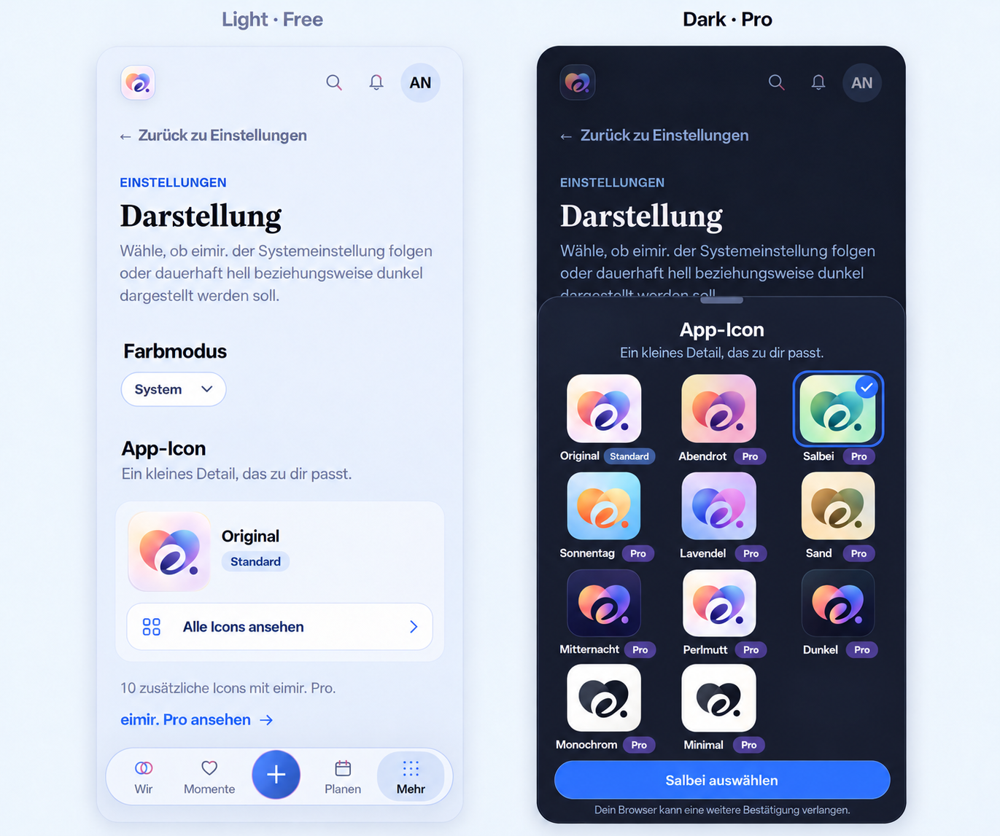

# Premium app-icon selection — product preflight

**Owner:** [#1307](https://github.com/baerenmarke90/eimir/issues/1307). 
**Status:** full poster catalog requested by the Product Owner on 2026-10-12; selection UX and downgrade rule remain prepared proposals. This package changes no runtime behavior. 
**Reviewed baseline:** `main` at `170a89faadef184c124472f544680262e159d207`, 2026-10-12. 
**Authority:** [Product Reference v1](../../../product/design/product-reference-v1.md), [identity contract](../1225-identity-system/CI.md), [freemium matrix v1.4](../../../FREEMIUM-FEATURE-MATRIX.md) and [entitlement ADR 0006](../../../m6/ADR-0006-ENTITLEMENT-ARCHITECTURE.md).

## 1. Confirmed decision and full poster catalog

The exact original-poster icon is the Free/Core default. Normal System/Light/Dark appearance and automatic adaptation of the original brand remain Free/Core. Selecting an alternative icon is Premium personalization. This contract is the same in Cloud and Self-Hosted.

The Product Owner expanded the preparation to every independently illustrated icon tile in the poster. The catalog contains the free Original and ten additional Pro choices. The phone, dock and store illustrations repeat the Original rather than adding selection presets. Display names remain proposed localized labels.

| Stable candidate ID | Proposed German name | Eligibility | Artwork |
| --- | --- | --- | --- |
| `original` | Original | Free/Core | [350 px exact default crop](candidates/original.png); the existing Dark treatment remains part of the default family |
| `sunset` | Abendrot | Pro | [Warm pink/yellow variant](candidates/sunset.png) |
| `sage` | Salbei | Pro | [Green variant](candidates/sage.png) |
| `daylight` | Sonnentag | Pro | [Blue/orange variant](candidates/daylight.png) |
| `lavender` | Lavendel | Pro | [Purple variant](candidates/lavender.png) |
| `sand` | Sand | Pro | [Earth-tone variant](candidates/sand.png) |
| `midnight` | Mitternacht | Pro | [Lower-row dark variant](candidates/midnight.png) |
| `pearl` | Perlmutt | Pro | [Fixed upper Light treatment](candidates/pearl.png) |
| `dark` | Dunkel | Pro | [Fixed upper Dark treatment](candidates/dark.png) |
| `monochrome` | Monochrom | Pro | [Upper monochrome treatment](candidates/monochrome.png) |
| `minimal` | Minimal | Pro | [Lower-row minimal variant](candidates/minimal.png) |

All ten extra fixed selections use `theme.bespoke_packs`. These are icon choices, independent of the contextual Original/Natürlich/Warm UI color worlds. The alternative artwork is fixed across Light/Dark; its filled tile supplies its own background. The standard in-app Brand remains the original family. Selecting a fixed Perlmutt/Dunkel/Monochrom preset is Pro; automatic Light/Dark treatment of the original default remains Free/Core.

The source is the unchanged [owner poster](../1225-identity-system/references/owner-app-logo.png). Crop coordinates and source fingerprint are recorded in [source-crops.json](source-crops.json). Alternative sources are only 141–150 px: inspect any required 180/192/512 px resampling on actual launchers before shipping. Generated mockup icons must never replace these source pixels.

[Exact-source catalog](catalog.html) · [rendered catalog sheet](poster-icon-catalog.png)

## 2. Current screen and generated reference

The inspected destination is `/more/settings/appearance`, reached through More → Settings → Appearance. Current main has a PageHeader, Back to Settings, a repeated appearance explanation, and the existing System/Light/Dark selector. The shell retains search, notifications, avatar, four labeled destinations and the central add action.

| Evidence | Role |
| --- | --- |
| [Current Light](evidence/appearance-current-light.png), [current Dark](evidence/appearance-current-dark.png) | Actual 390 × 844 Chromium captures using the existing authorized API fixture |
| [Generated full-catalog proposal](appearance-icon-selection-proposal-v2.png) | Light/Free settings summary and Dark/Pro selector, generated with the built-in Imagegen tool from the actual screens and full exact-source catalog |
| [Exact-source catalog sheet](poster-icon-catalog.png) | Eleven actual PNG crops rendered from `catalog.html`; ten Pro labels and one Standard label |
| [Earlier three-choice proposal](appearance-icon-selection-proposal.png) | Historical preparation before the owner's full-catalog request |
| [Generation prompt](image-prompt.md) | Reproducible brief and input-image roles |

The proposal preserves the current destination and capabilities. It names the existing theme section “Farbmodus” and removes the repeated lower page heading/explanation to make room for App-Icon. The settings page shows the current icon and opens the full catalog with “Alle Icons ansehen”. The existing `ShortTaskSheet` presents eleven choices in a three-column grid with internal scrolling and a reachable completion footer. Expanded uses the same task in the primitive's centered modal, with an explicit close control; it does not need a separate dashboard composition.

This image is a design reference, not implemented UI or accessibility evidence. Its generated outlines, Pro badges and exact spacing must be reconciled with shared primitives during implementation.

## 3. Mobile interaction contract

- **Open:** retain More as the selected root destination and Back to Settings as the return action. The free theme selector remains first.
- **Choose:** the summary opens the existing ShortTaskSheet with eleven named radio choices, visible selected state, keyboard arrows and at least 44 CSS px targets. A check and outline supplement color. The sheet initially focuses the current choice, makes the background inert, and uses its existing named dismissal control, Escape/Back handling and opener focus restoration. Choosing a tile previews it; it does not write or update installation metadata.
- **Free:** Original remains available. Paid choices can be previewed with a quiet Pro marker. “eimir. Pro ansehen” follows the existing `/more/profile#profile-premium` information destination used by PartnerQuickActions; it does not create a new checkout flow.
- **Pro:** all ten additional choices carry the Pro mark. One explicit, thumb-reachable “Salbei auswählen”/equivalent action saves the selected ID. Use the existing ProMark and control/focus tokens. The completion footer stays reachable while the catalog scrolls. Ordinary Back discards an unsaved preview and restores focus/context.
- **Pending:** prevent duplicate activation; retain the selected preview and show immediate progress. Apply the existing sheet's close-blocked/pending lifecycle. A late response must not affect a different Account or Space.
- **Success:** “Auswahl gespeichert” means the authoritative preference write succeeded. A separate platform instruction explains any installation approval still required. Never report that the home-screen icon changed based solely on a successful save, DOM update or elapsed time.
- **Failure/offline:** retain the preview, expose retry and the original choice. No queued Premium writes or forced reinstall. When capability lookup fails, use the known installed/default state and show a recoverable availability message rather than treating failure as a Free entitlement.
- **Motion/accessibility:** use existing non-blocking state/focus motion and respect reduced motion. The visible labels and radio semantics carry meaning; decorative icon images have empty alt text. Pro status and errors are textual. Review 320/390/430 px, small heights, 200% text, Light/Dark and keyboard operation.

## 4. Platform findings and delivery gate

| Surface | Established capability | Product consequence |
| --- | --- | --- |
| Browser favicon | Existing `theme.ts` and bootstrap already select PNG favicon URLs | A selected favicon can be rendered in the active document; this is distinct from the installed launcher |
| Installed Chrome PWA | Chrome 144 documents identity-update review and distinct icon URLs/metadata for changed artwork | Offer platform guidance and test the real installation/update flow; an in-app selection cannot silently guarantee the user's approval |
| iOS/iPadOS Home Screen | WebKit documents manifest icon support and precedence of `apple-touch-icon` | Check both metadata sources. The cited documentation does not establish a portable existing-install icon setter or completion signal |
| Capacitor/native launcher | Different platform capability boundary | Prepare as a separately scoped platform task after the Web UX is accepted; no native changes in this preparation |

Primary sources, checked 2026-10-12:

- [Chrome: web-app updates from Chrome 144](https://developer.chrome.com/blog/improvements-to-web-app-updates): significant identity changes are reviewed by users; changed icon URLs/metadata matter.
- [W3C Manifest Working Draft, 2026-10-09, updating the manifest](https://www.w3.org/TR/2026/WD-appmanifest-20261009/#updating): icons are security-sensitive metadata; update application is controlled by the user agent. This is a draft, not a compatibility guarantee.
- [WebKit: Home Screen manifest icons](https://webkit.org/blog/13878/web-push-for-web-apps-on-ios-and-ipados/#new-fallback-icon): an HTML Apple touch icon takes precedence over manifest icons.

**Inference and recommendation:** selection, saved preference, browser favicon, installation metadata and actual launcher artwork are separate states. Documented browser behavior supports a platform proof, but does not prove personalized variant manifests work reliably in all supported installs. Do not market immediate universal home-screen switching from this preparation alone.

The next bounded proof should use static per-variant manifests and immutable icon URLs, a constant explicit manifest `id` resolving to the current `/` identity, and unchanged scope/start URL. Changing the icon must not create a duplicate app or reset stored data. No Account IDs, Space IDs, tokens or personal text belong in manifest URLs. Avoid blob manifests, per-user service-worker shell caches, automatic uninstall/reinstall and timing-based claims of completion. Verify existing-install updates, fresh install, cancellation, restart and returning to Original on the intended devices before choosing a shipping compatibility promise.

## 5. Entitlement, ownership and persistence proposal

Reuse `Capability.THEME_BESPOKE_PACKS` (`theme.bespoke_packs`) and the current entitlement service/OpenAPI read model. Both partners benefit from the Space grant, while each person's chosen icon remains personal. Do not introduce another subscription, SKU or generic theme runtime.

Recommended persistence for the later implementation is a narrow personal `AppIconPreference`, scoped to the authenticated Account and active Space, containing a catalog ID and resource version. Apply the existing unique-owner, ETag/If-Match and 409 conventions. Original is readable/selectable for all authorized members. Saving a new paid choice authenticates, establishes membership, validates the catalog ID and checks the central capability on the server. Client flags only shape presentation. Artwork itself is public brand material and does not need a private media endpoint.

`ProfilePreference` is unsuitable: the current model describes likes/preferences about a person and can be shared or private relationship content. Keep those semantics intact. Reuse the existing query/cancellation/error patterns shown by DailyQuoteSettingsPanel and account/Space scoping conventions; introduce no universal settings framework.

The saved preference is a desired choice. Installation applies to a device and may still require explicit browser approval. Do not silently change launcher metadata when accounts or Spaces change. The platform proof must determine the small local bootstrap snapshot needed to retain an installation choice without storing credentials or exposing another account's setting.

**Proposed downgrade rule for PO review:** retain the saved cosmetic choice and never delete it. Original remains available; saving another Premium choice requires a current grant. This avoids promising an automatic launcher reversion that Web APIs cannot verify. Read/export/deletion follow normal account-data lifecycle rules. Trial, grace and Self-Hosted license behavior inherit the existing central evaluator.

## 6. Reuse, business and cross-cutting review

**Business/freemium impact reviewed:** classification is already explicit in matrix v1.4. This preparation proposes write gating for new paid choices and a non-destructive downgrade policy for later acceptance. It adds no billing behavior, user-media storage, managed compute, quotas or provider costs. Both deployment modes use the same static catalog and entitlement model.

**Reuse review relevant:** considered the W3C manifest/HTML icon standards, current Chrome/WebKit behavior, existing Brand/theme/Settings and ShortTaskSheet primitives, native launcher APIs and third-party icon-switch plugins. Prefer platform metadata plus existing primitives after a device proof. Reuse ShortTaskSheet for modal ownership, Back, dismissal and focus rather than introducing another picker overlay. A plugin cannot supply a portable Web launcher setter, so no new dependency or provider is selected. The built-in image-generation tool produced a planning artifact only; there is no runtime third-party image call.

**Cross-cutting:** allowlist IDs rather than arbitrary URLs/uploads; separate authorization from entitlement; keep public icons apart from private caches; retain privacy-safe query scoping, stale-response ownership and account cleanup; use i18n for all copy; avoid retry loops and automatic offline writes. Static candidate files are bounded public assets and should load only when needed. A later preference schema must cover account deletion, authorized export, backup/restore and migration. Native delivery has its own explicit gate.

## 7. Next implementation slices and acceptance

1. **Approve selection UX, proposed names and the downgrade rule.** The owner has requested the complete poster catalog with all ten extra choices classified Pro. The generated image and exact crops remain review material for the interaction and naming decisions.
2. **Prove platform delivery.** Real-device evidence for intended browser/PWA surfaces, stable app identity, icon masks, approval/cancellation and retained state. Record supported and unverified surfaces explicitly.
3. **Preference/entitlement API.** Narrow schema/OpenAPI, membership and capability enforcement, Free reset, non-destructive reads/downgrade, invalid ID and stale-write cases.
4. **Appearance UI.** Existing page/controls with direct preview, authoritative save, failure recovery and safe return. Test the whole open → choose → save → observe → return journey and account/Space switches.
5. **Proven installation adapters.** Wire only the platform behavior established by the proof. Native integration remains a separate task if commissioned.

Before shipping, verify crop equality with the poster, 16/32 px favicon rendering and 180/192/512 px launcher quality/masks. Use meaningful tests for nonmember access, unavailable capability, stale ETag, downgrade, account switches during save and truthful installation feedback. A rendered mockup or a passing DOM test does not certify an installed launcher update.

## Preparation checks

- Actual current Appearance page captured in Light/Dark at 390 × 844 with authorized mocked APIs; both capture runs passed and recorded no unexpected API request.
- Original is byte-identical to the accepted default asset; all ten additional assets match their recorded source-crop pixels.
- The rendered source catalog contains eleven loaded artwork files, ten Pro labels and one Standard label. Its coverage includes all seven lower-row tiles and the three right-column treatments.
- The updated generated reference was inspected for retained theme choice, shell/navigation, full catalog coverage, a free default, Pro alternatives, theme-correct sheet treatment and separate save/platform language.
- No app runtime, API, theme token, entitlement evaluator or native file is changed by this package.
