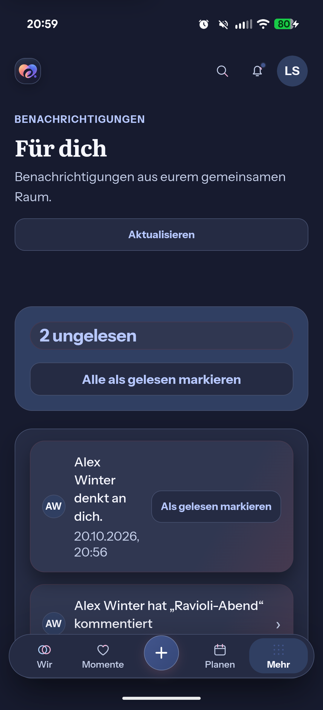
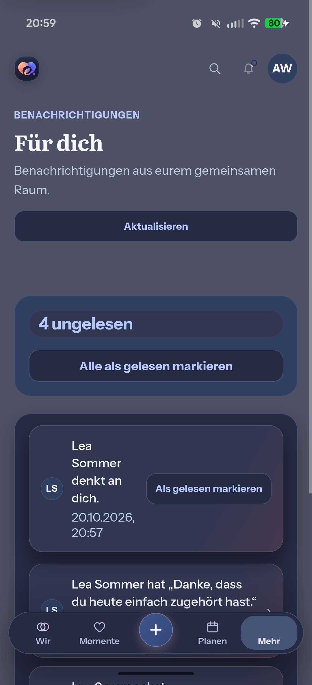

# Physical Account-replacement recheck: 2026-10-20

Three ordinary sign-out/sign-in replacements succeeded with each new
registration's first delivery on the connected Pixel. No failed registration
was recovered by disabling and enabling it again. This is new positive
acceptance evidence; it does not retroactively explain the earlier
`PUSH_SUBSCRIPTION_GONE` result or identify the separately corrected native
ordering defect as its cause.

## Source and isolated environment

Runtime source: `a91014546aa8037433bd9b24f7535f87ecfa9f41`, whose only native
runtime change from `26b0d5c4` is `UnifiedPushBridge.java`, Git blob
`f7f63c6912eab3d82a7d325cfa34e107df35d0ab`. The Android correction and its
independent failing-baseline/passing-regression evidence are described in
[Account-replacement follow-up](account-replacement-follow-up-2026-10-20.md).
The intervening Web commit changes browser tests and evidence only.

The physical build used an independent checkout so its temporary package,
label, version and localhost network overrides could not affect the canonical
native build or tests. No runtime Web source or API behavior was changed for
the physical test. API and worker used the matching backend source with only
the local QA configuration. Existing configured-provider, ownership and
notification-policy checks remained authoritative.

| Item | Identity |
| --- | --- |
| Hardware | Pixel 10 Pro Fold, folded display |
| Android | 16 / API 36, `BP4A.251205.006 release-keys` |
| WebView | `com.android.webview` 148.0.7778.120 |
| QA package | `de.sidebyside.app.debug.pushqa` |
| QA version | code 3, `0.2.0-pushqa.20261020-recheck-debug` |
| APK SHA-256 | `4f6ee0c20918f275a3cd7513774232f7cea17b8a819e6580d9c64441e5630c13` |
| Distributor | gCompat-UP 2.1.2, code 27 |
| Distributor signer SHA-256 | `df11176406c63a7876103ce6cc1a8fca239df76aa5f6de5cdbafe73ecdbf1875` |
| Allowed QA push origin | `https://fcm.googleapis.com` only |
| Physical display | 1080 × 2364 |
| System font / night mode | 1.1 / auto throughout |

The existing official-distributor download was signature-checked before
reinstallation. A new local database, new random credentials and new VAPID key
served only fictional Lea Sommer / Alex Winter Accounts at `eimir.invalid`.
No production backend, personal app or personal Account was used.

## Executed sequence

| Step | First-delivery result |
| --- | --- |
| Fresh Lea activation | Normal Alex → Lea partner gesture returns 202; worker delivery `SUCCEEDED`, attempts 1; one foreground native wake observed |
| Lea sign-out → Alex sign-in and activation | Normal Lea → Alex gesture returns 202; worker delivery `SUCCEEDED`, attempts 1; background QA notification is received and actually tapped; Alex's inbox displays Lea's gesture |
| Alex sign-out → Lea sign-in and activation | One encrypted content-free transport probe to the first new endpoint is accepted; actual background notification tap opens Lea's inbox with Alex's content |
| Lea sign-out → Alex sign-in and activation | One encrypted content-free probe to the first new endpoint is accepted; actual background notification tap opens Alex's inbox with Lea's content |

All four endpoint URLs differ, verified through secret-free SHA-256 comparison.
Old registrations are inactive after each sign-out; all four are inactive
after final sign-out. Each normal sign-out also verifies old access and refresh
credentials return 401, native receipt is disabled, and real document reload
keeps the login entry visible. No blind resend, registration recovery,
cooldown reset, shortened policy or artificial registration delay was used.

The two later probes exercise the existing encrypted provider transport and
native receipt; they create no domain event and are not counted as extra
worker deliveries or additional partner gestures. Domain and transport
evidence remain separately counted in the
[machine-readable result](device-account-recheck-2026-10-20.json).

The QA permission prompt was observed; by the next automation snapshot it had
already been dismissed and registration was active. The automation's attempted
permission-button lookup found no such button. No automated permission tap is
credited, and the active registration/delivery checks independently establish
the resulting permission state.

## Account-context captures

These captures establish fictional Account context. The Alex capture still
contains the Android shade-exit transition; it is not a settled visual-layout
acceptance image. The screencap command prefixed a multiple-display diagnostic;
only that transport text was removed, leaving the PNG bytes unchanged. Raw
captures are retained locally. No image pixels were edited.

## Cleanup and limits

Both QA Accounts were signed out before removing the QA app and the newly
installed distributor. QA reverse/forward ports and temporary device XML were
removed. The owned API, worker, database/container/volume and credential files
were removed; ports 8100 and 55439 are closed. Personal eimir. packages and ntfy
remain installed. USB stay-awake was temporarily 3 and restored to 0; font
remained **1.1** and night mode **auto**, verified again after cleanup.

The earlier subscription-gone cause remains unproven and was not reproduced in
this fresh run. These successful ordinary replacements are distinct from the
deterministic direct-native-registration regression. The combined final-APK
unfolded/folded/Dark/enlarged-font acceptance is still incomplete. The user's
instruction forbids further font enlargement, so none was performed.

PR #1271 remains Draft pending its remaining acceptance and fresh hosted
verification. No merge, production configuration change or signed release
was performed; published test.13 still lacks this Push receiver. Business,
freemium, provider and product-design decisions remain those of the existing
integration; this run adds verification only.
