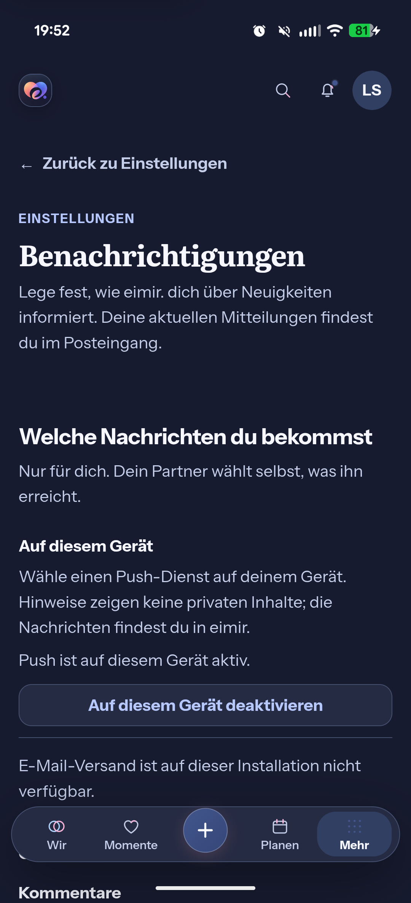
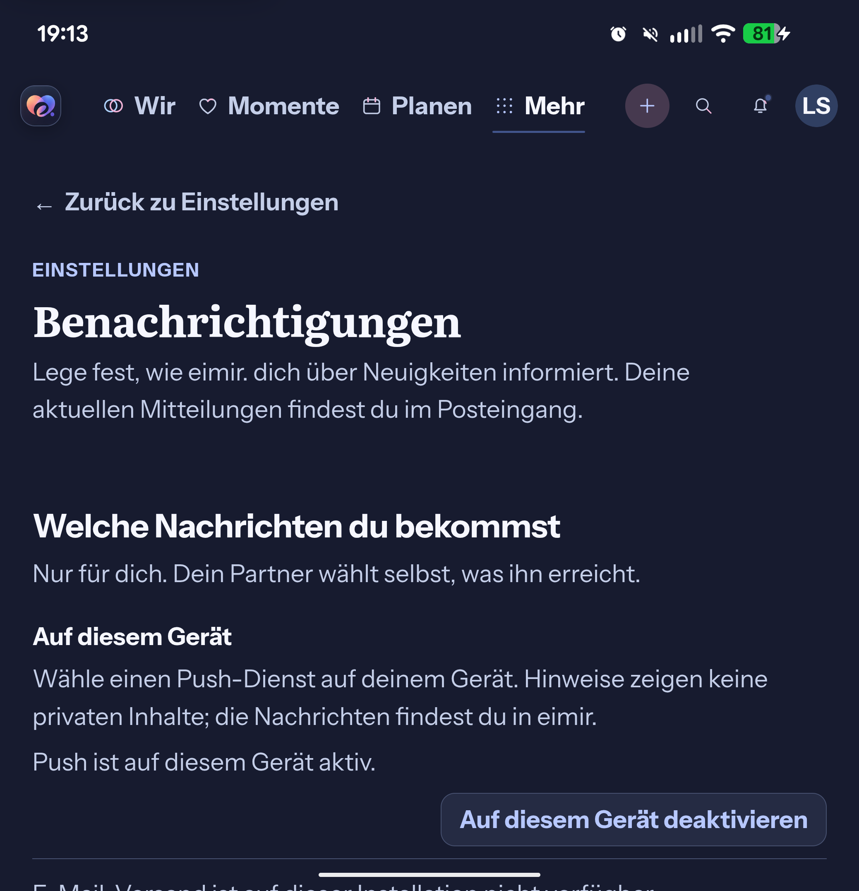

# UnifiedPush physical verification: 2026-10-20

PR #1271 remains **Draft**. A second distributor delivered encrypted wakes on
the connected Pixel. Two integration defects were corrected and retested.
Account replacement still has an unexplained first-registration failure, and
the combined enlarged-font/fold acceptance is incomplete. This report is not
merge or signed test-channel release acceptance.

## Exact identities and isolation

| Item | Identity |
| --- | --- |
| Baseline source | `039254b0e6086c4f17961a7e7e944cb1e7dcde43` |
| Readiness correction | `63f26aa7` |
| Corrected client/backend source | `45fde83df723f90efc9c644a8502fcde6a43a821` |
| Base main | `50dcc7fcc39fec288fc800615ea7948fde30e5fe` |
| Hardware / OS | Pixel 10 Pro Fold; Android 16, API 36, `BP4A.251205.006` |
| WebView | `com.android.webview` 148.0.7778.120 |
| Distributor | gCompat-UP 2.1.2, `org.unifiedpush.distributor.fcm`, version code 27 |
| QA application | `de.sidebyside.app.debug.pushqa`, label `eimir. Push QA` |
| Corrected QA version | code 2, `0.2.0-pushqa.20261020-debug` |
| Corrected APK SHA-256 | `2315f6c19934d855c03996ecaea2bc085107d7b169bf3d77e18bfb0c8f2824ec` |
| Baseline APK SHA-256 | `a74c5557459ba851b8639c51d9e61c332d2adc04da75850b7e90b796b6feadb6` |
| Folded viewport | 443 × 970 CSS px; DPR 2.4375; physical 1080 × 2364 |
| Open viewport, baseline run | 851 × 883 CSS px; physical 2076 × 2152 |

Both APKs differ from their stated source only by temporary QA package/label,
version and localhost API/network configuration. Those overrides were restored
before committing. The corrected source includes the backend fix; the local API
was restarted with it. No production backend or personal app was overwritten.

The QA API, worker, PostgreSQL container and fictional Lea Sommer / Alex Winter
Accounts were isolated. All addresses use `eimir.invalid`. An expiring existing
`TEST_FIXTURE` entitlement enabled the actual icon-selection UI; no entitlement
check was bypassed. Credentials, VAPID private key, endpoint URLs and encryption
keys are excluded from versioned evidence.

gCompat-UP was obtained through the download linked by the
[official distributor documentation](https://unifiedpush.org/users/distributors/fcm/)
from IzzyOnDroid (`org.unifiedpush.distributor.fcm_27.apk`). Its signing-certificate
SHA-256 is `df11176406c63a7876103ce6cc1a8fca239df76aa5f6de5cdbafe73ecdbf1875`.
The actual required origin, `https://fcm.googleapis.com`, was allowed only in the
QA backend. This is the existing UnifiedPush Web Push transport through a
supported distributor, not a native eimir FCM implementation or credential setup.
The device resolved Mozilla's push hostname to `127.0.0.1`; personal DNS was not
changed to make Sunup work.

## Defects corrected before the final run

1. **Misreported Push availability.** The device could be active while channel
   preferences always reported `PUSH_TRANSPORT_NOT_READY`. The backend had
   hardcoded `available=False`. It now reuses the existing provider registry and
   requires at least one active endpoint owned by the authenticated Account with
   a configured provider. Missing, disabled, foreign and unconfigured endpoints
   do not promise availability. Regression cases fail on the old code and pass
   after correction; the actual device then displays the consistent active state.
2. **Notification entry during authentication restoration.** A retained Android
   Activity could deliver `onNewIntent` while the authenticated Push hook had not
   mounted. The earlier identity-link listener consumed Capacitor App's retained
   generic URL event; `getLaunchUrl` still described the original URI-less launch.
   A fully new Activity passed and therefore did not cover this failure. The
   existing native Push plugin now retains a separate Account-tagged
   `notificationOpen` event. Only the fixed generic URI and VIEW action qualify.
   The authenticated hook consumes it through the existing inbox route and
   document-leave guard. General identity links retain their existing intake.

The [integration preflight](cloud-refresh-2026-10-20.md#physical-follow-up-preflight-retained-android-entry)
records reuse, R5/F2, privacy and business-model decisions. No composition,
localization, token, entitlement, schema, migration or new dependency was added.

## Physical results on the corrected APK

| Case | Observed result |
| --- | --- |
| Registration | Actual device action, system notification permission and gCompat-UP; active owned server endpoint and consistent channel capability |
| Foreground domain event | Normal Alex → Lea “thinking of you” request returns 202; worker delivery succeeds on attempt 1; native wake count 1; authenticated unread data refreshes; zero QA system notifications |
| Background / repeated wakes | Real provider sends encrypted generic wakes; exactly one notification ID 1, channel `eimir_notifications`, category `msg`, visibility `PRIVATE`; generic body only, no partner name/content |
| Warm notification tap | Actual Android notification-body tap opens authenticated `/more/notifications` from the prior Today context |
| Process absent | Exact QA PID/UID/name verified before bounded process termination; absence verified before send, without force-stop; notification tap starts a new process and opens the authenticated inbox |
| Authentication pending | QA database briefly paused to hold real authentication reads; app launched without a URI, stored session and visible restoration confirmed; actual notification tapped; database resumed in `finally`; inbox opens after restoration |
| Alternative launcher | `de.eimir.app.icons.dark` enabled; notification entry and restored login work with that icon |
| Disable / revoke | Actual disable action clears native registration and owned active endpoint; subsequent send to the retired endpoint returns `PUSH_SUBSCRIPTION_GONE` |
| Sign-out / local persistence | Both fictional Accounts: old access and refresh credentials return 401, native enabled=false, login remains visible after document reload; every QA endpoint inactive at teardown |
| Account replacement | **Not fully accepted; see below.** Old Account endpoints stay inactive and the new session belongs to Alex, but the first new endpoint cannot receive |

Lifecycle repetitions use direct calls to the existing provider with the same
encrypted content-free wake. These are transport probes, not additional domain
events. Normal partner gestures separately exercise the API/projector/worker
chain. A second immediate gesture correctly hit the normal cooldown; no policy,
clock, delivery assertion or database rate state was reset to bypass it.

One earlier tap attempt happened after Android locked the device and was not
counted as successful entry. The pending-auth test above independently confirms
the corrected path while unlocked and without an original launch URL.

## Open Account-replacement finding

After Lea signs out, Alex signs in and activates Push. Native status names Alex
and the backend records Alex's endpoint. A normal Lea → Alex gesture returns
202 and creates the correct authenticated in-app notification, but its first
delivery fails on attempt 1 with `PUSH_SUBSCRIPTION_GONE`; the backend disables
that endpoint. No system notification arrives in the ten-second receipt window.
The endpoint and complete secret differ from every earlier QA registration, so
reuse of an identical old endpoint is not established.

An explicit normal disable/enable action obtains a working registration. A
subsequent background transport probe delivers; tapping it opens Alex's inbox,
showing Lea's newly created notification rather than Lea's recipient context.
This recovery does **not** turn the first attempt into a pass. The cause could
be in application/connector/distributor lifecycle; it is unproven. Preserve this
as a repeatable acceptance target before approving Account replacement. Do not
add delays, blind automatic retries or weaken the delivery assertion.

## Display evidence and explicit limit

The corrected APK uses 110% Android system font, 17.6 CSS px root size, Dark mode,
443 × 970 CSS px, no horizontal overflow and a reachable complete device action.
The actual screenshot above contains only the fictional QA app.

This second capture is explicitly the **baseline APK before the readiness fix**:
open physical display, Dark, system font 150%, root 24 CSS px, 851 × 883 CSS px,
wrapping text and reachable device control. System notification settings and
return were exercised in that open state. The contradictory unavailable-channel
copy is part of the reproduced backend defect, not the corrected result.

The operator physically opened and closed the device. Folding locked Android;
after unlocking and restoring the original 110%, the folded session/context and
layout were checked. A valid folded 150% capture was not obtained. The user
explicitly instructed **not to enlarge the font again**. No further enlargement
was performed. The required combined open/fold/Dark/enlarged-font acceptance on
one final APK remains incomplete; neither image nor component renders waive it.

## Automated verification and failures retained

- Backend readiness, endpoint API and UnifiedPush tests: **22 passed**; Ruff,
  formatting, strict changed-module mypy and diff checks pass. Three new ownership
  cases include a configured provider behind an older unconfigured endpoint.
- Web Push, identity entry, Notification Settings, sign-out and encrypted-session
  persistence: **83 focused tests passed**. The retained-entry regression first
  fails with `/today` on the unfixed source; Account mismatch and warm/cold draft
  safety remain covered. TypeScript and changed-file Biome checks pass.
- Complete local Web run: **2051 passed, one failed, one existing skip**.
  `DailyInsightsPage.test.tsx` could not find the `Euer Vibe` heading in its
  capability case. The unchanged file then passes **all 20 cases** in isolation.
  Its cause is unproven; this is not a clean full-suite result.
- Canonical `:app:assembleDebug`, `:app:assembleDebugAndroidTest`,
  `:app:testDebugUnitTest`, `:app:lintDebug`: **BUILD SUCCESSFUL**, strict Gradle
  verification, JDK 21. All four NativeSessionCipher unit tests pass. Production
  Web/Capacitor build succeeds with existing bundle/directive warnings.
- An initial overbroad unqualified Gradle test-APK task also built SDK modules
  and failed duplicate Kotlin classes in a Capacitor SDK test graph. The canonical
  app-only tasks above pass without changing dependencies or verification.
- Local launcher instrumentation: **not passed**. All four cases encounter
  `IllegalAccessError` accessing package-private target classes, including the
  pre-existing LauncherIcons setup/reset. The new fixed-URI negative cases compile
  but cannot be credited as executed successfully. The cause is unproven; fresh
  hosted API 28/36 results are required. Physical interactions above are separate.

Hosted success for `039254b0` is historical evidence for that exact source.
Fresh CI for the evidence-containing PR head must be read separately. The two
previous hosted browser retry findings remain visible in the PR; no assertion,
retry, timeout, security threshold or workflow was weakened.

## Cleanup and release boundary

Both Accounts were signed out and all six QA endpoints were inactive before
teardown. Only the temporary QA app/test APK and newly installed gCompat-UP were
removed. Personal eimir packages and ntfy remain installed. Own ADB forwards,
reverse port, temporary device files, API/worker and owned QA database are removed
during teardown; private QA credentials are deleted after database removal.

Final device settings are verified at font scale **1.1**, night mode **auto** and
USB stay-awake **0** (the original values). No new font enlargement is permitted
by this report. No merge, production configuration, signed APK release or test
channel publication was performed; published test.13 still lacks this receiver.
