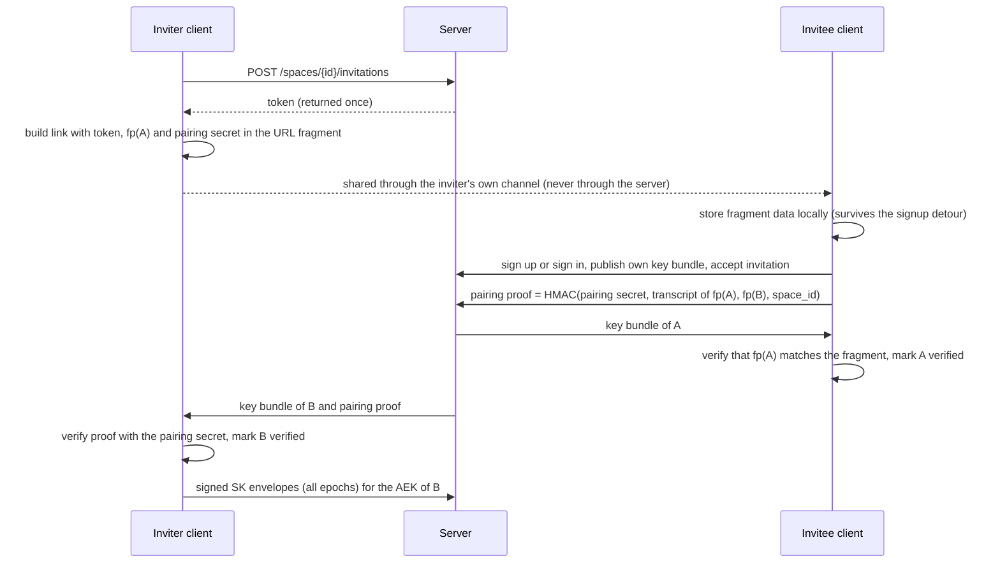

# MX — End-to-end encryption concept

**Status:** Concept for Product Owner and security review. **Nothing in this document is
implemented.** No end-to-end encryption claim is allowed until the conditions in
[section 16.3](#163-copy-and-claim-rules) and [section 21](#21-verification-testing-and-external-audit) hold.
**Milestone:** MX (Roadmap) — "real cryptographic protection: key model, migration, client crypto, Recovery".
**Baseline reviewed:** `main` at `52d2eeda39f11d430d01676de93ebe11c92a6567` (2026-11-04).
**Owner:** MX tracking issue [#1638](https://github.com/baerenmarke90/eimir/issues/1638).
**Builds on:** [Encryption at rest (#797)](../ENCRYPTION-AT-REST.md), [Security](../SECURITY.md),
[Architecture — E2EE readiness](../ARCHITECTURE.md#e2ee-readiness), [Privacy model](../PRIVACY-MODEL.md),
Master Specification sections 18 and 67, [Roadmap MX](../ROADMAP.md).

This document is the complete design proposal for giving eimir. real end-to-end encryption
(E2EE): content of a couple is encrypted on their devices and the operator stores and
serves only ciphertext. It covers the cryptographic design, the key lifecycle, every
existing domain and server feature that depends on plaintext today, product/UX
consequences, Cloud and Self-Hosted operations, the business/freemium assessment, the
reuse review, verification, phasing, and the decisions the Product Owner must take.

---

## Contents

0. [Executive summary](#0-executive-summary)
1. [Goals, non-goals and the claim boundary](#1-goals-non-goals-and-the-claim-boundary)
2. [Baseline on main](#2-baseline-on-main)
3. [Threat model](#3-threat-model)
4. [Design principles](#4-design-principles)
5. [Architecture overview](#5-architecture-overview)
6. [Key hierarchy](#6-key-hierarchy)
7. [Cryptographic suite, formats and bindings](#7-cryptographic-suite-formats-and-bindings)
8. [Identity, pairing and verification](#8-identity-pairing-and-verification)
9. [Devices, unlock and recovery](#9-devices-unlock-and-recovery)
10. [Domain coverage](#10-domain-coverage)
11. [Feature impact and redesign](#11-feature-impact-and-redesign)
12. [Client architecture](#12-client-architecture)
13. [Server and API architecture](#13-server-and-api-architecture)
14. [Lifecycles](#14-lifecycles)
15. [Migration and rollout](#15-migration-and-rollout)
16. [Product and UX concept](#16-product-and-ux-concept)
17. [Operations, Self-Hosted and Cloud](#17-operations-self-hosted-and-cloud)
18. [Business / freemium consistency](#18-business--freemium-consistency)
19. [Cross-cutting quality review](#19-cross-cutting-quality-review)
20. [Reuse-before-build review](#20-reuse-before-build-review)
21. [Verification, testing and external audit](#21-verification-testing-and-external-audit)
22. [Delivery plan](#22-delivery-plan)
23. [Product Owner decisions required](#23-product-owner-decisions-required)
24. [Risks and open questions](#24-risks-and-open-questions)
25. [Documentation to update on implementation](#25-documentation-to-update-on-implementation)
26. [E2EE readiness guardrails that apply now](#26-e2ee-readiness-guardrails-that-apply-now)

Appendices: [A — Glossary](#appendix-a--glossary) ·
[B — Inventory on the baseline](#appendix-b--inventory-on-the-baseline) ·
[C — Sources checked](#appendix-c--sources-checked)

---

## 0. Executive summary

**What changes.** Today the server encrypts protected payloads and media at rest under
operator-held keys (#797); the running application can read everything. With E2EE, the
clients (Web/PWA and the Capacitor Android app, which ship the same TypeScript bundle)
encrypt every protected payload and every media object before upload. The server keeps
its role as authorization authority, metadata index, key directory and ciphertext store,
but it can no longer read content.

**Recommended architecture in twelve points.**

1. **One crypto core in TypeScript**, shipped in the Web bundle and therefore also in the
   Android app. Native Android code only stores a device key in Android Keystore and
   decrypts notification previews. No second crypto implementation per platform.
2. **Standards and audited libraries only:** Web Crypto (AES-256-GCM, HKDF-SHA-256,
   Ed25519, X25519), HPKE (RFC 9180) with the hybrid post-quantum KEM X-Wing
   (X25519 + ML-KEM-768) for key envelopes, WebAuthn PRF for passkey unlock. No custom
   primitive; only key schedule, formats and composition are eimir.-specific.
3. **Key hierarchy for a durable archive, not a messaging ratchet.** An Account Root Key
   unlocks account identity keys; a Space Key (with epochs) protects shared content; a
   Personal Space Key per account and Space protects owner-only content; every record
   revision and every file has its own random key. Forward secrecy for the archive is a
   deliberate non-goal: couples must be able to reread their history on new devices.
4. **Owner-only content becomes cryptographically private**, not only authorization-private:
   the partner never receives the key, in addition to never receiving the rows.
5. **Couple-native trust:** the invitation link the inviter shares through their own
   channel carries (in the URL fragment, never sent to the server) the inviter's identity
   fingerprint and a pairing secret, so both identities are verified automatically.
   In-person QR verification and safety numbers remain available; key changes are visible.
6. **Passkey-first unlock without passwords:** a passkey with the PRF extension unlocks the
   keys in the same ceremony as sign-in. Alternatives: approve from another device
   (QR/short code), the Recovery Kit, and — for shared content only — the partner.
   Magic Link or operator recovery restores *access*, never *keys*.
7. **Server-gated reveal with split keys** for Mutual Reveal, surprises, time capsules and
   the trust vault: the server releases a key share when the condition holds, but alone
   it can never decrypt.
8. **Sender-sealed notification previews:** the writing client encrypts the small preview;
   the push provider and the server see ciphertext; the Android service decrypts with a
   derived preview key.
9. **Client-side intelligence:** search, Today/Story excerpts, recaps, insights, map
   projection, media validation, thumbnails, EXIF/GPS extraction and Transfer Bundle
   export run on the client for end-to-end protected content.
10. **Defense in depth stays:** the #797 at-rest layer still wraps E2EE ciphertext (new
    `crypto_version = 3`), server-side authorization still decides who receives which
    ciphertext, and the AAD binds ciphertext to its row — closing the #797 row-binding gap
    for E2EE content.
11. **Staged rollout:** first the personal scope (Private Area, gift ideas, private partner
    notes) — no partner key exchange required — then the shared scope per Space with both
    partners' consent, then migration of existing Spaces, then default-on after an
    external audit.
12. **Non-paywallable and identical on Cloud and Self-Hosted.** Premium features that
    currently need server plaintext are redesigned to work client-side; where they
    cannot, an explicit Product Owner decision is required instead of a silent privacy
    trade.

**What remains visible to the server** (and must be stated honestly): account emails and
identity, membership, timestamps, domain dates (for timeline, reminders and countdowns),
record types, counts, relations between records, status flags, ciphertext sizes (reduced
by padding), notification events, IP addresses and device metadata. See
[section 10.5](#105-residual-server-visible-metadata).

**What this costs.** Substantial client work (crypto core, key UX, client-side search and
media pipeline), a backend refactor of roughly forty modules that read protected fields
today, new key-directory tables and endpoints, a client capability gate, UX design for
eight new flows, an external audit, and a migration pass that re-uploads existing media.
Server compute for media/AI decreases for protected Spaces; client CPU and battery use
increase moderately.

**Decisions needed now** are listed in [section 23](#23-product-owner-decisions-required)
(23 items with recommendations).

---

## 1. Goals, non-goals and the claim boundary

### 1.1 Goals

| ID | Goal |
|---|---|
| G1 | The operator, its infrastructure and anyone who obtains database dumps, replicas, object-store snapshots or backups cannot read the content of end-to-end protected scopes: payload text, media originals, variants and posters, and the sensitive values listed in section 10.3. |
| G2 | Owner-only content is protected from the partner cryptographically, not only by query authorization. |
| G3 | Ciphertext cannot be moved between rows, Spaces, record types or authors without detection (integrity and binding). |
| G4 | A malicious or compromised server cannot silently substitute keys, add a hidden device or member, or inject a key it knows. Attempts are detected by clients. |
| G5 | Normal couples manage no technical key material during everyday use. Unlock is a passkey tap or approval on another device; recovery is understandable. |
| G6 | Cloud and Self-Hosted behave identically. No external service, phone-home or additional daemon is required. |
| G7 | Existing Spaces can migrate without data loss, and users keep every data right: export, deletion, offboarding and portability. |
| G8 | The design is crypto-agile and post-quantum hardened where it matters for long-lived archives (key envelopes). |
| G9 | The final claim is backed by an implementation, a test/evidence set and an external audit. |

### 1.2 Non-goals

| ID | Non-goal | Why |
|---|---|---|
| N1 | Hiding all metadata | Timeline, reminders, countdowns, quotas and authorization need dates, sizes and relations. Section 10.5 lists the residual set and reduction options. |
| N2 | Forward secrecy for archive content | A couple must be able to reread years of history on a new device. Post-compromise protection for *future* content is provided through epoch rotation. |
| N3 | Protection against a compromised, unlocked endpoint | Malware on an unlocked device, a malicious browser extension or an XSS during an unlocked session can read what the user can read. Mitigated (section 12.5), not eliminated. |
| N4 | Protection of shared content from the partner | Shared content is meant for both partners; a former partner keeps what their devices already hold. |
| N5 | Anonymity or traffic-analysis resistance | IP addresses, access times and request patterns remain visible to the operator. |
| N6 | A real-time messaging protocol | eimir. is an archive with collaboration, not a chat. MLS remains a candidate only for future real-time features (section 20). |
| N7 | Native iOS | Web-first per ADR 0011; Safari/PWA is covered. |
| N8 | Lawful-access or content-scanning hooks | E2EE without exceptional access. Legal developments are tracked as a risk (section 24). |

### 1.3 Vocabulary and claim boundary

This extends the vocabulary of [ENCRYPTION-AT-REST.md section 1](../ENCRYPTION-AT-REST.md#1-vocabulary).

| Term | Meaning in this document | Who can read content |
|---|---|---|
| Server-managed protection | Current state: TLS plus application-controlled encryption at rest (#797) | the running application/operator |
| **End-to-end protection** (product term) / **E2EE** (engineering term) | Content sealed on the client under keys the server never receives | only authorized member devices |
| Personal scope | `OWNER_ONLY` content of one Account in one Space | only that Account's devices |
| Shared scope | `SPACE_SHARED` content of a Space | the devices of both current partners |
| Gated content | Content whose key is completed only when the server releases a key share (reveal) | the authorized devices after release |
| Transient exposure | Content that passed through the server in plaintext once (for example a server-relayed import) before being sealed | marked; never called end-to-end |
| Residual metadata | Server-visible data that end-to-end protection does not cover | the server |

The existing rule stays binding: the claim that the operator cannot read content may be
used only after implementation **and** an external audit, and only for the scopes that are
actually end-to-end protected. Server-managed Spaces, the Demo Space, transient exposure
paths and residual metadata are never covered by the claim.

---

## 2. Baseline on main

### 2.1 Protected payload boundary and at-rest encryption

The architecture was prepared for this milestone from M0:

- 31 `ProtectedPayload` types bound to 30 JSONB columns through `ProtectedPayloadJSON`
  (`backend/src/eimir/db/protected_payload.py`). Domain code never sees ciphertext; raw
  dictionaries are rejected.
- `crypto_version` per row: `0` plaintext, `1` **reserved for client-sealed content**,
  `2` server AEAD envelope (`backend/src/eimir/domain/payload.py`). The helper
  `is_readable_by_server(crypto_version)` exists, and `ProtectedPayload.unseal` already
  states that rows the server cannot read must not break a whole list.
- `EncryptingMediaStore` wraps every media object (`EIMIRENC` format, 64 KiB AES-GCM
  chunks with index nonce and final flag).
- Outbox payloads are restricted to an allowlist of non-sensitive metadata
  (`PublicEventPayload`); jobs carry canonical IDs only.
- Database full-text indexes over payloads were removed; search decrypts and matches in
  the application (#797 section 7).
- Known #797 limit: ciphertext is not bound to its row identity.

### 2.2 Plaintext the server still depends on

Appendix B lists the inventory. In summary:

- **About forty backend modules read protected fields** today, for example
  `dashboard/service.py` (excerpts and titles), `search/service.py` (matching),
  `engagement/push_preview.py` (notification titles), `recaps/` (composition and local AI
  wording), `games/service.py` and `memories/experiences.py` (candidate titles),
  `wish_selections/service.py` (intersection of private favorites), `places/photo_enrichment.py`,
  `attachments/video_jobs.py`, `daily_checkins/service.py` and the Demo seeding.
- **Sensitive values in plaintext metadata columns:** `places.latitude/longitude`,
  `daily_check_ins.vibe/energy_level`, `profile_preferences.topic`,
  `related_persons.birthday`, `space_profiles.relationship_started_on`,
  `accounts.display_name`, account emails.
- **Server-side media processing:** magic-byte and dimension validation, pixel rewriting,
  EXIF/ICC handling (ADR 0014), thumbnails and posters (M2-D14/D15), HEIC decoding
  through `pillow-heif`, video remux/probe in the optional media processor (#88), and
  server-side GPS extraction for selected-photo Places (#1459/#1478).
- **Server-side fetches of content:** Photon reverse lookup (coordinates), link previews
  (`/spaces/{spaceId}/link-preview`, the URL), Google Photos and Immich imports (#1444).
- **Server-side Transfer Bundles** (#345): plaintext assembly in the worker, import with new
  target IDs.

### 2.3 Clients and platforms

- **Web/PWA:** React/Vite bundle served by the operator's Nginx with a strict CSP
  (`default-src 'none'`, `script-src 'self'`, `worker-src 'none'`). IndexedDB read cache
  (`web/src/client/productReadCache.ts`) persists **decrypted** `SPACE_SHARED` payloads
  for seven days. Browser credentials are tab-scoped. Web Crypto is used only for random
  values today.
- **Android:** Capacitor wrapper (ADR 0011) with **bundled** Web assets (`webDir: dist`,
  no remote `server.url`), `minSdkVersion = 26`, `CapacitorHttp` enabled.
  `NativeSessionCipher` already protects the session envelope with a non-exportable
  Android Keystore AES-256-GCM key in no-backup storage. Push previews use a
  device-provided 256-bit key; the server JWE-encrypts (`dir`/`A256GCM`) previews it
  composed itself (`engagement/fcm_push.py`). WebAuthn is unavailable inside the WebView
  until the native passkey bridge (#630) exists.
- **Invitation links** are built on the inviter's client from a token returned once
  (`web/src/client/invitationLink.ts`); the token travels in the URL fragment
  (`entryToken.ts`). The server never mails invitation links. This is the anchor for
  automatic verification in section 8.2.
- **Releases** are immutable with SPDX SBOMs and Sigstore-backed GitHub Artifact
  Attestations for the Web runtime archive (`docs/m6/IMMUTABLE-RELEASES.md`,
  `docs/m6/SBOM-ATTESTATIONS.md`).

### 2.4 Lifecycle contracts that constrain key handling

- **Leaving a Space (#518):** shared history stays with the remaining partner; the leaver
  loses access immediately; the leaver's Space-scoped owner-only rows are deleted; the
  Space is relationship-history locked (no new member); a zero-active Space is purged
  after a frozen 30-day deadline.
- **Account deletion (#520):** deletion tombstones outside the restorable database; a
  restore from an older backup must re-apply deletion.
- **Transfer (#345):** `SHARED` and `PERSONAL` exports; additive import with member mapping
  and new target IDs.
- **Backups (#190):** database dump plus media; keys are kept apart from data.

---

## 3. Threat model

### 3.1 Assets

| Asset | Examples | Protection target |
|---|---|---|
| Shared content | Memories, HeartMoments (shared), Milestones, comments, Plans, Wishes, Places incl. coordinates, Chapters, Collections, reminders, recap texts, shared preferences | confidentiality and integrity against everyone but the two partners |
| Personal content | private notes, gift ideas, private collections, private HeartMoments, private partner notes, own recap drafts, own Wish favorites | confidentiality against everyone but the owner, including the partner |
| Gated content | Daily Check-in values before reveal, surprises, time capsules, vault entries, question answers | confidentiality until the release condition |
| Media | originals (with retained EXIF/GPS per ADR 0014), display variants, thumbnails, posters, video, audio | as for the parent scope |
| Key material | ARK, identity keys, Space and personal keys, file keys, recovery key, PRF outputs | never on the server in usable form |
| Integrity of trust state | identity keys, device list, epoch chain, member set | tamper-evident |

### 3.2 Adversaries and outcomes

| ID | Adversary | Capability | Outcome with this design |
|---|---|---|---|
| A1 | Thief of a database dump, replica or backup | reads stored rows and objects | ciphertext under two layers (E2EE and #797); key envelopes need member private keys; no content |
| A2 | Storage/hosting provider | reads buckets/volumes | same as A1 |
| A3 | Passive, curious server (or attacker with read access to the running system) | reads requests, memory of the API, logs | sees only ciphertext and residual metadata; the API never holds content keys |
| A4 | Active, malicious or compelled operator | modifies the API, serves wrong keys, injects epochs, withholds or replays data | key substitution, ghost devices/members and injected epochs are detected (section 8.5); can deny service, withhold updates or roll back to older consistent states; **can deliver modified Web code to browser users** (A5) |
| A5 | Malicious Web code delivery | operator or attacker controls the served JS | can exfiltrate keys from browser sessions. Native app users are not affected (bundled, store-signed code). Mitigations in section 12.5. Documented residual risk. |
| A6 | Network attacker | TLS-level position | no content; TLS remains required |
| A7 | The partner | holds shared keys, uses own devices | cannot read personal scope (no key, no rows); cannot read gated content before release unless the server colludes |
| A8 | Former partner after leaving | holds old keys and caches | keeps what was already on their devices; cannot obtain new ciphertext (server authorization) and cannot read content created after the leave even with a later dump (epoch rotation) |
| A9 | Thief of a locked device | physical device | keys under Android Keystore / non-extractable Web Crypto keys; same protection as the current session envelope |
| A10 | Push provider (Google/UnifiedPush distributor) | sees push payloads | sees opaque wake payloads and sealed previews only |
| A11 | Email or OIDC account takeover | can sign in by Magic Link or OIDC | gets a session but **no keys**; the account stays locked; new devices need an unlock factor; partners see no key change |
| A12 | Passkey provider compromise (synced passkeys) | can complete PRF ceremonies | can unlock the account — the passkey provider is a trust anchor for PRF unlock; users can disable PRF unlock and use device approval plus Recovery Kit instead |
| A13 | Legal request to the operator | compels disclosure | only ciphertext, key envelopes and metadata can be produced |
| A14 | Future quantum adversary with harvested data | breaks X25519/Ed25519 later | key envelopes use a hybrid post-quantum KEM; content uses AES-256; signatures are not needed for confidentiality of harvested data |

### 3.3 Accepted residual risks

1. Browser users trust the code the operator serves (A5). Native app users trust the
   app-store distribution chain and the signing key.
2. A malicious server can withhold, delay or roll back data; clients detect only what
   their local state allows (section 8.5).
3. Metadata (section 10.5) is visible.
4. Reveal timing is enforced by the server; a malicious server can release a share early
   but still cannot read the content.
5. Malicious media from a partner is decoded on the recipient's device; there is no
   server-side sanitization for protected content (section 11.4).
6. Loss of every unlock factor loses personal content permanently; shared content can be
   re-shared by the partner.

---

## 4. Design principles

| ID | Principle |
|---|---|
| P1 | **The server is untrusted for confidentiality** but remains authoritative for authorization, membership, metadata and availability. Every existing server-side privacy filter stays in place: the partner never even receives owner-only ciphertext. |
| P2 | **One crypto core** for all clients (TypeScript in the Web bundle). Native code handles only key storage and notification decryption. |
| P3 | **No custom primitives.** Standards and audited libraries; eimir. code composes and frames. |
| P4 | **Crypto agility:** every envelope names its suite and format version; unknown or deprecated suites fail closed. |
| P5 | **Defense in depth:** E2EE inside, #797 at-rest outside, authorization around both. |
| P6 | **Per-record keys:** privacy transitions, reveals, epoch changes and migrations re-wrap small keys instead of re-encrypting bodies. |
| P7 | **Invisible by default, explicit about consequences:** no technical terms in everyday UI, but loss and recovery consequences are always disclosed before they matter. |
| P8 | **Fail closed, never silently plaintext:** an end-to-end protected scope never accepts or returns plaintext content; a client that cannot seal does not write. |
| P9 | **Metadata minimization with an honest residual list.** |
| P10 | **Couple-native trust ceremonies:** verification uses what couples already do — share an invitation, be together, scan a code. |

---

## 5. Architecture overview

```text
 Partner A devices                                   Partner B devices
 ┌──────────────────────────────┐                    ┌──────────────────────────────┐
 │ Web/PWA or Android app       │                    │ Web/PWA or Android app       │
 │  UI (React)                  │                    │  UI (React)                  │
 │   │ typed plaintext only     │                    │   │                          │
 │  Crypto core (Worker)        │                    │  Crypto core (Worker)        │
 │   - keys in memory           │                    │                              │
 │   - seal/open, media stream  │                    │                              │
 │   - local search index       │                    │                              │
 │  Key store: IndexedDB        │                    │  Key store: Android Keystore │
 │   (non-extractable keys)     │                    │   via Capacitor plugin       │
 └──────────────┬───────────────┘                    └──────────────┬───────────────┘
                │ HTTPS: metadata + sealed envelopes + ciphertext media │
                └──────────────────────────┬────────────────────────────┘
                                           │
                               REST API v1 (FastAPI)
                 ┌─────────────────────────┼──────────────────────────┐
                 │ Authorization & tenancy │ Key directory             │
                 │ (unchanged invariants)  │ (bundles, devices, epochs,│
                 │ Metadata features:      │  envelopes, unlock wraps, │
                 │ timeline order, reminders│  reveal shares)          │
                 │ notifications, quotas   │                           │
                 └─────────────────────────┼──────────────────────────┘
                                           │
              PostgreSQL (sealed JSONB inside #797 envelope)   MediaStore (EIMIRE2E inside EIMIRENC)
```

The server keeps every metadata-driven function. Every content-driven function moves to the
client or is redesigned (section 11).

---

## 6. Key hierarchy

### 6.1 Overview

```text
Unlock factors (any one):
  passkey PRF ─┐   Recovery Kit ─┐   approved device ─┐   local device key ─┐
               └──── wrap ───────┴──── transfer ──────┴──── wrap ───────────┘
                                          │
                               Account Root Key (ARK, 256-bit)
                                          │ AEAD
                    ┌─────────────────────┴──────────────────────┐
     Account Identity Key (AIK, Ed25519)          Account Encryption Key (AEK, X-Wing)
       signs devices, epochs, envelopes            receives Space Key envelopes (HPKE)
                                                               │
                         ┌─────────────────────────────────────┤
          Space Key epoch SK[e] (256-bit, shared scope)   Personal Space Key PSK[e]
            per Space; envelopes per member AEK            per Account and Space; wrapped by ARK
                         │                                      │
              Record keys RK (per record revision)    Record keys RK (owner-only records)
              File keys FK (per attachment)            File keys FK
              derived: notification preview key NPK, history wraps, inbox private key
```

### 6.2 Account keys

| Key | Type | Purpose | Where it lives |
|---|---|---|---|
| **ARK** — Account Root Key | 256-bit symmetric | Root of an account's key material; wraps the private account bundle and personal keys | never stored in plaintext on the server; wrapped by unlock factors (section 9) |
| **AIK** — Account Identity Key | Ed25519 key pair | Identity of the account for the partner; signs device certificates, epoch headers, key envelopes and bundle changes | public part in the key directory; private part inside the private account bundle (AEAD under ARK) |
| **AEK** — Account Encryption Key | X-Wing key pair (X25519 + ML-KEM-768) | Receives Space Key envelopes through HPKE | public part signed by AIK in the directory; private part in the private account bundle |

All devices of one account share AIK and AEK (through ARK). A partner therefore encrypts
each Space Key epoch **once per account**, not once per device. This follows the
vault-style model used by password managers and is simpler than per-device fan-out; the
trade-off for device revocation is handled in section 9.6.

The **private account bundle** (AEAD under `HKDF(ARK, "account-bundle")`) contains the AIK
and AEK private keys, the locally verified partner identities (section 8), and settings
that must follow the account to new devices. It is versioned and written with `If-Match`.

### 6.3 Device keys and device certificates

Each installation (browser profile or Android app install) creates:

- a **device wrapping key** `DWK`: non-extractable AES-256-GCM `CryptoKey` in IndexedDB
  (Web) or a non-exportable Android Keystore key (StrongBox when available, no-backup,
  `setUnlockedDeviceRequired`). It wraps ARK locally so the device can unlock without
  network or ceremony. The wrapped ARK stays on the device; the server never stores it.
- a **device signing key** (Ed25519) for device linking transcripts.
- a **device certificate**: `{device_id, account_id, device signing public key, platform,
  created_at}` signed by AIK and published in the key directory. Clients of both partners
  can list an account's certified devices; an uncertified device is never trusted.

On the Web, persisting `DWK` + wrapped ARK is the explicit "keep this browser unlocked"
choice (default on for an installed PWA, default off for a plain browser tab — decision
D-07). Without it, ARK lives only in the crypto worker's memory for the tab session.

### 6.4 Shared scope: Space Key epochs

- **SK[e]** is a random 256-bit key per Space and epoch `e`.
- An **epoch header** `{space_id, epoch_id, number, created_by_account, created_by_device,
  created_at, reason, previous_epoch_hash, member_set[(account_id, aik_fingerprint)]}` is
  signed by the creator's AIK. Clients verify the signature, the hash chain and that the
  member set equals exactly the verified members (at most two).
- An **envelope** per member: `HPKE.Seal(AEK_member, SK[e])` with `info` binding Space,
  epoch, recipient and recipient key version, plus a signature by the sender's AIK over the
  envelope transcript.
- A **history wrap** per epoch: `AEAD(HKDF(SK[e], "history"), SK[e-1])`. Any holder of the
  current epoch can walk back to every earlier epoch. New devices and re-verified
  identities therefore read the full history.
- **Rotation triggers:** a member leaves; a member removes a device with rotation
  (section 9.6); a member resets identity; manual "reset keys"; suite upgrade. There is no
  calendar-based rotation (it would not protect an archive that every member device can
  already decrypt).
- **Space creation:** the founder creates epoch 1 immediately. Content created before the
  partner joins is shared with the partner once pairing is verified (section 8.2).
- **Several Spaces:** an account that belongs to more than one Space has one identity and
  separate Space and personal keys per Space; no key is ever shared between Spaces, which
  preserves the "a new relationship never inherits a previous Space" rule of #518.

### 6.5 Personal scope: Personal Space Keys

- **PSK[e]** per (Account, Space): random 256-bit, wrapped by `HKDF(ARK, "psk" || space_id ||
  e)`, stored in the directory. Only the owner's devices can unwrap it.
- It protects every owner-only record of that account in that Space.
- On leaving a Space, the leaver's personal key records are deleted together with the
  owner-only rows (#518 section 5.2): crypto-erasure plus data deletion.

### 6.6 Record keys, file keys and derived keys

- **RK** — a random 256-bit key per record **revision**. The payload is encrypted under RK.
  RK is wrapped by a key-wrapping key derived from the scope key and the record identity:
  `KWK = HKDF(scope key, salt = record_id, info = "kwk" || record_type || scope)`.
  Consequences: a privacy transition (shared ↔ personal HeartMoment) re-wraps only RK;
  after an epoch change, existing records keep their older epoch (readable through the
  history chain) until they are rewritten; a reveal withholds part of RK.
- **FK** — a random 256-bit key per attachment, stored inside the attachment's sealed
  payload. Per-object keys are derived: `HKDF(FK, info = "media" || variant)` for
  `original`, `display`, `thumbnail`, `poster`.
- **NPK[e]** — notification preview key `HKDF(SK[e], "notification-preview")`, and the
  personal counterpart from PSK. It is the only key the Android native layer receives.
- **Local index key** — a device-local non-extractable key that encrypts the persisted
  search index and read cache metadata (section 12.3).

### 6.7 Gated reveal keys (split-key release)

For content that must stay closed until a condition holds:

```text
RK = HKDF(IKM = RK_client || RRS, salt = record_id, info = "gated")
RK_client  : wrapped like any record key (shared or personal scope)
RRS        : "reveal release share", 256-bit, generated by the author client,
             stored by the server (inside the #797 at-rest layer) and released
             to an authorized reader only when the condition holds
```

- The server alone cannot decrypt (it lacks `RK_client`).
- The partner alone cannot decrypt before release (it lacks `RRS`).
- The author always receives their own `RRS` (multi-device reading). A "sealed for
  everyone, including me" time capsule is enforced by the author's client discarding
  `RK_client`/`RRS` after upload; this is honest best effort and must be described so.
- **Withdraw before reveal** (trust vault #461) deletes `RRS`; the live content becomes
  undecryptable for everyone.
- Conditions: `MUTUAL` (both partners submitted — Daily Check-in Mutual Reveal, questions),
  `RECIPIENT_ACTION` (scratch cards), `AUTHOR_ACTION` (manual surprise reveal), `TIME`
  (time capsule, timed surprise), `BILATERAL_CONSENT` (trust vault).

### 6.8 Space inbox key (write-only ingestion)

Some content originates outside the members' clients (server-relayed imports, a lookup the
user explicitly asks the server to perform, system messages during migration). Each Space
has an **inbox key pair** (X-Wing HPKE); the private key is wrapped under SK. The server
seals such material to the inbox public key immediately; the next member client absorbs it
(decrypts, merges into the record, re-seals under RK) and deletes the inbox item. This
limits plaintext to the moment of ingestion and is always labelled *transient exposure*.

### 6.9 Key inventory

| Key | Generated by | Stored | Readable by | Rotated when | Deleted when |
|---|---|---|---|---|---|
| ARK | first device | wrapped per unlock factor; device-local wrap | owner devices | key reset (9.6 level 3) | account deletion |
| AIK | first device | public: directory; private: account bundle | owner devices | identity reset | account deletion |
| AEK | first device | same as AIK | owner devices | device removal with rotation, suite upgrade | account deletion |
| DWK | each device | IndexedDB / Keystore | that device | never (replaced with the device) | sign-out with "forget this device", app removal |
| SK[e] | any member device | HPKE envelope per member + history wrap | both partners | member leave, device removal with rotation, identity reset, manual | Space purge |
| PSK[e] | owner device | wrapped by ARK in directory | owner | device removal with rotation, key reset | leaving the Space, account deletion |
| RK | writing device | wrapped by scope-derived KWK inside the envelope | scope readers | every revision | with the record |
| FK | uploading device | inside the attachment's sealed payload | scope readers | never (new attachment instead) | with the attachment |
| RRS | author device | server (at rest) | released readers | never | withdraw, record deletion |
| NPK[e] | derived | Android Keystore-wrapped native store | owner device's native layer | with SK/PSK | sign-out, Space exit |
| Inbox key | founder device | public: directory; private: wrapped by SK | both partners | with SK epochs | Space purge |
| Recovery key | owner device | shown once; user-held | the user | regeneration | regeneration, account deletion |

---

## 7. Cryptographic suite, formats and bindings

### 7.1 Suite E2EE-1

| Function | Algorithm | Notes |
|---|---|---|
| Content AEAD | AES-256-GCM, 96-bit random nonce | fresh RK per revision; AES-256 keeps a large margin against quantum search |
| Key wrapping | AES-256-GCM under HKDF-derived KWK, random nonce, AAD | binds context; AES-KW is deterministic and has no AAD |
| KDF | HKDF-SHA-256 (RFC 5869) | domain-separated labels `eimir/e2ee/1/...` |
| Public-key encryption | HPKE (RFC 9180), base mode, KEM **X-Wing** (X25519 + ML-KEM-768), KDF HKDF-SHA-256, AEAD AES-256-GCM | hybrid post-quantum for the long-lived key envelopes; base mode plus explicit Ed25519 signatures because X-Wing has no authenticated mode |
| Signatures | Ed25519 (RFC 8032) | identity, device certificates, epoch headers, envelopes |
| Hash and fingerprints | SHA-256 | safety numbers, transcript hashes, epoch chain |
| Passkey unlock | WebAuthn Level 3 PRF extension → HKDF | optional factor |
| Recovery key | 256-bit random, Crockford Base32 groups with checksum, QR | no password-based KDF needed (high entropy) |

**Why hybrid post-quantum for envelopes from day one.** Content ciphertext is symmetric
(AES-256) and not the weak point. The asymmetric Space Key envelopes are: an attacker who
harvests a database dump today could recover every Space Key once X25519 falls, and with
it the complete archive — love letters are expected to stay private for decades. Upgrading
later would not protect envelopes already captured in old backups. Public keys (1216 bytes)
and encapsulations (1120 bytes) are negligible for a two-member Space.

**Contingency suite E2EE-1C** (only if decision D-04 rejects hybrid KEM after the library
audit): DHKEM(X25519, HKDF-SHA-256) with everything else unchanged, with an explicit
upgrade path that re-wraps every epoch for both members when hybrid becomes available.

**Library status checked 2026-11-04** (details in section 20): X-Wing is still an IETF
draft (`draft-connolly-cfrg-xwing-kem-11`, September 2026); `@hpke/hybridkem-x-wing` is
marked experimental; no independent audit of `@noble/post-quantum` was found. Chrome 154
(beta notes 2026-09-02) adds ML-KEM, ML-DSA and ChaCha20-Poly1305 to Web Crypto; whether
X-Wing ships natively is not settled. The suite choice is therefore conditional on the
crypto design review and the library audit (decision D-04).

### 7.2 Agility, downgrade protection and deprecation

- Every envelope carries `suite` and format version; both are part of the AAD or the signed
  transcript, so a server cannot relabel a suite.
- Clients keep an allowlist; unknown suites fail closed with a localized "update the app"
  state.
- A suite deprecation is a re-wrap job: new epochs and record-key re-wraps under the new
  suite, executed by member clients; content bodies are re-encrypted only if the AEAD
  itself is deprecated.
- The server validates that the suite id is allowlisted (configuration of the release, not
  an operator setting).

### 7.3 Record envelope

Stored inside the existing JSONB `payload` column, exchanged in the API as `sealedPayload`:

```json
{
  "e2e": 1,
  "suite": 1,
  "scope": "S",
  "kid": "0191f7c2-…",
  "ps": 4,
  "wk": "<base64url: nonce || AES-GCM(KWK, RK)>",
  "ct": "<base64url: nonce || AES-GCM(RK, padded payload JSON)>",
  "g": null
}
```

| Field | Meaning |
|---|---|
| `e2e` | client envelope format version |
| `suite` | crypto suite (section 7.1) |
| `scope` | `S` shared, `P` personal, `G` gated (shared or personal base) |
| `kid` | key id: the Space epoch id or the personal key epoch id |
| `ps` | payload schema version of the plaintext JSON (schema registry, section 12.1) |
| `wk` | wrapped record key (for `G`: wrapped `RK_client`) |
| `ct` | encrypted, padded payload |
| `g` | gated metadata: condition type, base scope (`S` or `P`) and release reference; never content |

The plaintext is UTF-8 JSON following the same schema as today's `ProtectedPayload`
(`seal()` output), plus fields that move into ciphertext (section 10.3).

### 7.4 Binding (AAD) and the #797 row-binding gap

Both AADs are length-prefixed binary transcripts (no JSON canonicalization). The content
AAD binds only values that never change for a record, so that privacy transitions and
epoch changes re-wrap the record key without re-encrypting the body:

```text
ct AAD: "eimir/e2ee/1/record" | suite | e2e | space_id | record_type | record_id
        | author_account_id | ps
wk AAD: "eimir/e2ee/1/record-key" | suite | space_id | record_type | record_id
        | scope | kid
```

- `record_id` is a **client-proposed UUIDv7** for creates in protected scopes; the server
  validates version, plausible timestamp and uniqueness. This binds ciphertext to its row,
  closing the #797 limit for protected content.
- `record_type` uses the pinned `crypto_context()` label, so renaming a class does not
  break existing ciphertext (the existing test that pins labels extends to E2EE).
- `author_account_id` is the original author (or creator); collaborative edits (#1603)
  keep it. Space-owned resources without an author use the nil UUID.
- `scope` and `kid` are bound through the wrap: moving a record key into another scope or
  under a foreign key fails authentication.
- Not bound: the row `version` counter (it also changes for metadata-only edits). Rollback
  of a record to an older valid revision by a malicious server is therefore not detected
  cryptographically (residual risk 3.3-2), but clients that remember a newer revision warn.

### 7.5 Media object format

```text
"EIMIRE2E" | format u8 = 1 | suite u8 | chunk_size u32 (65536)
| attachment_id (16) | variant u8 | nonce_prefix (7)
chunk_i = AES-256-GCM(K_variant, nonce = prefix(7) || i (u32 BE) || last (u8),
                      AAD = SHA-256(header))
(every chunk authenticates the complete header through its AAD)
```

- STREAM-style construction (the same construction class as the existing `EIMIRENC`
  framing and Tink streaming AEAD): truncation, reordering and appending fail; random
  access per chunk enables seeking for video.
- `K_variant = HKDF(FK, info = "media" || variant)`; `attachment_id` in the header binds the
  object to its row.
- The provider adapter still sees `application/octet-stream`. With #797 active, the server
  wraps the E2EE object again in `EIMIRENC` (decision D-12 covers a later direct-upload
  optimization).
- Thumbnails, display variants and posters are separate E2EE objects created by the
  uploading client.

### 7.6 Key envelopes, signatures and transcripts

- Space Key envelope: `HPKE.Seal(pk = AEK_recipient, info = "eimir/e2ee/1/space-key" |
  space_id | epoch_id | recipient_account_id | recipient_aek_version, aad = H(epoch
  header), pt = SK[e])`, plus `sig = Ed25519(AIK_sender, H("envelope" | enc | ct | info))`.
- Every signed object uses a binary transcript with a type label, length-prefixed fields
  and the suite id. JSON is only the transport encoding (base64url fields).
- Device-link transfers use HPKE (same X-Wing suite, because a recorded relay must not
  become decryptable later) to an ephemeral key of the new device (section 9.3).

### 7.7 Padding and length hiding

- Payload plaintext is padded with **Padmé** (leaks O(log log M) bits of length) before
  encryption. Short texts such as titles collapse into a few size classes.
- Media is not padded by default (storage cost); thumbnails, which are small, are padded
  to the next 4 KiB. Decision D-13 may extend padding.

### 7.8 Persistence schemes and `crypto_version`

| `crypto_version` | Stored value | Server can read content |
|---|---|---|
| 0 | legacy plaintext | yes |
| 1 | client envelope stored as-is (instance with at-rest `disabled`) | **no** |
| 2 | #797 server AEAD envelope over plaintext | yes |
| **3 (new)** | #797 server AEAD envelope whose plaintext is a client envelope | **no** |

`_enc` keeps equal to `crypto_version` (the #797 invariant). `is_readable_by_server`
returns false for 1 and 3. `audit-raw` gains a check that protected Spaces contain only
schemes 1/3, and a key-holding `audit-e2ee` (operator KEK only, no user keys) verifies that
every scheme-3 plaintext is a structurally valid client envelope.

---

## 8. Identity, pairing and verification

### 8.1 Identity and safety numbers

- An account's **identity** is `(account_id, AIK public key)`; AEK is valid only with an
  AIK signature.
- **Fingerprint:** `SHA-256("eimir/e2ee/1/identity" | account_id | AIK_pub)`.
- **Safety number** of a couple: the sorted concatenation of both fingerprints, displayed as
  12 groups of 5 digits (identical on both phones) and as a QR code.

### 8.2 Invitation-bound automatic verification



- The link fragment carries `invitationToken` (existing), `ik` (the inviter's identity
  fingerprint) and `pair` (the 128-bit pairing secret). Fingerprint and pairing secret live
  only in the URL fragment and on the two clients. A server that substitutes either bundle
  cannot produce a valid proof. The assurance equals the integrity and confidentiality of
  the channel the inviter used to share the link; in-person verification (8.3) upgrades it.
- The Cloud signup detour (#923 binds only the invitation hash to the signup proof) may
  open the mailed link in another browser context. The invitee client therefore stores
  the fragment data in IndexedDB at first open. If it is missing after the detour, pairing
  falls back to in-person verification (8.3) — explained in plain language, not as an
  error.
- Until the inviter's device confirms, the invitee is a member without access to shared
  content history ("waiting for the partner to confirm on one of their devices"). The
  inviter's client completes this automatically when it next runs; a push wake requests it.
  During this state personal features work; shared writes are paused with an explanation,
  because shared content must be sealed under a key both partners have confirmed.

### 8.3 In-person verification

- One partner shows the safety-number QR; the other scans it. Both phones confirm.
- Available at any time in the partner profile; recommended after any key change.
- Accessible alternative: compare the 12 digit groups (screen-reader friendly).

### 8.4 Key changes

- A new AIK for the partner (identity reset) shows a calm notice on the Wir surface and
  in the partner profile: shared content does **not** flow to the new identity until it is
  verified again. Nothing is re-shared silently.
- A new AEK signed by the known AIK (device removal with rotation) is accepted
  automatically and listed in the partner's security activity.
- Verified identities are stored in the private account bundle, so a user's new device
  inherits the verification state.

### 8.5 Malicious-server checks every client performs

1. AIK of the partner matches the verified fingerprint.
2. AEK and device certificates carry valid AIK signatures.
3. Epoch headers form a valid hash chain; the member set equals the verified members
   (at most two); the creator is a verified member.
4. No envelope addressed to an unverified key is ever created by this client.
5. Suite ids are allowlisted; transcripts and AAD verify.
6. Record AAD matches the row the server claims (Space, type, id, author, key id).
7. Monotonicity hints: newest known epoch number and per-record revision timestamps are
   remembered locally; regressions produce a warning in the security activity.

Optional later hardening: publish key-directory changes into a transparency log following
IETF KEYTRANS (drafts as of 2026), section 20.

---

## 9. Devices, unlock and recovery

### 9.1 Unlock factors

| Factor | What it unwraps | Availability | Notes |
|---|---|---|---|
| Device key (local) | ARK on this device | after first unlock on the device | Android Keystore; Web only with "keep this browser unlocked" |
| Passkey with PRF | ARK | browsers/authenticators with PRF; Android app after #630 adds PRF to the native bridge | same ceremony as sign-in; PRF output never leaves the client |
| Approve from another device | ARK (transferred) | any time a trusted device is available | QR in either direction; short-code comparison fallback |
| Recovery Kit | ARK | always | 256-bit key shown once, printable, scannable |
| Partner assistance | shared scope only | if the partner has a trusted device | requires in-person re-verification; personal scope is never recoverable this way |

The login password (Self-Hosted local accounts) is **not** an unlock factor: the server
receives it at login, so a key derived from it would not be end-to-end (section 9.8).

### 9.2 Locked and unlocked states

| State | Meaning | UI |
|---|---|---|
| Signed out | no session | existing flows |
| Signed in, locked | session valid, no ARK in memory | content of protected scopes appears as a calm locked state with one dominant "Unlock" action; server-managed content still works |
| Unlocked | ARK and scope keys in memory | normal app |
| Unlock pending partner | member without shared keys yet (8.2) | waiting state, no fake empty content |

The read cache shows protected content offline only when the device can unlock locally
(device key or PRF works offline; the PRF ceremony needs no server round trip when used
only for unlock).

### 9.3 New device flows

1. **Passkey with PRF:** sign in with the passkey → PRF output → unwrap ARK → unlocked.
2. **Approve from another device:**
   - the device with a camera scans a QR shown by the other device; the QR carries
     `{link_id, ephemeral HPKE public key hash, 128-bit link secret}`;
   - without a camera, both devices show a 6-digit comparison code derived from the
     transcript; the user confirms the match on the trusted device;
   - the trusted device sends `HPKE.Seal(ephemeral key, ARK)` bound to `link_id` and the
     transcript; the server only relays; link requests expire after ten minutes and are
     rate limited.
3. **Recovery Kit:** scan the QR or type the groups → unwrap ARK.
4. **Magic Link or OIDC only:** signed in, locked; the UI offers 1–3, and partner
   assistance for shared content.

Every new device creates its own device certificate after unlock and appears in the
security activity of the account (and in a short notice on other devices).

### 9.4 Recovery Kit

- Generated client-side at the first moment it becomes meaningful: before the first
  personal-scope item is stored or when the Space becomes end-to-end protected, whichever
  comes first — never as a blocking first-run wall.
- Contents: the recovery key (13 groups of 4 Crockford Base32 characters plus checksum
  groups), a QR code, the account email hint, the creation date, localized instructions.
  Delivered as a printable page (browser print) and as text for a password manager.
  Generated entirely on the client.
- Optional confirmation: re-enter two random groups.
- Regeneration invalidates the previous kit (server deletes the old recovery wrap).
- Settings → Security shows "recovery set up / not set up" without nagging; a gentle
  reminder may appear at most at the existing gentle-prompt cadence boundaries.

### 9.5 Recovery matrix

| Situation | Shared scope | Personal scope | Account access |
|---|---|---|---|
| New phone, old phone available | approve from old phone | same | sign in |
| New phone, synced passkey with PRF | passkey | same | passkey |
| All devices lost, Recovery Kit available | Recovery Kit | same | Magic Link/OIDC + kit |
| All devices and kit lost, partner available | partner re-shares after in-person verification | **lost** | Magic Link/OIDC |
| Everything lost, no partner | lost | lost | Magic Link/OIDC |
| Operator account recovery (ServerAdmin proof) | not restored | not restored | restored |

"Lost" must be stated before it can happen: in the Recovery Kit step, in the private-area
first use, and in Settings → Security.

### 9.6 Device removal and key reset levels

| Level | Trigger | Effect |
|---|---|---|
| 1 Sign out device | user signs out | session revoked; local key material wiped ("forget this device") |
| 2 Remove device | lost or replaced device | server revokes sessions and the device certificate; a trusted device creates a new AEK (signed by AIK), new SK epoch for each Space and new PSK epochs; future content is unreadable for the removed device even with a later dump |
| 3 Reset encryption keys | suspected compromise | level 2 plus new ARK, new private bundle, new unlock wraps (passkeys re-registered for PRF), new Recovery Kit |
| Identity reset | every factor lost | new AIK/AEK/ARK; partner must re-verify (8.4); personal content of the old identity is unrecoverable and is deleted after confirmation |

A removed device that already held ARK could still decrypt material it can obtain; the
server-side revocation prevents it from obtaining new ciphertext, and level 2 rotation
protects new content against a later leak. Level 3 is the complete answer for suspected
compromise.

### 9.7 Identity reset

The reset flow explains consequences first, creates new keys, deletes old personal key
records and old personal-scope ciphertext of that account (after explicit confirmation),
and leaves shared content waiting for partner re-verification. It never transfers
ownership and never touches the partner's personal scope.

### 9.8 Password-based unlock (deliberately not in v1)

Deriving keys from the login password would require the server never to see the
password. OPAQUE (RFC 9807, CFRG, 2025) could provide that, but it changes the
authentication architecture of Self-Hosted local accounts. It is recorded as a later
option, not part of MX v1.

---

## 10. Domain coverage

### 10.1 Coverage rules

1. Every `ProtectedPayload` of an end-to-end protected scope is sealed by the client.
2. Scope follows the existing privacy class: `SPACE_SHARED` → shared scope,
   `OWNER_ONLY` → personal scope. A visibility transition re-wraps the record key of the
   record and of each attachment bound to it.
3. Server-held credentials stored as `ProtectedPayload` (push secrets, Immich API keys,
   OAuth state/tokens) are not couple content and remain server-managed (#797).
4. Structural values that the server must enforce (references, ordering, uniqueness)
   leave the payload and become metadata (section 10.4).
5. Sensitive values that sit in plaintext columns today move into the payload where the
   server does not need them (section 10.3).

### 10.2 Domain table

| Domain | Payload today | Scope under E2EE | Changes |
|---|---|---|---|
| Memories | title, body, tags, photo reactions, cover id, place order | shared | cover id, place order and photo reactions become metadata (10.4) |
| HeartMoments | text, emotion, tags, cover id | shared or personal by visibility | transition = re-wrap; cover id becomes metadata |
| Milestones | title, body | shared | – |
| Comments | body | shared | link preview policy (11.6) |
| Chapters | title, description | by privacy class | dates stay metadata |
| Places | name, description, address, geocoding source | by privacy class | **latitude/longitude move into the payload**; "photo-generated" becomes an explicit metadata flag |
| Plans | title, description, cover id | shared | cover id metadata; dates, status, special-event flag metadata |
| Wishes | title | shared | status metadata |
| Wish selection | round title; private favorite ids | round title shared; favorites see decision D-15 | – |
| Collections / items | titles | shared | completion and position metadata |
| Private collections / items | titles | personal | – |
| Private notes | title, body | personal | pinned metadata |
| Gift ideas | title, description, recipient, occasion, target date, price, URL | personal | status/pinned metadata |
| Profile preferences | value | `SELF_PROFILE` shared; `PRIVATE_PARTNER_NOTE` personal | **topic moves into the payload**; category/sentiment stay metadata |
| Partner nicknames | nickname | personal | – |
| Related persons | display name | by privacy class | birthday split: month/day metadata for annual reminders, **year into the payload** (decision D-17) |
| Important dates | label | by privacy class | date stays metadata |
| Reminders | title, description | by privacy class | schedule metadata; sealed notification preview stored with the reminder |
| Recap editions | headline, introduction | shared | client-side composition (11.7) |
| Recap reflections | text | personal until shared | – |
| Daily Check-in | vibe note | gated (Mutual Reveal) | **vibe and energy move into the gated payload** (decision D-14) |
| Attachments | original name, sensitivity, capture time, orientation, metadata flag | parent scope | adds FK; **width/height/duration move into the payload**; media class and ciphertext size stay metadata |
| Photo location drafts | coordinates | personal (uploader) | replaced by client-side extraction; server drafts no longer needed for protected scopes |
| Push secrets, preview keys | secrets | server-managed | the preview key concept is replaced by NPK |
| Photo source connections/selections | credentials and tokens | server-managed | client-side fetch path (11.13) |

### 10.3 Metadata that moves into ciphertext

`places.latitude/longitude`, `daily_check_ins.vibe/energy_level`,
`profile_preferences.topic`, attachment `width/height/duration_seconds`, the related-person
birthday year, and optionally `space_profiles.relationship_started_on` (decision D-18).
Each move removes a server function that used the value; section 11 assigns the
replacement.

### 10.4 Structure that moves out of ciphertext

`selected_cover_attachment_id` (Memories, HeartMoments, Plans), `place_order`, photo
reactions (preset kind per account and photo), and the "automatic photo Place" marker.
These are IDs or preset enums the server needs for referential repair ("removal of the
chosen medium restores null", one reaction per account and photo) and carry little
meaning without the content.

### 10.5 Residual server-visible metadata

| Category | Examples | Reason | Reduction option |
|---|---|---|---|
| Identity | email addresses, account display name, locale, time zone, auth methods, passkey metadata | authentication, mail, day boundaries | per-Space display name inside the shared profile (decision D-19) |
| Membership and devices | Space membership, partner relation, device list, platforms | authorization, key directory | – |
| Time | `created_at`, `updated_at`, UUIDv7 timestamps, access times | ordering, sync | – |
| Domain dates | `happened_on/until`, `planned_on/end`, important dates, birthdays (month/day), check-in day | timeline, reminders, countdown, rediscovery | coarse dates for selected domains later |
| Structure | record types, counts, relations (Place/Chapter links, comment targets), cover/order ids | navigation, integrity | – |
| State | wish/plan status, completion flags, pinned, privacy class, reveal state | workflows | – |
| Sizes | padded ciphertext length, media size, media class | quotas, limits | Padmé padding |
| Activity | notification and activity events (kind, actor, target id) | delivery | – |
| Behavior | gentle-prompt rhythm observations (opt-in), push timing | delivery pacing | – |
| Network | IP addresses, user agents | operations | – |

### 10.6 Server-held secrets that are not user content

Push endpoint secrets, Immich API keys, OAuth tokens and session secrets stay under #797.
They protect integrations, not couple content, and the server must use them.

---

## 11. Feature impact and redesign

### 11.1 Overview

| Feature (owner) | Server plaintext use today | E2EE design | Residual / decision |
|---|---|---|---|
| Search (M4-A, #797 §7) | decrypt and match in the API | client-side index over authorized sealed rows; same query subset | first-sync cost; D-11 |
| Timeline/Story `q` filter | text filter in the API | client filters locally; server rejects `q` for protected Spaces (no misleading empty result) | – |
| Today/Dashboard (`dashboard/service.py`) | builds titles and 280-char excerpts | server returns metadata + sealed payloads; client builds excerpts | – |
| Rediscovery (#1546), "Weißt du noch?" | selection by dates; some content-aware reading | selection by metadata; content signals become metadata flags (for example "has text", "has photo") | – |
| Notifications and push previews (#565) | server composes name + title, JWE to device | sender-sealed preview under NPK; native decrypt; generic fallback | – |
| Email digests | content-free already | unchanged | – |
| Reminders (M4) | schedule from metadata | unchanged; sealed preview stored at creation | – |
| Gentle prompts (#1620) | metadata and memory ids | unchanged; client decrypts the referenced memory | – |
| Thinking of you, support gestures | no text | unchanged | – |
| Comments link previews (#1583) | server fetches the URL | explicit disclosed server fetch or native direct fetch | D-09 |
| Media validation, variants, EXIF (M2, ADR 0014) | server decodes, rewrites, thumbnails | client-side pipeline; server checks only ciphertext bounds | D-10 (new READY contract) |
| HEIC | `pillow-heif` on the server | client conversion to a display variant; original kept | D-10 |
| Video (#88) | server remux/probe/poster | client probe and poster; no server remux | D-10 |
| Selected-photo Places (#1459/#1478) | server extracts GPS, Photon lookup | client extracts GPS; lookup direct or disclosed relay | D-08 |
| Saved Memory map (`memories.map`, Premium) | server projection of coordinates | client projection | D-16 (enforcement) |
| Map tiles | client already | unchanged | – |
| Recaps (#497/#1528) | server composition + Ollama wording | client-side rules composition; AI on-device later or explicit consent | D-05 |
| Daily Check-in, Mutual Reveal (#493), insights (#1151) | server projections of plaintext vibe/energy | gated values; client insights | D-14, D-16 |
| Wish selection (#1535) | server intersection of private favorites | opaque ids as metadata (recommended) | D-15 |
| Surprises, time capsules, scratch cards, trust vault (#514/#446/#449/#461) | server withholds plaintext | split-key gated reveal | – |
| Questions (M7) | mutual reveal | gated `MUTUAL` | – |
| Games, guided experiences (#866/#1566) | server reads candidate titles | server selects ids by metadata; client decrypts | – |
| Calendar handoff (#1560) | client-side ICS already | unchanged | – |
| Transfer export/import (#345) | worker assembles plaintext | client-side export/import; later ciphertext relocation | D-20 |
| Photo sources (#1444/#1467) | server fetches photo bytes | client-side fetch; server relay = transient exposure | D-21 |
| Demo Space | server-seeded content | stays server-managed, never labelled end-to-end | – |
| PDF Chronicle (#517, Premium), video montage (Premium) | planned server rendering | client-side rendering; montage feasibility open | D-16 |
| ServerAdmin, support | no content access | unchanged; recovery semantics documented | – |
| Settings and catalogs (appearance, app icon, notification and quiet-hour preferences, Space modules #432, Daily Quote catalog #1151) | metadata or operator catalog content only | unchanged | – |
| Entitlements, quotas | metadata | ciphertext bytes count; client-computed Premium features need an enforcement decision | D-16 |

### 11.2 Search

- Each client keeps a **local index** of the content it is authorized to read (shared scope
  plus its own personal scope). The server still never sends partner-private rows, which
  keeps Master Specification section 35 intact ("private partner results must never be
  generated and then hidden in the client").
- Sync: a bounded, cursor-based sealed feed per Space (`updated_at` + id cursor), ordinary
  authorization, no content in logs.
- Index: Unicode word segmentation (`Intl.Segmenter`), case folding, the documented query
  subset from #797 section 7 (AND, quoted adjacency, `-word`, `or`). A small library
  (MiniSearch, MIT) may replace custom indexing after the reuse check.
- Persistence: encrypted with the local index key; cleared on sign-out, Space exit and
  account switch.
- Sizing: for a couple with 5,000 text records of ~1 KiB, the first sync is ~5–7 MiB of
  ciphertext; incremental afterwards.

### 11.3 Notifications and push previews

- When a client writes something that produces a notification (comment, Memory, Plan
  completion…), it attaches `sealedPreview = AEAD(NPK[e], {actorLabel, titleExcerpt, kind})`
  bounded to the existing 3000-byte limit. Reminders store the sealed preview at creation.
- The server forwards the opaque preview in the FCM data payload or the UnifiedPush
  encrypted wake payload (both already exist) and never parses it.
- The Android service decrypts with NPK from its Keystore-wrapped native store (provisioned
  by the crypto core after unlock). Without NPK it shows the existing generic text.
- The user's existing preview preference continues to decide whether a preview is shown on
  the lock screen.

### 11.4 Media pipeline

**New READY contract for protected scopes (requires decision D-10, replaces M2 section 7
steps 3–5 and 8 for these scopes):**

| Step | Who | Check |
|---|---|---|
| 1 | uploading client | magic bytes, allowed type, size, dimensions/duration within the M2 limits, decodability through the platform decoder |
| 2 | uploading client | creates display variant (when needed), thumbnail/poster via canvas re-encode (metadata-free); keeps the original per ADR 0014 |
| 3 | uploading client | encrypts original and variants (7.5), seals the attachment payload with FK and dimensions |
| 4 | server | object exists at its server-generated key, size within limits, valid `EIMIRE2E` header bound to the attachment id, declared media class allowlisted, Space/owner binding, quota |
| 5 | server | sets READY — meaning "structurally valid ciphertext stored", not "pixels validated" |
| 6 | every reading client | decrypts and decodes in the browser/WebView sandbox; failures render the existing unavailable-media state |

- **Transport:** large encrypted uploads should be chunked and resumable. The tus protocol
  (already on the candidate list) fits; the current streaming route remains possible with
  per-file bounds (implementation decision in MX-2).
- **HEIC:** Chromium (desktop and WebView) cannot decode HEIC. Options: Android native
  `ImageDecoder` through a Capacitor bridge, Safari's native decoder on iOS, or a WASM
  decoder (libheif is LGPL-3.0 — license review). Recommended: keep the encrypted
  original, add a JPEG/WebP display variant created where a decoder exists, and ask the
  user to add such photos from their phone when no decoder is available (D-10).
- **Video:** the client probes MP4/MOV (for example with `mp4box.js`, BSD-3-Clause) for the
  #88 constraints, extracts a poster with `<video>` + canvas, and does not remux. Container
  metadata therefore remains inside the encrypted file (visible to the partner, never to
  the server). Playback decrypts into a bounded Blob in MX-2; chunk-wise streaming
  (MediaSource or a native local stream) is a later optimization.
- **Sensitivity blur (#1477):** `is_sensitive` stays inside the attachment payload; the
  client applies the existing blur/reveal behavior identically for all tiers.

### 11.5 Selected-photo Places and maps

- The client extracts GPS and capture time from selected photos (for example `exifr`, MIT)
  respecting the account preference, creates the Place with coordinates inside the sealed
  payload, and links it.
- Reverse lookup (decision D-08): **(a)** direct client request to the operator-configured
  Photon origin (CSP `connect-src` exact origin; the service sees the user's IP and the
  coordinates), or **(b)** an explicit server relay that does not log or store (the server
  sees the coordinates transiently; the result is sealed through the inbox key). Both are
  disclosed in the existing setting text; neither is called end-to-end.
- Map tiles (OSM) are already requested by the client after explicit intent; unchanged.
- The Premium saved Memory map becomes a client-side projection over decrypted Places.

### 11.6 Comments and link previews

The preview endpoint needs the URL. For protected Spaces (decision D-09): either the
explicit "show preview" action states that the server fetches the link (URL disclosed to
the server, not persisted), or the Android app fetches directly through native HTTP
(`CapacitorHttp`) and the Web shows no preview. The fetched title/description is stored, if
at all, inside the sealed comment payload.

### 11.7 Recaps and local AI (#497/#1528)

- The rule-based composition (selection, ordering, localized templates) moves into the
  client; the server stores sealed editions and metadata (year, variant, sources).
- The Ollama wording runs on the operator's host and must not receive protected content.
  For protected Spaces (decision D-05): the complete rules fallback becomes the default;
  later options are on-device inference or an explicit per-edition consent that sends up
  to eight excerpts to the operator's inference — marked as transient exposure and never
  covered by the claim.
- Premium gating stays on the creation of saved editions (a server-side write).

### 11.8 Daily Check-in, Mutual Reveal and insights

- Vibe, energy and note form one gated payload per check-in (`MUTUAL`, author always
  released). The partner's share is released only after the partner's own check-in for the
  same local day, preserving the rule that the UI must not reveal whether the partner has
  checked in.
- The Premium insights already run as a client-side presentation model
  (`web/src/client/dailyInsightsModel.ts`) over a server projection; they switch to the
  decrypted released values. The server can no longer compute insights itself
  (enforcement: D-16).

### 11.9 Wish selection (#1535)

Today the server intersects two private favorite sets. With E2EE only the server can still
compute the intersection without either partner seeing the other's non-matching choices.
Recommendation (D-15): store favorites as opaque Wish ids in metadata (the server learns
which ids were chosen, never what they mean). Private set intersection protocols were
considered and rejected: with two to five candidates, any protocol output reveals almost as
much, at much higher complexity.

### 11.10 Surprises, time capsules, scratch cards, trust vault

All four M7 concepts use the gated reveal of section 6.7 instead of three separate
lock mechanisms, which also matches #514's request for no third lock infrastructure.
Teasers and timestamps remain metadata; previews and thumbnails are gated together with
the content. A timelock alternative without server trust (drand `tlock`) was considered and
rejected as default because it needs an external network and conflicts with the
zero-phone-home rule for Self-Hosted.

### 11.11 Games and guided experiences

Candidate selection moves to metadata (eligible record ids, dates); the client decrypts the
candidates and renders titles. Entries remain canonical shared Memories sealed like any
other.

### 11.12 Transfer Bundles and portability (#345)

- **Essential export (non-paywallable)** for protected scopes is produced on the client:
  fetch sealed rows and media, decrypt, stream into the existing versioned ZIP layout
  (for example `client-zip` or `fflate`, MIT) to a file (File System Access API where
  available, a download otherwise, Android storage through a native bridge).
- **Import** on the client: parse, validate, re-seal with new client-proposed ids under the
  target Space keys, upload through the normal create paths or a bulk endpoint.
- **Relocation without decryption** (Cloud ↔ Self-Hosted with the same Space keys and
  preserved ids) is a later option (D-20).
- `PERSONAL`/`SHARED` semantics, member mapping and authorization rechecks stay unchanged.

### 11.13 Photo sources (Google Photos, Immich)

Credentials stay server-held. For protected Spaces the client downloads selected items
(the Android app through native HTTP, avoiding CORS; the Web where the provider allows it)
and encrypts locally. Where only the server can fetch, the import is marked as transient
exposure and sealed through the inbox key (decision D-21).

### 11.14 Demo Space, administration and support

The Demo Space stays server-managed and is never labelled end-to-end. ServerAdmin has no
content access today and keeps none; account recovery by an operator restores access only,
which `SERVER-ADMIN.md` and `SELF-HOSTED-RECOVERY.md` must state. Support processes cannot
inspect content; users may voluntarily share screenshots or exports. Abuse handling and
legal orders can act on Accounts and Spaces (suspend, delete) and on metadata, never on
protected content; a reporting user may voluntarily attach material their own client
decrypted.

---

## 12. Client architecture

### 12.1 Crypto core

- A new module `web/src/crypto/` running in a **dedicated Worker** (requires CSP
  `worker-src 'self'`). The UI talks to it through a narrow typed message API:
  `unlock`, `lock`, `sealRecord`, `openRecords` (batch), `sealMedia`/`openMediaChunk`,
  `prepareInvitationFragment`, `verifyPairing`, `createEpoch`, `linkDevice`,
  `buildRecoveryKit`, `searchLocal`.
- **Payload schema registry:** JSON Schemas generated from the Pydantic payload models at
  build time (versioned `ps`). Decrypted payloads are validated before reaching React; an
  invalid payload renders as unavailable instead of breaking a list (the existing
  `unseal` expectation).
- **Provider abstraction:** Web Crypto first; `@noble/curves`/`@noble/hashes` as audited
  fallbacks for engines without X25519/Ed25519; ML-KEM through Web Crypto where available
  (Chrome 154+) and a vetted JS implementation otherwise (D-04).
- **Multi-tab:** Web Locks API for epoch creation, migration batches and device linking;
  `BroadcastChannel` for lock/unlock propagation within one browser profile.
- **Memory hygiene:** no keys in React state, logs, error reports or query keys; error
  reporting receives stable error codes only.

### 12.2 Key storage per platform

| Platform | Device wrapping key | Wrapped ARK | Session-only option |
|---|---|---|---|
| Web (browser tab) | non-extractable AES-GCM `CryptoKey` in IndexedDB | IndexedDB | default: memory only (tab-scoped, like credentials) |
| Web (installed PWA) | same | same | default: persisted (D-07) |
| Android app | Android Keystore AES-256-GCM, StrongBox when available, no-backup, unlocked-device-required | app-private no-backup storage via a new `NativeKeyStorePlugin` (pattern of `NativeSessionStoragePlugin`) | optional biometric gate later |
| Safari/iOS PWA | as Web; storage may be evicted | as Web | re-unlock with passkey PRF |

### 12.3 Data-flow integration

- **TanStack Query:** query functions return sealed DTOs; a `select`/decode step in the
  crypto boundary turns them into typed domain objects; decrypted values live only in
  memory caches.
- **Persistent read cache:** stores **sealed** DTOs only, so the IndexedDB cache stops
  holding plaintext — an improvement over today's persisted `SPACE_SHARED` payloads.
  Offline reads decrypt when local unlock is possible.
- **Drafts:** unchanged in-memory semantics; any durable draft store must encrypt with the
  local index key.
- **Media cache:** decrypted object URLs remain bounded and revoked per
  `OBJECT-URL-OWNERSHIP.md`; ciphertext may be cached, plaintext not persisted.

### 12.4 Android wrapper

- `NativeKeyStorePlugin`: create/load the device wrapping key, wrap/unwrap ARK, store NPKs
  per Space, wipe on sign-out/Space exit; real-device acceptance like #1357.
- Push: `EimirFirebaseMessagingService`/UnifiedPush receiver decrypt sealed previews with
  NPK; the existing activation/ownership binding (#565) stays.
- Passkeys with PRF arrive with the native bridge (#630): Credential Manager accepts
  standard WebAuthn JSON, so the PRF extension is requested in the same JSON; provider
  support must be verified on devices (Google Password Manager passkeys support PRF).
- WebView feature gate: the app checks Web Crypto capabilities at startup and shows an
  "update Android System WebView" state if neither native nor fallback paths are usable.

### 12.5 Web delivery integrity

The Web client is the weakest link for E2EE (A5). Measures:

1. **Prefer bundled code where the strongest assurance matters:** the Android app ships its
   own bundle; documentation explains the difference without alarming users.
2. **Published bundle identity:** extend the immutable release manifest with the Web
   bundle's file hashes; attestations already exist.
3. **Subresource Integrity** for every script and stylesheet in `index.html` (build
   plugin), plus `require-trusted-types-for 'script'` to reduce XSS risk.
4. **Small trusted computing base:** the crypto worker imports only the crypto core and its
   vetted dependencies.
5. **WAICT watch item:** the cross-vendor Web Application Integrity, Consistency and
   Transparency effort has a Firefox Nightly prototype (2026); adopt manifest/log
   publication when browsers enforce it.
6. **Self-Hosted:** the operator is the user's own trust anchor; official releases remain
   verifiable through attestations.

### 12.6 CSP and browser features

| Change | Reason |
|---|---|
| `worker-src 'self'` | crypto worker (and the existing PWA service worker registration, which `worker-src 'none'` would block) |
| optional exact `connect-src` origin for direct Photon lookup | only if D-08 selects (a) |
| no `'wasm-unsafe-eval'` | the recommended stack needs no WebAssembly; adding WASM (for example HEIC decoding) requires its own CSP decision |
| `require-trusted-types-for 'script'` | XSS hardening |

Baseline observation, independent of E2EE: the production CSP in `web/nginx.conf` (and its
check `web/scripts/check_csp_header.sh`) sets `manifest-src 'none'` and
`worker-src 'none'`, while `web/index.html` links `/manifest.webmanifest` and
`web/src/pwa.ts` registers `/service-worker.js` for production browsers. Under CSP Level 3
both are blocked, so PWA installation and the offline page cannot work as intended.
`docs/SECURITY.md` also lists `media-src 'none'` although the header allows `'self'` for
video. This should be fixed in its own change before MX relies on installed-PWA defaults
(decision D-07).

### 12.7 Performance budgets

| Operation | Budget (mid-range Android, warm) |
|---|---|
| Open 50 timeline records (batch decrypt) | ≤ 50 ms crypto time |
| Unlock with device key | ≤ 150 ms |
| Unlock with passkey PRF | ceremony time + ≤ 200 ms |
| First search index build, 5,000 records | ≤ 3 s, background, progressive |
| Encrypt 20 photos / 100 MiB | runs alongside upload; UI stays responsive; ≤ 2 s extra wall time |
| Decrypt a thumbnail | ≤ 10 ms |

---

## 13. Server and API architecture

### 13.1 Content protection modes

| Field | Values | Meaning |
|---|---|---|
| `spaces.shared_protection` | `SERVER_MANAGED`, `MIGRATING`, `END_TO_END` | shared scope of the Space |
| `accounts.personal_protection` | `SERVER_MANAGED`, `MIGRATING`, `END_TO_END` | the account's owner-only content in every Space |
| `personal_protection_state(account_id, space_id)` | progress per Space | migration bookkeeping |

Invariants: in `END_TO_END` the server **rejects** plaintext payload fields for that scope
(`E2EE_SEALED_PAYLOAD_REQUIRED`) and never returns plaintext; `MIGRATING` accepts sealed
writes and serves both representations; returning to `SERVER_MANAGED` is only possible
through the explicit flow in section 15.4.

### 13.2 Key directory schema (sketch)

| Table | Content |
|---|---|
| `crypto_account_bundles` | account id, suite, AIK public, AEK public + signature, version, timestamps; history table append-only |
| `crypto_account_secrets` | private account bundle (AEAD under ARK), version |
| `crypto_unlock_wraps` | id, account id, kind (`PASSKEY_PRF`, `RECOVERY_KEY`), credential reference hash, wrapped ARK, parameters, created/last used/revoked |
| `crypto_devices` | device id, account id, signing public key, certificate, platform, status, link to `DeviceSession` |
| `crypto_device_links` | short-lived link requests: ephemeral public key, transcript hash, sealed transfer, expiry, attempts |
| `space_crypto_state` | Space id, current epoch id, inbox public key, sealed inbox private key |
| `space_key_epochs` | epoch header fields, signature, history wrap |
| `space_key_envelopes` | epoch id, recipient account id, recipient AEK version, HPKE enc/ct, sender signature; unique per epoch and recipient |
| `personal_key_epochs` | account id, Space id, number, wrapped PSK |
| `reveal_release_shares` | record type/id, Space id, share (at rest), condition, release state, released/withdrawn timestamps |
| `space_inbox_items` | sealed server-originated items awaiting absorption |
| `crypto_events` | content-free security activity: bundle, device, epoch, unlock-factor changes |

Every table follows the tenant guard: no access by id alone; Space tables require active
membership; personal tables require the owner; 404 for foreign rows.

### 13.3 API surface (sketch, OpenAPI-first)

```text
GET    /account/crypto                      bundle, devices, unlock factors (no secrets)
PUT    /account/crypto/bundle               create/rotate public bundle (signed)
GET    /account/crypto/secrets              private bundle (ciphertext)       If-Match
PUT    /account/crypto/secrets
POST   /account/crypto/unlock-wraps         add passkey/recovery wrap
DELETE /account/crypto/unlock-wraps/{id}
POST   /account/crypto/devices              register certificate after unlock
POST   /account/crypto/devices/{id}/revoke
POST   /account/crypto/device-links         new device opens a link request
GET    /account/crypto/device-links/{id}    trusted device reads the request
POST   /account/crypto/device-links/{id}/approve
GET    /spaces/{spaceId}/crypto             state, epochs, member bundles, own envelopes
POST   /spaces/{spaceId}/crypto/epochs      new epoch + envelopes (serialized per Space)
POST   /spaces/{spaceId}/crypto/envelopes   envelopes for a newly verified member
POST   /spaces/{spaceId}/crypto/pairing     pairing proof relay (8.2)
GET    /spaces/{spaceId}/sealed-feed        cursor feed for local search and export
POST   /spaces/{spaceId}/protection/migration        start / progress / complete
GET    /spaces/{spaceId}/reveal-shares/{type}/{id}   released share for the caller
GET    /spaces/{spaceId}/inbox              sealed inbox items; DELETE after absorption
```

New stable error codes (client-localized): `E2EE_SEALED_PAYLOAD_REQUIRED`,
`E2EE_PLAINTEXT_REJECTED`, `E2EE_ENVELOPE_INVALID`, `E2EE_SUITE_UNSUPPORTED`,
`E2EE_EPOCH_STALE`, `E2EE_EPOCH_CONFLICT`, `E2EE_RECORD_ID_INVALID`,
`E2EE_SIGNATURE_INVALID`, `E2EE_CLIENT_UNSUPPORTED`, `E2EE_DEVICE_REVOKED`,
`E2EE_LINK_EXPIRED`, `E2EE_REVEAL_NOT_RELEASED`, `E2EE_MIGRATION_IN_PROGRESS`.

### 13.4 Sealed DTO contract and client capability gate

- Resource DTOs keep their metadata fields; content fields become optional and a
  `sealedPayload` (the envelope) is added. For protected scopes the server fills only
  `sealedPayload`; for server-managed scopes only the plaintext fields. Generated clients
  (OpenAPI Generator) keep a single type per resource.
- Write DTOs accept either plaintext fields or `sealedPayload`; the mode of the target
  scope decides which is allowed.
- **Capability gate:** clients send `Eimir-Client-Crypto: e2ee-1` (a header, not a user
  setting). The server answers protected-scope content requests from clients without it
  with `E2EE_CLIENT_UNSUPPORTED`, so an older Android bundle cannot write plaintext into a
  protected Space or show it as empty. The Web client is always current; the Android app
  shows an update prompt.

### 13.5 Server-side validation of sealed content

The server validates structure, not meaning: JSON shape and field lengths, base64url,
allowlisted suite, `kid` refers to an existing epoch/personal key of the right Space and
owner, `scope` matches the row's privacy class, maximum envelope size per record type
(derived from current field limits, padding and overhead), client-proposed UUIDv7 rules.
Content rules (non-empty title, tag count, label length) move to the client schema and
become client-enforced; recipients tolerate invalid payloads.

### 13.6 Concurrency, idempotency and epochs

- `If-Match`/409 semantics are unchanged.
- Epoch creation takes a per-Space advisory lock; at most one current epoch.
- A write sealed under a superseded epoch after rotation receives `E2EE_EPOCH_STALE`; the
  client re-wraps RK under the current epoch (cheap) and retries.
- Create receipts fingerprint the sealed envelope; a retry must resend identical bytes
  (the client keeps the sealed request until confirmed).
- Membership changes and epoch rotation serialize with the #518 lifecycle boundary: after
  `LEFT` commits, no envelope for the former member may be created.

### 13.7 Jobs, outbox, logs

No job, outbox event, log line or metric may contain envelopes, previews, wrapped keys,
PRF outputs, link secrets or fingerprints. Allowed: ids, counts, suite ids, stable error
codes. The existing `PublicEventPayload` allowlist and log redaction extend to the new
fields.

### 13.8 At-rest layer interplay

- Protected payloads are stored as `crypto_version = 3` when #797 runs `required`/`migrating`,
  and as `1` when an instance runs `disabled`.
- Media: `EIMIRE2E` inside `EIMIRENC`. Uploads keep using the authorized application route
  in MX-2. Because the content is already end-to-end encrypted, presigned direct transfer
  could be re-enabled for protected objects later (D-12).
- Key rotation (`rewrap-payloads`, `rewrap-media`) keeps working without user keys.

---

## 14. Lifecycles

### 14.1 Space creation and partner join

1. The founder's client creates the Space (`POST /spaces`), epoch 1, the inbox key pair and
   its personal key.
2. Invitation and pairing per section 8.2.
3. After verification, the inviter's client publishes envelopes for every epoch to the
   partner's AEK. The partner's clients then read the full shared history.

### 14.2 Leaving a Space (#518)

On the authoritative `ACTIVE → LEFT` transition:

- the server revokes the leaver's access to Space crypto endpoints immediately (same
  serialization boundary);
- the leaver's personal key records for that Space are deleted with the owner-only rows
  (crypto-erasure plus deletion);
- the remaining partner's client creates a new epoch whose member set no longer contains
  the leaver (prompted on next use, also triggered by a push wake);
- the leaver's clients wipe Space keys, NPKs, sealed caches and the local index for that
  Space when they observe the transition;
- shared history remains readable for the remaining partner; the relationship-history lock
  is unchanged (no new member ever receives these keys).

### 14.3 Orphaned Space purge

At the frozen `offboarding_purge_at`, the existing purge removes ciphertext, epochs,
envelopes, reveal shares and inbox items with the Space. Backups follow the bounded
operator retention; their contents remain ciphertext.

### 14.4 Account deletion (#520)

Deletion removes bundles, secrets, unlock wraps, device certificates, personal key
records, link requests and crypto events of the account; shared content remains per the
existing retention matrix and stays readable for the remaining partner through the Space
epochs. The restore reconciliation journal additionally replays deletion of crypto
records; restoring an old backup cannot resurrect unlock wraps.

### 14.5 Backup and restore

Backups contain ciphertext, key envelopes and wrapped keys only. Restore needs the #797
operator keys as today, but **no user keys**: users unlock as usual after restore. A
restored older backup may contain older epochs or devices that were later revoked; the
deletion/revocation reconciliation must re-apply revocations as it does for deletions.

### 14.6 Sign-out, session revocation, local wipe

- Sign-out offers "forget this device's keys" (default on for shared computers; on for the
  Web tab mode by construction).
- A revoked session (refresh replay, admin revocation) locks the crypto worker and clears
  in-memory keys immediately.
- Account switch and Space switch clear decrypted caches exactly like today's read-cache
  context marker.

---

## 15. Migration and rollout

### 15.1 Coverage stages

| Stage | Scope | Why first |
|---|---|---|
| A — personal scope | private notes, gift ideas, private collections and items, private partner notes, partner nicknames, own wish favorites (if D-15 keeps them encrypted), own recap drafts | no partner key exchange; highest sensitivity; validates unlock/recovery UX with low feature impact |
| B — shared scope | every shared domain, HeartMoments of both visibilities and their transitions, media, comments, reminders, gated reveals | full value; requires pairing and the feature redesigns |

HeartMoments are deliberately not part of stage A: they transition between shared and
private, which needs the shared scope.

### 15.2 Enabling for new Spaces

During beta, enabling is an explicit choice behind an operator flag. After the stage B
audit, decision D-01 determines whether new Spaces start end-to-end protected by default.

### 15.3 Migrating an existing Space

1. **Preconditions:** both partners use capable clients, have key bundles, have verified
   each other, and have an unlock factor beyond the current device (prompted).
2. **Consent:** shared migration requires both partners' confirmation, because it changes
   recovery semantics and some features for both (D-02). Personal migration requires only
   the owner.
3. **Execution, client-driven and resumable:** a client fetches server-managed rows in
   batches, seals them, and replaces them with `If-Match`; the server swaps the payload and
   sets `crypto_version = 3` in one guarded update (same pattern as #797 migration). Media
   is downloaded, encrypted, uploaded as a new object, swapped, and the old object deleted.
   Owner-only rows are migrated only by their owner's client.
4. **Mixed state:** `MIGRATING` keeps both representations readable; server features that
   need plaintext skip sealed rows instead of failing.
5. **Completion:** the server verifies that no scheme 0/2 rows remain in the scope
   (key-less), sets `END_TO_END`, and drops derived server artifacts that contain
   plaintext (for example cached recap wording).
6. **Backups:** backups taken before completion contain server-readable content; they must
   age out under the retention policy before the scope may be described as fully protected
   in an operator statement (same rule as #797 cutover step 5).
7. **Cost:** media migration re-transfers every object once (Cloud bandwidth and time;
   resumable, background, charging-aware on Android).

### 15.4 Leaving end-to-end protection

Optional (D-03): both partners consent; clients decrypt and write plaintext into
server-managed form; keys are retained until completion. Never possible without a client
that can decrypt — the operator cannot downgrade a Space.

### 15.5 Old clients

The capability gate (13.4) protects protected scopes from older Android bundles. Release
notes and an in-app update prompt cover the transition; server-managed Spaces keep working
for old clients.

---

## 16. Product and UX concept

### 16.1 Experience principles

- **Privacy presence, not security theater** (#503): show real boundaries ("only you",
  "you two") and never decorative locks without a mechanism.
- **Invisible in everyday use:** no keys, fingerprints or suites outside Settings →
  Security.
- **Consequences before they matter:** recovery, key loss and device removal explain what
  happens in human terms at the moment of choice (Product Reference v1: "Disclose
  complexity, never consequences").
- **Couple-native ceremonies:** sharing the invitation verifies automatically; "hold your
  phones together" verifies in person; no CRM-like key tables.
- **Calm states:** locked, waiting for partner, and key-change notices are quiet,
  actionable and never alarming.

### 16.2 Flows and Mobile Interaction Contract seeds

Each flow needs a full Mobile Interaction Contract
([PARTNER-APP-EXPERIENCE-STANDARD.md section 10](../PARTNER-APP-EXPERIENCE-STANDARD.md#10-mandatory-mobile-interaction-contract))
and a generated visual reference against the then-current `main` before UI
implementation. Seeds:

| Flow | Human goal | Primary Compact state | Dominant action | Key states |
|---|---|---|---|---|
| Unlock | "Show me our memories" | locked surface over the destination, content shape preserved | Unlock (passkey) | loading, PRF unsupported → alternatives, offline (local unlock), error with retry |
| Recovery Kit | "Make sure I never lose this" | task page with one explanation, the kit preview | Save or print kit | success confirmation, skipped (gentle reminder later), regeneration warning |
| New device approval | "Use my new phone" | QR on one device, scanner on the other | Scan / Confirm code | expired link, mismatch, denied, success with device name |
| Partner verification | "Make sure it's really us" | safety-number card with QR | Scan partner's code | verified, mismatch with calm guidance, accessible digits |
| Waiting for partner | "Why can't I see our history yet?" | Wir surface with a warm waiting state | Remind partner (push) | completed transition with motion |
| Key change notice | "Something changed with my partner's security" | quiet notice in Wir and partner profile | Verify together | dismissible; persists until verified |
| Device list and removal | "Remove my lost phone" | Settings → Security list of devices | Remove device | confirmation with consequence, rotation progress, done |
| Enable/migrate protection | "Protect what we already have" | explanation + both-partner consent state | Turn on protection | partner pending, progress (resumable), success, failure with resume |

Motion: unlock and pairing completion use the existing causal transition tokens; reduced
motion keeps state changes without translation or scale. Compact first; Expanded keeps the
same task with more room for explanation, never a different product meaning.

### 16.3 Copy and claim rules

- Product copy lives in i18n resources; this engineering document deliberately gives no
  localized strings.
- Before the audit: no "end-to-end encrypted", "zero-knowledge" or "not even we can read"
  claims; beta surfaces are labelled as a preview of a new protection mode and make no
  protection promise.
- After the audit, claims apply only to protected scopes, name residual metadata in the
  privacy notice, and state the browser delivery caveat in the security documentation.
- Never imply protection for the Demo Space, server-managed Spaces, transient-exposure
  imports, link previews or lookups.

### 16.4 Accessibility and localization

- Safety numbers as grouped digits with screen-reader pauses; QR flows always have a
  non-camera alternative.
- Recovery Kit entry with group-wise validation and checksum feedback; large-text and
  keyboard friendly; locale-neutral character set (Crockford Base32) so no word list
  needs translation.
- Locked/waiting states announce changes through live regions; focus moves to the
  dominant action.
- Printable kit uses the active locale and respects RTL where relevant.

### 16.5 Design gates before UI implementation

Per [AGENTS.md](../../AGENTS.md): Product Reference v1 rules, owning Screen Templates (or a
documented new pattern), reused components and tokens, focal point, Compact/Expanded,
Loading/Empty/Error/Offline/Success, motion with reduced motion, privacy presentation,
generated visual reference with baseline SHA, and visual evidence in Light/Dark at
~360/~390/~430 px. Likely design-system gaps: verification sheet, recovery kit page,
locked-content state, security activity list.

---

## 17. Operations, Self-Hosted and Cloud

| Topic | Consequence |
|---|---|
| New infrastructure | none; same API, worker, PostgreSQL, MediaStore |
| Configuration | release-defined suite allowlist; operator flag only for the beta phase (`EIMIR_E2EE_AVAILABILITY`), no couple-facing technical settings; decision D-22 whether operators may disable E2EE after GA |
| Self-Hosted | identical behavior; works with at-rest `disabled` (scheme 1) or enabled (scheme 3) |
| Cloud | identical; #797 remains mandatory for the outer layer and server secrets |
| Backup/restore | no user keys needed; drills extend `verify-*` with key-less E2EE structure checks |
| Monitoring | counts per scheme and protection mode, epoch rotations, link-request rates, decryption-failure codes reported by clients (aggregated, content-free) |
| Incident response | runbooks for a client crypto bug (stop writes, ship fix, re-seal), a suite deprecation, a suspected key-directory tampering (users verify, operator publishes advisory), and a Web delivery compromise (rotate deployment, publish hashes, advise level-3 key reset) |
| Support | cannot read content; cannot restore keys; scripts explain recovery options |
| Release integrity | publish Web bundle hashes per release; SRI; attestations; WAICT watch item |
| Legal/compliance | update the privacy notice, records of processing and DPIA; law-enforcement responses can include only metadata and ciphertext; review encryption export declarations for app-store distribution; track the EU CSA Regulation (not adopted as of October 2026; exclusion of E2EE from detection reportedly under negotiation) |

---

## 18. Business / freemium consistency

**Business/freemium impact reviewed.**

| Aspect | Assessment |
|---|---|
| Classification | **Non-paywallable** — privacy and security capability under the matrix principle "Privacy and trust are non-paywallable". Add a row: "End-to-end protection for personal and shared content (MX)", MX, Non-paywallable, identical Cloud/Self-Hosted. |
| Entitlement/ownership | protection modes are Space- and Account-level privacy state, never an entitlement; Premium never expands key access (matches "No Privacy Override"). |
| Self-Hosted vs Cloud | identical; no Cloud-only key service; no artificial degradation. |
| Managed cost | server compute for thumbnails, video processing and AI wording decreases for protected Spaces; storage overhead is small (headers, padding, client variants comparable to server variants); one-time migration bandwidth for media; client CPU/battery increase moderately. |
| Quotas | measured on ciphertext bytes, the same per-Space quota model; no entity-count limits. |
| Downgrade, trial, restore | unaffected; protection does not depend on tier; saved Premium artifacts remain readable (they are sealed records). |
| Export/portability | essential export stays non-paywallable; produced on the client for protected scopes. |
| Premium features affected | relationship passport/recaps (#497/#1528), daily insights (#1151), saved Memory map, PDF Chronicle (#517), annual video montage, external integrations (#1444). Each keeps its value through client-side computation (section 11), except where decision D-16 is required. |
| Enforcement shift | ADR 0006 requires backend-authoritative enforcement. Purely client-side computations over a user's own decrypted data (for example insights) can only be gated by the server where a server resource is involved (saving an edition, catalogs, templates). Decision D-16 must accept client-enforced gating for those computations or keep a server-side component. |
| No trust upsell | E2EE must never appear in a paywall or Pro comparison; enabling it must not remove Free features. |
| Existing matrix wording | The row "Private Area owner-only isolation" already speaks of a "strict cryptographic/authorization boundary"; today only the authorization half holds. Stage A makes the cryptographic half true; until then the wording should not be read as an E2EE statement. |
| Matrix update | `docs/FREEMIUM-FEATURE-MATRIX.md` is updated with the MX row when the MX issue is accepted, before implementation. |

---

## 19. Cross-cutting quality review

| Area | Review |
|---|---|
| Security | new attack surfaces: key directory, device linking, pairing relay, sealed feed, reveal shares; all behind the tenant guard with privacy-safe 404s, rate limits for link requests and pairing proofs, single-use link secrets, signatures and AAD; fail-closed parsing with size limits; external audit (section 21). |
| Privacy and data lifecycle | content leaves server reach for protected scopes; residual metadata documented (10.5); read cache stores ciphertext; deletion and offboarding delete keys with data; backups hold ciphertext; transient-exposure paths explicit; product analytics stay content-free as today and gain only content-free protection events (enabled, unlocked, migrated). |
| Clean-Room and provenance | unaffected: no predecessor code, assets or data; new dependencies recorded in `docs/DEPENDENCIES.md` and `PROVENANCE.md`. |
| i18n | all new UI text through i18n; error codes stable and localized on the client; Recovery Kit locale-neutral encoding; user content never auto-translated. |
| Accessibility | non-camera alternatives, grouped digits, live regions, focus management, large text; ACCESSIBILITY-QA-MATRIX rows for the eight flows. |
| Concurrency and consistency | per-Space epoch lock, stale-epoch retry, If-Match unchanged, guarded migration updates, serialization with membership transitions, Web Locks across tabs. |
| Resilience and offline | local unlock offline; sealed read cache offline; migration resumable; no offline write promise (unchanged); link requests expire safely. |
| Observability | counts and codes only; no envelopes, keys, previews or fingerprints in logs, metrics, traces or crash reports. |
| Performance | budgets in 12.7; batch decryption in a worker; incremental search sync; chunked media; bounded Blob playback. |
| Contracts and migrations | OpenAPI additions (`sealedPayload`, crypto endpoints, error codes), new tables, `crypto_version = 3`, capability header; additive and backward compatible for server-managed Spaces. |
| Operations / Self-Hosted / release | no new service; beta flag; runbooks; release hash publication; parity between modes. |
| Testing | section 21. |

---

## 20. Reuse-before-build review

### 20.1 Standards and protocols

| Candidate | Use | Decision |
|---|---|---|
| HPKE, RFC 9180 | key envelopes, device linking | **selected** |
| X-Wing KEM (IETF draft, September 2026) | hybrid post-quantum KEM inside HPKE | **selected, conditional** (D-04) |
| ML-KEM, FIPS 203 | component of X-Wing | via X-Wing |
| HKDF, RFC 5869; AES-GCM, NIST SP 800-38D | key schedule, AEAD | **selected** |
| Ed25519, RFC 8032; X25519, RFC 7748 | signatures, classical KEM component | **selected** |
| WebAuthn Level 3 PRF | passkey unlock | **selected** as optional factor |
| MLS, RFC 9420 | group key agreement | **rejected for the archive:** designed for message streams with forward secrecy; new members do not receive history; needs ordered commit delivery; TypeScript implementation `ts-mls` states it is not audited. Candidate for future real-time features. |
| Signal protocol / Double Ratchet, Matrix Olm/Megolm (vodozemac) | messaging E2EE | **rejected:** messaging semantics and history problems; key backup would recreate this design anyway |
| IETF KEYTRANS (drafts 2026) | key transparency | **deferred:** adopt for directory transparency once stable |
| OPAQUE, RFC 9807 | password-based unlock without server knowledge | **deferred** (9.8) |
| Padmé padding | length hiding | **selected** |
| tus (resumable uploads) | chunked encrypted media upload | **candidate** for MX-2 |
| drand `tlock` | timelock reveal | **rejected as default** (external network, zero-phone-home) |
| WAICT | Web code transparency | **watch item** |

### 20.2 Platform capabilities

Web Crypto API (AES-GCM, HKDF, Ed25519 — Safari 17, Firefox 129, Chrome 137 — X25519;
ML-KEM/ML-DSA/ChaCha20-Poly1305 arriving in Chrome 154), IndexedDB with non-extractable
`CryptoKey`, Web Locks, BroadcastChannel, `Intl.Segmenter`, Android Keystore/StrongBox,
Android Credential Manager (#630), Android `ImageDecoder` for HEIF. Selected wherever
available.

### 20.3 Open-source components

| Component | License | Use | Notes |
|---|---|---|---|
| `@noble/curves`, `@noble/hashes`, `@noble/ciphers` | MIT | fallbacks for missing Web Crypto algorithms | published third-party audits for curves/hashes; verify audited versions |
| `@noble/post-quantum` | MIT | ML-KEM fallback | no independent audit found; include in eimir.'s audit scope or prefer native Web Crypto |
| `hpke-js` (`@hpke/core`, `@hpke/dhkem-x25519`, `@hpke/hybridkem-x-wing`) | MIT | HPKE composition | X-Wing module marked experimental (0.7.0); review or thin own HPKE wrapper over audited primitives |
| libsodium.js | ISC | considered | needs WASM (`'wasm-unsafe-eval'`) and lacks hybrid KEM; not selected |
| Google Tink | Apache-2.0 | considered | no maintained JS; native-only would split the implementation |
| MiniSearch | MIT | local search index | candidate |
| `exifr` | MIT | EXIF/GPS extraction | candidate |
| `mp4box.js` | BSD-3-Clause | video probing | candidate |
| `client-zip` / `fflate` | MIT | client-side export | candidate |
| QR generation (`qrcode`) and ZXing (scan, already on the candidate list) | MIT / Apache-2.0 | Recovery Kit, verification, device linking | candidate |
| libheif (WASM) | LGPL-3.0 | HEIC decoding on desktop Chromium | license review before any use |

### 20.4 Providers

No provider is required. Managed KMS/HSM (#797) is unrelated to E2EE keys and remains an
at-rest decision.

### 20.5 Custom implementation that remains necessary

Key schedule labels, envelope and media framing, the key directory, pairing and device-link
transcripts, gated reveal composition, and UX. Each is composition over the selected
primitives and part of the audit scope. Every third-party component is reviewed for
license, Cloud/Self-Hosted use, privacy (none sends data anywhere), cost (none), fallback
(Web Crypto or a sibling library) and user effort (none) before adoption, and recorded in
`docs/DEPENDENCIES.md` and `PROVENANCE.md`.

---

## 21. Verification, testing and external audit

| Level | Content |
|---|---|
| Test vectors | RFC 9180 HPKE vectors, X-Wing draft vectors, HKDF/Ed25519 vectors, eimir.'s own envelope/media vectors committed and run in Web (Vitest), Android (JUnit for preview decryption) and backend (structure validation) |
| Interop | Web Crypto vs fallback providers; Web vs Android preview decryption; old vs new suite |
| Negative and attack tests | key substitution by the server, ghost device, ghost member, injected epoch, forked epoch chain, ciphertext swap between rows/types/Spaces/authors, suite relabel, replayed link approval, expired link, stale-epoch write, plaintext write into a protected scope, old client without capability header, partner fetching personal envelopes, leaver fetching new epochs, reveal before condition |
| Property and fuzz tests | envelope and media header parsers (client and server), Padmé round trips, schema validation of decrypted payloads |
| PostgreSQL integration | migration guarded updates, epoch serialization, membership-transition races, deletion/offboarding crypto cleanup, restore reconciliation |
| Browser journeys | pairing with and without fragment, unlock paths, device approval, recovery kit, key change, removal with rotation, migration, offboarding — owned per the browser impact selection contract |
| Android device acceptance | Keystore storage, process death, update, NPK previews, PRF via #630 |
| Key-less audits | `audit-raw` extension and `audit-e2ee` in CI's encrypted lane |
| "No plaintext" contract test | API responses for protected scopes contain no plaintext content fields; logs/metrics scanners for envelope/key patterns |
| Performance | budgets in 12.7 on a reference mid-range device |
| External review | **(1) design review** of this concept before MX-1 implementation; **(2) implementation audit** before the stage A claim; **(3) delta audit** before the stage B claim; published summary; coordinated disclosure via `SECURITY.md` |

---

## 22. Delivery plan

| Phase | Content | Exit criteria |
|---|---|---|
| **MX-0 Decide** | this concept; PO decisions (section 23); MX tracking issue with acceptance criteria; ADRs for suite, key hierarchy and protection modes; external design review; FREEMIUM matrix row; UX preflights with visual references | decisions recorded; review findings resolved |
| **MX-1 Foundations** (no user-visible claim) | crypto core with test vectors; key directory tables/API; account bundle, device keys, unlock factors (device, Recovery Kit, device approval; PRF on Web); capability gate; schema registry; `crypto_version = 3`; key-less audits | all foundation tests green; interop matrix green |
| **MX-2a Personal scope** | sealing for stage A domains; client search over personal content; personal migration; security settings UI; beta flag | stage A journeys accepted on Web and Android; implementation audit passed; claim approved for the personal scope |
| **MX-2b Shared scope** | pairing and verification; epochs; sealed DTOs for all shared domains; client media pipeline; sealed previews and native NPK; client export/import; offboarding/deletion integration | stage B journeys accepted; delta audit passed |
| **MX-3 Feature completion** | gated reveal for Mutual Reveal and M7 reveal features; recaps rules client-side; insights; games; map; link preview and lookup policies; photo sources client fetch | feature parity table (section 11.1) closed or each gap has a PO decision |
| **MX-4 Migration and default** | shared-scope migration of existing Spaces; capability-gated Android release; default-on decision (D-01); docs and privacy notice | migration verified on production-like data; backups aged out per policy before operator statements |
| **MX-5 Hardening** | presigned E2EE media (D-12), streaming playback, transparency log (KEYTRANS), WAICT adoption when available, OPAQUE evaluation | optional |

Dependencies: #630 (PRF on Android), #797 closure items (the row-binding decision is solved
for protected content by section 7.4; server-managed content still needs its own
decision), and M7 reveal features, which should adopt the gated pattern from the start.

---

## 23. Product Owner decisions required

| ID | Decision | Recommendation |
|---|---|---|
| D-01 | Default for new Spaces after the stage B audit | default on, with a clear explanation during onboarding |
| D-02 | Consent model for shared migration | both partners must confirm |
| D-03 | Allow leaving end-to-end protection | allow with both partners' consent |
| D-04 | Hybrid post-quantum KEM from day one | yes (X-Wing), conditional on design review and library audit; contingency suite E2EE-1C |
| D-05 | Recap AI wording in protected Spaces | rules fallback by default; on-device later; per-edition consent option only if explicitly wanted |
| D-06 | Partner-assisted recovery of the shared scope | yes, with in-person re-verification |
| D-07 | Persist keys in plain browser tabs | default off for tabs, default on for installed PWA and Android |
| D-08 | Photo Place reverse lookup path | direct client request to the configured origin, disclosed |
| D-09 | Link previews in protected Spaces | explicit server fetch with disclosure; native direct fetch when available |
| D-10 | E2EE media READY contract, HEIC and video handling | accept the client-validated contract; display variant on capable devices; no server remux |
| D-11 | Client-side search as the only search for protected scopes | yes |
| D-12 | Presigned direct upload of E2EE media | later optimization after MX-2 |
| D-13 | Media padding | thumbnails only |
| D-14 | Vibe/energy as gated encrypted values | yes |
| D-15 | Wish favorites as opaque server-visible ids | yes |
| D-16 | Client-enforced gating for purely client-side Premium computations; montage feasibility | accept, keep server gating wherever a server write or asset exists; montage stays unavailable in protected Spaces until a client-side design exists |
| D-17 | Birthday year inside ciphertext | yes |
| D-18 | `relationship_started_on` inside ciphertext | keep as metadata (needed for day-count reminders) |
| D-19 | Per-Space display name inside the shared profile | later phase |
| D-20 | Ciphertext relocation between instances | later phase |
| D-21 | Server-relayed photo imports in protected Spaces | allow, labelled transient exposure |
| D-22 | Operator ability to disable E2EE after GA | no for Cloud; Self-Hosted operators may restrict new protected Spaces only with a visible instance notice |
| D-23 | Stage A as the first user-visible milestone | yes |

---

## 24. Risks and open questions

| Risk | Mitigation |
|---|---|
| Key loss frustrates users | passkey PRF, device approval, partner assistance for shared content, Recovery Kit timing, honest consequence copy |
| Web delivery compromise (A5) | section 12.5; native app guidance; level-3 reset runbook |
| Post-quantum library immaturity | design review, audit scope, native Web Crypto ML-KEM where available, contingency suite |
| Large backend refactor (~40 modules) | stage the work by scope; `is_readable_by_server` everywhere; sealed DTO generation; contract tests |
| Feature regressions (search, recaps, insights, imports) | parity table, client-side replacements, explicit PO decisions instead of silent loss |
| HEIC and video limitations on Chromium | display variants, native bridge, clear guidance |
| Old Android bundles | capability gate and update prompt |
| Performance on low-end phones | worker batching, budgets, incremental indexes |
| Legal changes (EU CSA Regulation) | monitor; no scanning hooks in the architecture; any mandated change is a PO/legal decision |
| German compliance positioning (BSI TR-02102 curve lists) | check current TR-02102 before marketing to regulated customers; the hybrid KEM includes ML-KEM |
| Audit cost and schedule | design review early to avoid expensive late changes |

Open questions for the design review: HPKE base mode plus signatures versus an
authenticated KEM construction; device-level versus account-level KEM recipients for
faster revocation; exact Padmé parameters; transparency-log timing.

---

## 25. Documentation to update on implementation

`docs/SECURITY.md` (E2EE section, claim rule, mandatory tests), `docs/ARCHITECTURE.md`
(E2EE readiness → implemented model), `docs/ENCRYPTION-AT-REST.md` (scheme 3, audits),
`docs/PRIVACY-MODEL.md` (scopes, residual metadata, transient exposure),
`docs/FREEMIUM-FEATURE-MATRIX.md` (MX row), `docs/BUSINESS-MODEL.md` if positioning changes,
`docs/m2/MEDIA-PIPELINE.md` (E2EE READY contract), `docs/m4/SEARCH-DESIGN.md`,
`docs/m6/SPACE-OFFBOARDING-LIFECYCLE.md`, `docs/m6/ACCOUNT-DELETION-RETENTION.md`,
`docs/m5/S6-TRANSFER-BUNDLE-OPERATIONS.md`, `docs/CAPACITOR-ANDROID-FOUNDATION.md`,
`docs/SELF-HOSTING.md`, `docs/SELF-HOSTED-RECOVERY.md`, `docs/SERVER-ADMIN.md`,
`docs/USER-FLOWS.md`, `docs/ACCESSIBILITY-QA-MATRIX.md`, `docs/DEPENDENCIES.md`,
`PROVENANCE.md`, `docs/IMPLEMENTATION-STATUS.md` (MX tasks), `docs/ROADMAP.md` (MX scope),
and the OpenAPI contract.

---

## 26. E2EE readiness guardrails that apply now

These rules cost little today and avoid rework later. They are proposed for adoption into
`docs/ARCHITECTURE.md` with the MX issue:

1. New user-authored text belongs in a `ProtectedPayload`; never add a plaintext content
   column (the `profile_preferences.topic` pattern should not repeat).
2. Structural references and server-enforced invariants belong in metadata, not inside
   payloads.
3. A new server-side feature that reads protected fields must state its E2EE replacement
   (client-side, gated reveal, inbox, or explicit transient exposure) in its issue.
4. New reveal/lock features (#446, #449, #514, #461, #493, questions) model the reveal as a
   server-released key share from the start; content is never derived on the server.
5. New notification types define a content-free text and a client-sealable preview.
6. New media processing on the server must name the client-side equivalent.
7. New imports name their client-side fetch path.
8. No database index, cache or read model may hold payload plaintext (already a rule).

---

## Appendix A — Glossary

| Term | Meaning |
|---|---|
| AEK | Account Encryption Key (X-Wing key pair) receiving Space Key envelopes |
| AIK | Account Identity Key (Ed25519) |
| ARK | Account Root Key (256-bit symmetric root of an account's keys) |
| DWK | Device wrapping key (non-extractable, device-local) |
| Epoch | a Space Key generation; rotated on membership or device changes |
| FK | File key per attachment |
| Gated content | content completed by a server-released share (RRS) |
| HPKE | Hybrid Public Key Encryption, RFC 9180 |
| Inbox key | per-Space public key for write-only ingestion |
| KWK | key-wrapping key derived per record from the scope key |
| NPK | notification preview key derived from a scope key |
| PRF | WebAuthn pseudo-random function extension |
| PSK | Personal Space Key per Account and Space |
| RK | record key per record revision |
| RRS | reveal release share |
| SK | Space Key (shared scope) |
| Transient exposure | content that passed through the server once before being sealed |
| X-Wing | hybrid KEM of X25519 and ML-KEM-768 |

---

## Appendix B — Inventory on the baseline

### B.1 `ProtectedPayload` types (31)

| Module | Types |
|---|---|
| `attachments/models.py` | `AttachmentPayload`, `PhotoLocationPayload` |
| `chapters/models.py` | `ChapterPayload` |
| `collections/models.py` | `CollectionPayload`, `CollectionItemPayload` |
| `comments/models.py` | `CommentPayload` |
| `daily_checkins/models.py` | `DailyVibeNotePayload` |
| `engagement/models.py` | `PushEndpointSecretPayload`, `PushPreviewKeyPayload` (server secrets) |
| `gift_ideas/models.py` | `GiftIdeaPayload` |
| `heart_moments/models.py` | `HeartMomentPayload` |
| `memories/models.py` | `MemoryPayload` |
| `milestones/models.py` | `MilestonePayload` |
| `people/models.py` | `RelatedPersonPayload`, `ImportantDatePayload` |
| `photo_sources/models.py` | `PhotoConnectionPayload`, `SelectedPhotoItem`, `PhotoSelectionPayload` (server secrets) |
| `places/models.py` | `PlacePayload` |
| `plans/models.py` | `PlanPayload` |
| `private_collections/models.py` | `PrivateCollectionPayload`, `PrivateCollectionItemPayload` |
| `private_notes/models.py` | `PrivateNotePayload` |
| `profiles/models.py` | `ProfilePreferencePayload`, `PartnerNicknamePayload` |
| `recaps/models.py` | `RecapPayload`, `RecapReflectionPayload` |
| `reminders/models.py` | `ReminderPayload` |
| `wish_selections/models.py` | `WishSelectionRoundPayload`, `WishSelectionPayload` |
| `wishes/models.py` | `WishPayload` |

### B.2 Backend modules that read protected fields (selection)

API projections: `api/v1/{chapters,collections,comments,heart_moments,memories,milestones,
people,places,plans,private_area,private_collections,profiles,reminders,story,wishes,
wish_selections}.py`. Services: `dashboard/service.py`, `search/service.py`,
`engagement/push.py` and `engagement/push_preview.py`, `recaps/service.py` and
`recaps/invalidation.py`, `games/service.py`, `memories/experiences.py`,
`memories/service.py`, `heart_moments/service.py`, `milestones/service.py`,
`plans/service.py`, `places/service.py`, `places/photo_enrichment.py`,
`chapters/service.py`, `collections/service.py`, `private_notes/service.py`,
`private_collections/service.py`, `profiles/service.py`, `daily_checkins/service.py`,
`wish_selections/service.py`, `attachments/service.py`, `attachments/video_jobs.py`,
`demo/{finalize,presentation,reminders,wish_detective}.py`.

### B.3 Sensitive plaintext columns

`places.latitude`, `places.longitude`, `daily_check_ins.vibe`, `daily_check_ins.energy_level`,
`profile_preferences.topic`, `related_persons.birthday`, `space_profiles.relationship_started_on`,
`accounts.display_name`, `account_emails`, `gentle_profiles.observations` (behavioral,
opt-in).

### B.4 Client and native touch points

`web/src/client/productReadCache.ts` (persisted plaintext read cache),
`web/src/client/authorizedMediaCache.ts`, `web/src/client/invitationLink.ts`,
`web/src/client/entryToken.ts`, `web/src/client/dailyInsightsModel.ts`,
`web/src/client/planCalendar.ts`, `web/nginx.conf` (CSP),
`android/app/src/main/java/de/eimir/app/{NativeSessionCipher,NativeSessionStoragePlugin,
PushPreview,PushPreviewKeys,EimirFirebaseMessagingService}.java`.

---

## Appendix C — Sources checked

Checked on 2026-11-04. Internet-Drafts are work in progress.

- IETF, RFC 9180 — Hybrid Public Key Encryption.
- IETF draft, [X-Wing: general-purpose hybrid post-quantum KEM, -11](https://datatracker.ietf.org/doc/html/draft-connolly-cfrg-xwing-kem) (September 2026).
- hpke-js, [`@hpke/hybridkem-x-wing`](https://jsr.io/@hpke/hybridkem-x-wing/doc) and [repository](https://github.com/dajiaji/hpke-js) (X-Wing and ML-KEM modules marked experimental).
- [`@noble/post-quantum`](https://www.npmjs.com/package/@noble/post-quantum) (no independent audit found).
- [ts-mls README](https://github.com/LukaJCB/ts-mls) (states no formal security audit).
- Chrome, [Chrome 154 beta notes](https://developer.chrome.com/blog/chrome-154-beta) and the blink-dev "Algorithm Updates in WebCrypto" intent (ML-KEM, ML-DSA, ChaCha20-Poly1305; X-Wing status unsettled).
- IPFS blog, [Ed25519 support in Chrome](https://blog.ipfs.tech/2025-08-ed25519/) (Safari 17, Firefox 129, Chrome 137); Mozilla [bug 1904836](https://bugzilla.mozilla.org/show_bug.cgi?id=1904836) (X25519 in Firefox).
- Corbado, [Passkeys and WebAuthn PRF for end-to-end encryption](https://www.corbado.com/blog/passkeys-prf-webauthn); Bitwarden, [Log into Bitwarden with a passkey](https://bitwarden.com/blog/log-into-bitwarden-with-a-passkey/) (PRF-based vault unlock).
- Android, [`GetPublicKeyCredentialOption`](https://developer.android.com/reference/androidx/credentials/GetPublicKeyCredentialOption) (standard WebAuthn JSON requests).
- Mozilla Hacks, [Trustworthy JavaScript for the open Web](https://hacks.mozilla.org/2026/05/trustworthy-javascript-for-the-open-web/); [waict.dev](https://waict.dev/); Cloudflare, [Improving the trustworthiness of JavaScript on the Web](https://blog.cloudflare.com/improving-the-trustworthiness-of-javascript-on-the-web/).
- IETF KEYTRANS, [protocol draft](https://datatracker.ietf.org/doc/draft-ietf-keytrans-protocol/) and [architecture draft -08](https://www.ietf.org/ietf-ftp/internet-drafts/draft-ietf-keytrans-architecture-08.html).
- IRTF, [RFC 9807 — OPAQUE](https://www.rfc-editor.org/rfc/rfc9807.html) (2025, Informational).
- Wikipedia, [Regulation to Prevent and Combat Child Sexual Abuse](https://en.wikipedia.org/wiki/Regulation_to_Prevent_and_Combat_Child_Sexual_Abuse) (status October 2026; verify against official EU sources).
- IETF TLS WG discussion on [BSI TR-02102 and X25519 hybrids](https://mailarchive.ietf.org/arch/msg/tls/ALYea-PbM8a0bSRzKITZQmlN5BQ/); [RFC 10024](https://www.rfc-editor.org/rfc/rfc10024.html) (PQ/T hybrids for TLS 1.3).
