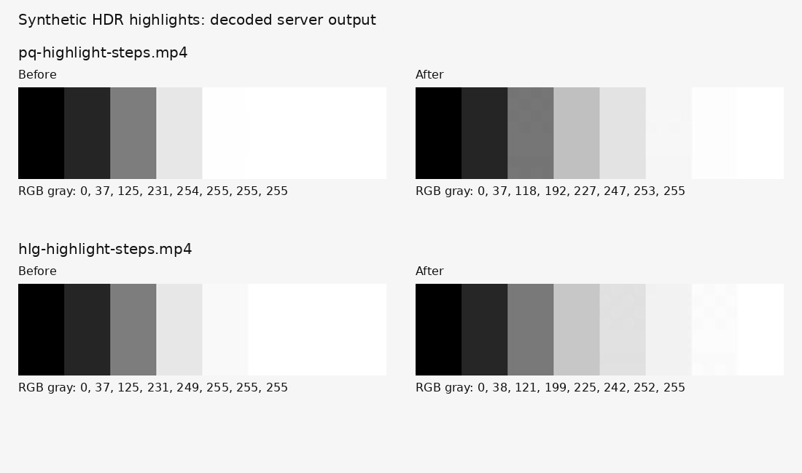

# Server video quality correction — #1710

This is dated validation evidence for the correction built on PR #1709,
`48532ea35a04f86364c11efe6c4c8c19b16b6d0f`, on 2026-11-09. The supplied device
screenshots motivated the investigation; only synthetic media was used in this
repository. Their different timestamps do not provide a measured comparison of
the user's original recording.

## Reproduced causes and selected correction

The pinned FFmpeg identifies the linear floating-point intermediate as RGB.
Its native `tonemap` highlight-desaturation code resolves luminance coefficients
from that matrix. RGB returns (1,1,1), whose sum is three, so even neutral bright
pixels are brightened/desaturated. The previous known-color fixture did not
exercise neutral highlight steps. `setparams=colorspace=bt709` immediately after
the actual linear BT.709 gamut conversion supplies the intended luminance
weights without changing the samples or pretending the transfer is already SDR.
The existing restricted build now enables this native filter.

The preceding transfer-to-linear stage also means a metadata-free PQ frame can
reach `tonemap` without its source-specific peak fallback. Resolve bounded
MaxCLL/mastering luminance from the selected primary stream and first decoded
frame, before conversion. Use the source-specific standard fallback when absent.
Reinhard 0.5 preserves highlight headroom while retaining the existing known-color
bounds; an evaluated Hable conversion darkened those midtones excessively.
Final SDR quantization uses dithering. Metadata removal and complete output
validation remain mandatory.

Source review: pinned FFmpeg
[`vf_tonemap.c`](https://github.com/FFmpeg/FFmpeg/blob/946fcce07b6dcd0331c8cc609192aeff5e1924f8/libavfilter/vf_tonemap.c),
[`csp.c`](https://github.com/FFmpeg/FFmpeg/blob/946fcce07b6dcd0331c8cc609192aeff5e1924f8/libavutil/csp.c),
and [`colorspace.c`](https://github.com/FFmpeg/FFmpeg/blob/946fcce07b6dcd0331c8cc609192aeff5e1924f8/libavfilter/colorspace.c).
No upstream codec source is modified by this correction.

The previous 4 Mbit/s target also discards detail in complex moving 1080p
recordings. Retain OpenH264's quality mode with an 8 Mbit/s target, 10 Mbit/s
peak setting, QP 18–32 and no skipped encoder frames. Compatible <=1080p SDR
H.264 stays on the lossless remux path. The 30 fps conversion, 250 MiB/180 s
input/output limits, gallery publication checks, 768 MiB process address space,
600-second total deadline, isolated role and original cleanup remain binding.

## Actual decoded evidence

The PQ fixture spans 0–10,000 nits; the HLG fixture spans 0–1,000 nits. Values
below are neutral RGB levels sampled from the actual sanitized output poster.

| Synthetic recording | Before | After |
| --- | --- | --- |
| PQ neutral steps | 0, 37, 125, 231, 254, 255, 255, 255 | 0, 37, 118, 192, 227, 247, 253, 255 |
| HLG neutral steps | 0, 37, 125, 231, 249, 255, 255, 255 | 0, 38, 121, 199, 225, 242, 252, 255 |

The final tests require neutral channels, preserved blacks/midtones, strict
highlight ordering and at least seven code values across the top three steps.
A separate PQ fixture verifies first-frame MaxCLL; pure cases cover rational
mastering luminance, precedence, invalid metadata and selecting the canonical
video stream rather than an attached cover.

The moving 1920×1080/30 fps fixture lasts one second and contains seeded
synthetic detail/noise. Compare the decoded source and sanitized frame at 0.5 s,
exported by the same JPEG encoder at quality 2. The RGB PSNR is an inexpensive
regression metric for this fixed fixture, not a universal perceptual score.

| Measurement | Before | After |
| --- | ---: | ---: |
| Decoded-frame RGB PSNR | 37.8169 dB | 41.5532 dB |
| Sanitized MP4 size | 487,919 bytes | 982,990 bytes |
| Median complete processing, three runs | 0.8116 s | 0.9113 s |
| Original upload size | 1,244,179 bytes | 1,244,179 bytes |

The new test requires at least 40 dB. The two neutral HDR tests and this detail
test all fail with the unchanged #1709 runtime and pass with the correction.
The existing color, portrait/rotation, audio preservation, malformed input,
metadata, duration, full-decode and poster-failure cases are retained. A remux
regression compares decoded pixels; encoded packet identity would incorrectly
forbid the existing deliberate SEI removal.

## Environment and reproduction

The measurements use the repository-pinned FFmpeg, OpenH264 and zimg source
archives with verified SHA-256. Local acceptance builds use generic C++ codec/
color implementations and the available C++ runtime, not the production SIMD/
static-link image. A separate local diagnostic binary enabled raw frame output
and showinfo solely to locate the brightness error. Those diagnostics are not
enabled in the shipped build. Python 3.12.14 is within the declared >=3.12
range; hosted CI verifies its pinned Python and exact restricted image build.

This is a tiny local processing sample. It does not measure a physical device,
production hardware, network upload speed or the worst-case 4K/three-minute
budget. Higher output quality uses more stored/playback bytes. Originals still
transfer directly, without local re-encoding or another pre-upload wait.
Background progress, immediate parent save and placeholders keep their existing
lifecycle. Historical sanitized videos need an original re-upload to recover
already discarded information.

Generate fixtures with `tools/media/generate-video-quality-fixtures.py`; see
`docs/DEPENDENCIES.md` for provenance. Run the existing dedicated Media Video
workflow, or supply the restricted binary paths as `EIMIR_TEST_FFMPEG` and
`EIMIR_TEST_FFPROBE` to `backend/tests/unit/test_video_processing.py`.
The [raw measurements](evidence/1710-video-quality/measurements.json) retain
three processing samples per version. All media and images here are synthetic;
no screenshot or recording from the Product Owner is committed.
