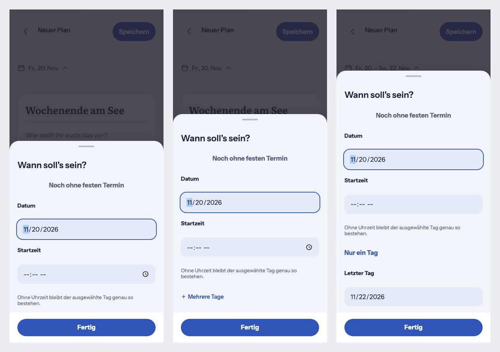
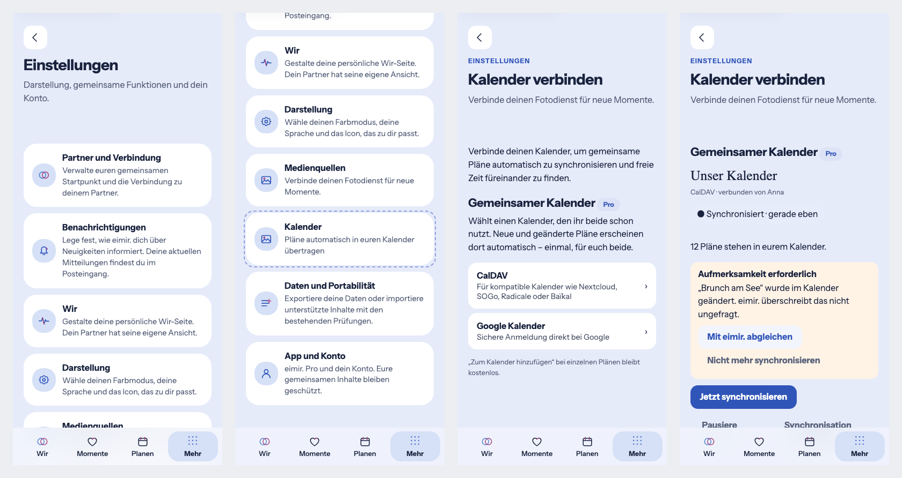
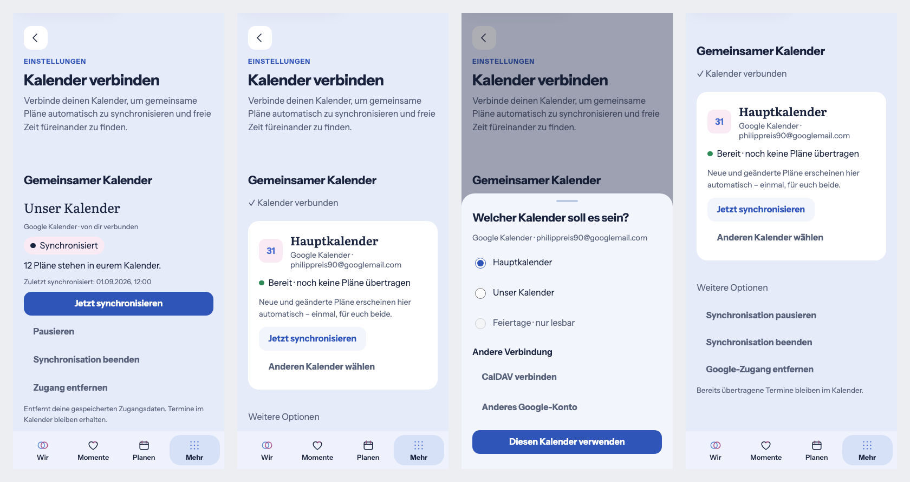
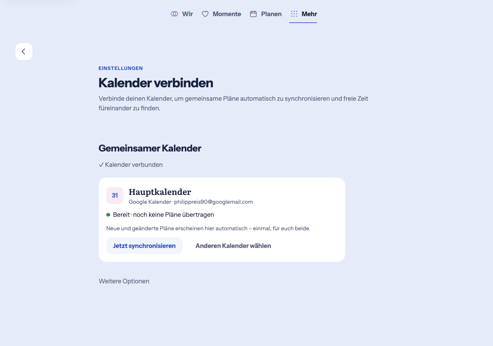

# Calendar integration: preflight and delivery contract

Owner: [#1895](https://github.com/baerenmarke90/eimir/issues/1895).
Baseline `main`: `146708719e469f1d86656e632c7c4145ee1bc3c3` (2026-11-15).

The Product Owner requested on 2026-11-15 a provider-neutral calendar
integration: an improved Free calendar handoff (PR A), automatic Pro sync to
one shared target calendar per Space over CalDAV and Google Calendar (PR B).
Shared availability is optional and **not commissioned**; it is recorded in
the issue only.

## PR A – calendar handoff (Free/Core)

### Reviewed baseline

Before the reference and before UI code: the focused Plan composer
(`PlanningCreatePage`, `/plan/plans/new`), the shared schedule sheet
(`PlanScheduleFields`) with date, optional start time, optional end time and
"ends another day", Plan detail editing, Wish→Plan conversion
(`WishProductPage`) and the shared Wish selection (`WishSelectionPage`), the
schedule summary (`planScheduleLabel`), Today agenda rows, discreet
presentation (`calendarPresentation`) and `PlanCalendarAction` with its native
Android bridge (`PlanCalendarPlugin`/`PlanCalendarIntent`) and the browser
`.ics` share/download.

### Generated visual reference

Left: the unchanged current schedule sheet from the real app (mocked API, 390 px,
Light) with a selected day. Middle: the same sheet with one add action for a
last day below the time hint, shown only while no start time is set. Right:
the disclosed last-day field; the summary reads as a period. This session has
no image-generation model, so the reference was composed from the real running
app plus DOM composition with existing components (the documented fallback of
#1816/#1892). It is composition guidance, not a pixel lock.

### Mobile Interaction Contract

| Concern | Contract |
| --- | --- |
| Outcome | Plan a weekend or a trip without inventing times, and hand it to any calendar app. |
| Relationship value | A shared getaway reads as one experience, not three separate days. |
| Placement / template | Existing schedule sheet in the Plan composer, Plan edit, Wish→Plan conversion and shared Wish selection. No new screen. |
| Primary Compact state | Date → start time (optional) → add action "Mehrere Tage" (only without a time) → "Fertig". |
| Dominant action | "Fertig" stays the single primary action of the sheet; the last day is an optional add action using the shared AddAction presentation. |
| Hierarchy | First day, optional time, optional last day; the trigger summary shows the period. |
| Immediate vs. disclosed | First day immediate; last day behind the add action; disclosure can be removed again (`m5s3.plan.removeLastDay`). |
| Pattern | Existing bottom sheet with native date inputs; no custom picker. |
| Loading / empty | Not applicable inside the sheet; an undated Plan stays valid. |
| Error | A last day before the first day is blocked inline by native `min` and a field error, the sheet stays open and focus moves to the field. |
| Offline | Unchanged composer behaviour: nothing is saved until the server confirms. |
| Success | The saved Plan detail and all overviews show the period; the calendar handoff produces an all-day event over the inclusive days. |
| Privacy | Discreet Plans keep exporting only the list title and the schedule. |
| Large text / narrow | 320 px reflow and 200 % text keep the stacked labelled fields; 44 px targets. |
| Motion | The existing sheet and disclosure motion; reduced motion removes translation. |
| Expanded | Same sheet content inside the bounded composer width. |
| Typing avoidance | Native date picker only; the last day defaults to the first day + 1. |
| Browser-only controls | None added. The browser `.ics` share/download stays hidden in the native app (existing runtime check). |

### Handoff contract

- All-day: `DTSTART;VALUE=DATE:<first>` and exclusive `DTEND;VALUE=DATE:<last+1>`;
  the native bridge receives UTC-midnight start and an end N≥1 whole days later.
- Timed: exact UTC instants; cross-midnight and DST changes are preserved.
- One-time copy: never described as synchronisation; no account needed.

## PR B – automatic sync (Pro)

### Reviewed baseline

Settings index (`/more/settings`, `SettingsIndex`), the media category with the
Immich (`PhotoSourceSettingsPanel`) and Google account panels as the existing
pattern for a personal external connection (consent sheet, Pro mark, calm
Free explanation linking the shared Pro paywall), `ProPaywallPage` contexts,
`useSpaceCapability`, `ShortTaskSheet`, `UiState`/`ProblemState`, Plan detail
(`PlanProductPage`) with `PlanCalendarAction`.

### Generated visual reference

1 current settings index; 2 the new "Kalender" category after "Medienquellen";
3 Pro state without a connection: one-sentence purpose, the shared calendar
heading (`calendarSync.sharedHeading`), CalDAV and Google Calendar as two full-width choices, a note that
the one-time handoff stays free; 4 connected: the shared calendar name as the
focal point, provider and who connected it, a status pill, an attention block
for an externally changed event with two deliberate choices, the single
primary action `calendarSync.actions.syncNow` and quiet pause and end actions.
Composed from the real running app (mocked API, 390 px, Light) plus
DOM composition; the lead line under the heading is a leftover of the media
page and is replaced by the category intro (`calendarSync.settingsIntro`).

### Mobile Interaction Contract

| Concern | Contract |
| --- | --- |
| Outcome | Plans appear in the calendar the couple already uses, without copying them by hand. |
| Relationship value | One shared source of "when"; less coordination effort, more time together. No pressure, no streaks. |
| Placement / template | New Settings category "Kalender" (`/more/settings/calendar`), utility template like the other settings categories (R5 calm utility). No new tab, no dashboard. |
| Primary Compact state | Not connected: purpose → provider choice. Connected: calendar name → provider/sponsor → status → attention (if any) → sync now (`calendarSync.actions.syncNow`) → pause/end. |
| Dominant action | Not connected: choose a provider. Connected: sync now (`calendarSync.actions.syncNow`). Destructive/secondary actions are tertiary. |
| Immediate vs. disclosed | Status and conflicts immediate; server address, username and app password only inside the CalDAV sheet; technical error detail never shown (fixed localized reasons). |
| Pattern | CalDAV: one `ShortTaskSheet` task (address → username → app password → consent → `calendarSync.caldav.check`), then a single-choice calendar list (radio group) with `calendarSync.choose.confirm`. Google: an OAuth handoff in the system browser (PR B2). |
| Loading | Calm `UiState` line; connect/check shows a pending button state and blocks duplicate submission. |
| Empty | Pro without connection: provider choice. Free: one calm value explanation with Pro mark and a link to the shared paywall (`/more/pro?context=calendar`); nothing else is requested from providers. |
| Error | Localized reasons for wrong credentials, no calendar found, not writable, unreachable/timeout, blocked address, TLS; input stays in the sheet. |
| Offline | Settings read stays visible from cache where available; actions are disabled with the existing offline notice. Sync itself runs on the server independent of devices. |
| Success | `calendarSync.connected.title` with `calendarSync.connected.body` and the connected state; success only after the server confirmed the target. |
| Status vocabulary | `calendarSync.status.*`: synced, running, broken (connection interrupted), attention (attention needed), paused, proPaused. |
| Plan detail | Below the one-time handoff action, one quiet line from `calendarSync.plan.*` (in the shared calendar / being transferred / changed in the calendar with a link to the calendar settings). Only when a target exists. |
| Privacy / relationship | Credentials and the connection label are visible only to the sponsor; the partner sees calendar name, provider, sponsor name and status and may pause or end sync. Discreet Plans sync only list title and time. |
| Large text / narrow | Single column, wrapping labels, 44 px targets, 320 px reflow, 200 % text. |
| Motion | Status pill cross-fades on change; sheet motion as existing; reduced motion removes translation. |
| Expanded | Same order in the bounded reading width; no table or columns. |
| Typing avoidance | Typing only where unavoidable (CalDAV address/credentials); `type="url"`, `autocomplete="username"`/`current-password`, no keyboard before the sheet opens; Google needs no typing. |
| Browser-only controls | None; the Google handoff uses the system browser on Android and the same tab on the Web. |

Why a list: the calendar choice is a single-select of the person's own
calendars (radio group), a bounded utility decision, not a record table.

### PR B2 – Google Calendar consent

Google appears as the second provider choice of reference panel 3 once the
operator configured the OAuth client. Choosing it opens Google's consent in
the same tab (Web, corrected 2026-11-15: the server redirects back to the
calendar settings with a fixed outcome) or the system browser (Android app)
through the shared, host-allowlisted opener. The app registers
`de.eimir.app://calendar/google`; the server redirects there with the same
fixed outcome, the app closes the browser and opens the calendar settings with
the confirmation. Older app builds keep the localized return page. Back in eimir., one
confirmation block (`calendarSync.google.confirmTitle`) shows the Google
account address with a primary confirm and a quiet cancel; only then the
existing calendar-choice sheet opens. This explicit confirmation is a
deliberate addition to the reference: it replaces a browser-binding cookie,
which cannot work across the app/system-browser boundary, and makes the
account that will receive the Plans visible before anything is written.
Evidence: [confirmation at 390 px](references/calendar-integration/evidence/calendar-sync-google-confirm-390-light.png).

### Connected state correction (Product Owner, 2026-11-15)

After the first live Google connection the Product Owner rejected the connected
state: the Google primary calendar showed the account address as its title, the
success block stayed, the primary button spanned the page, actions were
scattered, and there was no way to choose another calendar without ending sync.

Approved direction (composed from the running app, 390 px and 1280 px, Light):

| Concern | Contract |
| --- | --- |
| Focal point | One card for the shared calendar: calendar mark, name (`calendarSync.primaryCalendar` for a provider's primary calendar), provider and, for the sponsor only, the account label; the partner sees who connected it. |
| Status | One honest line: ready with nothing transferred yet, syncing, synced with the last success, or a problem; never "synced" before a Plan was confirmed. |
| Actions | Inside the card, content width: sync now (secondary) and choose another calendar (tertiary). |
| Choose another calendar | The existing bottom sheet lists the current connection's calendars and offers "another connection" (CalDAV, another Google account). |
| More options | Collapsed disclosure: pause/resume, end sync with confirmation, remove the provider access (sponsor only). |
| Success | A short, dismissing confirmation line instead of a persistent block. |
| Google return | On the Web the consent runs in the same tab and returns to this page with the confirmation; the Android app closes the system browser through its `de.eimir.app://calendar/google` link and opens this page with the confirmation. |
| Expanded | Same order, card bounded to the reading width, no full-width buttons. |
