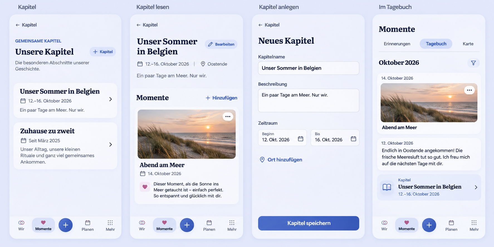

# Chapter experience and diary markers

Owning issue: [#1635](https://github.com/baerenmarke90/eimir/issues/1635).

## Reviewed baseline and coordination

Current main: `52d2eeda39f11d430d01676de93ebe11c92a6567`.
Parallel work: [#1634](https://github.com/baerenmarke90/eimir/issues/1634), branch
`fix/complete-moment-experience`, inspected head `ad0ba864984fecfcd0e8e853b26f9cc1be6be4fa`.
Its declared scope includes Discover layout, common native date/pagination/cache
behavior and Memory-to-Plan/Wish relations. This slice has a separate worktree
and branch, `feat/chapter-experience`. Recheck shared paths and current refs before
claiming integration compatibility. No merge or publication is authorized here.

## Generated visual preflight

Generated before UI implementation with the built-in image tool. The exact prompt
is in [reference-prompt.txt](reference-prompt.txt). This is a composition reference
using synthetic content, not runtime acceptance evidence. The historical
place-moment-picker Chapter screenshot supplied the existing palette and shell
grammar; current main source governs newer headerless Compact behavior.

Reviewed actual destinations and contracts: ChaptersOverviewPage, ChapterCreatePage,
ChapterProductPage, PlanningRelationManager, StoryProductPage, StoryList, typed
chapter relations, task origin/editor lifecycle, native date fields and tokens.
Product Reference v1 R1/R2, Screen Templates 4/9/11 and existing selection/task
contracts apply. Retain all supported title/description/date/place/edit/delete/
link capabilities. Personal titles and authored words lead; linked media remains
media of its original source. No custom chapter cover or fabricated count.

## Mobile interaction contract

Overview uses directly openable, readable chapter titles, optional description
excerpts and complete/open date ranges. Detail composes meaningful date/place
context with authored words and authorized moments. Absent optional metadata
does not create empty panels. Add belongs above linked content; removing a link
is a deliberate contextual action that retains the source.

Creation uses existing protected task lifecycle, title, optional authored prose,
native start/end dates and a singular Place choice. No date is invented.
Confirmed save opens the actual result. Dirty/pending exits, offline admission,
retained failures, conflict handling and account/Space ownership use existing
contracts. Browsing does not expose permanent editing controls.

Compact is normative. Expanded keeps the same hierarchy with useful reading
width. Long text reflows; targets and focus remain reachable. Existing causal
motion and reduced-motion behavior apply. Loading, empty, failed, offline,
pending and confirmed success remain distinct.

## Diary projection

Exactly one marker appears at an authored start date. End date is descriptive;
undated and end-only chapters have no invented diary position. Overlapping
chapters are independent. Explicit links select contents; date overlap never
creates links. Open/back restores the diary scope and position.

Keep ordinary StoryKind/StoryItem and Discover unchanged. The diary opts into
an additive chapterMarkers projection, with one authorized union, stable keyset
cursor and combined page limit. Year/type scope and marker-only pages must remain
correct. Source dates, privacy and typed relation boundaries are unchanged.
Chapter mutations invalidate applicable query and retained snapshot data.

## Reuse, business model and quality

Reuse existing authorized Chapter projections, timeline pagination, TanStack
query ownership, TaskBackButton/useTaskEditorLifecycle, task origin,
NativeDateField, PlaceChoicePicker, ShortTaskSheet and authorized moment previews.
A chapter period helper is a bounded shared presentation contract, not a generic
card framework. No new provider, cache, dependency or native UI.

No business/freemium impact: standard Chapter CRUD/relations and diary history
remain Free/Core under the matrix. No custom covers, bespoke user-configurable
magazine composition or narrative export is introduced.

Retain membership/Space isolation, encrypted reads, private-source exclusion,
If-Match, stale-owner guards, date-only meaning, localized copy, accessible
controls and bounded per-page work. No database-owned duplicate marker records
or additional notification side effects.

## Implementation and acceptance evidence

The overview now reads as authored chapter destinations with description excerpts
and complete/open periods, without per-card detail requests. The reader omits
absent context, retains an actionable authorized Place, and gives linked moments
room to lead. Add is above those moments; the existing shared contextual action
sheet now handles Place and Chapter unlinking with the source-retention consequence.
The same protected task lifecycle and native context fields serve chapter capture
and correction. A dirty or pending correction uses the focused shell and hides
linked-source destinations until the editor closes, so root navigation cannot
bypass draft protection. The selected Place remains a singular explicit reference.

The diary opts into `includeChapters`; ordinary StoryKind/StoryItem, Discover,
photo flows and relation choices retain exactly their existing content kinds.
One authorized SQL union supplies the combined keyset cursor/page limit. Only an
authored start contributes a marker/year. Marker positions preserve the exact
server order, including sub-millisecond creation ties that JavaScript Date cannot
represent; clients never re-sort the combined chronology. The projection adjusts
positions if a source becomes unreadable between query and authorized projection.
Loaded-page aggregation prevents duplicates and normalizes retained positions.

The existing Timeline return implementation was extracted as useTaskListReturn
and reused by the diary, annual archive and Chapters overview. It retains validated
origins, loaded range, layout-coordinate restoration and focus semantics. Chapter
mutations revoke derived Story snapshots through the existing cache store and
invalidate the affected diary/year queries. Late reads cannot repersist revoked
snapshots. Account/Space task ownership, online write admission and If-Match remain
binding. The shared cache's existing generation wipe is the failure fallback;
a storage failure cannot present a confirmed create as a failed creation.

Local checks on the implementation source (the resulting PR records its exact
commit and subsequent CI evidence):

- Web: 2,607 tests passed, two pre-existing tests skipped. Typecheck, lint,
  formatting, token/PWA checks and production build passed.
- Backend: all 1,284 unit tests passed, with 28 existing skips. PostgreSQL
  integration tests are collected but skipped locally because no test database
  is available. Ruff and mypy passed for all runtime modules. The explicit
  query/cursor manifest includes the optional includeChapters projection.
- Browser selection: 38 planning regressions passed; inventory remains valid.
  Nine new feature-scoped browser cases cover complete create/read/edit/link/
  unlink/return/delete, failed saves/conflicts, marker-only pagination and years,
  plus Compact 360/390/430, Expanded Light/Dark and 320px large-text/reduced-motion
  states. Collection/typechecking is not browser execution.
- The versioned OpenAPI contract and Web client were regenerated with the
  repository's generator version 7.24.0. The container-based CI drift check remains
  authoritative; this environment has no Docker executable.
- The identity scanner retains the exact generated reference prompt. A narrow,
  path-bound linguistic classification recognizes its adjacent-screen description;
  branding and active-code occurrences remain rejected. All 20 identity scanner/
  migration regressions pass and the complete scan has no MUST_RENAME findings.

The pinned Chromium download produced an invalid archive in this environment.
Actual current-source browser execution, screenshots and PostgreSQL acceptance
must therefore complete in CI before final review. The generated reference is
composition guidance, not implementation evidence. The PR Validation section owns
live results, source screenshots, remaining findings and exact tested revisions.

## Parallel integration boundary

The latest refresh keeps main at `52d2eeda39f11d430d01676de93ebe11c92a6567`.
#1634's implementation is now published as draft PR #1637, head
`9d4a00667df0ba10ac670469594ebd0e618ba0be`. A dry merge against this PR's first
implementation identifies four textual conflicts: browser inventory/impact,
ChapterCreatePage and ChaptersOverviewPage. It also exposes a semantic conflict
that Git does not flag: both branches add ProductReadCacheStorage.removeKind with
different argument orders and duplicate IndexedDB implementations.

Before combining, retain one account/Space-scoped removeKind contract and migrate
the shared-list revocation call to it; preserve both the list-generation lease
and this PR's derived-Story revocation stamp. Keep the protected Chapter editor
and NativeDateField (which already delegates to NativeDateInput), and apply #1637's
useWarmInfiniteQuery/AutoLoadMore to the refreshed overview and annual diary.
Preserve both inventory entries and re-run the browser planner, typecheck, cache
ownership tests and affected Chapter/Story journeys on the actual combined tree.
The other shared diffs auto-merge, but that is not product acceptance.

## Integrated acceptance, 2026-11-04

The Product Owner authorized merging #1637 first and then #1636. The integration
includes #1637 at `87fb7271badba9cbbe537e3bb5ad8c597518656d` and the Chapter
implementation at `ff82ee84b05aa3c14aecad09d9452ec3a41b568d`. The earlier parallel
boundary above records the diagnosis; this section records its resolution.

Both browser inventory entries and their production roots are retained. The
protected Chapter editor, task-origin return and shared native date field remain.
The refreshed overview uses the shared warm infinite-query and automatic-loading
primitives without losing cancellation, loaded-page return or focus restoration.
The cache now has one Account/Space/kind removal contract, preserving both the
shared-list generation lease and the derived-Story revocation stamp. A regression
verifies that revoking both groups rejects late writes while retaining unrelated
source details. No business/freemium classification or source authority changes.

Two acceptance-fixture corrections preserve the complete journey: linked Memory
details supply the required body, and annual Chapter pagination uses the same
automatic scroll interaction as the product. Counts, unique identities, return,
destructive consequences, ownership and accessibility assertions remain.

- The full Web suite passes with the CI Node 24.21.0 runtime: **2,623 passed,
  two existing skips** across 294 files. An initial Node 22 run exposed an
  incompatible jsdom Blob/Undici Response fixture; the unchanged avatar test and
  full suite pass under the actual CI runtime. No product/test workaround added.
- **20 complete affected browser cases pass** across Chapters, legacy capture,
  the shared Place/Chapter moment picker and device-review links/labels. The
  current-source sweep passed 19; its long create/read/unlink/edit/diary/delete
  journey reached the test budget while competing with the full unit suite.
  Trace evidence showed document loading consuming that budget. The complete
  unchanged journey then passed alone in 18.7 seconds. No timeout, retry, assertion
  or interaction delay was changed. The earlier integrated-source sweep passed
  all 20 together.
- TypeScript, lint, formatting, token/PWA checks and the production Web build
  pass. The changed browser spec typechecks; all **38 browser planner regressions**
  and the **89-spec inventory** pass. The final PR records current collection and
  hosted results. PostgreSQL and generated-client drift remain authoritative CI
  checks for the final integrated revision.

The following current-source captures use synthetic content and the pinned
Chromium 151.0.7922.34. Overview, reader and diary are reviewed at each size;
the browser journeys also verify open/interact/save/result/return, dirty/pending
navigation, conflicts, marker-only pages/years and accessible reflow.

| State | Overview | Reader | Diary |
| --- | --- | --- | --- |
| Compact 360 Light | [View](evidence/story-chapter-360-light-overview.png) | [View](evidence/story-chapter-360-light-detail.png) | [View](evidence/story-chapter-360-light-diary.png) |
| Compact 390 Dark | [View](evidence/story-chapter-390-dark-overview.png) | [View](evidence/story-chapter-390-dark-detail.png) | [View](evidence/story-chapter-390-dark-diary.png) |
| Compact 430 Light | [View](evidence/story-chapter-430-light-overview.png) | [View](evidence/story-chapter-430-light-detail.png) | [View](evidence/story-chapter-430-light-diary.png) |
| Expanded 1280 Light | [View](evidence/story-chapter-1280-light-overview.png) | [View](evidence/story-chapter-1280-light-detail.png) | [View](evidence/story-chapter-1280-light-diary.png) |
| Expanded 1280 Dark | [View](evidence/story-chapter-1280-dark-overview.png) | [View](evidence/story-chapter-1280-dark-detail.png) | [View](evidence/story-chapter-1280-dark-diary.png) |
| 320, 200% text, reduced motion | [View](evidence/story-chapter-320-light-large-reduced-overview.png) | [View](evidence/story-chapter-320-light-large-reduced-detail.png) | [View](evidence/story-chapter-320-light-large-reduced-diary.png) |

The GitHub PR owns live validation and merge state. Publication is outside this
task; these ordinary Web changes introduce no new native platform capability.

### Confirmed deletion and editor history

The final hosted integration sweep exposed a real return race after a confirmed
Chapter deletion. The editor owns a same-route Back entry. Returning to the diary
before retiring that entry could consume only the editor step, leaving the reader
on the deleted Chapter; its new read then correctly returned 404. Both hosted
attempts failed, and the unchanged full journey reproduced the race locally.

Deletion completion now uses the existing confirmed editor-close primitive before
removing the detail query and returning to the captured origin. Account/Space
activation and exact authorized-query admission are checked again inside that
completion callback. The fallback overview and successor-focus contract remain;
dirty/pending user exits retain their existing protection.

A regression uses BrowserRouter, the actual editor history entry, an authorized
diary origin with its year scope, and a deleted source that rejects later reads.
All 18 focused Chapter/editor/history unit checks pass. The unchanged complete
create/link/read/unlink/edit/diary/delete journey passes five consecutive runs
after the correction. The full Chapter/browser and exact final-head hosted
results are recorded in PR #1636. No position bound, timeout, retry or permission
assertion is relaxed.

The same hosted integration run exposed a 30-second budget overrun in the existing
320px gentle-prompt scenario. Its saved-consent and invitation-use portions now
form two complete journeys at each of the same five viewport/theme variants.
The first retains failed-save recovery, successful consent, reload persistence,
the resulting Today invitation, both accessibility scans and screenshots. The
second starts with that persisted server consent and retains dismissal/focus,
reload persistence, a later occasion, the blank composer, receipt bound and
consumed-invitation absence after another document load. Every existing assertion
remains, with the same 30-second test and five-second expectation limits.

All ten journeys pass without retries, taking 13.3–16.5 seconds each while the
complete Web suite runs alongside them. Browser ownership and selection remain
on the same 89 complete specs. The five extra case boundaries introduce no new
feature variants or repeated global feature acceptance; they isolate the two
existing contracts so document loads and accessibility work cannot consume each
other's normal test budget.

The hosted sweep also repeated a pre-existing quote-settings budget overrun.
Its order/visibility persistence and failure/recovery portions now run as two
complete journeys. The first follows the actual primary navigation into Today
and retains both settings and Today reload checks. The second retains the full
failure width, accessibility, retry, enabled-control and alignment assertions.
Both complete journeys pass twice without retries, taking 9.4–13.9 seconds each.
This adds one further case boundary with the same normal timeouts. Actual final
collection is 1,021 cases rather than 1,015, on the same 89 owned specs and feature
variants. The owning PR records the planning checks and final hosted result.
