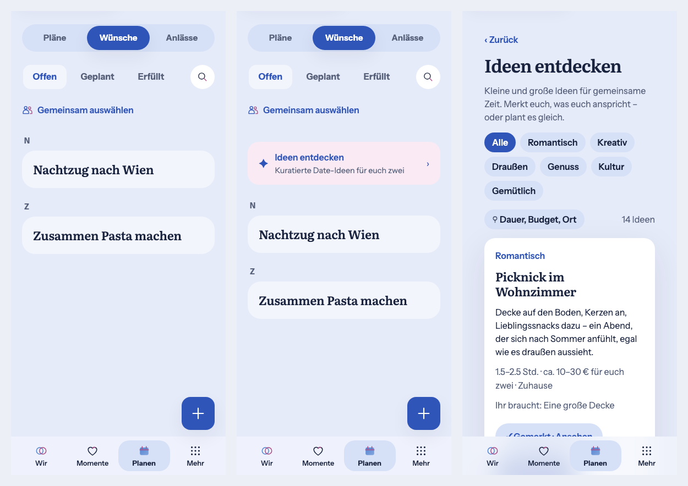

# Date inspiration (Pro): preflight and delivery contract

## Product decision and baseline

The Product Owner requested a mobile-first, Pro-only date inspiration under
Plan → Wünsche on 2026-11-14: curated ideas with filters, saving an idea (`dateIdeas.card.save`)
through the existing Wish workflow and planning it (`dateIdeas.card.plan`) through the existing Plan
composer. The whole discovery (catalog read, browsing, filters, adopting an
idea) is eimir. Pro. Existing Wishes and Plans stay Free/Core.

Baseline `main`: `58adc37d63b3c5edb6c7ff22d7e2e7700fa6db92`. Reviewed before the
reference and before UI code: the `/plan` hub with Pläne/Wünsche/Anlässe
segments, Wünsche scope (Offen/Geplant/Erfüllt), search, the compact
shared Wish selection entry (#1535), the floating create action, Wish detail
and canonical Wish-to-Plan conversion, the focused Plan composer
(`PlanningCreatePage`), task origins/return, `useSpaceCapability`, Pro marks and
the Daily Quote/Games discovery patterns, AddAction, StatusScope, UiState/
ProblemState, motion tokens and i18n resources. Related open issues #465
(Blind-Match), #469 (Irgendwann-Maschine) and #487 (Date-Experience-Modi) are
not implemented here; the catalog is a reusable source for them later.

## Generated visual reference

Left: the unchanged current Wünsche segment from the real app (mocked API,
390 px, Light). Middle: the same screen with the new entry beneath
the shared Wish selection entry. Right: the focused discovery view. This session has no
image-generation model, so the reference was composed from the real running
app plus DOM composition using the existing tokens (the documented fallback
used for #1816). It is composition guidance, not a pixel lock: real components
replace the placeholder glyphs; existing segments, search, scope, the selection
entry, the floating create action and the bottom navigation are preserved.

## Mobile Interaction Contract

| Concern | Contract |
| --- | --- |
| Outcome | Find an appealing shared experience and keep it as a Wish or plan it now, without typing. |
| Relationship value | Anticipation and a low-effort "let's do this" moment; no scores, streaks or pressure. |
| Placement / template | Entry in Planen → Wünsche (Offen scope) next to "Gemeinsam auswählen"; focused subpage `/plan/ideas` (Plan Hub → Detail/Discovery). No new navigation, no dashboard area. |
| Primary Compact state | Back → title and one-sentence intent → category chips → duration/budget/setting disclosure (`dateIdeas.filters.more`) with active-filter count → result count → idea list. |
| Dominant action | Per idea: `dateIdeas.card.plan` (shared AddAction link) opens the existing Plan composer prefilled with `planTitle`, or — for an idea already saved as a Wish in this session — the canonical Wish-to-Plan conversion of that Wish with `planTitle`. `dateIdeas.card.save` is the lighter action and opens the existing Wish composer prefilled with `wishTitle` and the description. Nothing is saved before the couple confirms in the composer. |
| Hierarchy | Category → title → emotional description → duration/budget/setting line → requirements → actions. |
| Immediate vs. disclosed | Categories immediate; duration, budget and setting behind one disclosure. Active filters are always summarized outside the collapsed area with a reset. |
| Pattern | Subpage; native buttons with `aria-pressed` single-select chips per group, AND across groups, instant client-side filtering of one catalog response. |
| Loading | Skeleton-free calm loading state (`UiState`), stable layout reserved for the list. |
| Empty / no match | `dateIdeas.empty.title` with one reset action and a hint to loosen a filter; never a blank page. |
| Error / offline | `ProblemState` with retry; offline keeps a cached list visible with the cache notice. Writes happen only in the existing composers, which keep their offline/retry and idempotency behavior. |
| Success | The composer saves an ordinary Wish or Plan and opens its actual detail; Back returns to the ideas with filters, scroll and focus. A Wish created from an idea is remembered for this session only, so the card then shows `dateIdeas.card.saved` and plans through that Wish. |
| Free | One calm value explanation with a Pro mark and a deliberate link to the shared Pro paywall (`/more/pro?context=dateIdeas`); no catalog request, no modal, no repeated paywall. |
| Privacy | Only the shared catalog and which open Wishes reference an idea. No click, rejection or partner-content analysis; no external transfer. |
| Large text / narrow | 320 px reflow, 200 % text, wrapping chips and actions, 44 px targets. |
| Motion | Tokenized fade/lift for list changes and save confirmation; reduced motion removes translation and keeps all state. |
| Expanded | Same order and one column in the bounded reading width (`--reading-max`), starting at the leading edge. No table, extra columns or management UI. |
| Return | Back returns to Wünsche with scope and scroll (task origin). Composer and Wish detail return to the ideas view with filters intact. |
| Browser-only controls | None. |

Why cards: each idea is an independently meaningful unit with its own actions,
which satisfies "a card must earn its boundary". The list is a discovery
collection, not a record table.

## Data, entitlement and catalog architecture

- Capability `planning.date_inspiration` (central `Capability` enum; every
  all-Pro grant includes it). Server-side gate on `GET /spaces/{id}/date-ideas`
  only; one Space grant serves both partners. No new check on Wish or Plan
  endpoints. The catalog is never a public or bundled client asset.
- Catalog: the editorial handoff `eimir-date-ideas.v1.json` (200 ideas, de/en,
  `catalogVersion` 1.0.0) is stored verbatim as
  `backend/pro/src/eimir_pro/date_ideas/data/catalog.json`. Its format is the editorial
  [JSON Schema](../../../backend/pro/docs/date-inspiration/catalog.schema.json); the Pydantic models
  mirror it and additionally require unique IDs. `backend/pro/pro_scripts/date_ideas_catalog.py validate|import`
  re-checks any revision and rejects files that would drop a persistent ID.
  IDs stay stable across translations, copy edits and reordering.
- Filters: category, `maxMinutes` and `maxBudget` as inclusive upper bounds
  (presets 20/30/45/60 minutes, free/5/10/20 EUR; 0 EUR means free) and place
  home/out, where no place filter means anywhere. All combine with AND.
- Images: the editorial image handoff (`eimir-date-ideas.images.v1.json`,
  25 WebP files, 1200×800) is bundled with the backend. Each idea shows its
  own image when the manifest has one, otherwise its category image; alt texts
  come from the manifest in the idea's content locale. Images are served only
  by the Pro-gated `GET /spaces/{id}/date-ideas/images/{imageId}`
  (`private, no-store`), held in the Account/Space query cache with the catalog
  (removed on downgrade) and loaded when a card nears the viewport inside a
  reserved 3:2 frame. `pro/pro_scripts/date_ideas_catalog.py validate-images|import-images`
  checks a new image handoff against the catalog version, categories and files.
- Locale: an unsupported locale uses the complete default (German) entry;
  fields of two languages are never combined.
- Adoption: the client prefills the existing composers. "Save as wish" uses
  `createWish` with `wishTitle` and the description; "Plan now" uses
  `createPlan` with `planTitle`, or `convertWishToPlan` with the real Wish ID
  and `If-Match` when the idea was saved as a Wish earlier in this session.
  The existing create receipts (`Idempotency-Key`) protect retries; nothing
  deduplicates by title. Catalog IDs and filter metadata never enter a Wish or
  Plan request, so there is no second data store and no schema change.
- Downgrade and isolation: adopted Wishes and Plans are ordinary content. The
  client removes cached catalog responses as soon as the capability is absent
  or denied; Space changes and sign-out clear the query cache, and the page
  remounts per Account/Space.

## Reuse review

Reused: FastAPI/Pydantic, `ensure_capability`, entitlement service, Wish service
and create receipts, Alembic, generated OpenAPI client, React Router task
origins, TanStack Query, `useSpaceCapability`, ProMark, AddAction, UiState/
ProblemState/OverviewCacheNotice, `assertOnlineWrite`, i18next and Intl
formatting. The catalog follows the existing bundled-JSON pattern of the Daily
Quote sayings. No external content provider, AI service, scraping, location
permission, dependency or infrastructure is added; the curated catalog is
editorial content, which no off-the-shelf component supplies.

## Business/freemium impact reviewed

New matrix row "Date inspiration" classified **Premium** (`planning.date_inspiration`).
Existing Wish & Plan lifecycle stays Free/Core with no entity limits; adopted
content is retained, editable and exportable after expiry; Self-Hosted and Cloud
behave identically (bundled catalog, no managed cost beyond a small read).

## Cross-cutting review

- Security: membership before capability (404 for foreign Spaces), 403 with
  `PREMIUM_ENTITLEMENT_REQUIRED` for Free members, strict request bodies, catalog
  IDs validated against the catalog.
- Privacy: Wish text stays in the protected payload; only the public catalog ID
  is plaintext provenance. No behavioral profile, no logging of choices.
- i18n: all UI copy in de/en resources; catalog content localized with fallback;
  `Intl` for currency and duration.
- Accessibility: native buttons and links, `aria-pressed`, status announcements
  for result counts and saves, headings per idea, focus restoration on return.
- Concurrency: the existing composers' create receipts (`Idempotency-Key`) and
  `If-Match` on conversion; replays return the same Wish or Plan.
- Resilience/offline: cached list with notice; the composers keep their
  existing offline and retry behavior.
- Performance: one catalog request per locale and session (client filters
  locally); exactly 200 ideas in v1; no per-card requests.
- Contracts/migration: additive OpenAPI and generated client; no database
  migration and no change to Wish/Plan write DTOs.
- Operations: catalog ships with the release; no configuration.

## Delivery and evidence

Implemented in the pull request for #1892: the editorial catalog, capability
and Pro catalog API; the Web entry, discovery page and composer/conversion
prefill; the shared Pro paywall ([contract](pro-paywall.md)); the matrix row
and price update (version 1.18). [Runtime evidence](references/date-inspiration/evidence/README.md)
covers Compact 320 (200 % text)/360/390/430, Expanded, Light/Dark, Free and
saved states. No native wrapper change; no Product Owner acceptance is implied.
