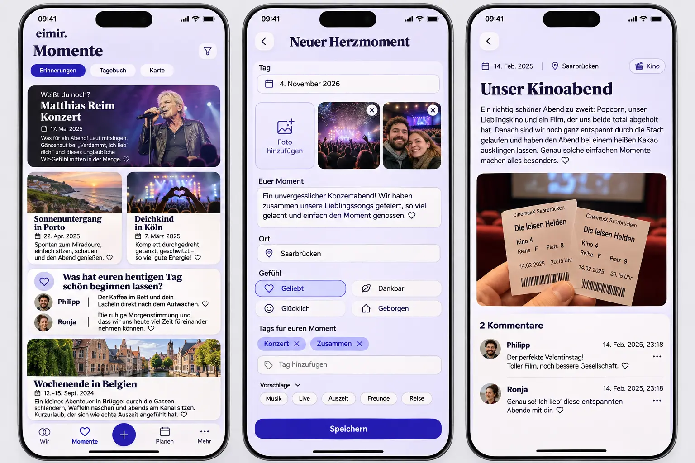

# November 4 device-review acceptance

## Baseline and scope

Inspected main: `52d2eed`. The three Product Owner device screenshots and current
StoryProductPage, MemoryCreatePage, HeartMomentProductPage, CommentsPanel,
SharedPhotosPage, native upload adapter, notification and recap implementations
were inspected before this preflight. This record owns the complete requested
scope; checks below describe observed acceptance, not planned completion.

The generated reference was produced before UI implementation. Its photo content
is illustrative. Existing navigation, tokens, privacy and domain contracts remain
authoritative; this image does not authorize invented fields or capabilities.

## Acceptance checklist

1. [x] Notification onboarding enables Small Invitations after explicit consent;
   Later/denial does not. The existing independent off switch remains effective.
2. [x] System IANA time zone replaces manual normal-user clock/zone settings and
   updates scheduling on foreground/resume without shifting authored calendar dates.
3. [x] Shared Happiness/Time Travel invitations expire and disappear after opening
   the current contribution; later partner contributions can appear again.
4. [x] Existing authorized Wishes and Plans can be linked from a Memory, with
   canonical destinations, explicit save/failure state and typed relations.
5. [x] Monthly invitations expire/are consumed and show their actual period;
   previous-month material is never labelled as current-month material.
6. [x] Discover mixes wide and narrow photo/text cards without vacant half rows,
   preserves source/focus order, and remains usable at large text/narrow widths.
7. [x] Own-comment overflow does not move author, timestamp or row alignment.
8. [x] Video upload transfers actual bytes, reports actual progress/processing,
   cancels safely and exits stalled transfers with an actionable retained retry.
9. [x] Places sort alphabetically across pages and selection surfaces, with
   active/archived/all scopes and encrypted names preserved.
10. [x] Memories has no manual Renew Discovery button; safe rotation remains.
11. [x] Dates use the same native field interaction throughout. Range end says
    “Bis”, uses regular weight and no redundant arrow/Change action.
12. [x] HeartMoment feeling follows Place and precedes the shared tag editor.
13. [x] New-Plan labels omit parenthesized optional markers.
14. [x] Tags learn from authorized authored labels. The existing periodic worker
    and local inference propose labels without silently changing authored content.
15. [x] All paginated product lists load on scroll, including photo settings and
    source selection. Loaded pages and media use bounded account/Space storage,
    stop on errors/offline/end, and survive supported navigation/restart.

## Mobile Interaction Contract

Product Reference v1 R1/R2/R3/R5 and Screen Templates 4/7/8/9/11 apply. People,
photographs and authored words lead. The existing shell, contextual tabs,
ShortTaskSheet, focused capture, native date input and semantic tokens are reused.
There is one dominant completion action. Optional enrichment stays progressively
disclosed; tag suggestions reduce typing and do not open the keyboard by default.
No administrative table/list is introduced for relationship content.

Compact keeps reachable controls and gap-free editorial composition. Expanded
uses meaningful media width and the same task hierarchy. At 320/360/390/430 px
and 200% text, dates/metadata/labels wrap without hiding controls. Non-blocking
existing reveal/feedback motion respects reduced motion. Utility and consent
remain calm; no new decorative delight or pressure copy is appropriate here.

Loading retains safe content. Empty differs from failure. Errors retain drafts
and explain retry. Offline reads use only authorized stored shared data; offline
writes remain unsaved. Confirmed creation precedes relation enrichment, so a
failed link cannot duplicate a saved Memory. Return retains scope/loaded range.
Private HeartMoment material never enters another member's suggestions, derived
data, shared composition or cache. Relationship and account transitions revoke
late completions.

## Reuse review

Reuse Intl/system time-zone detection, native date inputs, IntersectionObserver,
TanStack infinite queries, existing product/media stores, typed Content Relations,
notification preferences, PostgreSQL job registry and local structured inference.
Do not add a second cache, transport, scheduler, provider or form lifecycle. Pure
composition and authored-label ranking are small domain logic, not a new service.
Current primary platform documentation is checked for changed commodity behavior.

## Business/freemium review

Capture, authored labels, relations, sorting, notification settings and retained
media remain Free/Core in Cloud and Self-Hosted. New video upload retains
`media.video_upload`; operator processing availability remains separate. Learned
labels are ordinary capture assistance. Optional periodic local inference uses
bounded existing operator resources and the existing AI availability boundary;
no paid history restriction or external data processor is introduced. Existing
deletion, export, privacy, storage-quota and downgrade contracts remain binding.

## Cross-cutting review and validation

Preserve tenant/author authorization, source privacy, If-Match, cancellation,
unknown-write reconciliation and account/Space resource ownership. Bound query,
storage, inference input/output and job growth. No sensitive diagnostics or
automatic authored-content rewrites. All copy uses i18n and actual local dates.

Applicable workflows/classifiers and PR metadata gates were inspected before
implementation. Run relevant lower-level tests, typecheck, lint and build before
push; then selected complete browser journeys and backend integration checks.
Collect independent failures and fix related causes together; no speculative
reruns or weakened assertions. Record exact-source visual and behavioral evidence
here before final review. Merge and publication require separate authorization.

## Execution evidence

Owning work record: [#1634](https://github.com/baerenmarke90/eimir/issues/1634).
All fifteen implementation items are included in this branch. Local checks:

- 217 targeted Web tests passed, including consent, invitation expiry, native dates,
  binary transfer, scoped durable pages, denial and late-result revocation.
- Backend non-integration sweep: 1,272 passed initially; the three findings were
  corrected together. The affected files plus new proposal/CORS tests then passed
  all 38 checks. Ruff, mypy, generated contract, TypeScript and production build pass.
- Browser acceptance covers capture/save/return at 320/360/390/430/1280, the new
  Plan/Wish link/unlink journey, stable comment metadata, explicit learned/AI labels,
  native push consent/denial, gallery pagination/retry/restart/access revocation,
  and Discover renewal/rate/offline/denial through the shared pull gesture.
- The dependency planner conservatively selects all 88 browser specs because the
  shared App/interaction boundary changes. Full regression and PostgreSQL/encrypted
  integration results are recorded on the owning PR; no test is omitted by `--grep`
  from its required CI context. Focused local runs diagnose individual behavior.

| Reviewed state | Committed evidence |
| --- | --- |
| Compact Discover, populated mixed-width rows | [390 light](evidence/moments-390-light.webp) |
| Own/partner comment metadata | [390 dark](evidence/comments-390-dark.webp) |
| Existing Plan/Wish associations | [360 light](evidence/links-360-light.webp), [1280 dark](evidence/links-1280-dark.webp) |
| Place → feeling → shared tag editor | [390](evidence/heart-tags-390.webp) |
| Photo gallery, retained media and scrolling | [390 dark](evidence/photos-390-dark.webp), [1280 light](evidence/photos-1280-light.webp) |
| Capture and native date reflow | [390 light](evidence/capture-390-light.webp), [320 large text / forced colors](evidence/capture-320-large.webp) |

The local browser uses the exact pinned Chrome for Testing 151.0.7922.34 headless
shell. Its official Google artifact was usable after the Playwright CDN download
returned a corrupt archive. PostgreSQL cannot start under this runtime's UID
restrictions, so real SQL/migrations run in the existing PostgreSQL CI service.
The native retained-XHR contract and real HTTP byte/CORS boundary are tested;
physical Android/mobile-network upload latency remains device acceptance, not a
claimed browser result. No APK publication or deployment is part of this PR.

Durability is bounded: twelve contiguous shared pages per scoped/filter query,
256 KiB per snapshot, five-minute live freshness, thirty-minute in-memory GC;
existing photo storage keeps at most 192 entries / 48 MiB for seven days.
Private/mixed query stores are not persisted. Account/Space, denial, source privacy
and mutation invalidations retire stale snapshots and late network completions.
Photo-provider picker selections remain transient, with loaded pages and mounted
thumbnails retained during that task.

Database upgrades add protected discardable tag proposals (0107) and typed
Memory–Plan/Wish associations (0108). Existing essential Transfer export/restore
includes the new authored links; derived proposals are reproducible and excluded.
The existing local worker scans bounded shared source batches every six hours,
with no external provider, automatic tag rewrite, or private-source inference.

### Continuation audit

The replacement-thread audit preserves the same implementation and work record.
View-receipt completion now uses the existing authorized Query-identity lease
before invalidating a Dashboard, and retires on unmount. Provider-backed tests
exercise the real hook and reject late invalidation of a replacement Dashboard.
The pagination fallback is determined after client mount, retaining automatic
scrolling and accessible recovery without server-rendered pagination chrome.
The comment-order assertion now verifies that the single pagination sentinel
precedes composition, matching the reviewed automatic-loading contract.

The complete corrected Web suite passes: 2,611 tests and two existing skips.
The complete suite remains an unchanged required CI gate.
All 18 recap browser journeys pass with the browser clock fixed to the fixture's
October 30 viewer day, the accessibility scan targeting the actual invitation,
and denied covers absent. No timeout, retry, ownership or accessibility assertion
is relaxed. The browser-planning regressions (38), inventory, formatting, lint,
typecheck and production build pass. Twelve focused backend contract, proposal,
CORS and protected-payload checks also pass. Exact final-head CI and database results
belong to [PR #1637](https://github.com/baerenmarke90/eimir/pull/1637).

The initial PostgreSQL sweep also identified missing ownership entries for the
eight new API operations, an incorrect use of the existing production-client
tuple fixture, and the obsolete newest-first Places expectation. The correction
adds the operations to the full anonymous/tenant/resource matrix, uses the real
request client, and asserts the requested alphabetical default. The unchanged
matrix-completeness assertion now runs as a unit test, so an omitted operation
fails the cheap preflight without requiring PostgreSQL. The new protected model
is explicitly registered in the integration fixture, also selecting the existing
encrypted-mode CI lane for this PR.

The pinned [Capacitor 8.5.2 native bridge](https://github.com/ionic-team/capacitor/blob/8.5.2/core/native-bridge.ts)
was checked directly: it retains the browser XHR constructor and methods before
patching, matching the binary upload adapter rather than assuming an SDK shape.

### Final device-review consolidation

The final layout check measures occupied column bounds, including paired inline
milestones, and verifies regular native-date label weight. All 55 complete browser
cases in the recap, capture, device-review and Discover specs pass. Two added recap
journeys verify consumed invitations stay absent after return and expired October
invitations stay absent on November 4. Refreshed Compact evidence is linked above.

The four additional complete browser specs exercise 75 journeys: 74 passed in one
sweep, and the updated large-text Settings choice passed separately. Its transient
replacement-select diagnostic was corrected to exercise the actual remaining
module visibility choices, retaining the 44 px, viewport, keyboard, focus and
saved-write assertions. The obsolete manual-zone control is explicitly absent.
Plan completion checks the schedule editor by its actual field identity, retaining
the readonly completion date and single pending write. Monthly composition uses
one recent contribution, while the empty Space has no perpetual recap link.

On consolidated head `9d4a006`, all four normal and all four encrypted PostgreSQL
shards, complete Web units, generated clients, video and Self-Hosted checks passed.
The final additions retain those fixes and add a private-source inference negative
case, an explicit newest-first Places opt-in, and blank photo-only inference input.
After reconciliation, 12 affected Web unit checks, three cheap backend proposal/API
matrix checks, 17 planner checks, inventory, TypeScript, formatting, Ruff and the
production build pass. Current-head hosted checks remain mandatory; no failed job
was blindly rerun and no permission, timeout or retry assertion was weakened.

The remaining historical R1 capture-evidence interaction now edits the native
date field directly, rather than clicking the removed date-summary button. All
19 complete R1 journeys pass, retaining title/text/photo composition, confirmed
canonical save, large text, theme, width and reduced-motion coverage.
