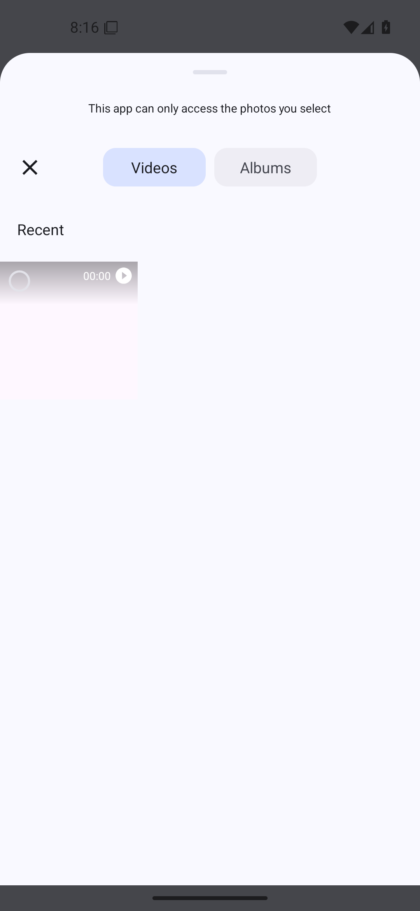
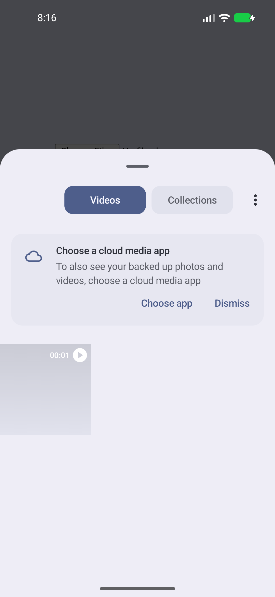
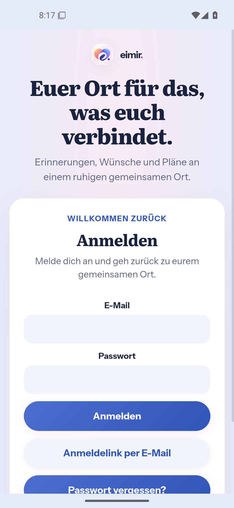
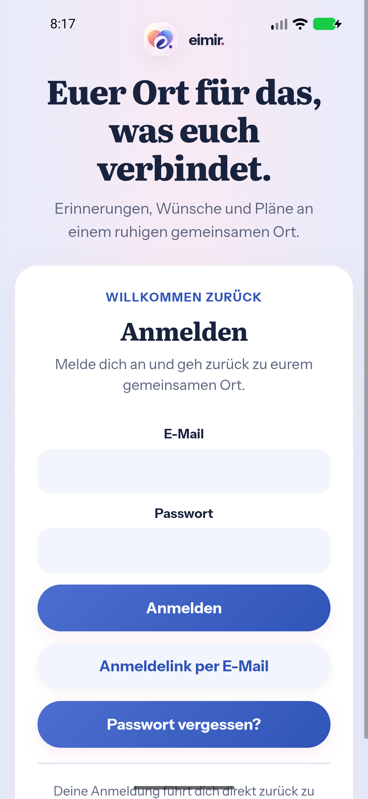

# Android video gallery and background continuity

Owners: #1611 and #1609. Implementation: #1612, based on the current
background-recovery branch through `6f859e3d`.

## Exact source

- Captured runtime head: `a7e71d78a1e68fdec6bd7df79c0da7164747f36b`.
- Runtime tree: `30ff23aac29bc7b90203ffa39e72ef9b2d897d7a`.
- Native verification: [run 41600985832](https://github.com/baerenmarke90/eimir/actions/runs/41600985832), all three lanes passed.
- Integration head: `2a39c3ad6fbe063ab9197ae06232fcd99ec985c0`, with the identical runtime tree after resolving the overlap with merged main #1610. Current integration checks remain separate; no older status is copied.
- Native production-source listing SHA-256: `1b5f2ff7380a71c0f11c6422848aed81ce287cd66dc75fdafb00f15c0614bc3f`.

Reproduce that listing with `git ls-tree -r` at the runtime head for
`android/app/src/main`, `android/app/build.gradle`, `android/variables.gradle`
and `web/package-lock.json`, then hash its unmodified stdout. This evidence
commit adds captures and documentation only; it does not replace the tested
runtime source or copy statuses from another revision.

## Bounded change

The video entry uses AndroidX's video-only system gallery, with its normal
single/multiple contracts and platform fallback when unavailable. The existing
chooser owns a process-local read-descriptor lease and stable metadata for
each supported selected video. The private provider serves independent readers
on the already granted open file; it never copies video bytes into storage,
grants another app access, accepts an arbitrary source URI or permits writes.
Disposal invalidates leases before cleanup and fences in-flight work. Slow
provider work stays outside the registry lock required by Activity disposal.

The integrated dependency recovers one non-crash background renderer loss on
actual task return. Real crashes and unsafe/repeated loss retain explicit
recovery. Healthy returns retain their existing bridge and WebView. Notification
intent handling remains independently verified.

## Journey and evidence

The original artifact ZIP digests were verified before extraction. All seven
published PNGs below were inspected and are byte-identical to those artifacts;
`captures.json` records their SHA-256 and Git blob identities.

| Lane | Verified outcome | Original artifact |
| --- | --- | --- |
| API 28 | Native adapter/frame, crash, notification and preview lane passed with explicit SDK-gated skips. Chromium 69 is a native-only fixture, not modern Web UI acceptance (#1613). | [13214787016](https://github.com/baerenmarke90/eimir/actions/runs/41600985832/artifacts/13214787016) |
| API 36 | 45 adapter cases, 5 recovery cases, 8 notification cases, 4 preview cases and the real Android-file/Web/API/worker pipeline passed. | [13214568135](https://github.com/baerenmarke90/eimir/actions/runs/41600985832/artifacts/13214568135) |
| API 37.1 | 45 adapter cases, 5 recovery cases, 8 notification cases and 4 preview cases passed on the 16K system. | [13215711010](https://github.com/baerenmarke90/eimir/actions/runs/41600985832/artifacts/13215711010) |

| Capture | Reviewed state |
| --- | --- |
| [API 36 gallery](api36-native-video-picker.png) | Actual Videos/Albums gallery, selected-file privacy surface and video item in the platform thumbnail-loading state. |
| [API 37.1 gallery](api37-native-video-picker.png) | Actual Videos/Collections gallery and video item; platform cloud-source suggestion remains optional. |
| [API 36 player](api36-native-video-playback.png), [API 37.1 player](api37-native-video-playback.png) | Decoded blue H.264 frame and native controls after deliberate playback; seek/pause is also asserted by the journey. |
| [API 36 return](api36-renderer-background-return.png), [API 37.1 return](api37-renderer-background-return.png) | The real bundled login interface visibly returns after renderer reclamation. Labels, fields and actions are painted after finite entry motion completes. |
| [API 36 real crash](api36-renderer-real-crash.png) | A deliberately crashed renderer retains the existing explicit native recovery dialog. |

Gallery screenshots complement the four-read/full-byte/decode assertions; a
thumbnail still loading in the OS gallery is not used as proof of decoded video.
The earlier background-only capture was rejected. Readiness now observes
rendered text, visible on-screen content/control targets with opaque ancestors,
finished finite motion and a compositor-frame acknowledgement.

The gallery journey uses a shell-owned, previously unreadable H.264 fixture.
The real HTML multiple-video input opens the system gallery. The test selects
the visible video and explicitly confirms Add/Done. Four Chromium File reads
must agree and match the exact platform-redacted variant of the identified source fixture. Only the 35-byte location box is zeroed; the other container bytes and all 50 encoded audio/video packets remain identical. The unredacted GPS-bearing source also fails this gallery privacy check. Deliberate Play must
produce a decoded 96-by-64 frame, then seek/pause successfully. Separate
provider tests cover independent readers, write denial, private/no-grant
registration, malformed and disposed URIs, idempotent disposal and late adoption.

Background tests use the actual app task and lifecycle acknowledgements. They
verify one fresh Activity/WebView after reclamation, no background prompt,
preserved new notification intents, no replay of consumed links, healthy
continuity and explicit recovery after a real renderer crash.

## Product acceptance boundary

These are native capability fixtures, not screenshots of newly designed eimir.
pages. Web product sources are unchanged. The existing [integrated video
reference and interaction contract](../../references/88-video/README.md),
Product Reference v1 R1/R2 and Create/Edit remain the composition authority.
Android owns the gallery's appearance, accessibility, localization and motion.
The captures establish the correct gallery, selected-media handoff and native
recovery outcomes; they do not establish physical Pixel/Fold or store acceptance.

Upload entitlement, retained-media access, server validation, attachment limits,
Cloud/Self-Hosted behavior and original-photo location consent are unchanged.
No manual workflow rerun, added sleep, gesture retry, relaxed assertion or
longer timeout is used to obtain these results. The initial missing Done action
and inherited intent/lifecycle fixture issues were fixed with real platform
interactions, and the resulting source was checked afresh.

## Capture previews

