# Page composer #1730: implementation evidence

Owning issue: [#1730](https://github.com/baerenmarke90/eimir/issues/1730).
Approved reference source: [#1731](https://github.com/baerenmarke90/eimir/pull/1731),
`origin/docs/diary-composer-reference:docs/product/design/references/page-composer`.
Initial runtime baseline: `main` at `14b624f8f`, including merged #1727 and #1729.
Destination refreshed to `868b16a84` after #1731 merged during implementation
and to `d258eb833` after #1734 merged. The latter's shared sheet and important-date
changes were integrated without conflicts. The PO correction also integrates
`ae4f001416` (#1737), whose five additions are reference files for the separate
Today monthly-story experience; it changes no runtime source or dependency.
Before delivery, `main` advanced to `b23039090` (#1739). The integration below
preserves both sets of semantic roles and fixture fields; it does not change any
Composer component, style or consumed token value.
Reference head:
`4bbb3110b31a0944992712a125900391754261c4`.
This audit compares the initial runtime baseline with the integrated implementation.
Test names below identify coverage; actual execution results and their revisions
are reported separately under Validation.

## Product Owner review precedence

The [binding review decision](https://github.com/baerenmarke90/eimir/pull/1735#issuecomment-6776422807),
reviewed at `e55c6808b`, supersedes former deviations 3, 6 and the omitted
unscheduling choice in 11. It also supersedes the HeartMoment order in original
frames 5–7 and 15. The original reference folder remains unchanged.

The updated Compact interaction contract is: context, photos, HeartMoment voice,
existing title/lead and prose, feeling, then chips/links. With no media, HeartMoment
starts with its text. All three editor/read galleries use the same inline crop;
fullscreen retains the full image. The editor stage always exposes cover choice,
remove, sensitivity and count. A 56 px thumbnail only selects that stage; it
never opens a management mode or changes the saved cover by itself. Failed items
offer Retry on the stage.
The compact schedule sheet explicitly offers the existing unscheduled state,
and Plan detail map links use the same underline as the other readers.

A subsequent PO correction in this implementation task removes the additional
composer Arrange and automatic-cover-reset rows, overriding the earlier quiet
arrangement-entry instruction. It also removes the separate inline Reveal row.
The image already opens the existing fullscreen, which retains its Reveal/Hide
controls. No replacement entry, menu or gesture is added. The removed row was
the only composer entry to `PhotoArrangeTask`; default/experience galleries keep
that task and their automatic-cover reset. Composer stage cover choice and the
existing automatic default remain; there is no separate reset action.

The PO accepted the previously documented boundaries 1, 2, 5, 7, 8, 9, 10 and
12. Boundary 10 additionally discloses the retained saved-sensitive placeholder
difference; that newly explicit visual exception has not been separately approved.
The existing transient completion handoff in 4 may remain pending separate PO
confirmation.
Numbers are retained so the reviewed exceptions stay traceable; 3 and 6 are
resolved corrections, not current deviations.

## Main inventory and final owners

| Section 3a function | Present on baseline main; missing or different | Final owner and behavior | Focused coverage |
| --- | --- | --- | --- |
| 1. Back, type heading, text Edit, saved feedback, no new capture on ordinary detail | Back already existed through `SubpageNavigation`/task navigation. Memory/Heart used the read shell with icon Edit; Plan used its authored heading and icon Edit. Saved feedback covered Memory creation but not all edit/create outcomes. Completed Plan detail exposed capture continuation actions. | `ComposerHeader`, `StoryDetailPageShell`, `StoryDetailEditLink` and the three product pages render contextual Back, compact localized type heading and text Edit. Save outcomes expose a short saved pill. Ordinary reopened completed Plans have no new-capture action. Existing completion confirmation preserves its transient result handoff (see deviation below). | `MemoryProductPage.test.tsx`: “keeps Edit as a labeled text action in the compact type header”; `HeartMomentProductPage.test.tsx`: “keeps a quiet visible text action for editing in the read header”; `PlanProductPage.test.tsx`: “shows a completed Plan as a truthful read result without reopening capture automatically”; `PlanProductPage.edit.test.tsx`: “keeps the activating Edit button separate from the new native-submit control”. |
| 2. Date/schedule, Place/map return, calendar, Heart visibility/feeling | Date, Place, visibility, feeling and `PlanCalendarAction` existed. Memory/Heart Places opened an intermediary sheet; Plan opened Place detail. Full-page Heart tint and the requested compact read composition differed. | `ComposerDateContext`, `MomentPlaces`, `HeartMomentLocation`, `PlanProductPage`, `MomentMapLink`/`photoPlaceMapUrl`, `PlanCalendarAction`, `HeartEmotionSurface`/`HeartEmotionBadge` retain the same data and platform owners. Coordinates link directly to the existing internal map; missing coordinates remain text. Plan uses its existing short schedule and calendar boundary. | Browser: “detail Places restore their map invoker without consuming a later clean editor return” (all three products); “HeartMoment keeps every feeling visible, tints page and system bar, and restores visibility after choice”. `PlanProductPage.test.tsx`: direct-map link, timed end range and undated intention tests. |
| 3. Swipe/snap, count/dots, navigation, cover first, sensitivity, reactions, fullscreen/zoom | Swipe/snap, count, pointer/keyboard navigation, conceal/reveal and fullscreen/zoom/close/Escape were already implemented. Dots were missing. Cover selection started at its stored index instead of displaying it first. Revealed sensitive photo activation toggled concealment instead of opening fullscreen. Six reactions and summary chips already existed for Memory only. | `MediaGallery`, `MemoryPhotoGallery`, `PlanPhotoGallery` and Heart media integration reuse loading, authorization, fullscreen and sensitive-state owners. Display order puts the cover first without changing stored order. Labeled dots and fraction count supplement existing navigation. Concealed activation reveals; revealed activation opens fullscreen; an explicit Hide control remains. Memory reactions retain their existing API. | Browser: “saved galleries retain sensitive reveal, swipe, fullscreen zoom and the same slide on return” (all three products, plus six offered Memory reaction choices and a confirmed LOVE summary; retained carousel/unit tests cover persistence and removal). `MediaGallery.test.tsx`: labeled position dots. `MediaGalleryLoading.test.tsx`: fullscreen navigation/window restoration. `MemoryPhotoGallery.test.tsx`: reaction persistence, removal, failure and cache identity. Retained `memory-carousel-stability.spec.ts` preserves gesture, image/object-URL loading, timing, focus, privacy and geometry protections. |
| 4. Display title | Authored Memory/Plan titles and Heart lead text already existed, with different hierarchy/placement. | Product pages and `PageComposerDetail.css` place Memory/Plan display titles after gallery content. Heart photos and voice precede its existing lead, as required by the later PO review. Generated Memory date titles remain one context date rather than a repeated authored heading. | `MemoryProductPage.test.tsx`: “keeps the short date above content and an authored display title after media” and “shows a generated title date once in the context row”; `HeartMomentProductPage.test.tsx`: “keeps long authored text once inside the content area, apart from the compact heading”; `PlanProductPage.test.tsx`: authored prose/no repeated heading. |
| 5. Memory initial, Plan note, bounded long prose | Memory already used `drop-cap-letter` and uppercase display treatment. Plan already had no initial. `ExpandableDescription` already preserved full prose with Show more/less, but the existing excerpt threshold was character/newline based. Plan's description box had border/shadow. | `ExpandableDescription`, `PageComposerDetail.css` and the pages retain authored text and disclosure ownership. Memory uses the scoped 1.3em initial. Plan uses one soft note surface without border/shadow. Measured visual overflow in the new detail composition adds the approximately five-line clamp/fade even when the existing character excerpt is short. | `ExpandableDescription.test.tsx`: “bounds long prose and preserves the full text through accessible expand and collapse”, ownership reset, inert HTML/safe links, multiline and URL-boundary tests. Retained `create-surface-visual-checks.spec.ts` checks authored prose and the initial at mobile/expanded widths. |
| 6. Tags, Heart voice, Plan shared Lists | Tags, saved voice and linked List rows/progress already existed. Heart voice placement differed. Plan rows navigated to the full List destination rather than a bounded sheet. | Existing tags and `SavedVoiceNote` stay with their owners; Heart voice follows photos and precedes its text. `PlanCollectionLinks` embeds the canonical `CollectionProductPage` with explicit ID; its checklist/add/versioning behavior is reused. Close refetches row progress. Pending operations block dismissal; unsaved List text requires explicit discard. | `PlanCollectionLinks.test.tsx`: “opens the canonical checklist in a sheet and updates its Plan row after checking and adding”; “keeps an unsaved list entry until the user explicitly discards it”. Browser: “Plan schedule and linked checklist remain bounded tasks with updated progress”. |
| 7. Read-only linked Wishes/Plans; linking only in composers; no Heart detail section | Memory read-only Wish/Plan links, Heart Plan links and Plan source-Wish association existed. The backend supports different relation domains by content type. | `StoryPlanningLinks`/`MemoryPlanningLinks` retain Memory destinations; `PlanWishLink` shows its source Wish with secondary title. Heart detail omits the linked section. Existing link/unlink management stays in create/edit. Plan creation stages a supported source Wish, creates the canonical Plan once, then associates it; a partial retry reuses and rereads the known parent. | `PlanningCreatePage.test.tsx`: “stages a Wish before creation and retries its association without creating another Plan”; “keeps the confirmed Plan after list-link failure and retries without creating a second Plan”. `HeartMomentProductPage.test.tsx`: “retries failed Plan associations against the known saved parent without creating twice”. `PlanCollectionLinks.test.tsx`: read-only detail and partial-link reconciliation. |
| 8. Existing comments, excluded for owner-only Heart | `CommentsPanel` and its create/edit/delete/permissions/offline/uncertain-state behavior already existed on all three products. Owner-only Heart already excluded comments. | `CommentsPanel` retains the same APIs, ownership and private exclusion. Detail presentation permits inline composition without opening the keyboard on read. The optional photo comment action uses the existing comment task owner. | `CommentsPanel.test.tsx`: “discloses the detail composer without activating the keyboard on read”; caller-owned edit/delete tests; comments/pagination before composer; “keeps newer text when an older submitted draft succeeds late”; failure draft retention and identical uncertain-retry identity. |

## Explicit deviations and retained domain boundaries

1. **Photo reactions remain Memory-only.** The brief's gallery paragraph is
   generic, but the destination main has only the Memory photo-reaction endpoint.
   HeartMoment and Plan expose no supported reaction endpoint. Their galleries
   preserve all existing navigation, privacy and fullscreen behavior. No backend
   or synthetic local reaction state is introduced.
2. **Composer linking follows supported relations.** Memory can link existing
   Wishes and Plans; HeartMoment can link existing Plans; Plan can associate one
   source Wish. Heart-to-Wish and Plan-to-Plan associations do not exist in the
   current API. Choices are limited to those supported domains, and the Plan's
   existing return-to-Wish lifecycle remains an editor action.
3. **Resolved: media first in every editor and reader.** The later PO decision
   supersedes the Heart lead-first illustrations. Existing photo and voice
   owners precede Heart text and feeling; no new title or description field is
   introduced. Empty media owners remain mounted but have no visible gap.
4. **Plan completion preserves its existing transient result handoff.** Immediately
   after a confirmed completion, the existing `PlanStoryContinuation` can still
   offer the related Memory/Heart/Milestone capture handoff. It is restricted to
   `completion.isConfirmed`; ordinary reopened completed Plan detail has no
   start-new action. Removing the transient handoff would regress the existing
   completion result contract and retained completion journeys.
5. **Emotion actions use an accessible derivation of existing roles.** An 80% mix
   of the existing emotion accent with semantic text supplies readable action
   foregrounds and filled interactions. The unmodified Happy accent could not
   reach 4.5:1 against white, and the visibility tint reduced other pairs below
   AA. No palette was added; all six feelings pass the Light/Dark browser Axe
   checks. The result is slightly darker in Light and lighter in Dark than the
   illustrated accent.
6. **Resolved: permanent stage controls and a stable strip.** Cover/Use as cover,
   Remove, Sensitive and count occupy the four stage corners; the three
   interactive controls retain 44 px targets and count is noninteractive. The current cover has a star; selecting another 56 px thumbnail
   only previews it. There is no inline management mode, enlarged strip tile, per-tile
   mutation control or Done action. The separate arrange task retains its
   existing Finish/Cancel confirmation in default galleries. The later PO
   correction removes the composer Arrange and automatic-cover-reset rows, with
   no replacement entry. The separate inline Reveal row is removed as well;
   existing fullscreen Reveal/Hide remains available after stage activation.
   Retry is on the failed stage, and canonical upload/status/error ownership
   is unchanged.
7. **Existing List unlink remains beside the edit chip.** The existing chooser
   excludes already linked Lists and cannot unlink them. Its named unlink
   control remains available beside the chip; the chip reopens that existing
   chooser. Read rows have no relation-management action.

8. **Private Heart location remains a protected snapshot.** Its existing picker
   can copy an authorized saved Place or choose a location without creating a
   shared Place. The new shared-Place creation row is limited to shared relation
   editors, preserving the private-location boundary. Existing operator voice
   availability and the user's Pro-mark preference also remain authoritative.

9. **Read screens retain the existing global navigation.** The illustrated
   details omit the application shell. Runtime read screens keep its bottom
   navigation and central QuickCreate entry so the existing More, contextual
   Back and cross-task navigation remain available. Focused create/edit tasks
   hide that navigation and use only their header and tool row. The three
   ordinary details have no page-specific start-new action.
10. **Existing task, media and privacy affordances remain explicit.** The shared
    Back control, operable sheet handle/Close controls, visible fullscreen and
    Hide controls, canonical glyphs and existing comment
    timestamp/ownership menu differ from the illustrative artwork. The source
    sheet retains provider privacy/consent disclosures, connection states and
    applicable Pro marks, so its height can exceed frame 8. No decorative
    avatar, provider logo or synthetic media reaction is added. The embedded
    List retains its existing per-item menus, absent from the illustration.
    Local sensitive draft thumbnails reuse their owned image under blur and an
    eye-off glyph. Already-saved sensitive Plan/Heart thumbnails retain the
    existing solid protected placeholder with the eye-off glyph, rather than
    eagerly fetching protected images solely to create the illustrated blur.
11. **Resolved unscheduling omission; native fields remain.** The schedule sheet
    now explicitly offers the localized existing no-fixed-date choice. It
    follows the native date-change path, clearing date, time and end state and
    notifying the owning editor's dirty guard. Date/time fields still use the
    browser's locale formatting. The new-Place map-choice tile has no decorative
    map illustration; its existing map task, validation and feedback remain.
12. **Illustrative data and accessible dimensions differ.** Runtime captures
    use real fixture photos, authored content, linked items, reaction totals,
    voice duration/waveform and selected feeling/visibility rather than drawn
    sample data. Saved feedback appears after a real save, not on an ordinary
    read. Browser captures omit the drawn bezel/status bar. Tool targets are
    48 px and interactive chips/dots are at least 44 px; narrow/200% text can
    wrap or stack them, including stacked feeling choices, to keep labels
    intact without horizontal scrolling. At narrow/200% widths the stage uses
    its cover and sensitivity glyphs with full accessible labels; shrinking
    those words into vertical letter columns is avoided without reducing text size.
    Strip tiles are 56 px at the standard text size in every selection/state;
    enlarged text retains the shared rem-based token scaling.

## Bounded lifecycle review

The integrated Plan implementation retains the native form's hidden schedule
and Place values when sheets close. Place selection clears the parent pending
guard before the picker unmounts. Read and edit headers have separate native
button identities, preventing the activating Edit click from submitting the new
form. List draft discard is explicit; a pending List write blocks dismissal.
Staged Wish and List retries reuse a confirmed Plan instead of creating another
one. The shared tool row only manages visual viewport/safe-area presentation and
cleans up its listeners/observer; domain requests remain with existing owners.
The later retained browser run identified three additional lifecycle gaps:
return focus after map navigation, native cancel propagation through nested
sheet portals, and the pending-to-success close boundary after creating a Place
from Plan creation. Their corrections and regression results are recorded in
the PO correction validation below. This bounded source review does not replace
browser/accessibility or native-device acceptance.

## Reference exclusion

Both commands produced no paths against the integrated working tree:

```text
git diff --name-only origin/main -- docs/product/design/references/page-composer
git ls-files --others --exclude-standard docs/product/design/references/page-composer
```

The approved reference files are read from #1731; they are not copied into this
implementation PR.


## Lifecycle corrections found during regression verification

The retained tests exposed and now protect exact-image dot selection, native
Edit/Submit node separation, Place pending release, List dirty dismissal, and
partial relation retries against a known parent. Additional Heart checks retain
account/task-scoped create-observer state, synchronous same-version privacy
admission, pending feedback after unmount/return, and the original ability to act
on a newer authoritative version without accepting an older write's cache result.
The final retained browser rerun also found stale create-only Place/link state
counting as dirty after create-from-Plan, saved result and clean Edit. Those
create-only values now affect only create-mode dirty admission; the regression
asserts one canonical creation, no edit write and Back without a discard prompt.

## Scope, reuse and quality

The approved reference and later binding PO review govern non-experience
Memory, HeartMoment and Plan create/edit/read. Wish, Milestone, Chapter, experience question/answer layouts,
API/schema and wrapper capabilities retain their existing contracts. Composer-specific shared component variants are opt-in. Gallery fractions,
position dots, single-item counts and revealed-photo fullscreen activation are
limited to the in-scope presentation; default galleries and experience paths
keep their previous pagination and sensitive-toggle behavior.

Native buttons/forms, file inputs, CSS scroll snap, visual viewport and the
existing task/sheet, upload, provider, map, voice, tags, List and gallery owners
were selected over a new form, modal or media library. The small shared tool/chip
primitives arrange existing actions; no dependency or provider was introduced.

No business/freemium impact: device photos and authoring remain Free/Core;
external sources remain Premium with existing availability and Pro presentation;
video retains Premium-upload/Core-retained-media and operator-processor rules.
The saved map retains its existing Pro boundary; basic Places, calendar handoff
and Lists remain Core. Couple ownership, quotas, cost, retention, downgrade,
export and Cloud/Self-Hosted behavior are unchanged. The authoritative feature
matrix needs no tier change.

No new content logging, telemetry, endpoint, schema, cache authority or media
authorization was introduced. Native input ownership, source consent, upload
admission, version preconditions, account/Space scope, uncertain responses and
known-parent retries remain with their existing owners. New labels are in both
shipped locales. Browser journeys exercise private visibility, draft recovery,
keyboard/focus, sheet return, reduced motion and reflow. Real Android software
keyboard/system Back acceptance was not performed in this browser-only proof;
wrapper code and browser-only button visibility are unchanged.

The screenshots use synthetic localized fixtures and existing repository demo
photos. Media content, voice duration, selected feeling/visibility and available operator
features reflect those fixtures rather than the illustrative reference data.
Browser captures omit the drawn phone bezel/status bar; feeling theme-color is
verified separately. These are runtime evidence, not copied reference assets.

## Initial implementation validation

This records the pre-review implementation at PR head `e55c6808b`. The PO
correction validation below supersedes it for changed behavior and current captures.

Production source: `47aa560abef75eb36712c2c689b40dce020e30fa`, based on
`main` at `d258eb83372f12ef1c62b4827dcf4419bbde7b27`. Browser evidence uses
local Chromium, Node 26.7.0, a fresh Vite fixture build, production components
and fixture HTTP transport. The 200% case deliberately sets the root font size;
normal captures have no replacement layout or screenshot-only product styles.

| Check | Observed result |
| --- | --- |
| Final composer browser run, one worker | **21 passed**, 3.2 minutes: all 20 composer cases plus the retained shared-HeartMoment/Plan clean-edit return case. All 153 images were refreshed. |
| Accessibility within those cases | All six feelings in Light/Dark (12 Axe audits), all three readers at 390 px Light/Dark (6 Axe audits), 320 px/200% reflow, contained selection marks, native target geometry, focus and reduced motion passed. |
| Retained browser regression diagnosis | Initial 366-case run: 295 passed, 71 failed. After presentation-selector migrations and actual hit-target/overflow corrections, exact 71-case rerun: 70 passed, one false-dirty lifecycle failure. That last case passed after the create-only state fix and is included in the final 21. This is a correction chain, not a claim of one green 366-case command on the final revision. |
| Full unit suite | **2,884 passed, 2 skipped**, 320 files passed and two files skipped; 123 seconds with two workers. Started at `6ced0a33c` with all final runtime JavaScript; the subsequent `47aa560ab` change only selects the readable CSS initial color, separately verified by final browser/Axe evidence. |
| Typecheck, lint and format | All exit 0 on the final production source. Lint reports 154 warnings and 34 informational diagnostics, no errors. Format checks 1,106 files. |
| Production build and foundations | Build, semantic token/legal/i18n/PWA checks, and Capacitor foundation check pass. No native build or wrapper change. |
| Browser inventory | Pass: 105 specs; historical full baseline 972 and PR-critical baseline 719. Those inventory baselines are not the executed count. |
| Engineering/documentation language and whitespace | Both language audits and `git diff --check` pass on the final evidence/test/documentation tree. No audit exclusion or rule was weakened. |

The final test-selector correction waits for the actual saved Place result inside
`.moment-place-choices`, then asserts selected context before tags/save. The old
broad name match could instead click the temporary new-Place action while the
saved query was loading. The unchanged POST assertion exposed that test error;
no product Place state was lost. The final run preserves the canonical write,
privacy, source-byte, gesture, geometry, retry and focus assertions. No forced
click, sleep, skip or increased timeout was added to make retained cases pass.

Reproduce the final browser slice from `web/e2e` (the Playwright configuration
builds the fixture app before preview):

```sh
EIMIR_BROWSER_SPECS='["page-composer.spec.ts","plan-linked-lists.spec.ts"]' SCREENSHOT_EXPORT_DIR=/tmp/eimir-1730-evidence npm test -- --workers=1 --reporter=line --grep 'page-composer.spec.ts|shared HeartMoment capture retains its Plan in both directions'
```

Real Android software-keyboard/system-Back acceptance and a live backend journey
were not performed. Browser fixtures exercise the production UI and transport
contracts; they do not replace device or Product Owner acceptance. CI must be
green before merge. This implementation does not merge or publish the app.

## PO correction validation

The review correction reuses the existing media, arrange, native date and map
owners without a new dependency, endpoint, entitlement or storage authority.
Sensitive local-image thumbnails reuse the already-owned draft URL inside the
existing blur/eye mask. Retained saved-sensitive previews keep their protected
owner; no new protected-media fetch or URL lifetime is introduced. The observed
inline-comment focus loss after mouse submission is corrected only for an owned,
unchanged successful draft and an eligible native focus target; initial reads,
newer drafts and foreign focus remain untouched.
Map return restores the exact invoking link within the existing scoped task
origin. Plan keeps the completed return marker with its persistent reader owner,
so a later clean inline Edit/Close retains the Edit button's focus and the newer
reading position. HeartMoment retains its existing separate edit-route owner.
The shared route handoff likewise applies a completed task origin only once per
history-entry/return key. A real-browser diagnostic attributed the stale 60 px
scroll after native Plan editor Close to that handler; the exact browser
regression then passed with the correction. Focused component cases verify
duplicate callbacks, fresh origins, cancellation and invalidation before delayed
work. Task-origin storage, authorization and history payloads are unchanged.
The narrow Memory form's generic button padding no longer insets the carousel
slides. The shared composer reset keeps the existing image crop edge-to-edge;
the 320 px/200% matrix checks zero slide padding, `cover` fit and the image/slide
edges against the stage, alongside the existing four-corner and Axe checks.
Focused unit verification and the updated browser/capture manifest bind the
correction to its source revision. The initial result above is historical,
not evidence for the changed media interaction.

The Composer captures and results below use application source `894c445d6`
and `main` at `ae4f001416`. Both browser revisions contain the same `web/src`
tree. The subsequent current-main integration is recorded separately below.
No source or browser expectation changed during an individual run.

| Check | Observed result |
| --- | --- |
| Focused application units | 246 passed across 19 files in 37.2 s on `894c445d6`, using one worker and the Vite runner config loader. Includes legacy arrangement/reset and editor/default fullscreen conceal, reveal, hide, focus and URL ownership. |
| Static and build preflight | Full Web types, lint (zero errors; existing 154 warnings and 34 infos), format, production build (tokens, legal, i18n and PWA checks), and the 61-entry E2E type check covering all 43 changed E2E TypeScript files passed. Capacitor foundation, scoped engineering-language audit and 33 product-design classifier/gate tests passed. |
| Browser selection | 105 inventoried specs; historical full baseline 978 and PR-critical baseline 719. The 38 planning regressions passed. The unchanged always-run core collected 133 cases in 10 specs, disjoint from 170 cases in eight affected feature/reference specs. The six new media-state cases stay outside the always-run core. |
| Latest PO scope, `39a34da1a`, `--workers=1` | Composer matrix 26/26 (3.1 min); affected retained specs 142/144 (5.9 min); mandatory core 133/133 (4.0 min). All 303 distinct cases executed. The two failed media-preservation tests incorrectly inferred that fullscreen browsing selected the first draft thumbnail. The existing stage selection is preserved on return. |
| Corrected browser setup and evidence, `eb1c0abfe`, `--workers=1` | 42/42 passed (3.6 min): the full 26-case composer matrix and 16 media/planning correction cases, with all 174 images regenerated in that run. The two tests now explicitly select the first thumbnail, then verify the second remains the cover and original input order/canonical IDs persist. Actual fullscreen swipe/zoom and privacy checks remain. All 303 distinct cases have a passing result on the same application source. |

The later PO decision makes the old composer Arrange/automatic-reset steps
obsolete. Their journeys now verify absent rows, exact preview/cover identity,
original input order and canonical persistence. Legacy arrangement keeps its
committed Cancel/Finish/order/reset proof. The existing reader privacy controls
are unchanged; the six composer media cases exercise concealed fullscreen,
explicit reveal, decoded image, Hide, return and failed-upload retry in both
themes. No skip, force action or timeout relaxation was used.

Before that later decision, the previous PR head's [Browser QA run](https://github.com/baerenmarke90/eimir/actions/runs/42879064829)
reported 119 failures. The consolidated compatibility run on `e2b777dba`
executed 663 cases in 52 complete specs with one worker: 632 passed and 31 failed
(29.3 min). The failures exposed obsolete presentation assumptions/fixtures
and real map-focus, nested-cancel and awaited Place-close bugs. The scoped
shared handoff correction prevents a completed map return from replaying scroll
on native Plan editor Close. The subsequent 251-case run at `3e787ae22` passed
250; one 320 px/200% native drag target was outside the visible arrange task.
The follow-up at `cfe46048d` passed 26 fresh captures and the 38-case subset,
including that case using the existing native First/Finish control. All 31
historical failure identities passed across those two runs. This is a diagnostic
and correction chain, not a claim that the initial 663-case run was green.
The latest PO removal subsequently superseded the composer arrangement entry.

The [capture manifest](capture-manifest.json) records commands, native JSON
statistics and hashes, revision bindings, original/renamed test identity
coverage, and every selected PNG hash. All current captures come from the
actual Chromium client, including three normally scrolled stage viewports at
320 px/200%. Long full-page screenshots are supplementary: Chromium's capture
resizing can show a carousel paint seam and the fixed tool row once inside the
long image. The scrolled stage shots and edge/corner assertions verify the
actual viewport without those capture artifacts.

No unchanged remote workflow retry was used. GitHub Checks record CI on the final PR head. No physical-device acceptance or
Android package build was performed in this Web validation.

## Current main integration

The delivery integrates `b23039090` (#1739) at `5fd8eb5b2`. Its Today monthly
mosaic/story changes add semantic roles and localized fixture fields. Both sets
of tokens and both fixture groups were kept; the generated roles preserve all
previous declaration values. No Composer component, style or consumed role
changed. The 174 captures therefore keep their actual `eb1c0abfe` / `894c445d6`
provenance against `ae4f001416`.

On `cf3ee953c`, the production build, 126 focused tests in four files (5.75 s),
63-entry E2E type check, formatting, inventory and all 38 browser-planning
regressions passed. Actual full collection is 1,241 cases in 105 specs; the
historical inventory numbers are separate. The integration selection executed
**234/234 passing cases in 16 complete specs** with `--workers=1` (8.3 min, zero
skipped/flaky): the existing 133-case core and six Today, story, settings and
reflow specs. It includes the Today-to-Composer routes and enlarged-text reflow.
The manifest records the exact selection, native statistics and report hashes.

## Reference-to-runtime comparison

Heart order and media controls in the original frames are superseded by the
[PO review](https://github.com/baerenmarke90/eimir/pull/1735#issuecomment-6776422807).
The runtime images below follow that later decision; the boards retain authority
for compatible typography, color, spacing and other states.

References below remain at the original #1731 commit; only runtime captures are
added here. The source images include illustrative phone chrome and media.
Create/edit use the same approved anatomy. Filename frame numbers inherited from
the matrix state are descriptive; the reference column identifies the matching
composition (for example populated Diary create matches frame 2).

| Reference composition | Runtime at 390 px |
| --- | --- |
| Diary empty, frame 1<br> |  |
| Diary populated create, frame 2<br> |  |
| Diary edit, frame 2<br> |  |
| Heart empty, frame 5<br> |  |
| Heart populated create, frame 6<br> |  |
| Heart edit, frame 6<br> |  |
| Plan empty, frame 9<br> |  |
| Plan populated create, frame 10<br> |  |
| Plan edit, frame 10<br> |  |
| Diary detail, frame 13<br> |  |
| Diary comments, frame 14<br> |  |
| Heart detail, frame 15<br> |  |
| Plan detail, frame 16<br> |  |
| Diary Dark, frame 3<br> |  |
| Heart Dark, frame 7<br> |  |

### Compact matrix

Every linked screenshot is paired with its source frame in the first column.
Dark Diary populated follows frame 3; Dark Heart follows frame 7.

| State / reference | 360 Light | 360 Dark | 390 Light | 390 Dark | 430 Light | 430 Dark |
| --- | --- | --- | --- | --- | --- | --- |
| [Diary empty: frame 1](https://raw.githubusercontent.com/baerenmarke90/eimir/4bbb3110b31a0944992712a125900391754261c4/docs/product/design/references/page-composer/empty-390.png) | [Capture](1730-diary-empty-frame-1-360-light.png) | [Capture](1730-diary-empty-frame-1-360-dark.png) | [Capture](1730-diary-empty-frame-1-390-light.png) | [Capture](1730-diary-empty-frame-1-390-dark.png) | [Capture](1730-diary-empty-frame-1-430-light.png) | [Capture](1730-diary-empty-frame-1-430-dark.png) |
| [Diary populated create: frame 2](https://raw.githubusercontent.com/baerenmarke90/eimir/4bbb3110b31a0944992712a125900391754261c4/docs/product/design/references/page-composer/filled-390.png) | [Capture](1730-diary-populated-create-frame-1-360-light.png) | [Capture](1730-diary-populated-create-frame-1-360-dark.png) | [Capture](1730-diary-populated-create-frame-1-390-light.png) | [Capture](1730-diary-populated-create-frame-1-390-dark.png) | [Capture](1730-diary-populated-create-frame-1-430-light.png) | [Capture](1730-diary-populated-create-frame-1-430-dark.png) |
| [Diary edit: frame 2](https://raw.githubusercontent.com/baerenmarke90/eimir/4bbb3110b31a0944992712a125900391754261c4/docs/product/design/references/page-composer/filled-390.png) | [Capture](1730-diary-edit-frame-2-360-light.png) | [Capture](1730-diary-edit-frame-2-360-dark.png) | [Capture](1730-diary-edit-frame-2-390-light.png) | [Capture](1730-diary-edit-frame-2-390-dark.png) | [Capture](1730-diary-edit-frame-2-430-light.png) | [Capture](1730-diary-edit-frame-2-430-dark.png) |
| [Heart empty: frame 5](https://raw.githubusercontent.com/baerenmarke90/eimir/4bbb3110b31a0944992712a125900391754261c4/docs/product/design/references/page-composer/generated-heartmoment-reference.png) | [Capture](1730-heart-empty-frame-5-360-light.png) | [Capture](1730-heart-empty-frame-5-360-dark.png) | [Capture](1730-heart-empty-frame-5-390-light.png) | [Capture](1730-heart-empty-frame-5-390-dark.png) | [Capture](1730-heart-empty-frame-5-430-light.png) | [Capture](1730-heart-empty-frame-5-430-dark.png) |
| [Heart populated create: frame 6](https://raw.githubusercontent.com/baerenmarke90/eimir/4bbb3110b31a0944992712a125900391754261c4/docs/product/design/references/page-composer/generated-heartmoment-reference.png) | [Capture](1730-heart-populated-create-frame-5-360-light.png) | [Capture](1730-heart-populated-create-frame-5-360-dark.png) | [Capture](1730-heart-populated-create-frame-5-390-light.png) | [Capture](1730-heart-populated-create-frame-5-390-dark.png) | [Capture](1730-heart-populated-create-frame-5-430-light.png) | [Capture](1730-heart-populated-create-frame-5-430-dark.png) |
| [Heart edit: frame 6](https://raw.githubusercontent.com/baerenmarke90/eimir/4bbb3110b31a0944992712a125900391754261c4/docs/product/design/references/page-composer/generated-heartmoment-reference.png) | [Capture](1730-heart-edit-frame-6-360-light.png) | [Capture](1730-heart-edit-frame-6-360-dark.png) | [Capture](1730-heart-edit-frame-6-390-light.png) | [Capture](1730-heart-edit-frame-6-390-dark.png) | [Capture](1730-heart-edit-frame-6-430-light.png) | [Capture](1730-heart-edit-frame-6-430-dark.png) |
| [Plan empty: frame 9](https://raw.githubusercontent.com/baerenmarke90/eimir/4bbb3110b31a0944992712a125900391754261c4/docs/product/design/references/page-composer/generated-plan-reference.png) | [Capture](1730-plan-empty-frame-9-360-light.png) | [Capture](1730-plan-empty-frame-9-360-dark.png) | [Capture](1730-plan-empty-frame-9-390-light.png) | [Capture](1730-plan-empty-frame-9-390-dark.png) | [Capture](1730-plan-empty-frame-9-430-light.png) | [Capture](1730-plan-empty-frame-9-430-dark.png) |
| [Plan populated create: frame 10](https://raw.githubusercontent.com/baerenmarke90/eimir/4bbb3110b31a0944992712a125900391754261c4/docs/product/design/references/page-composer/generated-plan-reference.png) | [Capture](1730-plan-populated-create-frame-9-360-light.png) | [Capture](1730-plan-populated-create-frame-9-360-dark.png) | [Capture](1730-plan-populated-create-frame-9-390-light.png) | [Capture](1730-plan-populated-create-frame-9-390-dark.png) | [Capture](1730-plan-populated-create-frame-9-430-light.png) | [Capture](1730-plan-populated-create-frame-9-430-dark.png) |
| [Plan edit: frame 10](https://raw.githubusercontent.com/baerenmarke90/eimir/4bbb3110b31a0944992712a125900391754261c4/docs/product/design/references/page-composer/generated-plan-reference.png) | [Capture](1730-plan-edit-frame-10-360-light.png) | [Capture](1730-plan-edit-frame-10-360-dark.png) | [Capture](1730-plan-edit-frame-10-390-light.png) | [Capture](1730-plan-edit-frame-10-390-dark.png) | [Capture](1730-plan-edit-frame-10-430-light.png) | [Capture](1730-plan-edit-frame-10-430-dark.png) |
| [Diary detail: frame 13](https://raw.githubusercontent.com/baerenmarke90/eimir/4bbb3110b31a0944992712a125900391754261c4/docs/product/design/references/page-composer/detail-diary-390.png) | [Capture](1730-diary-detail-frame-13-360-light.png) | [Capture](1730-diary-detail-frame-13-360-dark.png) | [Capture](1730-diary-detail-frame-13-390-light.png) | [Capture](1730-diary-detail-frame-13-390-dark.png) | [Capture](1730-diary-detail-frame-13-430-light.png) | [Capture](1730-diary-detail-frame-13-430-dark.png) |
| [Diary comments: frame 14](https://raw.githubusercontent.com/baerenmarke90/eimir/4bbb3110b31a0944992712a125900391754261c4/docs/product/design/references/page-composer/detail-diary-comments-390.png) | [Capture](1730-diary-comments-frame-14-360-light.png) | [Capture](1730-diary-comments-frame-14-360-dark.png) | [Capture](1730-diary-comments-frame-14-390-light.png) | [Capture](1730-diary-comments-frame-14-390-dark.png) | [Capture](1730-diary-comments-frame-14-430-light.png) | [Capture](1730-diary-comments-frame-14-430-dark.png) |
| [Heart detail: frame 15](https://raw.githubusercontent.com/baerenmarke90/eimir/4bbb3110b31a0944992712a125900391754261c4/docs/product/design/references/page-composer/detail-heart-390.png) | [Capture](1730-heart-detail-frame-15-360-light.png) | [Capture](1730-heart-detail-frame-15-360-dark.png) | [Capture](1730-heart-detail-frame-15-390-light.png) | [Capture](1730-heart-detail-frame-15-390-dark.png) | [Capture](1730-heart-detail-frame-15-430-light.png) | [Capture](1730-heart-detail-frame-15-430-dark.png) |
| [Plan detail: frame 16](https://raw.githubusercontent.com/baerenmarke90/eimir/4bbb3110b31a0944992712a125900391754261c4/docs/product/design/references/page-composer/detail-plan-390.png) | [Capture](1730-plan-detail-frame-16-360-light.png) | [Capture](1730-plan-detail-frame-16-360-dark.png) | [Capture](1730-plan-detail-frame-16-390-light.png) | [Capture](1730-plan-detail-frame-16-390-dark.png) | [Capture](1730-plan-detail-frame-16-430-light.png) | [Capture](1730-plan-detail-frame-16-430-dark.png) |

### Expanded, reduced motion and enlarged text

The three stage viewport captures show the actual scrolled editor at 200%
text, with all four corners and the filling crop checked. The full-page images
supplement them with the overall form flow.

| State / reference | 1280 Light | 1280 Dark | 320 / 200% / reduced | 320 full page | 390 Dark / reduced | 320 stage viewport |
| --- | --- | --- | --- | --- | --- | --- |
| [Diary empty: frame 1](https://raw.githubusercontent.com/baerenmarke90/eimir/4bbb3110b31a0944992712a125900391754261c4/docs/product/design/references/page-composer/empty-390.png) | [Capture](1730-diary-empty-frame-1-1280-light.png) | [Capture](1730-diary-empty-frame-1-1280-dark.png) | [Capture](1730-diary-empty-frame-1-320-light-200-percent-reduced.png) | [Capture](1730-diary-empty-frame-1-320-light-200-percent-reduced-full.png) | [Capture](1730-diary-empty-frame-1-390-dark-reduced.png) | — |
| [Diary populated create: frame 2](https://raw.githubusercontent.com/baerenmarke90/eimir/4bbb3110b31a0944992712a125900391754261c4/docs/product/design/references/page-composer/filled-390.png) | [Capture](1730-diary-populated-create-frame-1-1280-light.png) | [Capture](1730-diary-populated-create-frame-1-1280-dark.png) | [Capture](1730-diary-populated-create-frame-1-320-light-200-percent-reduced.png) | [Capture](1730-diary-populated-create-frame-1-320-light-200-percent-reduced-full.png) | [Capture](1730-diary-populated-create-frame-1-390-dark-reduced.png) | — |
| [Diary edit: frame 2](https://raw.githubusercontent.com/baerenmarke90/eimir/4bbb3110b31a0944992712a125900391754261c4/docs/product/design/references/page-composer/filled-390.png) | [Capture](1730-diary-edit-frame-2-1280-light.png) | [Capture](1730-diary-edit-frame-2-1280-dark.png) | [Capture](1730-diary-edit-frame-2-320-light-200-percent-reduced.png) | [Capture](1730-diary-edit-frame-2-320-light-200-percent-reduced-full.png) | [Capture](1730-diary-edit-frame-2-390-dark-reduced.png) | [Stage](1730-diary-edit-frame-2-320-light-200-percent-reduced-stage.png) |
| [Heart empty: frame 5](https://raw.githubusercontent.com/baerenmarke90/eimir/4bbb3110b31a0944992712a125900391754261c4/docs/product/design/references/page-composer/generated-heartmoment-reference.png) | [Capture](1730-heart-empty-frame-5-1280-light.png) | [Capture](1730-heart-empty-frame-5-1280-dark.png) | [Capture](1730-heart-empty-frame-5-320-light-200-percent-reduced.png) | [Capture](1730-heart-empty-frame-5-320-light-200-percent-reduced-full.png) | [Capture](1730-heart-empty-frame-5-390-dark-reduced.png) | — |
| [Heart populated create: frame 6](https://raw.githubusercontent.com/baerenmarke90/eimir/4bbb3110b31a0944992712a125900391754261c4/docs/product/design/references/page-composer/generated-heartmoment-reference.png) | [Capture](1730-heart-populated-create-frame-5-1280-light.png) | [Capture](1730-heart-populated-create-frame-5-1280-dark.png) | [Capture](1730-heart-populated-create-frame-5-320-light-200-percent-reduced.png) | [Capture](1730-heart-populated-create-frame-5-320-light-200-percent-reduced-full.png) | [Capture](1730-heart-populated-create-frame-5-390-dark-reduced.png) | — |
| [Heart edit: frame 6](https://raw.githubusercontent.com/baerenmarke90/eimir/4bbb3110b31a0944992712a125900391754261c4/docs/product/design/references/page-composer/generated-heartmoment-reference.png) | [Capture](1730-heart-edit-frame-6-1280-light.png) | [Capture](1730-heart-edit-frame-6-1280-dark.png) | [Capture](1730-heart-edit-frame-6-320-light-200-percent-reduced.png) | [Capture](1730-heart-edit-frame-6-320-light-200-percent-reduced-full.png) | [Capture](1730-heart-edit-frame-6-390-dark-reduced.png) | [Stage](1730-heart-edit-frame-6-320-light-200-percent-reduced-stage.png) |
| [Plan empty: frame 9](https://raw.githubusercontent.com/baerenmarke90/eimir/4bbb3110b31a0944992712a125900391754261c4/docs/product/design/references/page-composer/generated-plan-reference.png) | [Capture](1730-plan-empty-frame-9-1280-light.png) | [Capture](1730-plan-empty-frame-9-1280-dark.png) | [Capture](1730-plan-empty-frame-9-320-light-200-percent-reduced.png) | [Capture](1730-plan-empty-frame-9-320-light-200-percent-reduced-full.png) | [Capture](1730-plan-empty-frame-9-390-dark-reduced.png) | — |
| [Plan populated create: frame 10](https://raw.githubusercontent.com/baerenmarke90/eimir/4bbb3110b31a0944992712a125900391754261c4/docs/product/design/references/page-composer/generated-plan-reference.png) | [Capture](1730-plan-populated-create-frame-9-1280-light.png) | [Capture](1730-plan-populated-create-frame-9-1280-dark.png) | [Capture](1730-plan-populated-create-frame-9-320-light-200-percent-reduced.png) | [Capture](1730-plan-populated-create-frame-9-320-light-200-percent-reduced-full.png) | [Capture](1730-plan-populated-create-frame-9-390-dark-reduced.png) | — |
| [Plan edit: frame 10](https://raw.githubusercontent.com/baerenmarke90/eimir/4bbb3110b31a0944992712a125900391754261c4/docs/product/design/references/page-composer/generated-plan-reference.png) | [Capture](1730-plan-edit-frame-10-1280-light.png) | [Capture](1730-plan-edit-frame-10-1280-dark.png) | [Capture](1730-plan-edit-frame-10-320-light-200-percent-reduced.png) | [Capture](1730-plan-edit-frame-10-320-light-200-percent-reduced-full.png) | [Capture](1730-plan-edit-frame-10-390-dark-reduced.png) | [Stage](1730-plan-edit-frame-10-320-light-200-percent-reduced-stage.png) |
| [Diary detail: frame 13](https://raw.githubusercontent.com/baerenmarke90/eimir/4bbb3110b31a0944992712a125900391754261c4/docs/product/design/references/page-composer/detail-diary-390.png) | [Capture](1730-diary-detail-frame-13-1280-light.png) | [Capture](1730-diary-detail-frame-13-1280-dark.png) | [Capture](1730-diary-detail-frame-13-320-light-200-percent-reduced.png) | [Capture](1730-diary-detail-frame-13-320-light-200-percent-reduced-full.png) | [Capture](1730-diary-detail-frame-13-390-dark-reduced.png) | — |
| [Diary comments: frame 14](https://raw.githubusercontent.com/baerenmarke90/eimir/4bbb3110b31a0944992712a125900391754261c4/docs/product/design/references/page-composer/detail-diary-comments-390.png) | [Capture](1730-diary-comments-frame-14-1280-light.png) | [Capture](1730-diary-comments-frame-14-1280-dark.png) | [Capture](1730-diary-comments-frame-14-320-light-200-percent-reduced.png) | [Capture](1730-diary-comments-frame-14-320-light-200-percent-reduced-full.png) | [Capture](1730-diary-comments-frame-14-390-dark-reduced.png) | — |
| [Heart detail: frame 15](https://raw.githubusercontent.com/baerenmarke90/eimir/4bbb3110b31a0944992712a125900391754261c4/docs/product/design/references/page-composer/detail-heart-390.png) | [Capture](1730-heart-detail-frame-15-1280-light.png) | [Capture](1730-heart-detail-frame-15-1280-dark.png) | [Capture](1730-heart-detail-frame-15-320-light-200-percent-reduced.png) | [Capture](1730-heart-detail-frame-15-320-light-200-percent-reduced-full.png) | [Capture](1730-heart-detail-frame-15-390-dark-reduced.png) | — |
| [Plan detail: frame 16](https://raw.githubusercontent.com/baerenmarke90/eimir/4bbb3110b31a0944992712a125900391754261c4/docs/product/design/references/page-composer/detail-plan-390.png) | [Capture](1730-plan-detail-frame-16-1280-light.png) | [Capture](1730-plan-detail-frame-16-1280-dark.png) | [Capture](1730-plan-detail-frame-16-320-light-200-percent-reduced.png) | [Capture](1730-plan-detail-frame-16-320-light-200-percent-reduced-full.png) | [Capture](1730-plan-detail-frame-16-390-dark-reduced.png) | — |

### Bounded tasks and fullscreen

| Reference / behavior | Runtime |
| --- | --- |
| [Frame 4: tags](https://raw.githubusercontent.com/baerenmarke90/eimir/4bbb3110b31a0944992712a125900391754261c4/docs/product/design/references/page-composer/sheet-390.png)<br> |  |
| [Frame 8: photo sources](https://raw.githubusercontent.com/baerenmarke90/eimir/4bbb3110b31a0944992712a125900391754261c4/docs/product/design/references/page-composer/generated-heartmoment-reference.png)<br> |  |
| [Frame 11: schedule](https://raw.githubusercontent.com/baerenmarke90/eimir/4bbb3110b31a0944992712a125900391754261c4/docs/product/design/references/page-composer/generated-plan-reference.png)<br> |  |
| [Frame 12: new Place](https://raw.githubusercontent.com/baerenmarke90/eimir/4bbb3110b31a0944992712a125900391754261c4/docs/product/design/references/page-composer/new-place-390.png)<br> |  |
| [Frame 17: shared List](https://raw.githubusercontent.com/baerenmarke90/eimir/4bbb3110b31a0944992712a125900391754261c4/docs/product/design/references/page-composer/plan-list-390.png)<br> |  |
| Diary fullscreen, same-slide return, swipe and zoom | [Capture](1730-diary-fullscreen.png) |
| Heart fullscreen, same-slide return, swipe and zoom | [Capture](1730-heart-fullscreen.png) |
| Plan fullscreen, same-slide return, swipe and zoom | [Capture](1730-plan-fullscreen.png) |

Saved result and draft continuity: [Diary after Save](1730-diary-saved-detail-frame-13.png), [restored Diary draft](1730-diary-restored-draft.png).

## PO media-state captures

These additional Compact captures exercise actual local uploads and an injected
upload failure, not a drawn placeholder or a layout override. They show the
permanent stage controls, stable strip, protected sensitive preview and stage
retry in each product and both themes.

| Composer/theme | Several photos | Sensitive selected | Failed photo |
| --- | --- | --- | --- |
| Diary / Light | 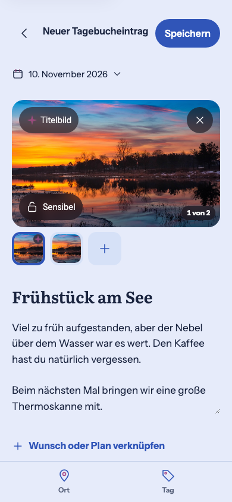 | 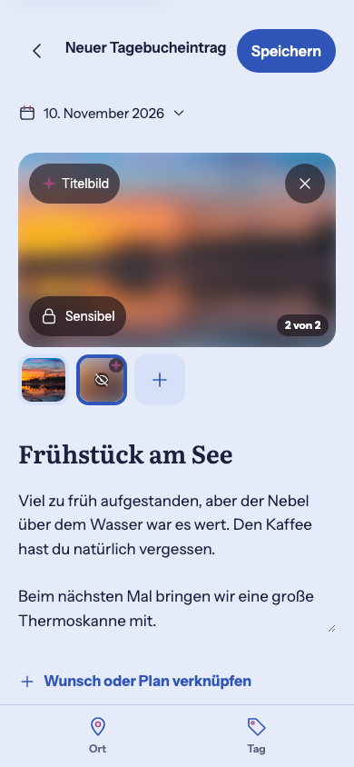 | 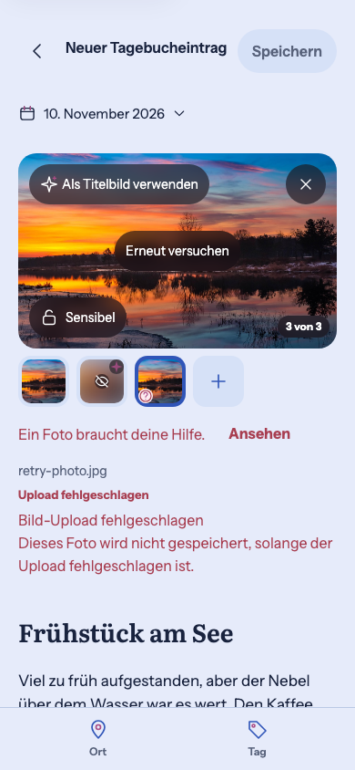 |
| Diary / Dark | 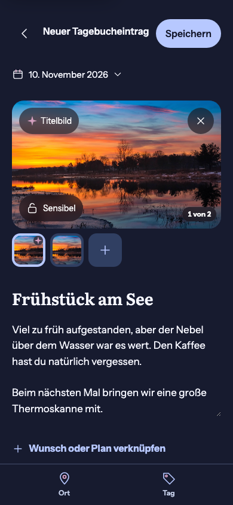 | 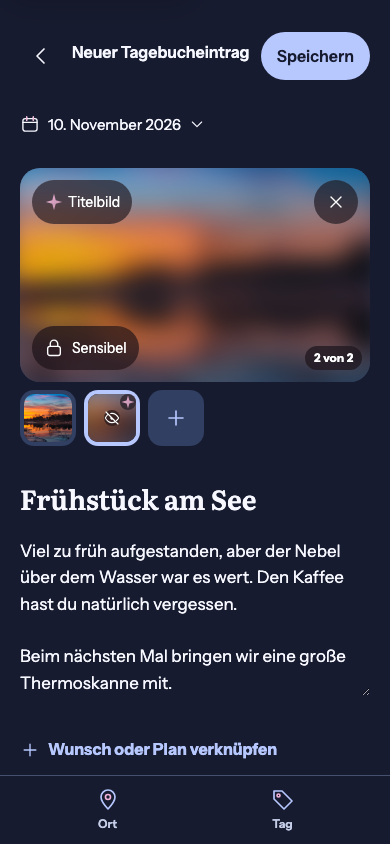 | 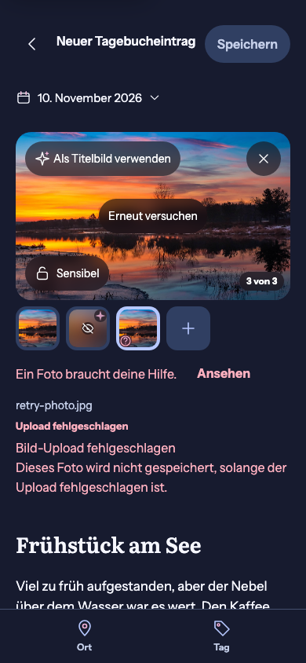 |
| Heart / Light | 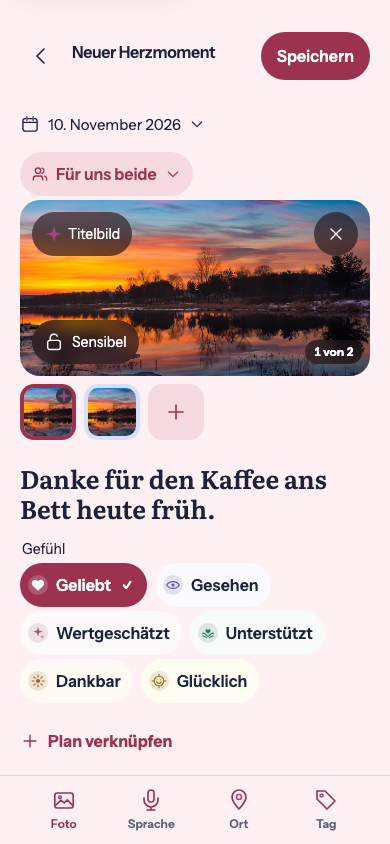 | 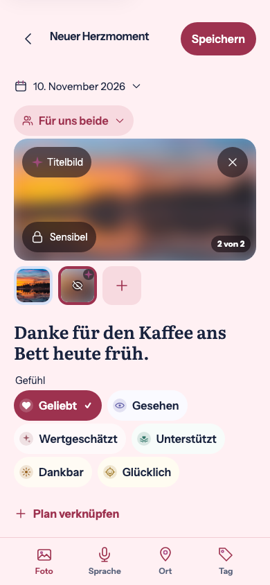 | 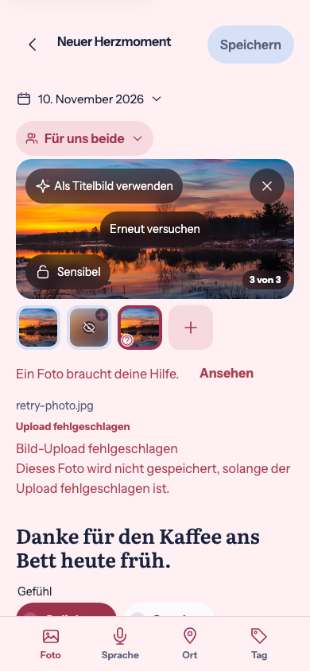 |
| Heart / Dark | 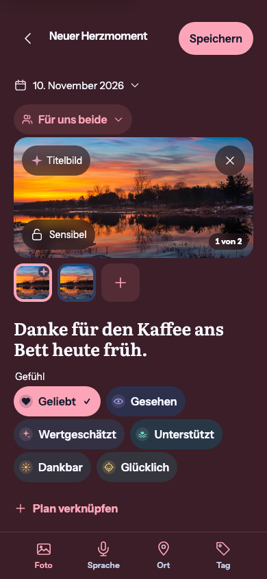 | 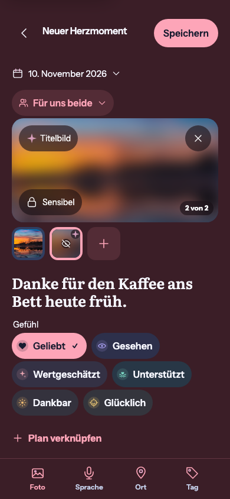 | 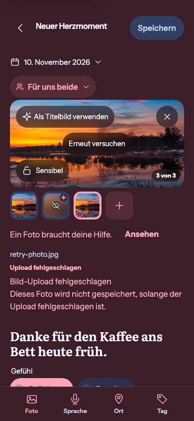 |
| Plan / Light | 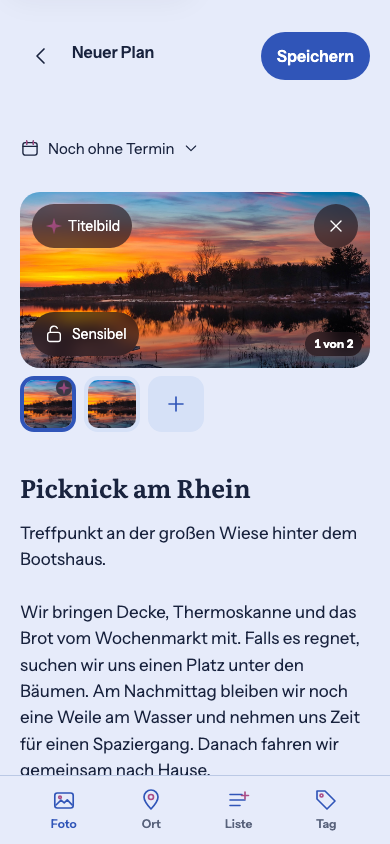 | 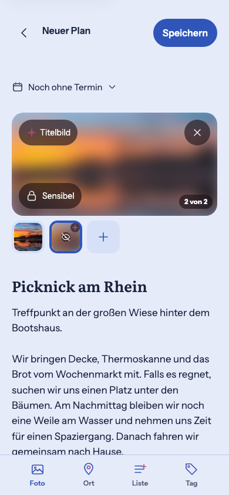 | 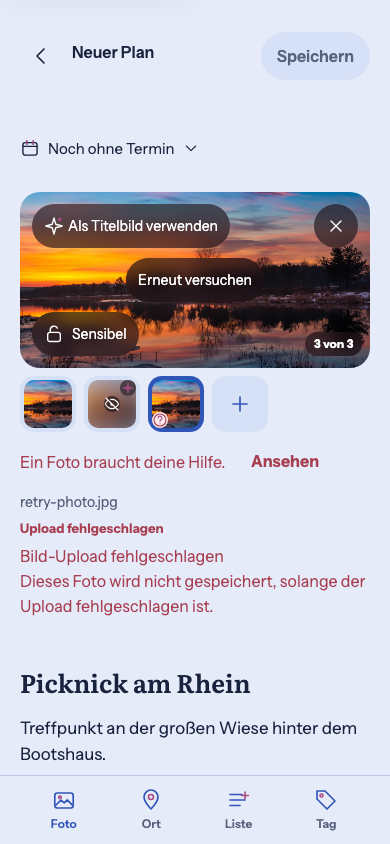 |
| Plan / Dark | 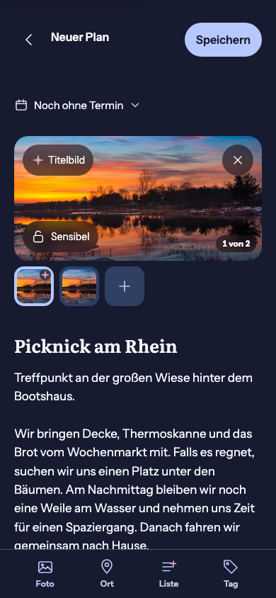 | 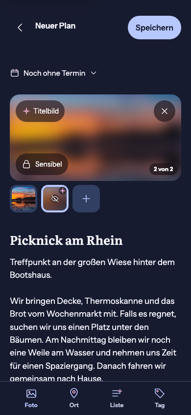 | 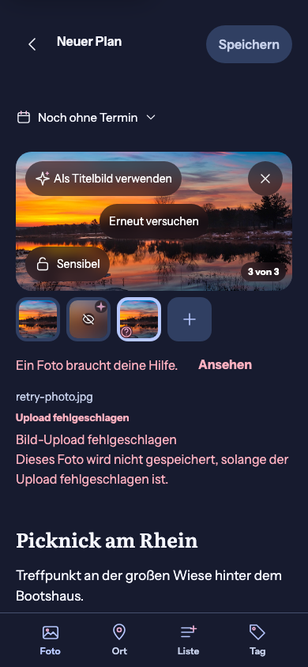 |

[Capture inventory](capture-manifest.json) identifies all 174 current runtime PNGs.
No drawn reference or source screenshot is copied. The only test presentation
override is the explicit 200% root-font scaling case.
