# Wir monthly mosaic and story summary: implementation evidence

Owning issue: [#1736](https://github.com/baerenmarke90/eimir/issues/1736).
Approved reference: [#1737](https://github.com/baerenmarke90/eimir/pull/1737),
merged at `ae4f0014166a81b9f55a0b779102cebac39e04f4`.
Runtime revision: `ebf2868f9c7225a750af29b606852ace07d7da59`.
Evidence was captured against that runtime tree; the subsequent evidence commit
changes only this directory. GitHub CI binds the final PR head and merge context.

## Reference comparison

The [approved frames](../../references/today-month-story/README.md) remain
unchanged. The existing selected Wir color world and shell continue to govern
surrounding presentation; this slice changes neither those settings nor the
cover, feelings or recent activity. The reference's category colors and story
surface are semantic Light/Dark tokens. The stronger existing media scrim
protects caption contrast over arbitrary photos. Tile heights use rem units to
retain room when text scales. Sensitive previews retain the existing 12px
concealment token; a localized visible label is separated from the caption even
at 200% text. Dates remain in accessible names, with no duplicate visual date.

| Reference | Implementation, 390px Light | Implementation, 390px Dark |
| --- | --- | --- |
| Frame 4: one photo | 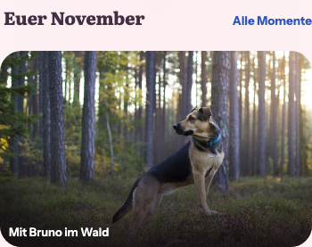 | 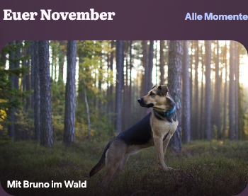 |
| Frame 5: two photos | 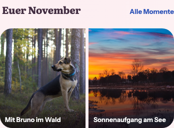 | 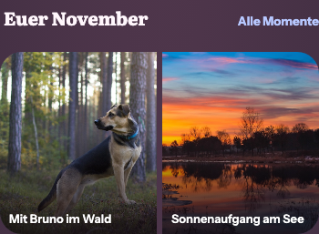 |
| Frames 1 / 6: three photos, one sensitive | 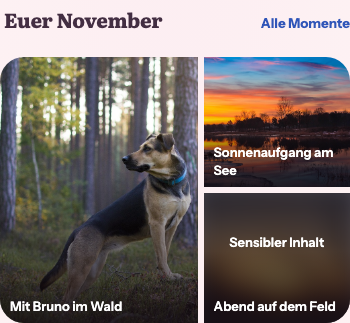 | 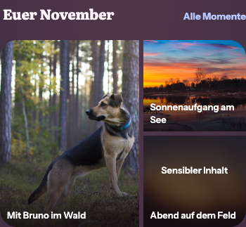 |
| Frames 2 / 3: full story | 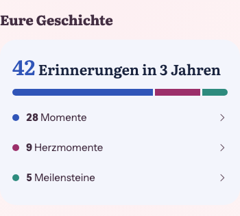 | 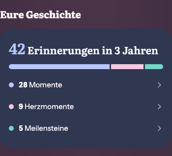 |
| Frame 7: two categories | 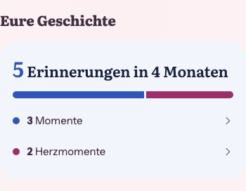 | 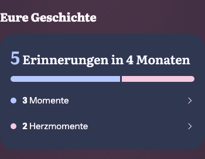 |
| Frame 8: no duration | 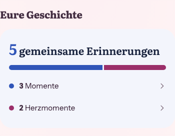 | 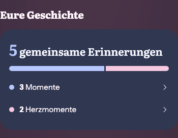 |

## Widths and accessibility

Each listed browser case captures all three photo counts, the full story,
two non-zero categories and the no-duration fallback. Corresponding PNG files
are retained beside this index. The fixture contains authorized CC0 demo
photographs only, anchored to November 2026 for a deterministic localized heading.

| Width/theme | Mosaic | Story |
| --- | --- | --- |
| 360 Light | [Three photos](today-month-reference-3-360-light.png) | [Full story](today-story-reference-3-360-light.png) |
| 360 Dark | [Three photos](today-month-reference-3-360-dark.png) | [Full story](today-story-reference-3-360-dark.png) |
| 390 Light/Dark | See comparison above | See comparison above |
| 430 Light | [Three photos](today-month-reference-3-430-light.png) | [Full story](today-story-reference-3-430-light.png) |
| 430 Dark | [Three photos](today-month-reference-3-430-dark.png) | [Full story](today-story-reference-3-430-dark.png) |
| 320 Light, 200% text | [Three photos](today-month-reference-3-320-light.png) | [Full story](today-story-reference-3-320-light.png) |
| 1280 Dark | [Bounded mosaic](today-month-reference-3-1280-dark.png) | [Bounded story](today-story-reference-3-1280-dark.png) |

The browser checks real 220/200/130px base geometry, a spanning lead tile,
no horizontal scrolling, real image decoding, concealment and no inline reveal,
visible keyboard focus, 44px category targets, Light/Dark axe, reduced-motion
feedback, category destinations, keyboard activation and return to Wir. The
sensitive label's text bounds must end before the caption begins at every
reference width, including 320px at 200% text. Existing complete Today,
Daily Quote and relationship journeys retain source navigation, personal
visibility/order, de-duplication, loading/error recovery and optional Pro access.
No native wrapper/capability changed, so no new native-device claim is made.

## Validation

- `npm test -- --maxWorkers=2`: **2,886 passed**, two pre-existing skips,
  319 passing files (321 including the skipped files), 160 seconds.
- Focused Today / SharedStorySummary / theme-token tests: **116 passed**.
  Covers each photo count, sensitive concealment, canonical links, no duplicate
  visual dates, eligibility, explicit empty preview, live zero-category omission,
  localized totals, singular/plural day/month/year periods and no-duration fallback.
- Complete affected browser specs (`today-living-home`, `today-daily-quote`,
  `relationship-reflections`, `shared-story-summary-visual`), one worker:
  **73 passed**. After the bounded color, reading-width and rem-height refinements,
  the complete Today suite passed **36/36**. The final sensitive-label spacing
  regression and all reference frames passed **8/8** on the runtime above.
- Lint, format, typecheck, token/localization reproducibility, production build,
  engineering-language audit and documentation-language audit passed.
- Browser inventory and planning regressions: **38 passed**. Shared token changes
  conservatively select the full regression: **1,215 tests in 104 specs** collected.
  The feature remains outside the global always-run core; ownership explicitly
  includes the summary and filtered Story continuation.

The first default-parallel local unit run had 19 failures/timeouts in six
unrelated files while local work competed for resources. Those six files passed
unchanged with one worker (121 tests), and the unchanged complete two-worker
rerun passed. No assertions, timeouts or CI protections were relaxed. The first
local planning run could not bind its test port in the sandbox; the authorized
port-enabled run passed all 38 tests. The language audit ran without the generated
E2E bundle, as in a clean CI checkout. No remote rerun has been requested.

## Product boundaries

No business/freemium impact. The monthly module remains Free/Core. The lifetime
story remains the existing independent personal opt-in requiring
`relationship.passport`, off by default, following the authoritative feature
matrix. The reference's description of both modules as Free/Core was corrected
in #1736 without changing the frozen reference. Cloud/Self-Hosted, ownership,
quotas, storage, retention, downgrade and retained sources remain unchanged.
The eligibility helper is unchanged; the existing explicit opt-in still bypasses
that helper, while the live summary omits zero category rows and the explicit
empty component preview retains them.
