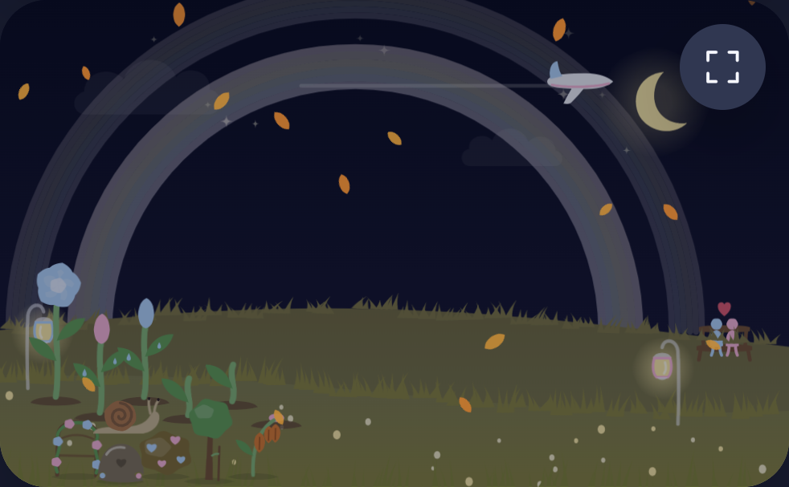
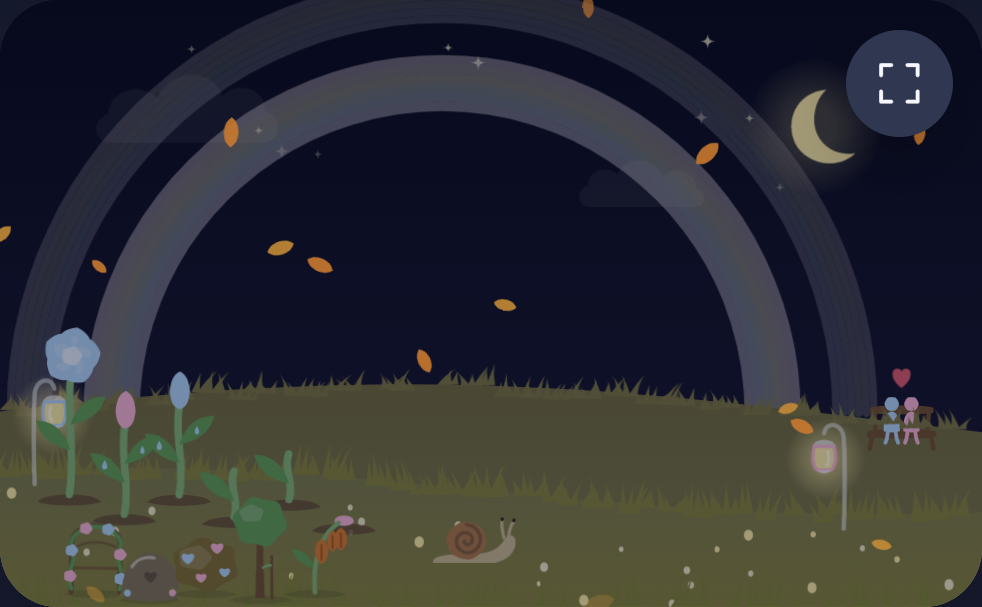
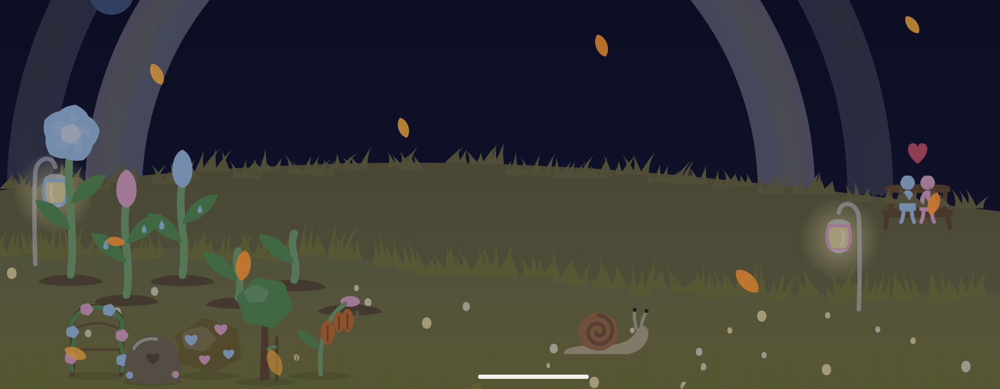

# #2063 Garden depth bands and resting idle motion: device evidence

Measured on 2026-11-19 on a Pixel 10 Pro Fold with the outer display at 120 Hz, using the debug WebView build. The same protocol ran for both builds: a fresh app start, the same account and garden, no tracing during the jank windows, and `dumpsys gfxinfo` plus `top`.

- **Before:** `main` at `915e97ec8`.
- **After:** this change.

The screenshots are cropped to the garden scene, so no personal content of the account appears.

## What changed visually

Nothing should have changed: the composition and depth order are meant to be identical.

| Before (`main`) | After (depth bands) |
| --- | --- |
|  |  |

The plane, leaves and stars differ between the two images only because they were caught mid-motion.

Full screen with depth bands:

Wir garden preview with depth bands:

All nine bands report one identical box on the device:

| View | Box |
| --- | --- |
| Garden page | `20,325,403,248` |
| Full screen | `0,0,969,443` |
| Wir preview | `20,473,403,201` |

## Measurements

Garden page, steady state, three 8 s windows:

| | Before (`main`) | After |
| --- | --- | --- |
| Janky frames | 7.2 %, 5.6 %, 10.8 % (mean 7.9 %) | 5.4 %, 3.9 %, 5.2 % (mean 4.8 %) |
| 99th percentile frame | 25–26 ms | 22–24 ms |
| App / WebView renderer CPU | 165 % / 280 % | 118 % / 222 % |
| GPU thread busy, 6 s trace | 3.8–4.1 s | 0.27–0.29 s |

Idle pages:

| | Before (`main`) | After |
| --- | --- | --- |
| Wir idle, renderer CPU | 205 % | 36 % |
| Wir idle, app CPU | 35 % | 20 % |
| Momente › Karte idle, renderer CPU | 125 % | 14 % |
| Momente › Karte idle, app CPU | 19 % | 7 % |

Renderer CPU is the sum of three `top` samples.

Notes:

- **Remaining Wir idle cost:** about 14 commits per second, mostly the one-second countdown, which the Product Owner accepted.
- **Remaining garden cost:** main-thread style and paint for the roughly 150 looping SVG animations. They cannot run on the compositor because they animate SVG children.

## Wir garden preview rest

- The preview plays only while on screen, and only for `motion.duration.ambientRest` (12 s) of visible time in total.
- Then it holds every part where it is (`animation-play-state: paused`).
- Offscreen it rests at once.
- Reduced motion keeps it still, as before.

## Momente › Karte opening

There are no map screenshots here: the map shows the account's personal places and photos. The behaviour was checked frame by frame on the device:

- **First open after an app start:** the page shows its calm loading surface. The map, its photo stacks and the basemap then fade in together, in one piece.
- **Returning to the map:** it is still mounted and shows completely at once.

Cold open measurements, from the tap on Karte:

| | Before (this PR's first push) | After |
| --- | --- | --- |
| Main-thread blocking by `URL.createObjectURL` | 416–665 ms | 0 ms (worker) |
| Long tasks in total | 770–974 ms | 190–420 ms |
| Map complete (basemap, photos) | built up piece by piece until about 2 s | 1.7 s, in one piece |
| Return to the map | rebuilt each time | 14 ms, already complete |

The single largest remaining block is starting the map's GPU surface (WebGL), about 190 ms. It happens once per app start.

The first open also waited on four provider round trips (style, TileJSON, sprites, glyphs) before any tile. The style with its TileJSON is now kept on the device, and sprites and glyphs come from the native HTTP cache, so tiles load at once. A stored style older than a day is not used, and repeated missing tiles drop it.

## Grass in three groups per row (Product Owner, 2026-11-20)

The Product Owner compared individual tufts, groups and whole rows in a side-by-side preview built from the same tuft geometry and timing. They chose three groups per row of a 340-wide garden.

Each group leans from its roots with a skew, so roots stay on the ground; the gust uses the same skew. The meadow moves in a few offset waves.

Garden page, steady state, three 8 s windows on the Pixel:

| | Depth bands only | Depth bands and grass groups |
| --- | --- | --- |
| Janky frames | mean 4.8 % | 1.04 %, 0.73 %, 0.83 % |
| 99th percentile frame | 22–24 ms | 19–20 ms |
| Running animations | 151 (104 of them tufts) | 54 (9 grass groups) |

## Momente map prepared after start (Product Owner, 2026-11-20)

In the phone app the kept Momente map is built in the background once the app is quiet:

- about 4 s after start;
- after 1.5 s without touch, scroll or keys;
- in an idle period;
- not while hidden, and not with Data Saver.

The map is laid out at its real size but invisible and inert, outside the scrollable page. The first tap on Karte then shows it complete, as two cold starts on the Pixel confirmed. The Web builds the map when it is opened.
