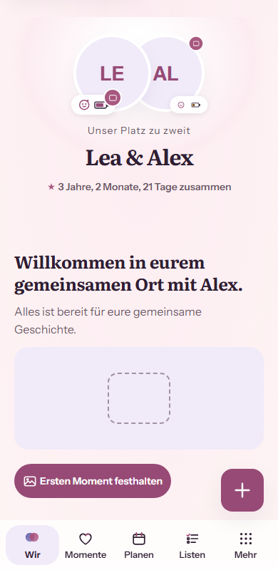
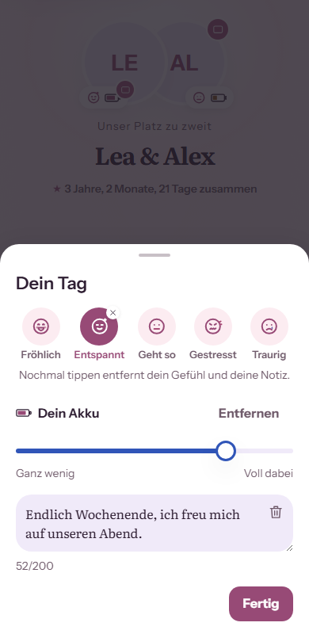
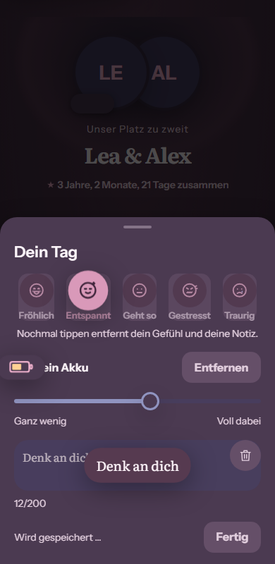

# #2073 motion layer: screenshot parity

The motion layer step must not change anything visible. This compares the
same screens built from `main` at `5528a2dbe` and from this branch.

## Method

- `web/e2e/tests/today-daily-checkin.spec.ts`, the `visual evidence` and
  `Fertig flies` cases, ran with `VISUAL_EVIDENCE_DIR` once per build
  (Playwright Chromium, one worker).
- Screens covered:
  - Wir resting after its opening;
  - the "Dein Tag" sheet;
  - the partner quick-action sheet;
  - Wir after a deletion;
  - the send flight (ghosts hovering in the top-layer flight layer, then
    landed).
- Variants covered:
  - 360, 390, 430 and 1280 px;
  - light and dark;
  - 200 % text;
  - reduced motion.
- Before each screenshot, a temporary copy of the spec (not committed)
  finished every finite animation and held every looping one at frame 0, so
  both builds were captured in the same end state. Without that step,
  screenshots of the same `main` build already differ from run to run by up
  to about 6 700 px (2.3 %) in their timing-dependent frames.
- Pixels were compared per channel with a tolerance of 2 of 255.

## Result

34 screenshots. 33 are identical; one differs by a single pixel of text
antialiasing (200 % text). No visible change.

| Screenshot | Differing pixels |
| --- | --- |
| `1790a-1280-light-1-resting.png` | 0 of 1024000 |
| `1790a-1280-light-2-dein-tag.png` | 0 of 1024000 |
| `1790a-1280-light-3-partner-sheet.png` | 0 of 1024000 |
| `1790a-1280-light-4-after-deletion.png` | 0 of 1024000 |
| `1790a-360-dark-1-resting.png` | 0 of 288000 |
| `1790a-360-dark-2-dein-tag.png` | 0 of 288000 |
| `1790a-360-dark-3-partner-sheet.png` | 0 of 288000 |
| `1790a-360-dark-4-after-deletion.png` | 0 of 288000 |
| `1790a-360-light-1-resting.png` | 0 of 288000 |
| `1790a-360-light-2-dein-tag.png` | 0 of 288000 |
| `1790a-360-light-200-text-1-resting.png` | 0 of 288000 |
| `1790a-360-light-200-text-2-dein-tag.png` | 0 of 288000 |
| `1790a-360-light-200-text-3-partner-sheet.png` | 0 of 288000 |
| `1790a-360-light-200-text-4-after-deletion.png` | 1 of 288000 |
| `1790a-360-light-3-partner-sheet.png` | 0 of 288000 |
| `1790a-360-light-4-after-deletion.png` | 0 of 288000 |
| `1790a-390-dark-reduced-motion-1-resting.png` | 0 of 312000 |
| `1790a-390-dark-reduced-motion-2-dein-tag.png` | 0 of 312000 |
| `1790a-390-dark-reduced-motion-3-partner-sheet.png` | 0 of 312000 |
| `1790a-390-dark-reduced-motion-4-after-deletion.png` | 0 of 312000 |
| `1790a-390-light-1-resting.png` | 0 of 312000 |
| `1790a-390-light-2-dein-tag.png` | 0 of 312000 |
| `1790a-390-light-3-partner-sheet.png` | 0 of 312000 |
| `1790a-390-light-4-after-deletion.png` | 0 of 312000 |
| `1790a-430-light-1-resting.png` | 0 of 344000 |
| `1790a-430-light-2-dein-tag.png` | 0 of 344000 |
| `1790a-430-light-3-partner-sheet.png` | 0 of 344000 |
| `1790a-430-light-4-after-deletion.png` | 0 of 344000 |
| `send-flight-360-light-hover.png` | 0 of 288000 |
| `send-flight-360-light-landed.png` | 0 of 288000 |
| `send-flight-390-dark-hover.png` | 0 of 312000 |
| `send-flight-390-dark-landed.png` | 0 of 312000 |
| `send-flight-430-light-hover.png` | 0 of 344000 |
| `send-flight-430-light-landed.png` | 0 of 344000 |

## Representative pairs

| Screen | `main` | This branch |
| --- | --- | --- |
| Wir, 390 px light |  |  |
| "Dein Tag" sheet, 390 px light |  |  |
| Send flight in the top layer, 390 px dark |  |  |
