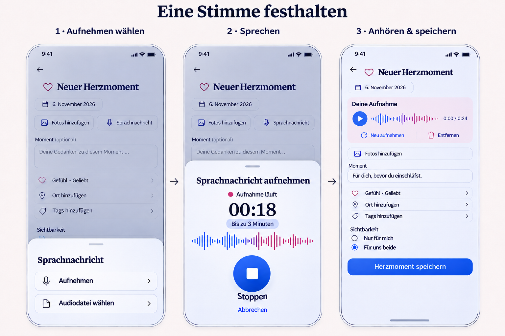
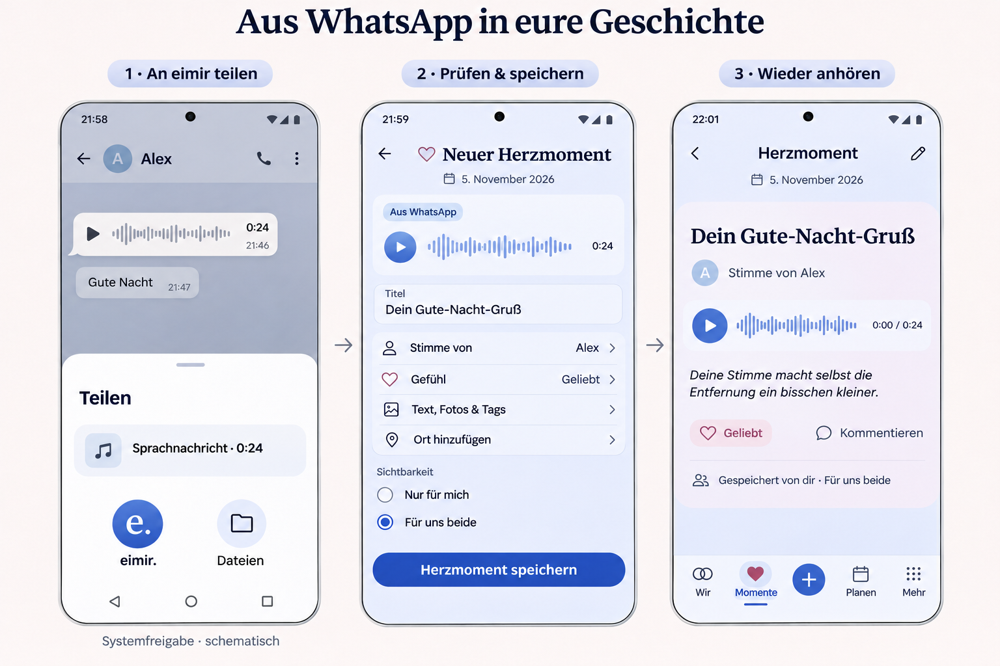

# HeartMoment voice notes

## Product decision and baseline

The Product Owner approved the generated voice-note concept on 2026-11-06 and
requested recording in eimir, audio import (including Android sharing from
WhatsApp), playback in HeartMoments and a PR. This is an explicit HeartMoment
follow-up to #470/#512; #470 retains its separate ten-second Memory scope.

Inspected main: `c5e15a4c29eb60adaec5a1d39f574fdc9b8c4d25`.
Reviewed the actual HeartMoment create/detail/edit routes, HeartMomentProductPage,
StoryCreatePageShell, ShortTaskSheet, PlanPhotosEditor, HeartEmotionPicker,
attachment binding/processing/transfer, and Capacitor activity/file chooser before
refreshing the generated recording reference. Existing back, date, photos,
thought, emotion, places, tags, audience and save stay available.

Built-in Imagegen was used. Prompt: refresh the approved three-phone recording
composition against the inspected baseline; preserve eimir pale blue/navy/rose,
all current composer capabilities and focused navigation; add the three-minute
limit, dominant Stop action, playable review, explicit audience and Save. The
approved import reference shows schematic Android sharing, unsaved review with
speaker attribution, then saved content-led playback. Images guide composition;
they are not exact icon/font locks. No automatic transcription or autoplay.

## Mobile Interaction Contract

Authority: Product Reference v1 R1 capture/R2 reading, Create/Edit and Detail
screen templates, existing ShortTaskSheet and semantic tokens. Compact first;
Expanded keeps the same task in a bounded reading width.

- Entry: Sprachnachricht beside existing media. Sheet: Aufnehmen / Audiodatei
  waehlen (localized). Android receives one shared audio file into a review draft.
- Capture: tap to start; microphone permission only then; visible recording state,
  elapsed time and real waveform; Stop creates a playable draft. Cancel, task exit,
  backgrounding and identity changes release every microphone track.
- Bounds: one voice per HeartMoment, 180 seconds, 20 MiB input. Audio alone is
  valid. These bounds permit the approved 24-second example and do not change
  Memory Audio-Polaroids. Actual duration/codec is verified by the server.
- Review: optional title and authored speaker label; never infer the speaker from
  importer/source. Re-record/remove preserves other fields. Explicit audience and
  one Save; existing idempotency, pending/error protection and result/return apply.
- Read: player leads, optional title/speaker, labeled play/pause/seek and duration;
  no autoplay. Saved-by and speaker remain distinct. Audio is never a photo cover.
- Preserve useful input during permission, format/size/duration, processing,
  upload and playback failures. Unsupported capture retains file import. Offline
  never reports a successful write. Loading/error/retry states are localized.
- Reuse sheet focus, Back/Escape, inert background, dismissal and focus restoration.
  Focused creation has no global nav. Standard sheet/feedback motion respects
  reduced motion. Keyboard, large text and 44/48px touch targets are integral.

## Reuse and business review

Reuse review relevant: use MediaRecorder/getUserMedia/Web Audio, native Android
ACTION_SEND and content URI grants, Capacitor, existing MediaStore/binding/
authorization/cleanup/protected payload/transfer, and the restricted FFmpeg role.
A recorder SDK, waveform dependency, second storage backend or speech provider
adds no needed value. Browser audio is the playback primitive, with small eimir
controls for content composition and accessibility.

Primary references reviewed:
- https://developer.mozilla.org/en-US/docs/Web/API/MediaRecorder
- https://developer.mozilla.org/en-US/docs/Web/API/MediaRecorder/isTypeSupported_static
- https://developer.android.com/reference/android/webkit/PermissionRequest
- https://developer.android.com/develop/ui/compose/sharing/receive
- https://ffmpeg.org/ffmpeg-formats.html

FFmpeg stays the existing LGPL component in its bounded, network-disabled media
role. Narrow Ogg/WebM/MP3/WAV/AAC input is normalized to metadata-stripped AAC/M4A;
verify duration and decode completely. Audio intake is an operator capability,
independent of video's Pro capability. Enable the same-revision media worker;
normal couples never configure keys/providers. Existing reads remain available
when intake is disabled. One shared contract serves Self-Hosted and Cloud.

Business/freemium impact reviewed: Short Audio / Voice Notes stays Free/Core in
the authoritative feature matrix. No new entitlement/count paywall. Existing Cloud
storage policy applies; byte/time bounds protect processing. Downgrade preserves
read/delete/essential export. No external provider account or fee.

## Cross-cutting contract and validation

Parent OWNER_ONLY/SPACE_SHARED authorization, visibility revocation, cross-Space
isolation and deletion apply to audio. Titles/speaker labels remain protected
relationship content. No content or sensitive filenames in logs/analytics/push.
Native handoff is bounded/volatile and cannot silently upload under a changed
account/Space. Dispose URLs and streams at task/authorization boundaries. Transfer
retains authorized audio and labels and revalidates imported bytes.

Validate real decoder fixtures plus malformed/long/oversized files; backend
private/foreign-parent/cleanup/transfer; recorder permission/cancel/late permission/
background/identity races; browser record/import/review/save/playback and failed
write recovery; Compact/Expanded, Light/Dark, reflow/reduced motion; Android
compile and available native tests. Report missing device evidence explicitly.
