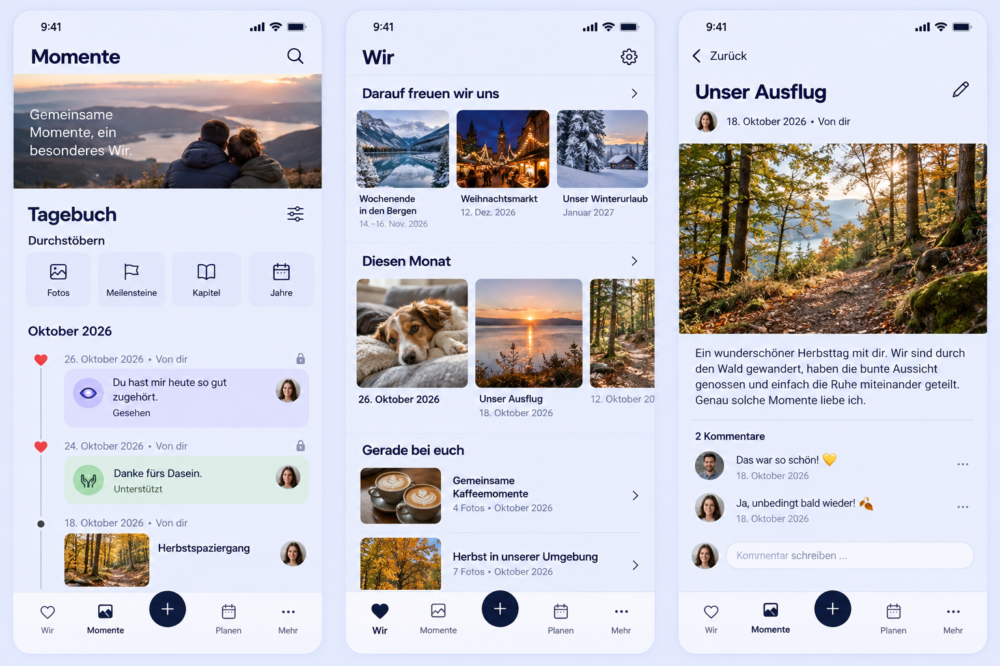

# Journal, captions and edit actions

## Product design preflight (2026-10-30)

Requested by the Product Owner in the implementation chat, including the two
attached Diary/Today screenshots and the follow-up removing the quote ornament.
Baseline main: `e9f6646065440c24baf4dfe02477704adaee57b7`.
Destination branch baseline: `da14f81791ae62a6ec4742762a43b8764ee2d298`
(`feat/primary-tab-swipe`; currently main plus its generated reference).

Reviewed the unified `/story` rediscovery hero/tapestry and Diary, current
filter sheet, `StoryBrowseLayer`, `StoryList`, `HeartEmotionVisual`, Today
monthly strip, quote, canonical read details, private read details, profile
identity and contextual comment editing. Preserve the four root destinations,
central create action, authorized images, privacy, active filters and task return.

Generated reference **before UI implementation**:

Generated using the built-in Imagegen tool (`ui-mockup`). The reference covers
category-tinted Diary entries with red heart nodes, visible browse destinations,
photo captions and a contextual pencil. The image is composition guidance:
its invented header/hero copy, repeated privacy locks, hidden navigation labels,
separators and four separate browse tiles are not implementation requirements.
The actual existing shell, shared browse strip and authorization take precedence.
The generation prompt is retained in
[prompt.txt](references/journal-category-edit-polish/prompt.txt). Its horizontal
layout wording was normalized during CI review to avoid a false legacy-product
identity match; the original transcript remains in commit `4238cdae` and the
image requirements are unchanged.

## Mobile interaction contract

- Outcome: recognize and rediscover one's history and edit the intended object.
  R2 (Moments), R4 (Today), R5 (utility), Detail and Story Timeline templates apply.
- Compact: preserve unified rediscovery followed by Diary. The recognizable
  sliders filter stays beside Diary; a visible Durchstöbern strip provides
  Photos, Milestones, Chapters and Years before the chronology. The filter
  sheet owns only draft filters and Apply/Cancel.
- Main action: open personal content. Editing is a secondary, named pencil at
  the trailing edge of the relevant title/section; no persistent edit form or
  duplicate edit shortcut. Item-specific actions stay with their item.
- Category: reuse all six existing emotion accent/surface pairs, icons and
  translated labels. All timeline heart markers use the existing red loved
  accent independently of category. Shapes and labels retain non-color meaning.
- Captions: preserve authored titles. For generated date titles, use one
  localized date as the heading and omit the repeated date underneath. Apply
  the same rule to Story, Today and other previews using these projections;
  do not rewrite stored titles or fetch bodies just for previews.
- Today: square photos with calm captions on the page, no link underline or
  colored caption container. Remove only the quote ornament, preserving the
  quotation, attribution, settings and entitlement states.
- Loading/empty/error/offline: retain existing regional states, caches, retry,
  author rights and disabled writes. No new data flow, cache or network call.
- Success: existing authoritative save, dirty/pending protection, keyboard
  focus restoration and originating filter/scroll/return state remain intact.
- One partner can browse and edit all content their capabilities allow without
  requiring participation from the other; optional comments stay optional.
- Controls have at least 44 px targets, visible focus, native link/button
  semantics, localized accessible names and Web tooltips. Browse labels wrap
  into two columns when necessary. No hover-only or gesture-only affordance.
- Expanded: same hierarchy with wider imagery and captions; no extra forms.
- Motion: reuse existing feedback/sheet and carousel behavior, including
  reduced motion; this correction adds no new animation or early keyboard.
- No new love microcopy/delight: personal content supplies the emotional value.

## Reuse, business and cross-cutting review

Reuse the existing emotion palette/attributes, `ListEntryIconButton`, pencil,
detail link, PageHeader, browse routes, task origin and date formatting. No
third-party dependency/provider or infrastructure implementation is required.
The generic edit action uses this existing icon pattern; contextual specific
field choices and destructive actions retain clear text where necessary.

**No business/freemium impact:** Memory CRUD/Timeline, HeartMoments, ordinary
search/filtering and photo browsing remain Free/Core under the matrix. No
capability, ownership, Cloud/Self-Hosted, quota, storage, operating-cost,
downgrade or existing-data behavior changes. Quote eligibility remains intact.

Security/privacy, API/migrations, concurrency, observability, operations and
resource usage are unchanged. Localization/date behavior, semantics/contrast,
focus/targets, reduced motion, narrow/large-text layouts and regression tests
are relevant. Validate all six categories in Light/Dark and generated/authored
captions; exercise filter draft/cancel/apply, browsing, edit/save/return and
private edit permissions. Capture Compact 360/390/430, 320 reflow, Expanded,
Light/Dark and reduced-motion evidence using synthetic content.

## Implementation and validation

UI source revision: `e97b869016395da6f274f0145abc953dac033025`, based on main
`e9f6646065440c24baf4dfe02477704adaee57b7`. The implementation initially used
the linked swipe branch; its only extra generated swipe reference was excluded
when moving this independent change onto main. No parallel swipe code or
uncommitted source-checkout changes were included.

- 235 targeted tests passed in 16 Vitest files, including original permission,
  draft/failure, profile, Story, Today, quote and private-edit coverage. The new
  caption regression preserves authored titles, normalizes blank/generated
  titles and handles missing dates without fabrication.
- 36 distinct Chromium journeys passed: category/heart/caption matrix (6),
  browse narrow/reflow (2), comment edit/late completion (11), comment offline
  create/update/delete (12), filter draft/cancel/apply (1), private Search
  edit/cancel/return (1), quote composition/reflow (2), nickname/profile (1).
  The six visual cases were also rerun to capture focused final screenshots.
- One isolated retry: the 390 Dark HeartMoment comment-create case initially
  remained on Login before any sign-in POST. The trace showed instance-status
  reads but no auth request; the same unchanged case passed alone. No successful
  independent test was rerun to mask that failure; no CI retry was used.
- Scoped Biome lint and format, TypeScript, semantic-token checks, PWA checks,
  production Vite build and `git diff --check` passed with Node 22.23.2.
  Existing bundle-size and upstream `use client` bundler notices remain.
- Browser checks include axe WCAG checks, 320 large-text/reflow, 360/390/430,
  Expanded, Light/Dark, reduced motion, explicit filter state and existing
  author-only mutation and task-return contracts. A profile focus regression
  found during implementation was corrected: deferred focus restoration never
  steals focus from a field the user has already entered.
- Browser request fixtures use synthetic accounts/content and repository demo
  media. No production data, API contract, persistence or authorization changed.
  No native wrapper capability changed; physical-device acceptance was not run.

### Visual evidence

| Composition | Evidence |
| --- | --- |
| Diary, Compact Light | [360](references/journal-category-edit-polish/diary-360-light.png), [430](references/journal-category-edit-polish/diary-430-light.png) |
| Diary, Compact Dark | [390](references/journal-category-edit-polish/diary-390-dark.png) |
| Diary, Expanded Dark | [1280](references/journal-category-edit-polish/diary-1280-dark.png) |
| Monthly captions, Compact Light | [390](references/journal-category-edit-polish/monthly-390-light.png) |
| Monthly captions, Expanded Dark | [1280](references/journal-category-edit-polish/monthly-1280-dark.png) |
| Quote without ornament | [Compact](references/journal-category-edit-polish/today-daily-quote-390-light.png), [Expanded](references/journal-category-edit-polish/today-daily-quote-1280-light.png) |
| Read-detail pencil and comment edit | [390 Dark](references/journal-category-edit-polish/comment-edit-success-390-dark.png) |

These are implementation evidence, not a declaration of final Product Owner
acceptance for the broader design program. Business/freemium and reuse findings
above were rechecked after implementation and remain unchanged.

## Pre-merge compatibility with PR #1523

The Product Owner authorized merge once this PR is ready and does not conflict
with #1523. Checked the swipe head `7586f4284f6c655cd4652cd5dec6cdbe7c63a3be`
against this PR's `cab771b28f888f1b7ccb444c452d9aaa9c963cc3` in a disposable
combined checkout. No changed paths overlap, and Git merged both without a
conflict (combined tree `a8e1000ec01cd51dce3a7106176cc81bcb69c4ec`).

On that actual combined source, the production build and 169 targeted tests in
seven files passed. All 13 Chromium cases passed: four primary-touch viewport
cases; native history/scroll/Planning restoration without extra fetches;
horizontal/vertical gesture ownership; explicit filter Apply/Cancel; four Diary
category/caption cases; and two monthly caption cases. The swipe hooks retain
ownership rules for buttons, editors, dialogs and horizontal photo strips.
PR #1523 itself was neither changed nor merged by this check.

Initial CI failures were inspected rather than retried. Localized Diary sample
prose was moved to the existing German browser fixture. Three older comment
test helpers now use the direct pencil or the separately named overflow menu;
all 77 tests in those files pass with their original permission, offline,
concurrency and failure assertions. A prompt layout phrase was reworded to
resolve the identity scanner's false brand match without weakening that gate.
Language, documentation-language and project-identity audits pass locally.
The original local full-suite attempt was stopped once it was obsolete during
these test-helper corrections; exact-head GitHub CI remains the full-suite gate.

The full Web CI subsequently passed all 2,276 tests (two existing skips), lint,
formatting, TypeScript and the production build. Broader browser regression
then exposed older flows that still opened Filter before selecting a browse
destination, plus one delete helper that still selected the edit label. These
flows now exercise the visible browse navigation and the named comment-actions
menu while retaining their original return, error, permission and accessibility
assertions. All six comment-delete cases, the shared-photo gallery/reflow/return
case, the short-viewport large-text task case, and all 13 Timeline-reference
cases pass locally. The original 42rem browse-strip width cap is retained on
Expanded; [current bounded-strip evidence](references/journal-category-edit-polish/browse-1440-light-bounded.png)
supplements the earlier exact-revision screenshots. Final-head CI remains the
merge gate after this scoped CSS/test alignment; no checks were bypassed.
