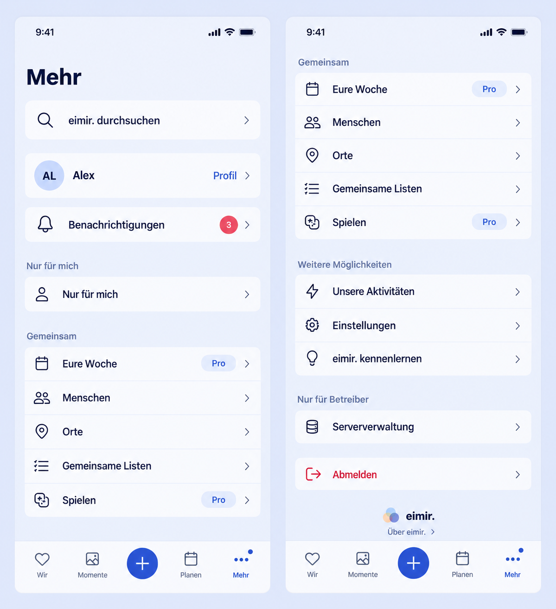

# Mobile shell and More utility consolidation

## Product Owner decision and baseline

On 2026-10-29 the Product Owner explicitly approved removing the persistent mobile header; consolidating the logo, avatar/account functions, global search and notifications in More; showing an unread dot on More; and retaining Expanded top navigation. This supersedes older guidance requiring Compact header utilities and the optional avatar shortcut. Stable routes and primary destinations remain unchanged. The owning issue is [#1507](https://github.com/baerenmarke90/eimir/issues/1507). The Product Owner subsequently explicitly selected the reference image's light, rounded grouped surfaces: separate identity/notification/private entries, continuous shared/utility lists, and an isolated sign-out surface. Dark uses the existing raised-surface token rather than literal white.

Reviewed current `origin/main` at `f35f82dbab2465fe337850a1e8db147f4eb3942a`, including AppShell, MoreOverviewPage, HeaderProfileMenu, HeaderNotificationsMenu, canonical routes, notificationRead ownership, profile identity, tokens, and the real More route wiring. Work is isolated in `fix/mobile-header-more` with separate dependencies and preview ports; unrelated active checkouts are not edited.

## Generated visual preflight

Generated before UI implementation with the built-in Imagegen tool. [Exact prompt](references/mobile-header-more/prompt.txt). The two panels show the beginning and continuation of More, with all existing shared/private/account destinations. This is composition guidance, not a pixel lock: reuse semantic raised-surface/radius/border tokens for the explicitly selected white grouped lists, and retain the authoritative brand asset instead of reproducing generated brand artwork. No new app-information destination is invented; the existing Brand is placed quietly in the More footer.

## Mobile Interaction Contract

- **Outcome / reference:** reclaim space for personal content while making utilities recognizable under More. Product Reference v1 content-before-chrome, D6, R4 and R5; Settings/Privacy template and existing navigation rows.
- **Primary Compact state:** below 840 CSS px, no persistent app header. A safe top inset protects content. Task-specific Back/Close remains available independently of global utilities.
- **Hierarchy / dominant action:** page title, global search entry, compact identity/profile entry and notifications, then existing private/shared destinations and account utilities. Open the intended named destination; no extra creation action or utility grid.
- **Discovery / input:** a full-width labelled search link opens the existing global search page without early keyboard activation. Named Profile, Notifications, Activity and Settings links remain visible. Sign-out and authorized Server Administration move into More. The logo becomes a quiet footer.
- **Interaction / return:** existing links, route history, task-origin return and sign-out lifecycle; no new persistence, gestures or save mechanics. Keep all canonical deep links.
- **Loading / empty / error:** navigation remains usable without fetched identity; existing account name/initials fallback. Unknown unread state does not fabricate a count or show an unread dot. Cached authoritative state can remain during refresh failure. Existing inbox/search pages retain their own pending/empty/error/retry handling.
- **Offline / success:** retain supported cached count/navigation. Reading/mark-all uses existing ownership-aware mutations; opening More does not mark notifications read. The dot disappears only when the shared count reaches zero and returns after a failed optimistic update.
- **Privacy / relationship:** current account identity only; keep account/Space cache isolation, server-admin capability check and existing private-area labels. Unread dot exposes no notification contents.
- **Reflow / accessibility:** 320/360/390/430px, large text, keyboard and focus; growing named rows, locale-aware count, accessible unread label, no color-only state, no horizontal overflow. Bottom navigation keeps four destinations and central creation action.
- **Motion:** existing navigation/row feedback and route transitions; a static unread dot, no arrival pulse or engagement animation. Existing reduced-motion semantics remain.
- **Expanded:** from 840px the horizontal primary navigation and creation action stay above the content. More is the shared home for account and global utilities, avoiding separate avatar functionality.
- **List rationale / personality:** scanning named utility destinations is the human task, so the established grouped list is appropriate. Real identity, palette and typography carry warmth; no invented romantic copy, decorative card wall or operational data.
- **Acceptance journey:** open More -> global search/inbox/profile/settings -> complete/read/return; mark all read and verify dot clearance; sign out through the existing session cleanup. Verify normal-user/admin visibility, deep links and Story return controls.
- **Visual acceptance:** representative Compact Light/Dark, Expanded navigation, unread and read, 320px/large text, simulated top/bottom safe areas and reduced motion. Browser checks cover real layout; component tests cover shared counter and account callbacks. No native wrapper change is planned.

## Reuse review

Reuse existing React Router links, AppShell navigation, Brand, PersonIdentity, MoreDestinationRow, profile identity loader, NotificationsApi, query keys and ownership-aware read lifecycle. Alternatives were keeping a header row or adding another primary tab; both conflict with the explicit PO direction and the existing four-destination contract. This changes utility placement only: no new search/index/push infrastructure, provider, substantial dependency or custom account/session implementation. No external provider review is necessary.

## Business / freemium consistency

**No business/freemium impact:** search, notifications, account access and baseline navigation retain their existing Free/Core boundaries, with identical Cloud/Self-Hosted behavior. Existing Pro badges and capabilities remain. No pricing, entitlement, quota, retention, managed-resource cost or downgrade/data behavior changes.

## Cross-cutting quality

Preserve authentication/session cleanup, capability-gated administration, current-account identity, Space-scoped unread state and existing mutation ownership. Localize new navigation labels and format counts using the resolved locale. Static status text complements the visual dot. Reuse the current polling query without duplicate polling. No API, database, migration, external data flow, logging, deployment configuration or native capability change.
