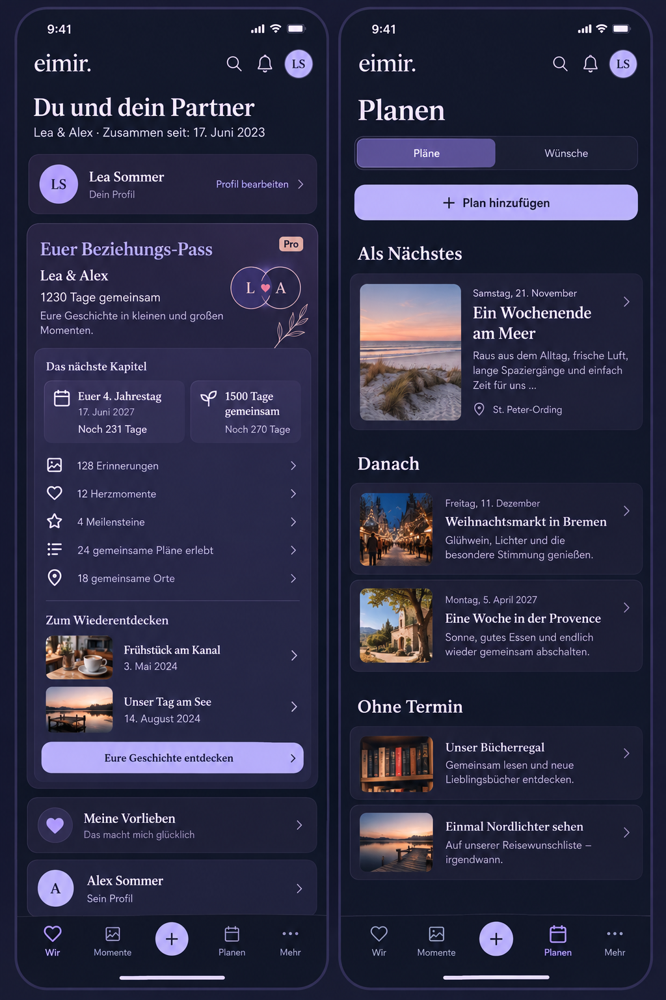

# Native continuity and a richer relationship passport

Owner: PO feedback in the 2026-10-29 workspace conversation; follow-up to #497.
Baseline inspected before implementation: `origin/main@7d671e2a068f89c9b16ee1e7c74da186a9c9c5d9`;
working baseline `0dfa04c6bfb5e7cadba416f039b0000d09aac63f` includes the pending Today refinements.

## Product design preflight / mobile interaction contract

References: Product Reference v1 R3 Planning, R4 Today, R5 Profile, Statistic
composition; existing ProfilePage, RelationshipPassport, TodayPage,
SharedPlanningOverviewPage, AppShell, Capacitor lifecycle and approved #497
whole-screen evidence inspected. Existing identity editing, relationship
settings, personal/partner preferences, private notes, Pro information, Plan
segmentation/create/detail and four-destination shell remain available.

Compact leads with the couple and their shared history. The passport becomes
an editorial composition: couple identity and duration; next anniversary and
round-day landmark when the existing duration is disclosed; optional truthful
lifetime counts; a bounded selection of shared highlights with canonical
destinations. The dominant action opens their history. No scores, quotas,
streaks, fabricated chronology, inferred private data or new content domains.
Expanded keeps this order and uses width for the date composition, not extra
controls. Use PartnerAvatarPair, ProMark, Link, ProblemState, existing typography,
spacing, identity surfaces and motion tokens. No new form or keyboard opening.

Loading is reserved for a first read. Background refresh retains authorized
content. Transient failure preserves existing content with deliberate retry;
authoritative denial hides it. Unknown entitlement is an error, Free is a
factual Pro entry, zero content has a meaningful start action, absent duration
does not reveal or infer a start date. All dates/numbers/copy use localization.
Links support keyboard and normal Back. Reflow at 320/360/390/430, large text,
Light/Dark and reduced motion must preserve content and reachable actions.
No entrance animation on an automatic background refresh.

Plan overview excerpts are bounded to 180 graphemes and three visible lines;
the original remains intact in detail. Native root Back minimizes the Android
task so returning reuses the current WebView; OS process death remains possible.

## Reuse decision (2026-10-29)

Reviewed TanStack Query v5 staleTime/gcTime/placeholderData, its standard
whole-client persistence plugin, Capacitor App lifecycle/minimizeApp, native
encrypted storage, HTTP/Service Worker caches and existing scoped IndexedDB.
Selected existing Query + IndexedDB + generated DTO serializers, no new
dependency/provider/license or service cost. Whole-client persistence is
rejected because it could persist credentials, private content, entitlements,
notifications and activity. Service Workers never cache authenticated requests.
Sources: https://tanstack.com/query/latest/docs/framework/react/guides/placeholder-query-data,
https://tanstack.com/query/latest/docs/framework/react/guides/important-defaults,
https://capacitorjs.com/docs/apis/app.

## Cache decision and cross-cutting review

The PO request authorizes a narrow extension to M2-D18's availability-failure-only
rule: after Account and Space authorization, the approved shared Today and Plan
overview snapshots may paint read-only while network revalidation runs. This
exception does not extend to private content, auth/membership/entitlement data,
the Pro passport, profile preferences, signed URLs, media bytes or write queues.
Snapshots retain the existing seven-day hard expiry and synchronous generation
invalidation on sign-out/Account/Space changes; API origin is part of identity.
Each overview is at most 256 KiB. Initial and failed cached reads show timestamp
and read-only meaning. Snapshot loading never updates freshness. 401/403/404
remove the corresponding entry and never fall back. A denied response must not
retain visible stale data. Successful reads replace snapshots; writes remain
server-authorized, current-context and online-only. Existing Query invalidation
remains the single live consistency mechanism. No schema or backend API change.

Business/freemium impact reviewed: native continuity and ordinary shared read
caching remain Free/non-paywallable in Cloud and Self-Hosted. The richer live
passport remains Space-scoped `relationship.passport` Pro, volatile, without
deleting or withholding source history/export on downgrade. No new managed
resource, grant, storage tier or provider. Shared-only Dashboard projections
provide bounded highlights, never totals inferred from a page.

## Generated composition reference

Generated before UI implementation with the built-in Imagegen tool. The exact
[generation prompt](references/native-continuity/prompt.txt) is retained. The
generated plan photographs, alternative icon shapes, decorative flourishes and
abbreviated profile controls are illustrative and do not authorize new features
or replace the existing shell, identity editor, preferences and private notes.
Implementation uses real shared text highlights and the existing UI primitives.

Final rendered evidence and validation are recorded alongside this document.
Real installed APK process-death/device acceptance cannot be established by
browser tests.

The same-day authorized coordination with the place-dialog task makes lifetime
statistics optional only within the Pro passport. They start off. The personal
choice is scoped by instance, Account and Space on this device, with no content
or entitlement persisted and no cross-device promise. The legacy Today module
stays hidden for everyone while transport preference keys remain compatible.
Source history and ordinary source-list access stay Free.

Representative actual renders are under
[`references/native-continuity/evidence/`](references/native-continuity/evidence/).
They cover 320/360/390/430 px, Expanded 1280 px, Light/Dark, 200% text and reduced
motion, including first load, opt-in counters, Free entry, an interrupted save,
and a cold Plan-overview reload with delayed network revalidation.

Final checks: [validation record](references/native-continuity/validation.md).
