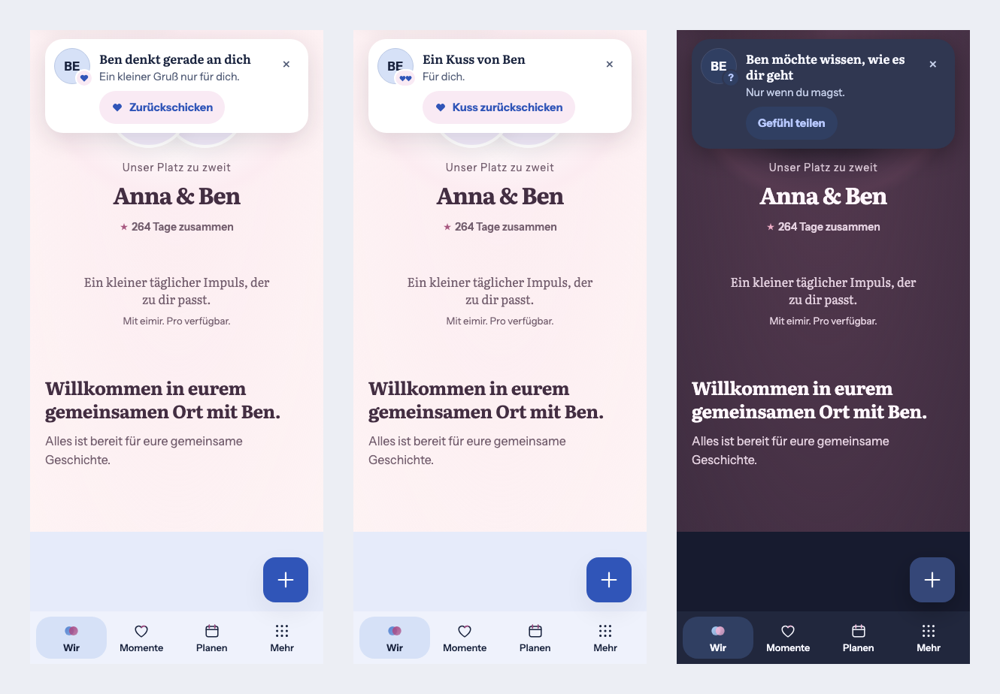

# Partner gesture receipt (#455)

**Baseline:** `main` at `f3c6b8393`, 15 November 2026.
**Decision:** the Product Owner request of 2026-11-15 asks for a small,
emotional receipt for the three existing partner gestures. It is the explicit
product decision that the [#1211 foreground arrival review](1211-foreground-notification-arrival.md)
and the [#1212 event motion review](1212-event-driven-arrival-motion.md)
required before any foreground surface. This document records the resulting
contract. Their privacy, lifecycle and policy gates remain binding.

Owning issue: [#455](https://github.com/baerenmarke90/eimir/issues/455)
(receipt part only; the global sender entry is unchanged). Related: #1206
(quick actions), #515 (notification policy), #1790 (everyday closeness).

[#1912](https://github.com/baerenmarke90/eimir/pull/1912) extends the shared
receipt to new, authorized in-app notifications. The
[Wish date proposal follow-up](../notification-workflow.md#wish-date-exchange-presentation-1910)
uses the same host, timing and suppression rules. It puts a calendar badge on
the check-in variant's calm arrival and gives the recipient a direct action to
open the proposal or confirmed Plan. Ordinary check-in status updates remain silent.

## Original scope (#455)

- One shared presentation primitive, `PartnerGestureReceipt`, for the existing
  notification kinds `THINKING_OF_YOU`, `PARTNER_KISS` and `PARTNER_CHECK_IN`.
- No new notification kind, gesture, endpoint, API field, migration, push
  payload, Notification Center, read store, presence or delivery receipt.
- Replies reuse `usePartnerGesture` and therefore the existing `THINKING` and
  `KISS` endpoints, idempotency keys, cooldowns, module checks and the
  `partner.quick_actions.extended` capability.

## Product Owner motion decision (2026-11-15)

Two choreographies were compared in real time on the Wir screen at 390 px
([thinking](references/partner-gesture-receipt/variant-a-vs-b-thinking.webp),
[kiss](references/partner-gesture-receipt/variant-a-vs-b-kiss.webp),
[check-in](references/partner-gesture-receipt/variant-a-vs-b-check-in.webp)):
A, restrained (about 1 s, existing duration roles only), and B, expressive
(about 2.4 s). The Product Owner chose **B**. It needs two new semantic motion
tokens, `motion.duration.gestureMoment` (900 ms) and
`motion.duration.gestureSequence` (1800 ms), recorded in the
[motion guideline](motion-guideline.md) and zeroed for reduced motion like
every other duration role. The big heart briefly covers the partner's face
before settling as a badge; this was part of the reviewed variant.

## Generated visual reference

The 2026-11-15 foreground-notification follow-up uses this same composition and
Mobile Interaction Contract for ordinary in-app notifications. The
Wish invitation opens the existing private favorite selection and fans out two
symbols. The result brings a wish and a sparkle together. Other events have
distinct motion on the same badge. Existing Notifications copy, the authorized
open endpoint and the canonical destination define the action. Native wakes
trigger a fresh inbox read even when a coalesced row leaves the count unchanged.

Composed before runtime UI implementation from the real running app on
`f3c6b8393` (mocked API, Wir at 390 px) plus the token-based receipt markup and
its stylesheet, because no image-generation model was available in the
implementing session. Left: "Ich denke an dich" (Light). Middle: kiss (Light).
Right: "Wie geht's dir?" (Dark). Reviewed with it: the Wir hero with the couple
avatars and partner quick actions, the daily check-in sheet, the floating
create action, the Compact bottom navigation, the Notification Center under
Mehr, and the Snackbar.

## Mobile Interaction Contract

| # | Item | Contract |
| --- | --- | --- |
| 1 | User goal | Notice, in a calm moment, that the partner just sent a gesture, and answer it with one tap if wanted. |
| 2 | Relationship value | A small gesture feels personal and warm instead of a system message. |
| 3 | Compact state | A compact elevated surface at the top safe edge, above the current page; the page stays usable. |
| 4 | Dominant action | The gesture's reply: send a thought back, send a kiss back, or share how you feel. Close is secondary. |
| 5 | Hierarchy | Partner avatar with gesture glyph → personal sentence → quiet detail line → reply → close. |
| 6 | Immediate vs. disclosed | Everything is visible at once. No expanded state. |
| 7 | Pattern | Non-modal, transient surface (`aside` landmark). Not a dialog, sheet or toast with critical content. |
| 8 | Loading | Nothing is shown until the authorized notification item is loaded. Reply shows the existing sending copy. |
| 9 | Empty | No item: nothing is shown. |
| 10 | Error | Reply failures use the existing quick-action error copy inside the receipt; the receipt then stays until closed. |
| 11 | Offline | The receipt never appears from cached data. A reply offline shows the existing offline copy; nothing is queued. |
| 12 | Success | The existing sender copy (`partnerQuickActions.sentThinking`, "your greeting is on its way") replaces the reply. It never claims arrival or reading. |
| 13 | Privacy | Only the authorized, already visible notification item (actor name, avatar, kind). No mood, energy, presence or delivery state. |
| 14 | Large text / narrow | A container query in `em` stacks partner, sentence and reply when the text is large for the available width; labels hyphenate; the decorative picture keeps a fixed size; 44 px targets. Tested at 320 px with 200 % text and at 390/430/1280 px. |
| 15 | Motion | Enter: opacity + scale with `--duration-context`/`--easing-enter`. Then one expressive, one-shot gesture on the avatar (below, about 2.4 s), ending in a calm badge. Exit: `--duration-transition`/`--easing-exit`. Reduced motion: the settled state at once, no waves, hearts or wash movement. |
| 16 | Expanded | Same surface below the top navigation, max 26 rem wide. |
| 17 | List/table | None. |
| 18 | Platform patterns | Reuses the in-app banner pattern of mobile messengers, the shared avatar, Pro mark and quick-action icon roles. |
| 19 | Typing | No typing. Focus is never moved. |
| 20 | Reference | Above; baseline `f3c6b8393`. |
| 21 | Visual acceptance | Playwright evidence at 390 px Light/Dark, 320 px 200 % text with reduced motion, and Expanded. |

### Gesture variants

| Kind | Title / detail | Glyph and motion | Reply |
| --- | --- | --- | --- |
| `THINKING_OF_YOU` | `partnerGestureReceipt.thinking.title` / `.detail` ("Ben is thinking of you right now" / "a small hello, just for you") | A big heart appears over the avatar, beats twice (lub-dub) with one ripple, then settles as the heart badge. | `partnerGestureReceipt.thinking.reply` ("send one back") → existing `THINKING` send, only when the Thinking-of-You cooldown is not active. |
| `PARTNER_KISS` | `partnerGestureReceipt.kiss.title` / `.detail` ("a kiss from Ben" / "for you") | Two hearts float in on arcs from both sides, meet over the avatar, "kiss" with a short squeeze and a soft bloom, then settle as two small hearts. | `partnerGestureReceipt.kiss.reply` ("send a kiss back") → existing `KISS` send with the extended capability; without it, the Pro mark opens the shared Pro page exactly like the quick actions (`proPaywallPath()`). Not offered while the cooldown is active or the entitlement is not yet known. |
| `PARTNER_CHECK_IN` | `partnerGestureReceipt.checkIn.title` / `.detail` ("Ben would like to know how you are" / "only if you feel like it") | No hearts, no waves: the avatar takes one slow breath and a "?" badge settles soon after (calm receipt, see below). | `partnerGestureReceipt.checkIn.reply` ("share how you feel") → opens the existing own daily check-in sheet on Wir, only when vibe or energy check-in is enabled for the Space. Nothing is changed automatically. |

Without an actor name the existing anonymous titles are used. The avatar uses
the shared `AuthorAvatar` with its initials fallback.

## Calm partner notices (standard, 2026-11-15)

The Product Owner decided on 2026-11-15, after reviewing animated Compact
examples on the real Wir, Planen and Momente screens, that the calm check-in
receipt becomes the standard for every notification a partner deliberately
causes. Waves were judged restless and removed.

- **Calm receipt:** partner avatar (or its kind icon when no actor is
  available), one soft breath, a small kind-specific badge that lands about
  0.5 s after the surface opens, one reply pill, close. No waves, no hearts.
  Enter, exit, auto-close (8 s), suppression, announcement and reduced motion
  (settled state at once) stay as specified above.
- **Kinds and badges** (`PARTNER_NOTICE_ICONS`, existing `EimirIcon` set):
  Wish date proposal/counter/acceptance, Plan created and changed: calendar;
  Plan cancelled: close; shared Wish selection started: "together"; result
  ready: sparkle; random pick requested or decided: sparkle; random pick
  declined: "together" (#1907 J1, each with the round's own question as title); Herzversteck hidden or found: sparkle badge on the photo icon (#1907 H3); comment: message; photo reaction: photo; shared moment:
  moment; reminder created: bell; partner joined: "together"; one-time
  message: message; check-in keeps "?". The plain wish heart is never a badge
  because it belongs to "thinking of you".
- **Keep their own expression:** `THINKING_OF_YOU` (heart pulse with one soft
  ring) and `PARTNER_KISS` (two hearts meet, short bloom) are unchanged.
- **Plain surface:** system and owner-only kinds (data transfers, video
  failure, due reminders, gentle prompts) keep the avatar-less surface and
  their own icon motion; failures stay readable without decorative arrival.
- **Copy and replies** are unchanged: the title comes from the existing
  Notification Center copy and the single reply opens the same destination as
  the system notification. A deliberately opened push still navigates straight
  to its target; only the three gestures present the receipt for it, because
  the destination of the other kinds is the content itself.
- **Android push** is unchanged: system presentation, generic lock-screen text,
  at most one "view" action, no "reply" action.

Reference: [calm notices, Compact](references/partner-gesture-receipt/calm-notices-compact-reference.png)
(real screens, final state of the five examples; baseline `main` `9b8c4a33e`).

## Arrival and lifecycle

**Foreground arrival.** There is no realtime notification transport. The
receipt reuses the existing signals only:

1. The shell observes the existing unread-count query, a wake from the
   current native activation and a scoped browser Wish date wake. The query
   retains its 30-second and focus refreshes.
2. An increase after the first observed count, or a scoped wake with any
   count, triggers a bounded read of the authorized inbox (`limit: 5`) for the
   current Account and Space in the visible, focused window. Concurrent
   signals share the same in-flight read, with one pending read for arrivals
   that may have followed it.
3. An unread notification created during the current foreground session can
   appear once. The newest item appears. Other items in that read stay in the
   Notification Center. The source event distinguishes updates to coalesced rows.

A wake can reach the focused app without waiting for the next refresh.
Without a wake, a notice can trigger the receipt on the next unread-count
increase, usually within the refresh interval. Items that leave the count
unchanged still appear in the Notification Center.

**Open.** A system notification or the banner's open action resolves the item
through `openNotification` and navigates to the current authorized destination.
A deliberately opened gesture can also present its reply.

**Suppression (no later interruption).** The receipt is not shown — the item
stays in the Center — when a focused task route is active, a draft blocks
leaving, a modal layer or dialog is open, or a text field has focus. A receipt
on screen closes when the shell gives the screen to a focused task or loses focus.

**Never.** No stacking (one receipt; a newer arrival replaces it), no queue, no
replay from before the current foreground session, no replay of handled events,
no presentation after an Account or Space
change (scope check on every asynchronous result, host keyed by scope), no
read-state change (arrival, timeout and close do not mark read; the Center
remains canonical).

**Timing.** The receipt closes itself after 8 s. The timer pauses while the
pointer or keyboard focus is inside it and while a reply is pending; after an
error it stays until closed.

## Accessibility

- A permanent polite live region announces the title and detail exactly once
  when a receipt appears; the surface itself is not a live region.
- No focus movement. The receipt is a named `aside` landmark; its controls are
  reachable by keyboard and Escape closes it while focus is inside.
- The avatar is decorative here (`aria-hidden`); the sentence carries the
  meaning. Glyphs and motion never carry information alone.

## Policy, privacy and business review

- **Notification rules:** the receipt only uses items the server already
  admits to the in-app Center, so the per-account IN_APP choice (#638),
  membership, module and target authorization stay server-side. Quiet Hours
  defer external Push and Email only ([contract](../../m4/NOTIFICATION-QUIET-HOURS.md));
  the receipt is in-app, appears only in the focused, active window, makes no
  sound or vibration and never replaces a suppressed push.
- **Push privacy:** the foreground receipt reads its content from the
  authorized API. The [delivery contract](../notification-workflow.md) owns
  system copy and the encrypted Wish date preview.
- **Haptics:** no existing haptic primitive exists. None is added, so no new
  native dependency.
- **Business/freemium:** reviewed. Receiving and reading a gesture is the same
  for Free and Pro (`docs/FREEMIUM-FEATURE-MATRIX.md`, Notification Policy and
  partner quick actions rows). Sending a kiss or check-in reply stays behind
  the existing `partner.quick_actions.extended` capability, read only from the
  session's cached entitlement (no new read). No new capability, quota, cost,
  Cloud/Self-Hosted difference or downgrade behavior.
- **Reuse:** `usePartnerGesture`, `usePresentationPresence`, `AuthorAvatar`,
  `ProMark`, `getNotificationItemTitle` copy pattern, the Snackbar window-event
  pattern, the shared modal lifecycle, the document leave guard and the
  generated motion roles. Considered and rejected: the Snackbar itself (no
  avatar, one action, bottom position collides with navigation and the
  floating create action), a new SSE/WebSocket transport, polling and a
  motion library.

## Evidence and limits

Browser evidence from `web/e2e/tests/partner-quick-actions.spec.ts` (mocked
API, Chromium) is in [evidence/455-gesture-receipt](evidence/455-gesture-receipt/):
390 px Light (thinking) and Dark (kiss), 430 px Dark arriving on Momente and
opening the own check-in, 320 px Dark with 200 % text and reduced motion
(Pro discovery), Expanded 1280 px, and frame-exact motion of the real
component (`final-motion-*.webp`, `motion-filmstrip-390.png`). The Momente
content behind the 430 px receipt shows that fixture's unmocked error state,
not a product regression.

Known limits, documented instead of simulated:

- **No realtime transport.** Arrival follows the existing unread-count
  refresh and the scoped foreground wakes documented above. Without a wake
  or a count increase, an item stays in the Notification Center.
- **Native foreground push.** The active Android app receives the scoped wake
  and presents the in-app receipt after the authorized inbox refresh.
- **No device acceptance yet.** Android (Capacitor) behavior, including the
  push-open receipt, still needs a Pixel check.
- **Read state.** The authorized open action follows the existing Center
  behavior. Seeing, replying to or closing the receipt leaves read state alone.
