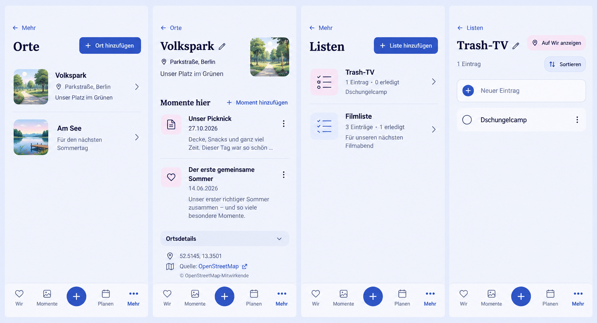

# Places and shared lists: compact product correction

## Preflight — 2026-10-30

User request: implement the reviewed Places and Lists corrections, with a
compact, intuitive composition consistent with Product Reference v1.

Baseline main: `1468e0a6e66eb5bd7b9192bf65ac357d8351b4d0`, freshly fetched.
Reviewed actual overview/detail components, shared planning styles, relation
picker, list mutations/reordering, checklist/pin controls, route helpers,
task lifecycle, Compact shell, tests and the user's four Android screenshots.

The built-in Imagegen tool produced this full-screen reference before UI code.
SHA-256: `407a3238a609dae082a1eeb763f54c513d842d8de44c2718edd4300e6bff71d0`.
The prompt specifies four complete 390 × 844 views: Places overview/detail and
Lists overview/detail, current periwinkle/ink/blue palette, 20 px gutters,
compact navigation, contextual actions and the current docked navigation.
**Intentional corrections to generated details:** do not implement the invented
park/lake illustrations, alternate navigation icons, decorative input outlines,
or expanded coordinates shown under a closed disclosure. Keep the actual shell
and authorized media pipeline. This is a hierarchy reference, not a pixel lock.

## Mobile Interaction Contract

- **Human outcome:** find shared places and their memories; read, add and check
  shared list entries without accidentally starting an edit.
- **Reference:** Product Reference v1 content → meaning → action → metadata;
  R5 utility/Detail and short Create/Edit, plus content-opening relations and
  readable checklists. Smartphone is normative; no forced imagery or card wall.
- **Compact:** short named Back, compact title/action, then actual content.
  One dominant add action on overviews. List detail leads with readable entries
  and a single horizontal add field/button. Place detail leads with name,
  address/authored description, then moments and their visible add action.
- **Reach/IME:** product-size targets, no automatic keyboard for reading,
  explicit text-edit intent. Short tasks reuse the scrolling ShortTaskSheet;
  Save remains reachable. Long labels wrap without sideways scrolling.
- **Context:** entire overview rows open details with clear chevrons. Existing
  routes, More selection, Back/deep links, pagination and delete-focus behavior
  remain. Confirmed create opens the real created resource.
- **List editing:** read-first plain text; named contextual edit/delete actions;
  explicit Save/Cancel for an entry edit. Sorting is a deliberate toggle with
  drag handles and existing keyboard arrow alternatives. Preserve order on check.
- **Place editing:** preserve manual name/address/description, map selection,
  optional coordinates, source attribution and capability-gated edit/delete.
  Put technical data behind progressive disclosure. No description placeholder.
- **Removal:** unlink/delete is secondary and explicitly confirmed with its
  consequence; do not offer undo without a restore contract.
- **Draft/Back:** dirty dismissal asks before discard; failed saves retain input;
  pending writes block duplicate/ambiguous actions; sheets own focus, dismissal,
  history, inert background and focus restoration through existing primitives.
- **States:** keep Loading, Empty, Error, Offline, Pending, Conflict and confirmed
  Success distinct. Retain valid content on refresh failure. Truthful counts use
  the actual complete CollectionDetail.items, never count a paginated overview
  as an all-history total. Unknown Place relation totals are not invented.
- **Motion:** reuse sheet/feedback/reorder roles, maintain visible save/check
  feedback and existing optimistic rollback; reduced motion retains all meaning.
- **Expanded:** same content and action order with bounded reading width;
  existing top navigation, centered sheets and no extra management columns.
- **Privacy:** existing shared resource capabilities and authorized relation/media
  previews remain authoritative, including concealed/locked media. No persistence
  of new content in browser storage, URLs, logs or analytics.

## Reuse, commercial model and cross-cutting review

Reuse existing PageHeader, ShortTaskSheet, PlanningDiscardConfirmation,
ChecklistToggle, ListEntryIconButton/useListItemReorder, PlaceMapPicker,
PlanningRelationManager, query/invalidation and i18n. Use native buttons/forms,
existing semantic tokens, SVG graphic strokes and shared modal lifecycle.
No dependency, map provider, backend/API change or custom gesture library.

No business/freemium impact: Place CRUD, coordinates and content links remain
the Free side of Mixed; Shared Collections & Checklists remains Free/Core
(feature matrix rows). No new paid boundary, quota, managed resource, tracking
or Cloud/Self-Hosted difference. Existing data and personal pin semantics stay.

Security/privacy: same API/capabilities, tenant scope and media authorization.
Concurrency: preserve versioned writes, conflict handling and checkbox/reorder
rollback. Accessibility: names, focus, semantic controls, large text, contrast,
safe areas and keyboard alternatives. i18n: all added copy in resources.
Resilience: no offline writes/outbox promise; failures keep drafts.
Performance/operations: no new providers, per-row fetches or durable storage.
Validation: targeted existing component/lifecycle/concurrency tests; complete
TypeScript/build and token checks; browser journeys and visual evidence at
360/390/430 px and Expanded, Light/Dark, sparse/dense and reduced motion.

## Delivery evidence

Implementation and verification results will be added here after the changes.
