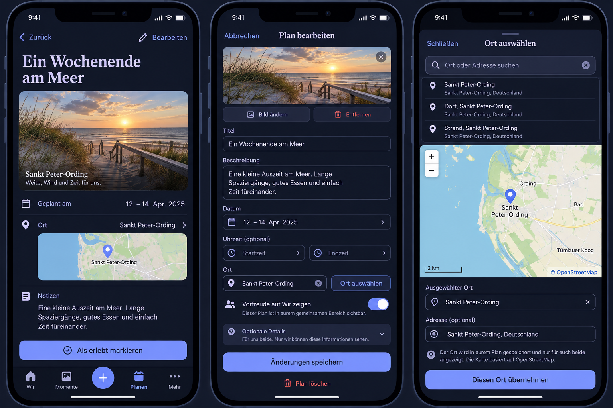

# One Plan editor, images and map selection

PO addition in the 2026-10-29 workspace conversation extends the ongoing native
continuity/passport task. Baseline and actual PlanProductPage, PlanningCreatePage,
PlacesOverviewPage and PlaceProductPage were inspected before implementation.
Current main reference: `7d671e2a068f89c9b16ee1e7c74da186a9c9c5d9`.

## Mobile interaction contract

R3 anticipates a shared experience. Reading shows the chosen image, actual
schedule, linked place and notes. One named Edit action opens one staged editor
for content, image, schedule, place and the existing countdown. One Save applies
the correction atomically. Countdown and fixed shared-visibility explanation
are absent from ordinary reading. Shared audience remains clear in creation
and optional editing context. Completion is a distinct experience action with
its existing date/confirmation/continuation, not another management editor.
Delete/return-to-wish remain explicit contextual actions with existing domain
restrictions. Dirty/pending exits, version conflicts and failed uploads preserve
the draft. The UI does not claim an uploaded image was bound until Plan save
confirms it. A selected cover is optional, shared, replaceable and removable.
Reuse the validated Attachment pipeline, ownership/binding/deletion, sensitive
media controls, scoped media memory cache and Object URL lifecycle.

Places use an explicit map picker with search results, pan/zoom, tap selection,
a visible marker and confirm. Existing names/addresses remain editable. Keyboard
panning and a use-map-center action provide an alternative to a pointer; manual
coordinates remain optional fallback. No automatic device-location request.
Escape/Back/Close cancel the choice without writing, confirming only updates the
parent draft. Failure keeps an existing place/draft and offers retry. No result
is distinct from unavailable service. Compact sheets protect scrolling, focus,
IME and bottom actions; Expanded preserves the same task. Use existing
ShortTaskSheet, forms, token roles, normal link/Back and reduced-motion behavior.

## Reuse, providers and privacy

Reviewed Leaflet 1.9.4 (BSD-2-Clause), Google Maps (API key/billing), MapLibre
(larger vector/style delivery boundary), existing Photon adapter and the OSM
tile policy on 2026-10-29. Select Leaflet and OSM raster tiles; forward search
extends the existing Photon vocabulary behind an authenticated, bounded backend
adapter. No Google account, normal-user key or provider setup. Commercial and
Self-Hosted use are supported by the selected permissive libraries; OSM data
requires visible attribution under ODbL. Public services are best effort, no SLA.
The operator owns the optional Photon origin; disabling it disables external
search while existing places and manual/map positioning remain usable.

The map loads only after a deliberate map-open action. OSM receives the visible
tile area, client IP and origin Referer; a visible service/privacy note explains
this before loading. Search text travels in an authenticated POST body to eimir.
and then to Photon, without client tokens, Account/Space identity, partner data
or telemetry. Provider calls use a fixed operator URL, no redirects, bounded
response/time, stable errors and account-scoped database rate limits. Queries
and coordinate-bearing provider errors must never enter logs. No tile scraping,
bulk download or offline tile packs; normal HTTP cache headers apply. Existing
saved places work without either provider. Map loading is separate from app
startup; no new startup SDK request.

## Business and quality review

Business/freemium impact reviewed: optional Plan cover and ordinary place
selection remain Free/Core in both deployments, using existing managed-media
limits and deletion/export semantics. No paid provider, capability, quota or
new data domain. A cover is at most one image per Plan, must be READY, owned by
the uploader, in the same Space and exclusively bound. Parent authorization
governs both partners' media reads. Replacement/removal/deletion use existing
media cleanup; transfer exports/imports include the referenced cover, and old
bundles default to no image. API/generated clients and additive migration ship
together. Tests cover unauthorized/cross-Space/media reuse, conflicts, atomic
editing, failed upload/search, map selection/return and existing Plan lifecycle.

Sources: https://leafletjs.com/reference.html,
https://github.com/komoot/photon,
https://operations.osmfoundation.org/policies/tiles/.

## Preflight and rendered evidence

The generated reference preceded this UI implementation; its exact prompt is
[`plan-map-prompt.txt`](references/native-continuity/plan-map-prompt.txt). The
runtime uses the established shell, forms, ShortTaskSheet and selected real
image rather than generated artwork. Actual Compact Light and Expanded Dark
renders are `map-picker-*`, `plan-unified-editor-*` and `plan-cover-reading-*`
in [`native-continuity/evidence`](references/native-continuity/evidence/).
The browser journeys open, choose a file, search/select/confirm on the map,
save once, observe the bound cover and linked place, and retain normal return.
Tile responses are deterministic fixtures; these tests certify interaction and
layout, not availability of the public OSM/Photon services. Installed Android
IME/process-death/device acceptance remains a release-device gate.

The operator may set `EIMIR_PLACE_SEARCH_URL` to a trusted Photon origin or an
empty string to disable forward search (default `https://photon.komoot.io`).
The native WebView appends a stable eimir identification to its usual User-Agent
for public tile service policy. Tile requests retain an origin-only Referer.
The map SDK is a separate lazy chunk; a local reused ErrorBoundary and explicit
retry contain module/network failure without destroying the parent editor.

Final checks: [validation record](references/native-continuity/validation.md).
