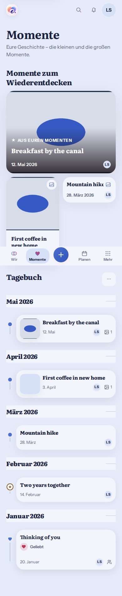
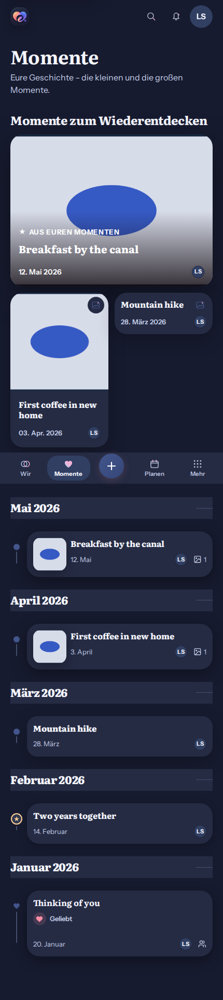
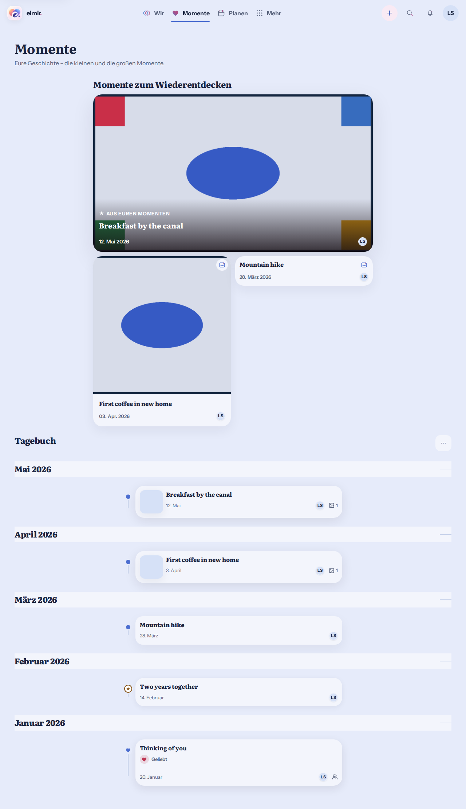
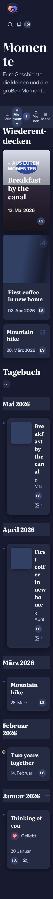
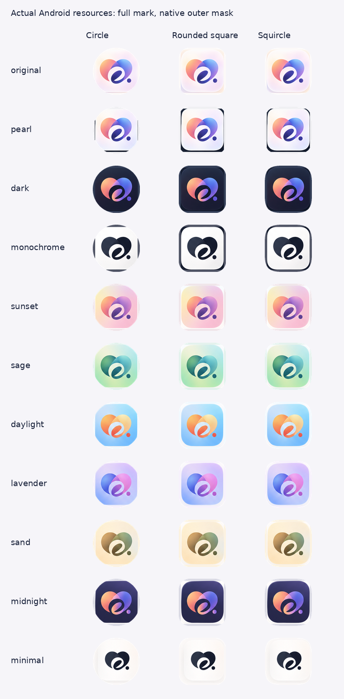
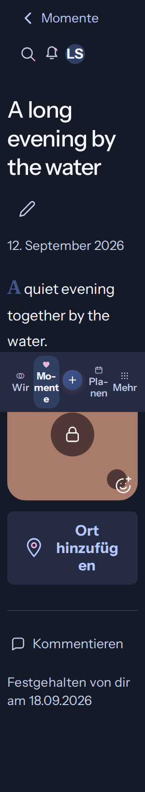

# Product consistency and deliberate Plan completion

Date: 2026-10-29. PO amendments in the owning workspace chat. Baseline main: `f35f82dbab2465fe337850a1e8db147f4eb3942a`; this isolated checkout starts at the separately validated Plan image fix `b53f7e973ec6764a25ec783223b062057ad643d4` (#1506). #1506 merged separately as `39804f58`. #1503 owns browser parallelization; the release chat owns its selected immutable test build. The experimental Android PR uses android-native-test/, a separate client. Preserve the shared dirty checkout and all those boundaries.

## Repository-aware visual preflight

Inspected TodayPage, DailyQuoteCard, CouplePresence, DashboardSettingsPanel/availability, the passport statistics preference, StoryProductPage/List and timeline markers, MemoryCreatePage/ProductPage/MomentPlaces, PlanProductPage/StoryContinuation, App bootstrap and the Android alias/resource generator/validator. Product Reference v1 R1-R5, the image/system direction, Detail/Create-Edit and ShortTaskSheet contracts apply.

Generated with the built-in Imagegen tool before implementation: [Compact product composition](references/product-consistency-20261029/compact-product-reference.png) and [places/startup/native-mask composition](references/product-consistency-20261029/places-and-startup-reference.png). Exact prompts are adjacent. These guide hierarchy, not invented domain capabilities. Exclude the generated alternate navigation glyphs, extra module actions, fictional relationship-strength content, place photos, replacement brand artwork, duplicate Plan title, and navigation shown during unauthenticated startup. Keep the actual navigation, domains, source data and approved brand assets.

## Accepted changes and Mobile Interaction Contract

1. **Global section anatomy:** a section title and its contextual action sit above the section's content surface, consistently. Content titles inside cards remain content, not another section header. Record this explicit PO rule in the normative design references and apply it to affected couple-facing surfaces.
2. **Quote:** remove the colored left rule and excess heading/body gap; slightly reduce quote/attribution size without suppressing attribution, settings, loading/error/offline or Pro behavior.
3. **Moments:** remove redundant visible type words on rediscovery cards, retaining conventional semantic icons and accessible type/name labels. Align every diary node center to the same rail at all widths/text sizes.
4. **Places:** a named Add Place action remains available on editable Memories/Moments with no photo GPS. Reuse existing saved-place and shared map mechanisms, authorization and typed relation APIs. Existing/new selection, confirm/cancel, loading/empty/error/offline, permission and retry are explicit. No automatic provider/location request; private content must not be exposed through shared Place relations.
5. **Optional Pro statistics on Wir:** deliberately enable only under the existing relationship.passport capability, with a personal opt-in initially off. Reuse authoritative counters and existing preference scope (instance/Account/Space); retain compatibility keys and source history. The separate passport view remains the owning Pro presentation. Update the versioned feature matrix for this new PO availability decision, superseding the temporary all-tier suppression.
6. **Couple Hero:** enrich the existing identity/duration with truthful already-available shared context such as the next Plan. Respect privacy, visibility preferences and sparse states. No invented scores, streaks, relationship strengths, duplicate large dashboard widgets or additional provider/query machinery.
7. **Launcher and startup:** the PO clarified that the video complaint refers only to the eimir launcher symbol and brief startup logo, not app-navigation or Android-system icons. Reuse approved artwork, correct platform adaptive geometry and native SplashScreen configuration, and replace the oversized Web bootstrap status card with a restrained branded state. Keep account/session, launcher aliases, sign-in entry and selected icon semantics. Never show cached private couple content before current authorization.
8. **Plan completion:** retain only the Plan completion CTA in reading. Activating it opens the shared short sheet with the experienced date; confirm completes the versioned Plan, cancel writes nothing. Pending/error/conflict/offline preserve intent. After confirmed completion offer the existing canonical Memory creation task with appropriate confirmed Plan defaults. Preserve the completed Plan; never silently reuse an exclusively bound attachment ID or invent an atomic conversion.

## Platform sources and native correction

Reviewed official Android adaptive-icon and SplashScreen guidance on 2026-10-29:
- https://developer.android.com/codelabs/basic-android-kotlin-compose-training-change-app-icon
- https://developer.android.com/develop/ui/views/launch/splash-screen
- https://source.android.com/docs/core/display/adaptive-icons

Current approved foregrounds are 432px with a centered 288px tile. The generated 132dp layer paints an 88dp tile, extending beyond the platform safe region. Correct the existing generator and geometry validator, not only one output resource; retain the approved raster pixels, native mask ownership and immutable package/signing/update contracts. The older 2026-10-26 overscan decision is superseded where it clips the requested complete mark. Native compiled/mask proof and real-device acceptance must be reported distinctly.

## Reuse, commercial and cross-cutting review

Use existing sections/tokens, ShortTaskSheet, PlaceMapPicker, typed APIs, scoped queries, authorized media/cache/Object URL lifecycle, staged attachment pipeline, canonical capture and native Android capabilities. No new third-party/provider or runtime service. Ordinary Plan/Memory/Place functions stay Free/Core with existing ownership, managed-media quota, deletion/export and Cloud/Self-Hosted behavior. The explicit Pro statistics availability change uses the existing passport grant and retains source history/export on downgrade. Launcher Original remains Free; existing cosmetic alternatives retain their current Mixed classification.

Verify current-owner admission before/after writes; fail closed on unreadable/private sources. Preserve partially successful create/link outcomes and retry only the unfinished step. No sensitive text, coordinates, imagery or credentials in logs, telemetry, browser-history payloads or committed fixtures. Public startup remains content-free. Localization, accessible names/targets/focus/return, large text, reduced motion and theme behavior are implementation requirements.

## Evidence plan

Use production journeys and disposable fixtures: Wir settings -> optional Pro statistics, quote settings, rediscovery -> diary, Memory -> add existing/new place -> cancel/save/return, Plan -> completion date -> confirmed result -> canonical Memory draft -> save/return, and cold/restored startup. Check Compact 320/390/430, Expanded, Light/Dark, 200%/400% reflow, offline/failure/pending/privacy and native icon masks. Static references never replace behavioral or installed-device evidence.

## PO-approved combined Moments composition

The subsequent PO request explicitly adopts the middle screen of the published
compact reference. Rediscovery now precedes the full Diary on one page. It uses
one lead and at most two compact companion cards, including the existing
server-authorized retrospective when present. It preserves server selection,
type-specific accessible names, concealed media, chronological paging, filters,
search and canonical detail/return. Structural archive destinations remain in
the Diary options sheet. The old two-tab composition is superseded. Normal
Compact uses two companion columns; large text can reflow to one. No source
history is capped by the preview limit.

## Implementation and local evidence

- Daily quote heading/actions precede the compact borderless quote surface;
  quote and attribution use smaller readable type. Plan notes use the same
  section-heading rule. The normative reference and component contracts record
  the shared rule.
- The couple Hero reuses a visible authorized next event. Hidden upcoming data
  does not reappear there. The passport Pro grant and an independent personal
  device opt-in govern Wir statistics; existing source counts remain Free.
- Editable shared Moments expose manual Place selection even without GPS.
  Existing Places and the shared map/search picker use typed relation commands.
  A known-created Place survives a failed link; retry repeats only that link.
- Plan completion progressively reveals a date sheet and retains pending,
  conflict, offline and duplicate-request ownership. Canonical Memory capture
  freshly reads a scoped completed Plan and seeds title, text and calendar date
  only into a pristine draft. Recovery/user input takes precedence. Attachments
  remain deliberately selected in the existing capture pipeline.
- Public restoration uses a restrained brand/status; Android uses AndroidX
  SplashScreen and all eleven corrected adaptive variants with matching opaque
  backgrounds. The approved source bitmap bytes are unchanged.

Proof uses disposable synthetic content, never PO photos, notes or coordinates:

Local runs cover 51 changed product journeys, 20 combined-Moments/archive/delete
journeys, the real map create/link-failure/retry journey, and the unchanged
navigation/filter journeys. Overlapping runs are not additive test counts.
Full unit/build, language, formatting, inventory, native compilation and resource
geometry checks are recorded in the PR for its final revision. Native mask
renders and successful compilation are not a claim of testing the owner's
installed Pixel build; native resources require a newly built APK. The existing
Arcane deployment remains under the PO's control and is not accessed here.

## PR CI follow-up

The initial full PR browser run identified ambiguous Story links after combining
rediscovery and Diary, a Place action min-content overflow, and a shared settings
switch that retained a fixed control width while its track scaled with text.
Story source-entry tests now name the Diary explicitly, the Place action reflows,
and the switch retains its minimum target while growing with text. Archive
links close the options sheet before navigation so Back returns to the Diary
without a stale dialog. No assertion, timeout, retry, skip or gate was relaxed.

The unchanged sensitive-media reflow journey passes in Light and Dark, including
320px with 200% text. The exhaustive settings reflow journey and the shared-photo
entry/Back journey pass. The focused Story/filter/Place unit run passes 32 tests.
Android instrumentation now measures the actual approved bitmap's visible pixels
inside the adaptive safe region rather than requiring the superseded overscan;
its test APK compiles and unit tests pass. Fresh emulator CI remains required.
The initial API 37.1 job failed downloading the SDK image before app execution.

## Cloud continuation and current-main integration

The isolated Cloud checkout integrates main `2f7c1df9`, including #1509's
headerless Compact shell, More utilities, stable privacy controls and browser
registrations. The approved unified Moments composition and #1503's four browser
shards with one worker remain intact.

The full-suite follow-up adds the now-visible, independent Discover read to the
strict task-boundary HTTP fixture. Unexpected-request, draft, focus and history
assertions remain unchanged. Timeline metadata checks target the Diary and assert
its intentionally borderless footer from PO #1508 instead of the superseded
separator, retaining all attachment-shape, typography and wrapping checks.

The API 37.1 instrumentation process exited before reporting any test, without a
captured crash entry. No cause or passing emulator acceptance is inferred from
that result. Continuous bounded-job device logs now accompany the existing
diagnostics; all three API levels and all instrumentation assertions remain
required. The exact resulting head must complete fresh CI before merge.

The existing test-channel source already records the matching infrastructure
diagnosis: two API 37.1 / 16K guest exits with `ApplicationExitInfo` reason
`LOW_MEMORY` at 4096 MB. Its `08dc6dc8` correction uses 6144 MB on the same public
runner, image and assertions; all three API jobs passed in
[run 40800049159](https://github.com/baerenmarke90/eimir/actions/runs/40800049159).
Reuse that verified guest allocation here, with host/guest memory and process-exit
diagnostics. This does not assert the cause of a different uncaptured exit and
does not remove any platform, test, timeout or required check.

Full-suite traces also show a successful automatic page load removing its
sentinel during the return test's scroll action. The journey now scrolls the
stable last loaded content item while retaining its exactly-once cursor,
full-range, focus and return-offset assertions. The strict Discover fixture uses
the actual selection schema, and Quick Create waits for the real sheet entrance
animation to finish before its capture action, following the existing completion
journey pattern. No sleep, synthetic input, timeout increase or retry is added.

The Today freshness journey now identifies the agenda explicitly because the
authorized next Plan also appears in the Hero; it still requires the refreshed
agenda, automatic invalidation and complete disappearance of the obsolete title.
At `faca04c8`, API 28 and 36 passed, including the real photo pipeline. API 37.1
reported 14 passing tests and a photo-picker input-event timeout; its memory
allocation correction still requires fresh acceptance and is not a claim that
this distinct event timeout has been resolved.
