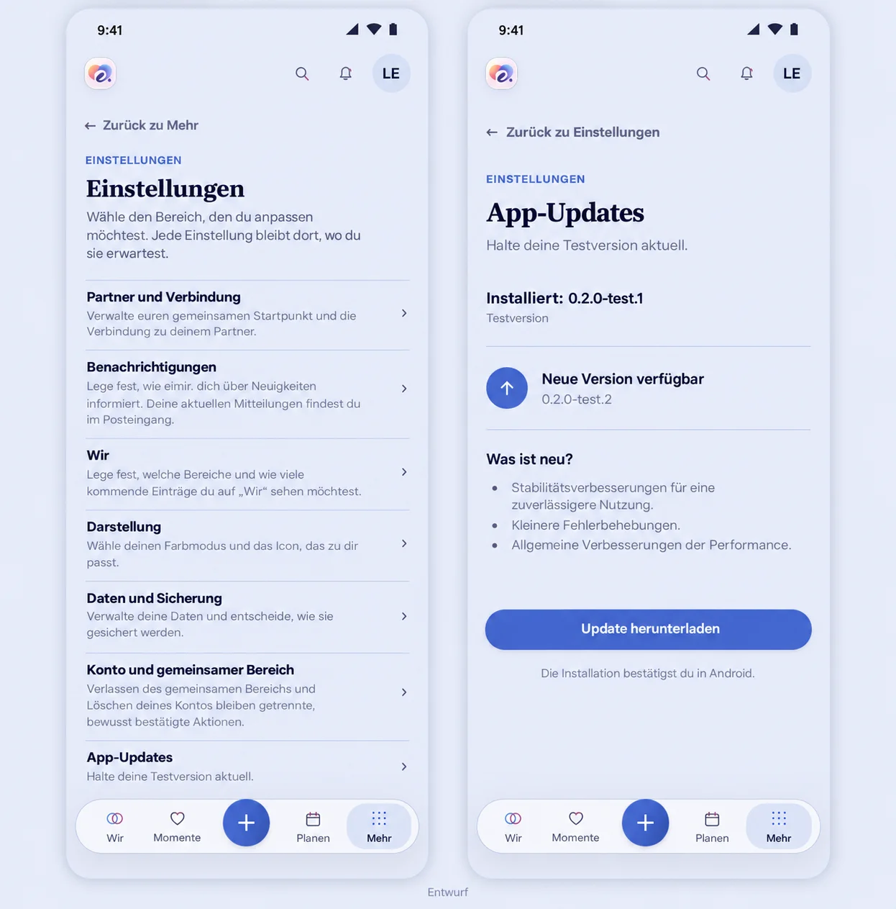

# Android test updates — implementation preflight

Owning issue: #1331. Baseline: `46872a4cee53f96c3a95f453506d664477456ae5`.
Date: 2026-10-17. This preflight precedes runtime implementation.

## Product decision and real destination

Philipp and his partner will use the test installation alone, exercising normal
registration, sign-in, partner invitation and everyday use. Configure
`https://demo.eimir.ur-cloud.de` explicitly with **Demo mode off** and **reset timer
off**. The persistent backend is provisioned afterward; its absence does not
block app preparation and is not successful connected acceptance.

The current `SettingsPage`, `SettingsIndex`, category routes, native shell,
Capacitor build environment, Android manifest/signing and existing Web update
behavior were inspected. A real Chromium 151 capture of the unchanged production
Settings consumer is preserved in `settings-baseline.png`. It retains the header,
search, notifications, avatar, named return, six settings categories and the four
primary destinations with central create action.

Generated with the imagegen skill/built-in image tool, using the baseline capture
as composition reference. The two-screen proposal preserves every existing
category and adds one supporting App Updates destination. It is a generated
reference, not a functioning screenshot or a pixel lock. The current R5 utility
composition, tokens, actual artwork and accessibility remain authoritative.
Expanded adapts the same bounded page rather than introducing a management pane.

Prompt: faithful whole-screen eimir Settings index plus focused App Updates page;
preserve all six categories, header and navigation; add current/test version,
available version, plain release notes, one download action and an Android
installation-confirmation explanation. No server URLs, tokens, extra forms,
nested card wall or romantic decoration. Input role: current real Settings
reference. Generated versions and notes are illustrative, never release claims.

## Mobile Interaction Contract

1. **Human outcome:** keep an installed test app current without finding APKs
   manually. Either partner can update independently; no bilateral action.
2. **Value:** dependable testing and continuity. Technical maintenance needs
   precise copy, not relationship microcopy, rewards or celebration.
3. **Primary Compact state:** Settings → App Updates. Existing R5 utility and
   Screen Template 8; version and actual update state lead.
4. **One dominant action per state:** Check, Download, Cancel download, Allow
   installation, or Install. No automatic installation or forced navigation.
5. **Hierarchy:** installed version, current status, offered version, release
   notes, action, platform consequence. Notes are plain text and secondary.
6. **Disclosure:** source revision belongs in a secondary build-information
   disclosure. No normal-user API, provider, GitHub-token or URL entry.
7. **Pattern:** ordinary category page and native Android installer/settings.
   Preserve normal history, named Back, bottom navigation and focus behavior.
8. **Loading:** explicit checking/download status; progress has a semantic label.
   Keep known installed/offered metadata readable.
9. **Empty:** no eligible release is a normal no-offer state, distinct from a
   failed check or a confirmed current version.
10. **Error:** localized, inline, actionable Retry. Do not display raw exceptions,
    endpoints or pretend an unreachable service means already up to date.
11. **Offline:** installed app remains usable; no queued installation or write
    replay. A later manual/foreground check may retry the read.
12. **Success:** only validated download means ready. Installation is a deliberate
    Android action. Returning from source-permission settings requires another
    explicit Install action; resume must not trigger it.
13. **Privacy:** no account, Space, auth token, content or install identifier is
    sent to the public update channel. Updater survives account switching because
    it owns only application metadata, never product data.
14. **Reflow:** normal-flow controls, wrapping versions/notes, 320/360/390/430 px,
    200% text and expanded landscape. No fixed action over the keyboard/content.
15. **Motion:** existing button/status feedback only. Non-blocking, no artificial
    delay; reduced motion retains every state and action.
16. **Expanded:** same centered utility content with bounded reading width.
17. **List rationale:** the existing categorized utility list is appropriate for
    finding settings; it is not a relationship-content CRUD presentation.
18. **Platform reuse:** Capacitor bridge/lifecycle, Android package inspection,
    FileProvider and system installer; no custom permission screen or installer.
19. **Typing:** none. All actions have text, native semantics and visible focus.
20. **Generated reference:** above, against the exact recorded baseline.
21. **Acceptance:** Settings → check → download → cancel/retry → validate →
    permission → return → deliberately install; revisit/back and large text.
    Mocked-browser results establish shared-UI behavior only. Native installer
    and installed A→B continuity require separate real-device/emulator evidence.

## Reuse, release and removal boundary

Use the current React/Capacitor product, settings links, PageHeader, button/status
semantics, i18n and semantic spacing/type/color roles. Implement the smallest
native sideload capability; no second product UI or update server.

Reviewed alternatives: Android package installation is the platform primitive;
Capawesome App Update's native update path depends on Store distribution; Web
live-update systems do not replace the native APK. RWN's private-repository
gateway and fixed six-APK policy are unnecessary for this public repository. No
RWN source is copied and no new runtime dependency is selected.

Use an explicit Android test release marker and a single universal APK. Validate
the manifest, allowed release URL, package, SDK, version, size, SHA-256 and actual
installed signing identity. Update requests have strict bounds and no account
credentials. Publish the marker last. Treat GitHub API throttling as unavailable,
with bounded checks rather than polling. GitHub is an existing distribution
service; its public network metadata is the only added external data flow.

Native update code and permission live only in a `sideload` build type/source set;
the normal release remains updater-free. The Web entry is a build-time gated
native capability. Do not weaken normal required PR checks, signing custody,
strict dependency verification or unrelated #1271 physical gates. Later Store
continuity requires deliberate package/app-signing identity management; an upload
key alone does not establish it.

**No business/freemium impact:** official client access and secure maintenance
remain Free/Core. No entitlement, domain persistence, quota, downgrade or
Cloud/Self-Hosted feature change. Test delivery does not activate Pro or certify
Cloud/Store readiness.

## Cross-cutting and verification

Security: reject malformed manifests, foreign URLs/packages/signatures, older
versions and corrupt/truncated downloads. Keep executable paths and endpoints
native-owned; Web callers cannot provide arbitrary download/install locations.
Use a private bounded cache, cancel work on native teardown and remove partial
files. Serialize check/download/install operations and preserve useful metadata
on failures. No sensitive logs or product-cache ownership.

Verify pure policy/integrity regressions, shared-UI action/lifecycle/reflow cases,
strict Android build/lint, bundled non-Demo configuration, manifest-last packaging
and store-artifact exclusion. Confirm the actual on-device A→B upgrade and
updater-free transition separately; never turn a successful compilation or a
browser fixture into a device-acceptance claim.
