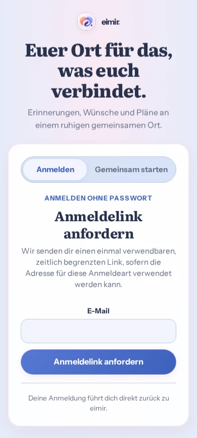
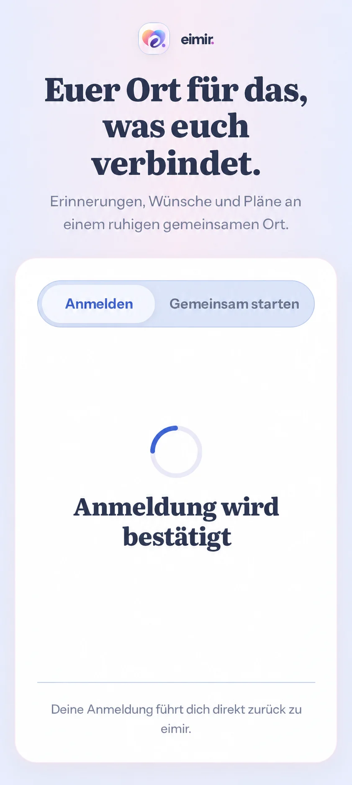

# Android email entry preflight

Owner #1331, follow-up within PR #1332. Date 2026-10-17. Main baseline
`cacc2522d2ab81db3d2b60fffbcce7909e587172`, inspected branch
`8ad5f8de946213598a678e7d7f8495a399557fd8`.

The private Arcane installation must exercise normal self-service registration
and sign-in without VPN. Cloud auth offers mailed proofs, with local passwords
disabled. The first updater APK registered only the native OIDC callback; it did
not receive HTTPS signup/magic-link/invitation/verification/recovery intents.
Server configuration alone cannot repair that missing installed capability.
Prepare a same-package/same-key higher version before initial installation,
and serve Digital Asset Links for the existing test certificate.

Actual React App/IdentityEntry capture at 390px with synthetic Cloud capability
metadata; no real accounts or mailed tokens. The current brand, hero, entry
segments, email form, primary action and assurance were inspected.

Generated through the built-in imagegen skill before runtime edits, using the
actual current entry capture as reference. Prompt: preserve the entire current
Compact Cloud composition and illustrate the existing inline proof-confirmation
state after an email link returns to Android. No new form, copy, provider field,
manual-token entry, product screen or second UI. This is composition guidance,
not an actual device screenshot or a new visual specification. Existing
IdentityEntry loading/error/success components and localization remain binding.

## Mobile Interaction Contract

- Outcome: open a real registration/sign-in email and return to the installed
  application, cold or warm, without losing the established product/session.
- Reuse Product Reference v1 entry experience, existing IdentityEntry and first
  Space flow; no new template or screen. Compact is normative; Expanded keeps
  the same current auth consumer. No typing beyond the existing email field.
- Android verified HTTPS App Links are the platform primitive. Declare only the
  five existing email entry paths on the fixed test origin in the sideload
  manifest; leave Web/OIDC and ordinary store source sets intact.
- Validate exact HTTPS origin, path and one bounded token; reject credentials,
  fragments, duplicates, malformed/foreign URLs and arbitrary navigation.
- Route the token in memory into the existing React consumer. Do not put it in
  history, persistent storage, logs or an external custom-scheme redirect.
- Subscribe before checking cold launch, deduplicate callback delivery, reject
  stale initial snapshots and clean up late subscriptions on unmount.
- A pending restore completes first. A link cannot replace an already signed-in
  account or interrupt its drafts. Signed-out users reuse current proof states.
- No additional motion, layout, release-note style or relationship microcopy;
  existing accessible status/retry and reduced-motion behavior are unchanged.
- Verification: adversarial URL/parser and lifecycle tests, real auth-consumer
  token entry, ordinary Web and native builds, actual manifest/source-set
  boundary, public assetlinks delivery. Android OS verification and complete
  email -> native session need separate device evidence.

Reuse: Capacitor App listeners and Android App Links/Digital Asset Links, not a
custom login protocol or auth server. No new runtime dependency. No auth/domain
policy or provider entitlement changes. **No business/freemium impact:** official
client access and secure sign-in remain Free/Core; no Premium, storage/quota,
Cloud/Self-Hosted policy or data migration change. Product tokens stay in memory
and are consumed through the existing backend protocol.
