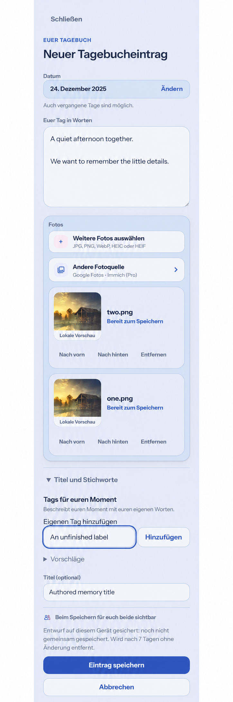

# Selected photo sources — generated composition reference

Generated on 2026-10-26 with the built-in Imagegen tool. This is prospective
composition guidance, not an implemented screen or provider approval.

Current baseline: `main@fe59df8c41848d156c4dd8367ae5b2f1c6d423b2` after
#1458. `photo-sources-compact.png` preserves the earlier 3955f444 photo-first
concept as history; it is superseded for future implementation.
Reviewed current `MemoryCreatePage`, `AttachmentDraftPicker`, tag editing,
date summary, fixed shared audience, task shell and upload/READY/save behavior.

The initial prompt requested a full smartphone-first R1 composition preserving Close,
photo/device selection and preview, narrative, suggested/custom tags, optional
title, editable date, fixed shared-audience note and Cancel/Save. It added a
secondary source choice for Google Photos and Immich (Pro) with selected-copy
and partner-sharing disclosure, without technical URL/key fields or a second
gallery. A correction prompt required the audience to be a fixed note (no
private-audience selector) and only one labeled Remove action.

The historical image is not a pixel lock: its floating source popover, illustrative tag
labels and missing visible Close/disclosure in the final overlay are not an
implementation contract. Compact must reuse the accessible short-task sheet
with Close, focus containment/return and disclosure before affirmative consent.
Use actual localized existing tags and date, semantic tokens and unchanged
fixed shared audience. See the complete [Mobile Interaction Contract and
rollout gates](../../../integrations/1444-selected-photo-sources.md).

The no-UI selection-safety slice does not display these planned source choices.
A future UI slice must recheck the current screen baseline, complete the
provider/security/entitlement gates and supply actual visual/behavioral evidence.

The refreshed prompt edited the actual #1458 390px evidence screenshot, preserving
date/prose-first order, both photos and earlier/later/remove, optional title/tag
disclosure with unfinished custom tag, fixed shared audience, seven-day local
status and save/cancel. It requested one quiet source action after the existing
device picker, labeled Google Photos and Immich (Pro), without an open popover
or technical configuration. The screenshot theme is an example, not a new
palette decision. The seven-day File checkpoint is a provider privacy/retention
gate before future wiring; no source controls are implemented here.
