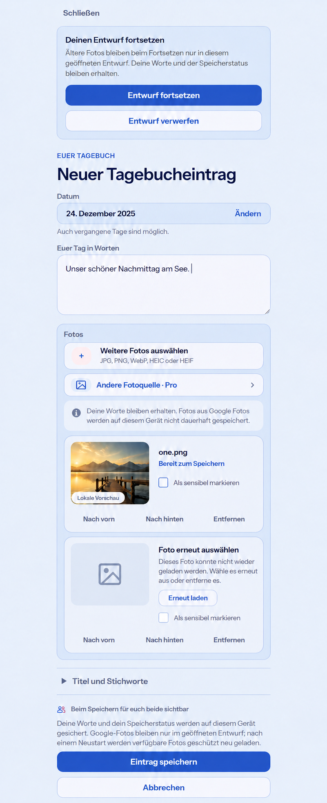

# Selected-photo recovery preflight (#1467)

Baseline: `main@ee6064fda6466258636e1e0446539336edb06a86`, inspected before
implementation: MemoryCreatePage, AttachmentDraftPicker, PhotoSourcePicker,
MemoryDiaryDraftStore, upload/READY/binding, uncertainty reconciliation and
authorized attachment reads. The existing R1/F2 diary composition remains.

Generated with the built-in Imagegen tool on 2026-10-28. Reference input:
`../1457/evidence/diary-compose-390-light.webp`, existing composition/style only.
No generated photo becomes a production/demo asset. This is a composition
reference, not a pixel lock; existing sensitive-media concealment remains.

## Mobile Interaction Contract

- Human task: continue authored diary work safely after interruption. One person
  can finish alone; no partner participation or infrastructure configuration.
- Reuse the dedicated diary task, existing photo slots, ShortTaskSheet, localized
  inline recovery/uncertainty notices, native file input, semantic tokens and
  upload pipeline. Words/date remain primary; photos retain their positions.
- Google copies remain in task-owned memory. Locally persist only photo
  descriptors/authorized attachment IDs plus the exact existing save journal.
  Ordinary new device Files retain the existing disclosed recovery contract.
- Resume keeps words/date/tags, photo ordering/sensitivity and exact uncertain
  create identity. Authorized server copies may be loaded into memory again.
  Missing photos get an explicit placeholder; no broken image or empty upload.
- A missing-photo retry reads the existing protected upload; explicit remove
  plus native reselection is available before Save. Do not silently omit photos.
  During uncertain/partial Save, edits stay locked and existing verify/open-saved
  actions resolve the original operation; never create a replacement identity.
- Old unversioned drafts have unknown provenance. Preserve them on load. Explain
  before explicit Resume that their photos become memory-only; that action
  migrates their checkpoint atomically. Explicit Discard retains its semantics.
- Compact uses the current single-column composition and 44px targets; Expanded
  keeps bounded width. No automatic keyboard, modal proliferation or new shell.
- Loading: retain form and named photo status. Offline/error: preserve work,
  keep missing positions and retry. Success: existing saved Memory/result/return.
  Keyboard, screen-reader status, Light/Dark, 320/360/390/430px, large text and
  reduced motion remain cumulative. No new motion token is needed.

## Business/reuse/cross-cutting

External source imports remain Pro, local/system selection Free/Core, and secure
recovery/privacy/data rights non-paywallable. Cloud/Self-Hosted parity, quotas,
existing content and downgrade semantics are unchanged. Reuse IndexedDB metadata
transactions, existing ownership leases and authorized server staging; do not
invent browser key management or add a library/provider.

Test storage byte absence, mixed-file order, retry/cancel/expiry, old draft
consent, two-tab ownership, Account/Space invalidation, failed upload and unknown
create/bind outcomes. Do not publish provider credentials, URLs or real photos.
Google remains hard-gated pending all underlying/provider/device acceptance.

## Generation prompt record

Initial prompt: repository-aware ui-mockup of the existing whole 390px diary
composer, preserving close/header/date/prose/photos/source action/sensitive
controls/reorder/remove/optional details/sharing/Save/Cancel; add an explicit
legacy Resume notice, one ready photo and one missing-photo placeholder with
retry/remove, and honest nonpersistent Google-copy status. Avoid admin UI,
technical storage terminology, credentials, paywalls, redesign or fake devices.

Correction prompt: only uncheck the first sensitive checkbox so its visible
preview respects existing concealment; replace footer copy with the statement
that words/save status persist, Google copies remain only in the open task and
available protected photos can be loaded again after restart. Preserve all
remaining composition. The actual localized implementation remains authoritative
for precise recovery/error semantics.
