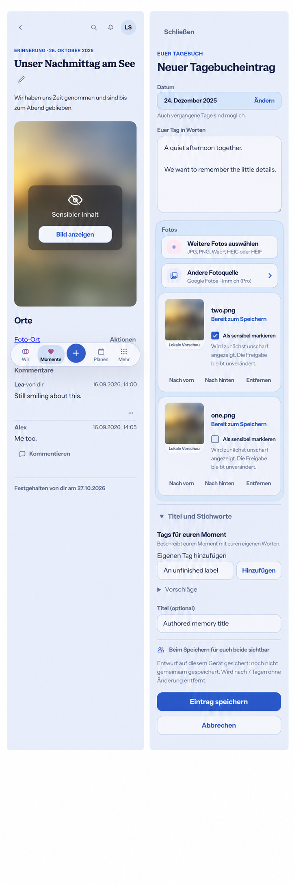

# Sensitive media preflight (#1477)

Baseline: `4c11ed43ccb3ffb917fe9ed408f6bd251d8f4099`, inspected 2026-10-28 before UI implementation.

## Inspected destinations and Mobile Interaction Contract

R1 diary capture (`MemoryCreatePage`, `AttachmentDraftPicker`) preserves date, authored prose, optional photos, provider source picker, ordering/removal, optional title/tags, sharing notice, durable draft status and explicit Save/Cancel. R2 saved Memory/HeartMoment keeps authored content, gallery, Places, comments, edit, task return and current shell. Existing `MediaGallery`, thumbnail consumers, shared photos, protected drafts and content-binding services were inspected. Only currently supported images are delivered; video remains unavailable.

Add a checkbox alongside each image in capture/edit. This is draft state and is committed with normal Save. Persist classification inside the existing protected Attachment payload, defaulting old payloads to false. Memory gallery replacement and HeartMoment create/update apply it under the existing parent/attachment transaction, authorization and concurrency contract before shared binding. No separate classification write may expose a newly shared image between requests. Cancel does not mutate saved classification.

Classification is persistent; reveal is local and volatile. The same gallery and its lightbox share reveal state per attachment. Neighbors remain concealed. Closing the viewing flow, actual document backgrounding, pagehide, or Account/Space change resets reveals without resetting gallery geometry or scroll. No focus-loss handler. No reveal data is written to URLs, browser storage or analytics. Cards and thumbnails remain concealed until deliberately opened/revealed in their own context.

Use neutral localized copy, a strong blur and contrasting cover, and a semantic button with a 44 CSS px minimum target. Keep text/buttons outside the filter. Concealed content has only a neutral accessible label; revealing restores ordinary image semantics without announcing the image description. Keep focus on the reveal/hide control. A neutral opaque loading/error fallback must never briefly expose image content. Unknown classification fails concealed; confirmed old server payloads need an explicit compatibility policy. Visible save state and errors remain distinct from local presentation.

Compact (320/360/390/430) is normative. Expanded keeps the existing reading width and identical actions. Reuse semantic colors, spacing, radius and motion tokens; add only a reusable concealment role where necessary. Reduced motion retains feedback with immediate concealment. No gesture-only controls, new modal confirmation, admin surface or global preference. One person can finish without requiring the partner to participate.

The generated reference is composition guidance, not runtime evidence: its unchecked second draft is mistakenly blurred; implementation must leave unmarked images clear. Preserve the runtime typography/navigation and avoid copying any generated visual artifact that conflicts with Product Reference v1. The source image is a synthetic landscape, not private user media.

## Reuse review

Alternatives: canonical protected Attachment metadata versus a second media store; existing gallery/CSS filtering versus a third-party concealment library; manual selection versus an external classifier. Select existing protected payload, parent mutation, media loader, gallery, native HTML checkbox/button, CSS filter and Page Visibility APIs. Custom code is only domain classification and presentation state. No new package/provider, license/ToS, account, server configuration or paid API. Cloud and Self-Hosted use the same path; opaque cover is the fallback.

Primary sources checked 2026-10-28: [WAI disclosure](https://www.w3.org/WAI/ARIA/apg/patterns/disclosure/), [Page Visibility](https://developer.mozilla.org/en-US/docs/Web/API/Document/visibilitychange_event), [Nielsen heuristics](https://www.nngroup.com/articles/ten-usability-heuristics/), [switch conventions](https://www.nngroup.com/articles/toggle-switch-guidelines/). No image analysis or external media transmission is introduced.

## Business/freemium and cross-cutting review

Non-paywallable media privacy under the existing feature matrix, identical Free/Pro and Cloud/Self-Hosted. No new media copy, storage quota, destructive downgrade or data-right limitation. Existing originals remain intact. Classification survives supported transfer/backup paths; old payloads default to unmarked. Preserve authorization, private/shared boundaries, version checks, idempotency, encrypted draft recovery, tenant-scoped cache invalidation, no sensitive logging, localization, keyboard/focus and stable media sizing. Blur is visual presentation, never authorization or encryption. No native packaging/release changes.

## Evidence plan

Verify transactional binding, classification edits, rollback/conflicts, private/cross-tenant boundaries, transfer round-trip and legacy payloads. Browser/component journeys cover capture/edit/save, mixed gallery/reveal/hide/lightbox/background/return, cards/shared photos, no initial flash, failed save, draft recovery, keyboard/axe, Light/Dark and Compact/Expanded. Generated design guidance does not satisfy these runtime tests.

Generated reference: original project ImageGen asset; prompt stored beside it. No private user content or external asset was introduced.
