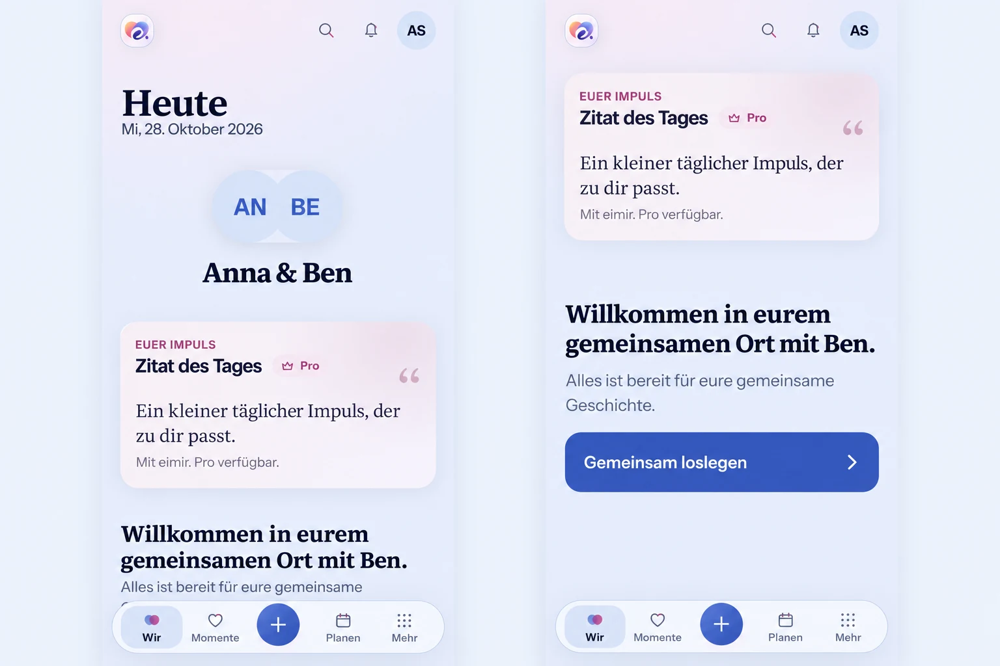
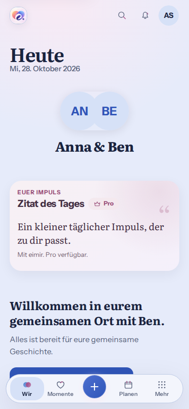

# Persistent Compact bottom navigation — #1489

## Product design preflight

Baseline: `main` at `5e19e8b8f522be6b59737b15a40e6c8bbbceb806` (2026-10-28).
The Product Owner requested implementation of #1489. This supersedes #970's
feed auto-hide decision. The current baseline has already removed that runtime
mechanism: the existing bar is fixed and no scroll-direction listener remains.
This slice proves its actual viewport position and completes clearance handling.

Reviewed production consumers: `AppShell.tsx`, `shell.css`, `product-reflow.css`,
`QuickCreateMenu.css`, `ShortTaskSheet`, the document scroll owner, and the shared
Wir, Momente, Planen and Mehr destinations. No route-level scroll container or
duplicate navigation is introduced. Expanded retains horizontal navigation.

Authority: Product Reference v1 navigation/thumb reach, R4/Today and R5/More,
Screen Templates shared anatomy, UX Patterns §2, Component Contracts navigation
and focused-task/short-sheet behavior. The current Today masthead is retained;
PR #1488 and alternative home compositions are separate work.

### Whole-screen generated reference

Created with the built-in imagegen tool from the actual baseline screenshot
below, before runtime implementation. Prompt: preserve the complete current
390×844 Today composition and show its top and lower content with the same
existing floating bar anchored to the same viewport edge; keep all four labels,
the central creation action, tokens and content; provide clearance for the last
action; introduce no redesign, dependencies or new capabilities.

This image guides navigation composition, not exact product copy or header
behavior: the existing header scrolls naturally out of view. Generated placement
and text artifacts do not override actual content, accessibility or v1.

Both images contain synthetic test identities and repository-authorized product
assets only. The generated reference is not runtime or physical-device evidence.

## Mobile Interaction Contract

- **Human outcome:** reach another shared destination or capture a moment at any
  ordinary scroll position; the relationship content remains the focal point.
- **Primary Compact state:** the existing pill on Wir, Momente, Planen and Mehr,
  with `Wir · Momente · + · Planen · Mehr`. The plus is an action, not a route.
- **Hierarchy/disclosure:** retain all existing content and actions. No new
  controls, typing, data collection, table, or management surface is needed.
- **Interaction:** existing semantic links and Quick Create; ordinary document
  scrolling never hides the bar. Focused composers keep their own completion
  controls. Existing modal focus containment and dismissal remain authoritative.
- **Insets/clearance:** use the shared effective bottom-safe-area value once in
  the bar offset and once in its reserved content footprint. Focused content
  scrolled to the viewport end must remain above the complete bar footprint.
- **States:** navigation is available independently of loading, sparse/empty,
  error, offline and success content; no new state or fabricated result.
- **Privacy:** preserve private/shared context, account/Space ownership and all
  existing authorization and modal-background boundaries.
- **Narrow/large text:** prove 360/390/430 px, 320 px reflow, enlarged text, short
  height and orientation/viewport changes without obscuring focus or actions.
- **Motion:** the persistent bar does not animate on scroll. Existing causal
  link/Quick Create feedback remains, with the existing reduced-motion contract.
- **Expanded:** existing horizontal header; no phone bar added to wide layouts.
- **Warmth:** existing personal content, imagery, palette and type carry it;
  additional playful decoration or relationship microcopy would distract here.
- **Acceptance:** viewport geometry before/after down/up scrolling and route
  return, safe-area injection, final focused action, Quick Create and sheet
  layering, focused task/keyboard-constrained viewport, Light/Dark, reduced
  motion, large text, root zoom/reflow and Expanded browser evidence.

## Reuse, business and cross-cutting review

Use platform CSS fixed positioning, existing semantic links, safe-area adapter,
design tokens, container-responsive shell and native scroll alignment. Compare
this with a navigation library, React portal, per-page scroll listeners and
measuring the bar on every scroll: those alternatives add maintenance, layering
or event work without a required capability. No dependency/provider is added.

**No business/freemium impact:** basic navigation and accessibility remain common
to Cloud and Self-Hosted. No entitlement, quota, cost, data retention, export or
downgrade contract changes; no matrix reclassification is required.

Accessibility, focus visibility, safe-area ownership, responsive layout,
reduced-motion and scroll stability are relevant. No API/schema, security/auth,
network, persistence, caching, localization-string or migration change is needed.
CSS-only behavior adds no listeners, React renders, requests or media reloads.
The Capacitor wrapper and its IME/inset integration are unchanged; headless
constrained-height checks do not claim real-device keyboard acceptance.

## Baseline regression proof

The stronger browser cases fail on the baseline before runtime edits:

- injecting the established `--safe-area-inset-bottom: 24px` adapter leaves the
  bar 24 px below its intended position because it reads `env()` directly;
- a focused action aligned to the viewport end ends at 700 px while the bar
  begins at 628 px, so it is obscured despite adequate document-end padding.

The existing tests passed because `toBeVisible()` proves rendering, not viewport
containment, and did not compare focused-content geometry with the fixed bar.
