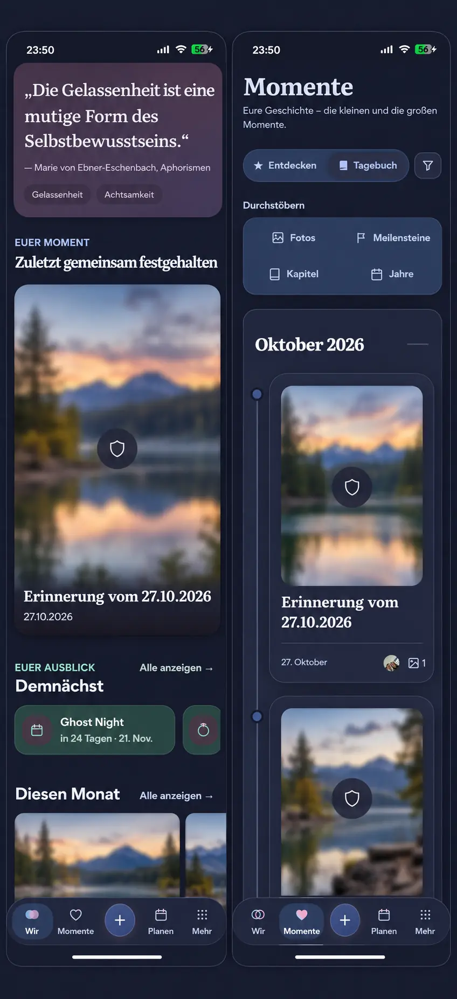

# Sensitive overview previews (#1493)

## Preflight and authority

Baseline main: `413d93465`. The issue records the Product Owner request, R2/R4
and Timeline/Today templates, mobile interaction contract, reuse review,
business/freemium assessment and cross-cutting decisions before implementation.

This reference was generated with the built-in Imagegen tool before runtime
implementation (commit `79007f867`). Its prompt preserves the supplied Wir/diary
composition and existing navigation, replaces only sensitive placeholders with
moderately blurred synthetic landscapes, and adds an icon-only reveal target.
The generated shield and neighboring synthetic photographs are illustrative:
implementation uses the existing `privatsphaere` padlock, the canonical shared
12px blur token, current main composition, and clear ordinary photographs.

## Shared contract

- `MemoryPreview` loads explicitly classified photos through the existing
  authorized resource owner; marked photos can paint only under the shared blur.
  Unknown classification stays opaque and cannot request/reveal a photo.
- Only the Wir focal card and diary cards enable the local reveal action. The
  same centered 48px Privacy button shows and hides one preview, retains focus,
  and exposes its localized name and pressed state. The remaining photo/card
  opens canonical detail, which starts concealed independently.
- `PreviewCardLink` supplies a whole-card navigation target **beside** content
  and media buttons. It preserves destination/modifier-click semantics, origin
  capture and keyboard navigation without nesting a button inside a link.
  Its content is hit-transparent except for the explicit media control.
- Center the control using insets and automatic margins. Centering must not use
  a transform that the common hover/press transform can replace and move out
  from under a pointer between pointer-down and pointer-up.
- Reuse the existing volatile reveal lifecycle, including native background
  state from the existing Query focus manager. Background, pagehide, navigation,
  resource/scope/classification replacement and remount conceal again. No reveal
  state is persisted or transmitted. Ordinary previews install no privacy-event
  subscriptions. Toggling does not replace the media resource or request it again.
- Loading and transport error keep the opaque safe fallback; a hidden image has
  no accessible description. Large text, Light/Dark and Expanded keep the same
  controls and media geometry. Concealment is immediate, including reduced motion.

No business/freemium impact: media privacy remains non-paywallable, Memory and
Timeline remain Free/Core, and Cloud/Self-Hosted share the same behavior. No new
dependencies, provider, media derivative, entitlement, quota, API, schema,
configuration, retention, export or downgrade contract.

## Runtime evidence and acceptance

Source-bound Playwright journeys use the repository-approved synthetic forest
photo and authorized API fixtures, never the supplied private photographs.

| Viewport / theme | Wir | Diary |
| --- | --- | --- |
| 360px Light | [Runtime](overview-wir-360-light-concealed.webp) | [Runtime](overview-diary-360-light-concealed.webp) |
| 390px Dark | [Runtime](overview-wir-390-dark-concealed.webp) | [Runtime](overview-diary-390-dark-concealed.webp) |
| 430px Light | [Runtime](overview-wir-430-light-concealed.webp) | [Runtime](overview-diary-430-light-concealed.webp) |
| 1280px Dark | [Runtime](overview-wir-1280-dark-concealed.webp) | [Runtime](overview-diary-1280-dark-concealed.webp) |

They cover 360px Light, 390px Dark, 430px Light and 1280px Dark on both screens:
initial shared blur, centered touch target, actual pointer/keyboard reveal and
hide, unchanged URL on reveal, photo-area navigation to concealed detail, return
to the original concealed preview, and Axe checks on the changed media controls
and sibling navigation link. The existing surrounding Timeline heading order
is outside that component-level accessibility assertion.

Component regressions additionally cover unknown flags, load failure, deferred
viewport loading, classification/scope/navigation changes, pagehide and native
background. Existing detail-gallery reveal and reaction journeys remain intact.
Actual APK publication and physical Android acceptance are separate delivery work.
