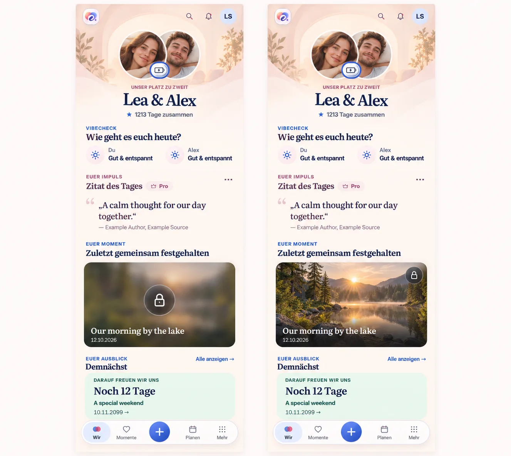

# Cozy Wir and translucent photography — #1498

## Preflight and authority

Baseline main: `9ee7e1444a20e2e013a065bda80fa4d8810b2ef3` (test.24).
The owning issue contains the Product Owner feedback, repository inventory,
Mobile Interaction Contract and generated visual reference before UI work.

Built-in imagegen used the actual 360px warm runtime screenshot as its reference.
Prompt: preserve the existing shell, couple portraits/Energy, names/duration,
Vibecheck, quote, memory, countdown and shared summary; create a sheltered warm
cream/rose composition with nearby portraits, an editorial introduction, open
Vibe rows and a personal-note quotation. Compare concealed and revealed photos:
translucent centered Privacy control while concealed, trailing top control when
revealed. Generated people/foliage/room imagery are illustrative and are not
runtime assets. The existing shared summary remains available below the
composition even though the generated board does not show that continuation.
Product Reference v1 R4/R2/R5 and the current domain/privacy contracts govern.

## Delivered composition and shared material

- Geborgen consumes the existing contextual `warm` identity palette, with a
  continuous warm ground, soft portrait alcove, nearby portraits and localized
  “Unser Platz zu zweit” introduction. Vibe rows and the quotation are open
  content rather than repeated boxed modules. Contextual palette adapters now
  also cover automatic Dark mode. The selector miniature/description matches.
- Classic and Modern retain their compositions, saved choices and tier rules.
  Every design shares the same content tree, module ordering/visibility,
  actions, resource owners and return/save/conflict behavior.
- `MediaOverlay.css` owns one token-based translucent material for in-image
  privacy, expand/reaction, navigation and count controls. White foregrounds
  remain fully opaque. The 60% dark resting layer retains normal-text contrast
  even over white photography; hover deepens the surface. Reduced transparency
  and forced colors have shared fallbacks. Geometry stays with each consumer.
- One existing Privacy button stays mounted and focused: centered when concealed,
  top trailing edge when revealed. It never disappears or becomes hover-only.
  The photo center is free, while the rest of the photo/card still navigates.
  Reveal never changes the media-resource identity or requests the photo again.
- Concealment remains immediate on background, pagehide, navigation and
  scope/resource/classification changes; unknown classification stays opaque.
- Fullscreen Privacy and Close have separate >=44px hit regions. Their previous
  overlapping positions are corrected, including Compact.

## Actual runtime evidence

Screenshots use synthetic names and existing authorized demo fixtures, never
private user photos. These are real React/Vite renders. The tiny green fixture
in the design-selector journey is deliberately synthetic; the overview journey
uses the repository-approved forest photograph. Source SHA-256 values are in
[runtime-source-sha256.json](runtime-source-sha256.json).

| Review | Evidence |
| --- | --- |
| Warm vs Classic, same 390px Dark content | [Geborgen](wir-warm-390-dark.webp), [Klassisch](wir-classic-390-dark.webp) |
| Compact Light | [360px](wir-warm-360-light.webp), [430px](wir-warm-430-light.webp) |
| Expanded Dark | [1280px](wir-warm-1280-dark.webp) |
| 200% text | [390px Dark](wir-warm-390-dark-large.webp) |
| Design selection | [Selector](selector-modern-390-dark.webp) |
| Wir preview | [Concealed](overview-wir-360-light-concealed.webp), [revealed](overview-wir-360-light-revealed.webp) |
| Diary preview | [Concealed](overview-diary-390-dark-concealed.webp), [revealed](overview-diary-390-dark-revealed.webp) |
| Expanded photo | [Revealed](overview-wir-1280-dark-revealed.webp) |
| Fullscreen controls | [Separate glass controls](fullscreen-glass-controls.webp) |

## Verification

- 110 component/unit tests pass across MemoryPreview, SensitiveMedia, TodayPage,
  CouplePresence, WirDesignSettings, MediaGallery and MemoryPhotoGallery.
- 14 browser journeys pass: design save/return/reload for all three designs at
  320/360/390/430/1280px plus 200% text; Free preview/cancel/reset and saved Pro
  retention; failed save/retry; Wir and diary privacy at 360 Light, 390 Dark,
  430 Light and 1280 Dark; fullscreen reveal/hide/close without overlapping targets; the existing Energy optimistic-save/rollback/retry journey at 320px Dark with 200% text.
- Those journeys verify native pointer/keyboard actions, focus retention,
  geometry/reflow, default/selected styling, shared blur, image-center clearance,
  translucent background with opaque foreground, canonical navigation/return
  and Axe accessibility. The component regression additionally checks no new
  media load on reveal/hide. Existing background/unknown/error tests remain.
- TypeScript, production build, token/PWA checks and scoped English engineering
  and documentation audits pass. Build retains existing bundle-size and
  dependency `use client` warnings; scoped lint retains existing MediaGallery
  non-null-assertion/template warnings, with no lint errors.
- Local browser: Chromium 149 from a temporary serverless browser package,
  repository Playwright 1.62.1, system font configuration. Every journey runs in
  a fresh browser process because this serverless single-process binary cannot
  reuse closed browser contexts reliably. No project dependency, CI config,
  assertion or auth fixture was changed to accommodate that runner.

No native wrapper change, physical-device acceptance, merge or new test release
is claimed. CI on the published PR remains a separate gate.

## Review correction: Energy overlay at large text

The first complete PR browser run found one real regression in the existing
Energy optimistic-write/retry journey. At 320px with 200% text, the fixed
navigation covered the slider. The warm page's new `isolation: isolate` created
an ancestor stacking context, trapping the hero's existing open-popover layer
below navigation. The same assertion failed in CI and in a local reproduction.

The warm canvas and portrait glow now paint as element backgrounds, without
adding an ancestor stacking context. Full-bleed page padding/margins preserve
content geometry and gutters. Existing Energy/gesture overlay ownership and
layer rules remain authoritative; no z-index escalation, scroll mutation,
delay, retry or assertion change is added.

[Unobscured Energy slider at 320px Dark / 200% text](energy-slider-320-dark-large.webp).
The unchanged failing journey passes after correction. All six design
save/return/reload sizes/text modes and all four overview privacy sizes/themes
were rechecked on the corrected source. Runtime screenshots and source hashes
were refreshed; component tests, formatting, typecheck, token checks and the
production build were rechecked as well.

## Reuse, business model and cross-cutting review

Reuse: existing warm identity tokens, CouplePresence (one optional eyebrow),
shared Today tree, native button/ARIA pressed state and volatile reveal lifecycle.
The smallest shared media material replaces parallel opaque surface treatments;
no new layout engine, provider or runtime dependency.

No business/freemium impact: Geborgen stays Free/Core; alternate selections
stay Pro and previously saved choices survive downgrade. Privacy remains
non-paywallable. No API/schema/auth, persistence, quota, retention, export,
managed cost or Cloud/Self-Hosted difference. No new media derivative, query,
cache or personal-data surface. Labels remain localized; motion does not delay
concealment and no position animation, timeout or retry was added.
