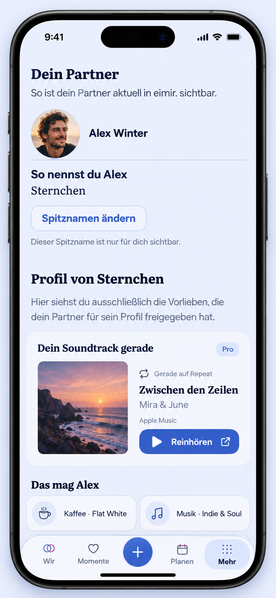

# Personal soundtrack — Compact product reference

Issue: [#1504](https://github.com/baerenmarke90/eimir/issues/1504)
Date: 2026-10-29
Tool: built-in image_gen, ui-mockup
Main baseline: `1afcb410ebd8db015255e49be06eb988d80048de` (confirmed through the GitHub connector before generation)
Destination: `/more/profile`, scrolled to the existing partner block.

## Repository-aware preflight

Reviewed the baseline main versions of:
- `web/src/components/ProfilePage.tsx`
- `web/src/components/ProfilePageBase.tsx`
- `web/src/components/PartnerIdentityPanel.tsx`
- `web/src/components/ProfileIdentityPanel.tsx`
- `web/src/components/ProfilePage.css`
- `web/src/components/PersonIdentity.tsx`
- `web/src/components/AppShell.tsx`
- `web/src/client/routes.ts`
- `web/src/i18n/locales/profiles.ts`
- `design/tokens.json`

Normative design sources: Product Reference v1; R5 Profile/Settings; Partner-App Experience Standard; Design Principles. The existing nickname screenshot `docs/product/design/evidence/794/nickname-profile-390-light-saved.png` was inspected and supplied to image_gen as a structural/color reference. Its older capture is supporting evidence, not the current-main baseline; the source inventory above is authoritative.

## Composition and retained capabilities

The image depicts the receiving partner's existing profile section after scrolling. It preserves:
- partner heading and explanatory context;
- compact avatar and current presentation name;
- private viewer-owned nickname and its existing change action/privacy caption;
- partner shared-preferences heading and preference content;
- the existing five-slot navigation: Wir, Momente, central create action, Planen, Mehr (selected).

The new song composition sits inside that partner section, after identity/nickname and before the shared preferences. The broader route still contains relationship summary, the viewer's own identity/preferences, relationship passport, separate private-note area and secondary Pro information above/below this viewport. These are not replaced or removed. The main header has scrolled out of view.

Reuse the existing identity/profile composition, preference chips, external-link behavior and semantic light-theme navy/periwinkle/cobalt colors, display/sans typography, spacing, radii and sheet/motion roles. The new song projection needs a small content-led pattern rather than another settings grid.

## Illustrative content and deliberate scope

- The person, seascape cover, song “Zwischen den Zeilen” and artist “Mira & June” are generated illustrative content, not actual user data, licensed provider artwork or proposed runtime assets.
- Apple Music illustrates the non-live, personal-song selection state. “Gerade auf Repeat” requires suitable repeat evidence and provider approval as specified in the issue; the mockup does not prove that any API supplies that evidence.
- The single dominant song action is external “Reinhören”; the arrow denotes leaving for the music service. There is no in-app playback or transport bar.
- The Pro badge identifies the existing Space-level product boundary. The nickname remains viewer-private. Source authorization, owner controls and analysis are not exposed to the receiving partner.
- The familiar preferences are shown as sparse example content. The extra “Das mag Alex” grouping caption is illustrative hierarchy, not a new domain field or a requirement to replace the existing preference-category rendering.
- The render uses a tall phone frame and compact spacing to show the entire composition. It is a generated design reference, not pixel-exact implementation or a screenshot of working functionality.
- Static motion-free composition is compatible with reduced motion. The runtime still needs the issue's full mobile interaction, accessibility and visual acceptance checks.

A new screenshot/Expanded mockup is not necessary for this bounded receiving-partner concept. Owner setup/consent and other runtime states must follow the issue's contract. Refresh the reference if the actual profile composition changes materially before implementation.

## Artifact provenance

- PNG: 852 × 1846 pixels.
- SHA-256: `9b1ad3cba5ba4f33f48d40a1b54ee4c4d2b3083e5561d3fbf9245a4b074c0e60`.
- [Exact generation prompt](prompt.txt).
- Published on a dedicated documentation branch; no runtime code or existing user work was changed.
