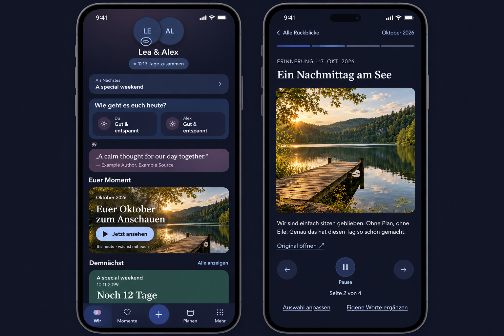

# Monthly recap discovery and playback preflight

Owner: [#1542](https://github.com/baerenmarke90/eimir/issues/1542).
Baseline: main `51fad502a8c89656365bbe8b327e0f54456fd6df`.

Generated with the built-in Imagegen tool after reviewing the current Today and
recap reader screenshots and their runtime components. The exact input is in
[prompt.txt](prompt.txt). Synthetic example names and reference photography are
composition guidance, never production fallbacks. Preserve the existing shared
focal moment; the recap belongs to the monthly-highlights responsibility rather
than replacing Euer Moment as the generated composition might suggest.

## Intended product contract

The existing monthly-highlights section owns a quiet Passport continuation and,
at month end, a photo/text-led Watch now invitation for a ready nonempty edition.
An early-next-month invitation may continue into the last completed month.
Use exact server period labels; never present a partial month as completed.
Personal module visibility and order remain authoritative. No permanent extra
widget, autoplay on Wir, or inference caused by a GET is introduced.

Reuse the authorized recap overview and existing source media/task-return
contracts. Failed optional discovery must not block Wir. A removed source or
authoritative denial must not leave its previous preview visible.

Watch now deliberately starts the finite slideshow. Opening the ordinary library
remains a reading task. Playback provides visible Pause/Play and Previous/Next,
text-sensitive dwell time, a segmented progress indicator and a final reflection
page where playback stops. Preserve selection, reflection, save and original
source actions. Original authored text remains separate from generated prose.

Backgrounding, source visits, selection/reflection/save tasks and content
interaction pause playback. Returning restores the same edition and page,
paused. Autoplay must not navigate away from an actively focused content control.
Reduced motion starts paused; manual playback can advance static pages without
photo movement. No swipe-only controls or touch interception of the app shell.
Use existing semantic motion/spacing/type/surface roles and useMediaQuery.

Compact 360/390/430 px leads; Expanded preserves reading measure. Verify Light,
Dark, large text, reduced motion, sparse/no-photo, unavailable-source, pending,
offline and permission-denied states. Neither a screenshot nor mocked inference
establishes actual operator-host model quality or latency.

## Implemented behavior

The invitation is part of monthly highlights, including its existing personal
visibility and ordering. It features a ready, nonempty current month in the last
three calendar days, or the previous month in the first seven days. Other days
retain a quiet Passport link. Timing uses Dashboard's server-provided viewer day;
period/partial labels use the actual edition. Free users may watch retained
editions; saved partial editions use the same retained-status label as the reader
instead of promising continued growth; Wir never queues a generation. Optional query failure/denial removes
the preview and preserves ordinary navigation. A source already featured elsewhere
on Wir is not repeated as the invitation photo.

The shared RecapMedia component owns authorized library/invitation/reader media.
MemoryPreview reports resource completion, including cache reuse and failure,
so a loading picture does not consume reading time. A single finite playback
hook preserves remaining dwell time through Pause, uses text-sensitive reading
time, pauses for content interaction/tasks/backgrounding and consumes Watch-now
intent once. Return from an original remains paused at the same page. Playback
stops at reflections and can be deliberately restarted. Existing editing, private
drafts, source return and saved-artifact behavior remain unchanged.

Page transitions use the existing context duration. Time-proportional playback
uses the shared generated playback easing role; its duration is reading time,
not an interaction-transition constant. Reduced motion opens paused and removes
photo/progress animation while allowing deliberate static playback. Controls
reuse the existing product-content container for narrow/large-text reflow; their
labels remain whole and their targets do not overlap. Generated
introductions have a localized AI-draft label, separate from authored originals.

## Verification

- Focused integrated playback/calendar/Today/media/motion tests: 110 passed.
- Browser suite: all 18 scenarios passed in a fresh integrated run against main
  `bad2cb2691ca7045ea290d6a6e63345989aab19b`. Reader/reflow scenarios also passed
  after the final control-layout correction.
  The first run exposed harness issues: explicit navigation to Wir was missing,
  normal Today preference/activity responses were missing, the task closes through
  the shared Close action, and synthetic visibility events must bubble to the
  window listener used by TanStack Query. Corrections preserve the assertions and
  timeout limits. No product test or privacy rule was weakened.
- Production build, semantic token generation/check, scoped lint and typecheck passed.
- Backend composition/model validation: 25 passed; scoped Ruff/format and strict
  mypy passed with locked dependencies on Python 3.12.
- The complete Web unit run found one new raw-easing violation, corrected by the
  shared playback token; all other 2343 tests passed. The motion regression suite
  passes with that correction. Required CI remains authoritative for the final head.

Local browser QA uses available Chromium 153 through an uncommitted launch-only
config. The pinned Playwright browser download returned HTML instead of a ZIP;
no browser assertion or CI configuration was changed. No physical Android-device,
actual operator-host model quality/latency or 1000-couple load claim is made.

Representative implementation evidence:

- [Wir Compact Light](evidence/recaps-wir-360-light.png)
- [Wir Compact Dark](evidence/recaps-wir-390-dark.png)
- [Wir 430 px](evidence/recaps-wir-430-light.png)
- [Wir Expanded Dark](evidence/recaps-wir-1280-dark.png)
- [Reader Compact Light](evidence/recaps-reader-360-light.png)
- [Reader Compact Dark](evidence/recaps-reader-430-dark.png)
- [Reader Expanded Dark](evidence/recaps-reader-1280-dark.png)
- [Large text and reduced motion](evidence/recaps-playback-360-dark-large-reduced.png)
