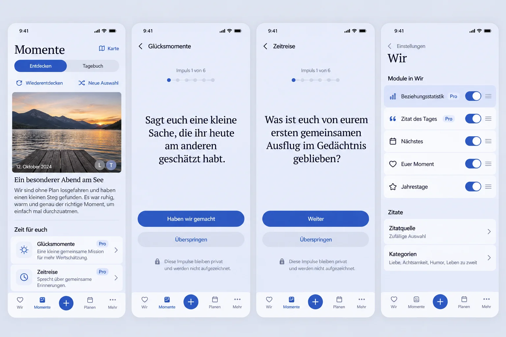

# Independent couple experiences and quieter Wir settings (#1562)

## Product Owner request and current baseline

Promote Glücksmomente and Zeitreise from Games into independent features. Also simplify Settings → Wir: remove Edit shortcuts for Daily Quote and relationship statistics, retain one statistics opt-in in the upper ordering list with a Pro badge, and replace the drag frame with a quiet hover-like emphasis.

Baseline main: 850ab01c81fb9f2bed57bc54d8a8cf794508ffea. Inspected StoryProductPage, GamesProductArea, LocalCoupleGame, App routes, settings composition, dashboard module order/visibility, useWirStatistics and quote preferences.

## Product Design Preflight / Mobile Interaction Contract

Product Reference v1 R2/R3 and Detail View/short focused task. Momente retains its map action, Discover/Diary tabs, current authored-content hierarchy and navigation. Add two quiet named entry links in Discover without replacing existing content. Each opens its own canonical route (/story/happiness, /story/time-travel), a content-led finite experience with one prompt at a time, deliberate next/skip/restart/finish, and normal Back to Momente. Remove those two entries from Games, which retains its other three games. No score, answer fields, streaks or required completion. Six existing authored prompts per experience remain intact. Back and forward use actual route history; entry does not erase the Momente tab/scope/position. Session state remains in memory and clears on context/entitlement loss.

Compact 360/390/430 is primary; Expanded shares the same bounded reading surface. Reuse PageHeader, EimirIcon, ProMark, semantic token roles, ProblemState, existing participant loading and prompt-session behavior. Preserve 44px targets, wrapping, focus on the current prompt and reduced motion. Loading, unavailable Pro, no second partner, request failure and retry are explicit. No claimed offline write or durable answers.

Settings retains the existing ordered list/handles and separate Daily Quote source preferences. Replace Edit jumps with actual row controls. The statistics row must use the existing personal Pro-controlled useWirStatistics preference rather than the intentionally retired shared_story_summary visibility flag. Remove the duplicate lower statistics section. Retain quote's own preference semantics. Dragging uses a subtle surface change without border/outline/elevation; ordinary keyboard focus remains visible.

Generated full-composition Compact visual reference will be attached here before feature UI implementation.

## Reuse-before-build

Reuse React Router canonical routes, the existing two authored prompt collections, finite session behavior, participant loader, entitlement boundary, token adapter and current reordering primitive. No new provider/dependency/platform infrastructure. Avoid copying either feature or building a second session engine. Native Android/Kotlin is outside this slice; canonical Web UI is packaged unchanged.

## Business/freemium impact reviewed

These two existing Pro experiences retain games.couple as their existing shared entitlement, now exposed independently from the game catalog; this is a navigation/product presentation extraction, not a new paid capability or changed price. Explicitly clarify the authoritative matrix's existing Premium games/experiences row. Both current partners and Cloud/Self-Hosted keep the same eligibility. Statistics remains relationship.passport Pro; Daily Quote remains daily.quote. No new backend data, provider/inference cost, quota, retention, export or downgrade semantics; revocation hides the session and retains existing authorized data/preferences.

## Cross-Cutting Quality

No new answer collection, storage, logs, telemetry, AI or memory access. Only existing entitlement and two-partner reads. Scope query/session identity by instance/account/Space. Fail closed on authorization/grant failures. Preserve local-only statistics consent and quote server ownership. Screen-reader/keyboard controls, localized copy, focus, reduced motion and long-text reflow are part of implementation. Validate direct links, game-catalog removal, finite sessions/skip/restart/exit, Free/Pro/error states, Momente return and persistence/serialization of existing settings. Visual browser evidence must reflect the final source.

## Generated reference, before UI implementation

Generated with built-in Imagegen before feature UI implementation. The prompt preserves the existing Momente map/tabs/Discover story, four named dock destinations and plus, adds two named experience entries and illustrates their existing first prompts plus the requested settings correction. It uses the current periwinkle/blue tokens and avoids game scores, forms and recording. Generation approximates typography, icon details, names of unrelated settings and exact spacing; these are not new requirements. Current runtime labels and supported source/category controls remain authoritative. The invented switch appearance is illustrative; reuse current accessible controls. No decorative divider, shadow or border is required by the image.

Expanded keeps the same reading/action sequence with bounded line length. Full runtime Compact/Expanded, Light/Dark and large-text evidence will be added after implementation. Neither the generated image nor browser transport mocks prove real Android calendar save/cancel behavior.

## Final scope and implementation

The PO additionally removed Memories settings and requires photo-derived Places
permanently enabled. The old URL redirects to the settings index. Migration 0096
re-enables prior disabled accounts and advances their preference revision without
backfilling stripped GPS or modifying existing Places. Authenticated legacy
clients receive PHOTO_LOCATIONS_ALWAYS_ENABLED when attempting to disable it;
stale If-Match writes still fail independently. No device location polling,
background location permission or new data provider is introduced. Private-image
exclusion, deliberately selected uploads, stripped published metadata, tenant
isolation, manual place corrections/unlinking and cleanup remain unchanged.

Glücksmomente and Zeitreise now have independent Momente routes. Their shared
finite session is migrated rather than copied; Games retains its other three
entries. Preserve all existing six prompts for each experience and existing
Pro games.couple eligibility. Entry captures the same bounded TaskOrigin as
other Momente destinations; deep entry returns safely to Momente. Instance,
Account, Space and experience own query/session identity. Entitlement errors or
loss unmount the active session. No answers or progress enter persistent storage.

The top quote control owns its existing server preference, including ETag and
conflict semantics. The lower quote section retains sources/categories. The top
statistics control owns the existing personal Pro opt-in; there is no duplicate
lower section or dead Edit jump. A shared optional row-control slot in the
ordering panel keeps its serialized write/reorder logic unchanged. Native input
labels retain product-sized hit areas. Drag and row focus use a quiet surface
change without a row frame/shadow; keyboard focus remains on the actual control.

## Verification

The full Web suite passed 2,385 tests with two pre-existing skips before the final
small focus/target/entry placement refinements; changed component cases are rerun
on the final revision. TypeScript, production build, token/PWA and browser
inventory checks passed. Backend non-integration run: 1,094 passed, 24 existing
skips, with one environment-only missing socksio dependency diagnosed separately.
A temporary PostgreSQL bootstrap cannot add its system user in this executor;
real PostgreSQL integration and the migration run in the repository CI.

Actual Chromium 153 browser journeys cover independent entry/direct routes,
skip/finish/restart/return, Compact 360/390/430, Expanded, Light/Dark and reduced
motion. Settings coverage preserves pointer/keyboard order, personal statistics
opt-in/reload and quote opt-in/save/Wir return. Photo-place coverage preserves
320px/200% reflow and actual saved place/read/edit/unlink journeys while removing
only the retired settings switch/URL. No assertion tolerance or timeout is raised.
Screenshots below use synthetic fixtures. The pinned Playwright binary download
returned an invalid archive locally; temporary Chromium 153 was used without
changing repository dependencies or browser pins.

Actual evidence: [Glücksmomente Compact](evidence/happiness-390-dark.webp),
[Zeitreise Compact](evidence/timeTravel-360-light.webp),
[Expanded](evidence/timeTravel-1280-dark.webp), and
[Wir settings after pointer/keyboard order and reload](evidence/settings-order-390-light.webp).
The missing local socksio package was installed only in the temporary environment;
all 12 media-configuration tests then passed. No runtime dependency changed.
