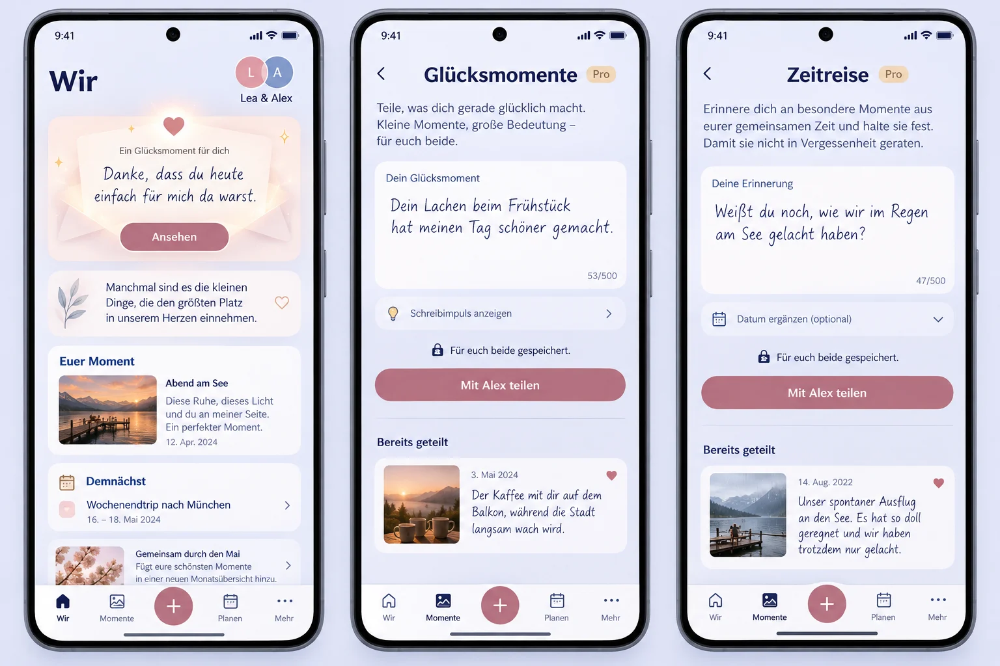

# Shared happiness and time-travel entries (#1566)

## Pre-implementation product contract

Baseline main: cd929f65336b38b70924a0ac2f36596aa8f9e55e.
The Product Owner now requires written entries, a partner Push and animated
presentation on Wir. This explicitly supersedes #1562's transient/no-recording
interaction and the older sofa-only framing in #867/#869.

Read current CoupleExperiencePage/Links and prompts, Today composition and
module catalog, canonical Memory create/receipt/authorization/export, engagement
projection/Push policy and notification preference groups before this reference.
Product Reference v1 R4/R5 and focused Create/Edit/Detail View remain normative.

## Generated whole-composition reference

Generated with built-in Imagegen before feature UI code. It shows the existing
Wir shell, couple identity, quote, authored moment, agenda and monthly material
around an incoming authored note, plus both named entry compositions. The image
is composition guidance, not a new icon/font system: use current glyphs,
typography, tokens, ProMark and real current functions. Do not implement invented
photos, counters, hints, paid labels, navigation drawings or extra paragraphs
merely because generation drew them. A focused dirty composer uses the actual
existing task/draft/return contract, not the image's illustrative dock.

## Mobile Interaction Contract

Glucksmomente invites a short present appreciation; Zeitreise invites a shared
recollection and optional past date. One labeled textarea, optional curated
inspiration and one deliberate Share action. State the actual shared-history and
partner-notification consequence briefly. No auto-send, ambient recording,
secret answers, streaks, scores or future scheduled delivery. Keep the existing
Memories domain as canonical authored history rather than a parallel story store.

Compact 320/360/390/430 and large text come first. Reuse current task/draft/create
receipt and query ownership. Pending writes cannot duplicate, uncertain outcomes
reconcile the same identity, failed/offline writes retain the draft, successful
writes lead to their actual saved result and return restores origin. Partner
absence and unavailable Pro are explicit. Reading existing content remains Core.

Wir adds one registered personal module only when a current authorized incoming
experience exists. The partner's words are primary; a bounded preview opens the
actual saved source. Existing avatar/quote/keepsake/agenda/monthly sections remain.
Use finite non-blocking paper/light reveal with ordinary focus and a static
reduced-motion equivalent. Expanded preserves bounded text and the same flow.

## Reuse, business model and cross-cutting review

Use a closed nullable origin on canonical Memory, existing idempotent creation,
shared visibility, author permissions, comments and portability. Add a safe
origin field to the existing Memory-created event so the existing engagement
projector can create a recipient-bound immediate Notification and existing
PushDelivery. No new payload store, provider, SDK, scheduler or generic framework.
No authored words enter Outbox, provider payloads or logs. Respect quiet hours,
recipient choices and current target/member authorization. Replays create one
Memory and one logical notification; imports do not send historical Push.

Creation/presentation remains under existing Space games.couple Pro; saved
sources and essential history/edits/export remain Core after expiry. No new SKU,
resource quota or Cloud/Self-Hosted distinction. Record this explicit retained-
source boundary in the authoritative matrix. Nullable migration and validated
transfer metadata preserve older sources/imports. Signed history cursors bind
origin, caller and Space. New controls reuse the existing grouped settings.

## Acceptance plan

Author -> share -> canonical saved result -> partner Notification/PushDelivery ->
Wir reveal -> open saved entry -> return. Include equivalent-request concurrency,
unknown outcomes, 503/offline retry, current authorization/member change, source
deletion, privacy-negative/cross-tenant cases, downgrade retained reads, import
round-trip without notification replay, keyboard/axe, narrow/200% text,
Light/Dark and reduced motion. Automated checks and synthetic browser evidence
must be distinguished from actual installed-device Push delivery acceptance.
