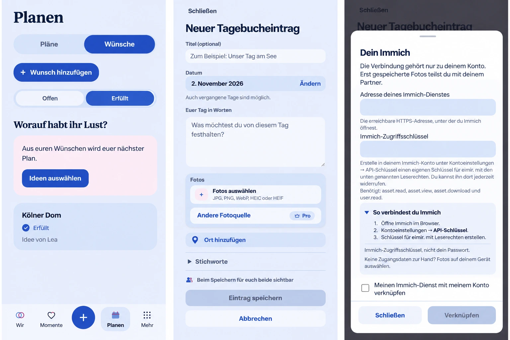

# Voice-feedback follow-up — product preflight

Owner: #1581. Baseline: main `26369e5d54f91fe63c180b5bc6d47cba6a8b4900`,
including merged Push PRs #1392, #1573 and #1578, plus #1575.

## Reviewed destinations and generated reference

The real baseline Planning/Wishes overview, Memory composer and personal Immich
sheet were rendered at 390 CSS px before implementation. Source owners are
`SharedPlanningOverviewPage`, `MemoryCreatePage`, `HeartMomentProductPage`,
`MomentPlacePicker`, `PlaceMapPicker` and `PhotoSourcePicker`. Existing Plans /
Wishes navigation, shared Wish selection, creation, content links, focused task
controls, local and external photo choices, tags, audience and save remain.

Generated with the built-in image-generation tool, using all three real baseline
captures as references. Prompt: preserve the current whole surfaces, colors,
typography, capabilities and navigation; add Open/Fulfilled scope to Wishes,
one optional Add place action between photos and tags, and disclosed personal
Immich setup steps with a device-photo alternative. No new provider, photo,
operator configuration or independent product design. The image is composition
guidance, not a pixel lock or runtime evidence. Ordinary controls reuse actual
tokens; the optional help is kept shorter than the illustration.

## Mobile Interaction Contract

Authority: Product Reference v1 R1 capture, R3 Planning and R5 utility; Plan Hub,
Create/Edit, Detail View, existing ShortTaskSheet and task-origin contracts.

- Wishes expose Open/Fulfilled scope outside disclosures. Each status owns its
  query/pagination/error/empty state. Returning from a Wish restores scope and
  selected source focus. Completing a Wish does not require photos or a Memory.
- Memory and shared HeartMoment capture offer one optional place action, using
  the same saved-place/map choice as post-save place linking. Creating a Place
  is explicit; cancelling capture does not delete an independently created Place.
- The selected place belongs to the exact submitted create snapshot. Memory
  draft recovery retains the selection under the existing owner/expiry boundary.
  Content and its typed relation save in one backend transaction. Retries use
  existing request identities; manual choices precede automatic photo locations.
- Private HeartMoments never publish a place or acquire a shared relation.
  Creating a new independent shared Place is explicitly labeled and its
  retention is disclosed before confirmation; searching alone creates nothing.
- Immich remains personal and optional. Disclosed instructions explain the
  reachable HTTPS address and a revocable read-only key, never a password or a
  partner's credentials. Device-photo selection stays directly available.
- Compact 360/390/430 is normative; Expanded preserves the same hierarchy.
  Existing 44px controls, keyboard/focus, large text and reduced-motion behavior
  remain. Loading, offline, failed selection/save and confirmed result are
  distinguished; no background write replay or new notification source.

## Reuse and cross-cutting decisions

Extract only the bounded Place-choice responsibility from MomentPlacePicker;
reuse the existing map picker, source APIs, query ownership and typed relation
service. Add one optional create field, with backwards-compatible receipt
fingerprints and generated OpenAPI/client alignment. No database migration,
dependency, provider, notification pipeline or shared credential is added.
Authorization checks remain same-Space and private-target-safe. Existing draft
retention, photo handling and current Push event policy remain authoritative.

No business/freemium impact: Wish/Plan lifecycle, ordinary moment capture and
basic Places remain Free/Core. Existing map and external-integration Pro
boundaries, retained data, quotas, Cloud/Self-Hosted behavior and provider costs
are unchanged.

## Validation plan

Test fulfilled/photo-free Wish discovery and return, status pagination/errors,
saved/new Place selection, create/replay atomicity and foreign/private rejection,
Memory draft recovery, manual-over-photo precedence and optional Immich help.
Capture actual Compact Light/Dark and Expanded journeys with reflow, keyboard,
reduced motion and scoped accessibility checks. Browser fixtures do not establish
physical Android or real-provider acceptance.
