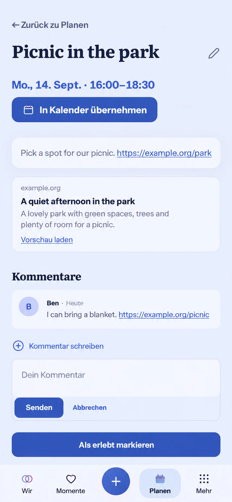

# Plan conversation and authored links — visual preflight

Owning issue: [#1583](https://github.com/baerenmarke90/eimir/issues/1583). Baseline main: `26369e5d54f91fe63c180b5bc6d47cba6a8b4900`.

Generated before UI implementation with the imagegen skill and built-in image tool, using the actual `planning-reference.spec.ts` 390×844 Light Plan detail screenshot captured on this main baseline (Chromium 153.0.8010.0). This is a composition reference, not runtime evidence. The prompt preserved the entire existing read-first Plan surface: Back, title/Edit, schedule/calendar handoff, description, completion and selected Planning bottom navigation; cover/gallery, place and completed-story continuation stay conditional existing functions.

R3 and the Detail View template govern. Authored prose remains primary. Conversation follows the description, reusing CommentsPanel; completion remains a separate contextual action. External HTTP(S) links are identified inline, with an explicit text-only metadata preview action for public HTTPS destinations. No remote image, script, tracking pixel or automatic third-party request. The generated illustration places a load action beside already resolved metadata and shows trigger plus open composer together; implementation must show these as mutually appropriate states, and must use the existing comment author/time/actions rather than inventing a chat avatar. Existing semantic tokens and accessible native links/buttons take precedence over image details.

Compact uses one column, wrapping long links at 320px/200% text. Expanded preserves the same reading hierarchy and bounded prose width. Existing comment pending/error/offline/owner lifecycle and reduced-motion feedback apply. Validate create, read, edit, delete, preview load/fallback and return with actual browser evidence in both themes; Android wrapper is unchanged.

Prompt: Generate a whole-screen Compact Plan detail from the actual baseline screenshot, retaining its composition and visible capabilities while integrating an inline linked description, compact title/description/domain metadata, a contextual CommentsPanel and composer. No device frame, generic dashboard, remote imagery or new management UI; synthetic authored text English and localized product labels German.
