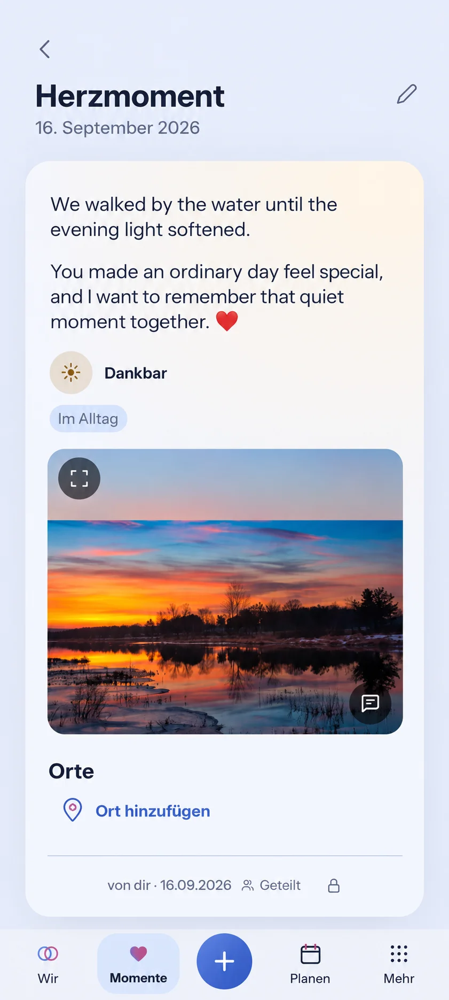

# HeartMoment reading — visual preflight

Issue [#1585](https://github.com/baerenmarke90/eimir/issues/1585). Current main baseline: `26369e5d54f91fe63c180b5bc6d47cba6a8b4900`.

Generated before UI implementation with the imagegen skill and built-in image tool from an actual 390×900 Light HeartMoment route on this baseline. All content is synthetic and the photo is an existing demo landscape. Uploaded personal screenshots were inspected only in conversation and are not project artifacts. The actual destination and Memory detail were reviewed before generation.

R2 / Detail View: use a compact HeartMoment label and date above the existing content area. Move the authored text there once, as readable UI-family prose with preserved line breaks, then retain emotion, tags, optional media, places, contextual comments, subdued provenance/privacy and Edit. No new title field, caption copy, nested text card or private/shared contract. Reuse the Memory heading/reading typography roles, not the old giant prose h1.

The reference represents Back, Edit, date, emotion, tag, photo expand/comment actions, Places, shared privacy/provenance and selected Momente navigation. Text-only and private entries adapt conditional content without missing-photo decoration or shared Place/comment leaks. Expanded retains the same bounded reading hierarchy. Existing task/navigation feedback and reduced motion apply; no decorative motion or new gesture.

Validate shared/private, photo/text/tag-only/short/long variants, actual edit-save-read-return, 320/360/390/430px and 200% text, Light/Dark, keyboard/axe and Expanded. Ordinary Web UI ships through the unchanged Android wrapper.

Prompt: Preserve the complete current synthetic HeartMoment screen and existing functions, replace the huge authored-text heading with a compact UI-sans HeartMoment title/date, and move the exact two-paragraph authored text into the existing tinted content area before emotion/tags/photo. Use the Memory's calm readable prose hierarchy; no personal imagery, new domain, dashboard, device frame or extra product controls. Generated composition is guidance, not runtime acceptance.
