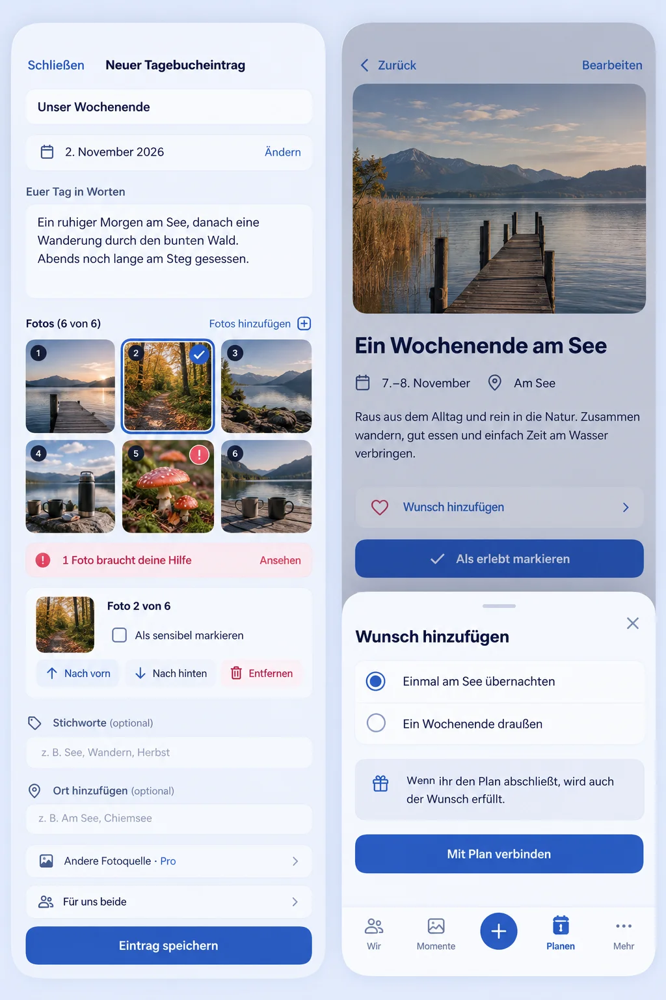

# Photo ordering and existing-Plan Wish linking preflight

Owner: [#1586](https://github.com/baerenmarke90/eimir/issues/1586). Baseline main: `26369e5d54f91fe63c180b5bc6d47cba6a8b4900`. Explicit integration base: PR #1582, `c9ba6d62c0cd8a008a8024dd908b68124ec2f3be`.

Generated with the built-in Imagegen skill after inspecting actual Memory/HeartMoment/Plan capture and edit implementations, their ordered attachment model, draft lifecycle and current typed Place/Wish relations. The actual 390px main Memory capture route was rendered first. Product Reference v1 R1/R3 and Create/Edit/Detail templates remain normative.

## Mobile Interaction Contract

Keep existing title/date/narrative, optional tags, Place choice, external-source entry, audience and explicit completion. Selected photos use a contact sheet with visible numbering/selection/status and one inspector; a file failure remains recognizable even when another file is selected. Native buttons select photos and move the selected identity earlier/later; announce its position. Selection, sensitivity, upload/retry and Object URLs remain keyed by identity. Reordering must not restart uploads. A complete save never silently excludes failed photos. All media stays within current authorization, file/pixel/byte/gallery limits and account/Space/generation ownership.

Memory editing composes retained and new photos into one ordered set. Plan galleries use the same shared inspector pattern. HeartMoments retain their current single-photo domain and compact single-file picker; this change does not invent a multi-photo HeartMoment contract. No new transport, dependency or provider.

Plan detail adds one quiet Wish action using ShortTaskSheet. Load eligible open Wishes lazily, allow explicit selection, explain canonical completion, and confirm before a write. Preserve Plan identity/title/description/schedule/media/place. Existing source-Wish relations cannot be replaced; one Wish remains linked to at most one originating Plan. Empty/loading/error/offline/conflict and pending/duplicate submission have explicit states. Closing restores focus and selection does not save. Existing versioned authorization and task ownership apply.

At 320/360/390/430px, actions wrap and retain 44px targets; 200% text never clips required information. Expanded adapts the same bounded grid/inspector. Theme tokens, status text, keyboard focus and causal selection feedback remain usable without motion. Review open → select/reorder/link → save → actual result → return, including failed/retry/cancel, drafts and denied/stale transitions.

## Interpretation of generated imagery

This is a composition reference, not a pixel lock or runtime evidence. Keep the repository shell/typography/icons; the generated board compresses page height and is not an authority for field or navigation changes. The shown Place input stands for the current explicit saved/map picker, not a new unbound text field. Audience is fixed shared for Memory, not a selectable recipient. Do not add a redundant `6 of 6` limit or generated stock photos to the product. A modal uses the existing ShortTaskSheet inert/background lifecycle; navigation behind it stays inactive. Preserve the one source-Wish boundary and current date semantics.

## Reuse, business and cross-cutting review

Reuse AttachmentDraftPicker/useAttachmentDrafts, current saved/draft Plan order controller, ordered Memory API, authorized previews and ShortTaskSheet rather than a new framework. Pillow validates and rewrites primary MPO JPEG pixels through the existing JPEG sanitizer; raw secondary streams are not copied. Official Pillow format documentation and Android HDR JPEG gain-map specification informed the classification review. Error messages are localized and never contain parser text.

Image upload, ordering, Memory/HeartMoment capture, Wish/Plan lifecycle and Plan galleries remain Free/Core identically in Cloud/Self-Hosted. Quotas, entitlements, downgrade, retention and essential portability remain unchanged. No new managed-service cost category. Author-only edits/deletion and private HeartMoment isolation remain unchanged. Wish linking must preserve same-Space authorization, lock order, unique constraints, versions, transactions/events and return/completion semantics. API additions regenerate the authoritative typed client. Negative image/authorization/concurrency cases and actual browser journeys are required; screenshots alone do not establish acceptance.

## Product recommendations

Optional Memory date ranges should use date-only semantics and later reconcile Timeline, map, recaps and portability. Multiple typed Place relations already exist; their current add action only appears on an empty set. Partner enrichment should be an explicit attributable permission, preserving author-owned text/privacy/deletion. These recommendations do not silently grant new author rights or alter schema.
