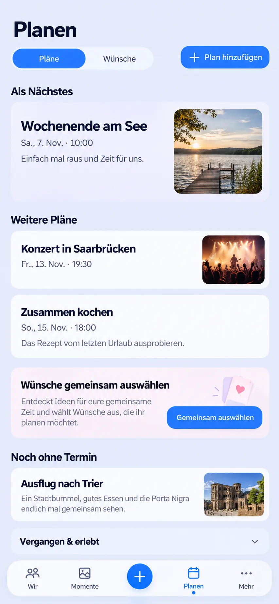
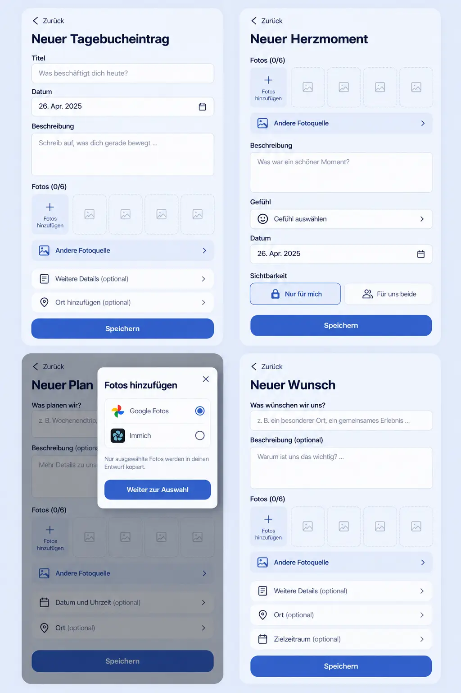
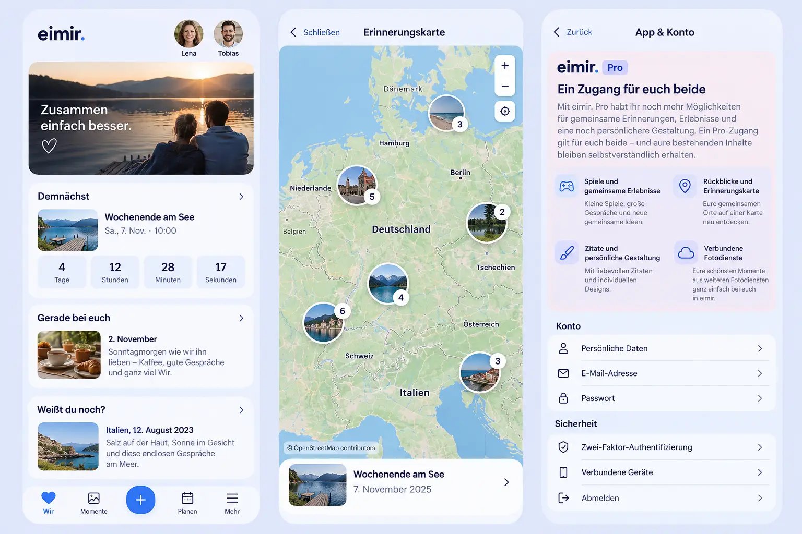

# Upcoming Plans — composition reference

Owner: #1589. Generated before UI implementation using the built-in image-generation tool on 2026-11-02.

Baseline: main `4a904c8cbdb31fa8bcdebc0038bb423558f2b0a7` plus #1588 `f0648225803ec6704650d39a20113706f33e34db`. The source branches were compared with their actual merge base `c9ba6d62`; overlapping files merge cleanly with Git's three-way merge. Preserve both comments/link previews from main and gallery/Wish adoption from #1588.

The reference preserves the heading, Plans/Wishes tabs, local create, upcoming grouping, Wish selection, undated and receded history plus existing primary navigation. Runtime must use the actual shared shell and actual localized copy; generated artwork does not redefine either. The illustrative undated photo and decorative Wish artwork are not runtime requirements. No invented image is added to a Plan. Compact remains one vertical content sequence, with no carousel or calendar mode. Expanded keeps the same bounded hierarchy.

## Mobile Interaction Contract

See [owning issue #1589](https://github.com/baerenmarke90/eimir/issues/1589) for states, navigation, accessibility, resource, Free/Core and reuse review recorded before UI code.

The upcoming section is continuous: focal title/schedule and authorized optional image; following Plans use readable titles, full localized schedules, optional short descriptions and authorized preview images. All dated upcoming content precedes Wish selection. No-image Plans do not reserve photo space. Existing grouping, origin capture and task return own chronology and focus. Loading/errors/cache remain distinct. Hover/press feedback uses existing tokens; reduced motion keeps the same visible information. Long titles/dates wrap at 320px/200% text. Each preview is one canonical link with a product-sized target and visible focus.

## Generation prompt

Use case: ui-mockup. Generate one integrated Compact eimir. /plan composition against audited main plus #1588. Keep current headerless mobile shell, page heading Planen, Pläne/Wünsche pills, reachable Plan hinzufügen, existing light blue/navy semantic palette and Instrument Sans, rounded borderless surfaces and floating four-destination navigation plus central create. Group the focal Plan and later dated Plans continuously before Wish selection. Use a slightly stronger focal treatment, readable titles, full dates, bounded supplied-photo previews and text-only Plans without media gaps. Retain Wish selection, undated intentions and disclosed history below. No carousel, dashboard, permanent management controls, invented runtime imagery or new domain features. The image guides hierarchy; actual product primitives, localized strings, privacy and responsive semantics remain authoritative.

## Follow-up composition references

The Product Owner expanded scope on 2026-11-02 before implementation of the additional surfaces. Existing Today composition, Memory/HeartMoment/Plan/Wish editors, PhotoSourcePicker, MemoryMapPage and ProInformationPanel were inspected against the integrated baseline above.

Generated with the built-in image-generation tool. Prompt: preserve existing eimir Compact shell, editor lifecycle, semantic palette, type and real destination functions; show Diary without redundant date helper, HeartMoment and Plan with shared existing photo source entry, explicit source Continue without a duplicate copy-consent checkbox, Plan/Wish without fixed audience banners, a timestamp-aware countdown, date-ordered current content separate from retrospective, native-modal map fullscreen, and prominent Pro feature information in App & Account. Retain private/shared choice for HeartMoments and actual entitlement boundaries; no new providers or checkout.

Generated artwork is illustrative: six-photo HeartMoment labels, Wish photos/target periods, outlined fields, altered home header, stock portraits and fabricated controls are NOT implementation requirements. Keep the actual one-photo HeartMoment, actual Wish domain, existing root header/navigation, borderless controls, actual account sections and source privacy. The reference communicates placement and hierarchy, not new capability or a screenshot claim. The owning issue records the expanded Mobile Interaction Contract and state/acceptance plan.
