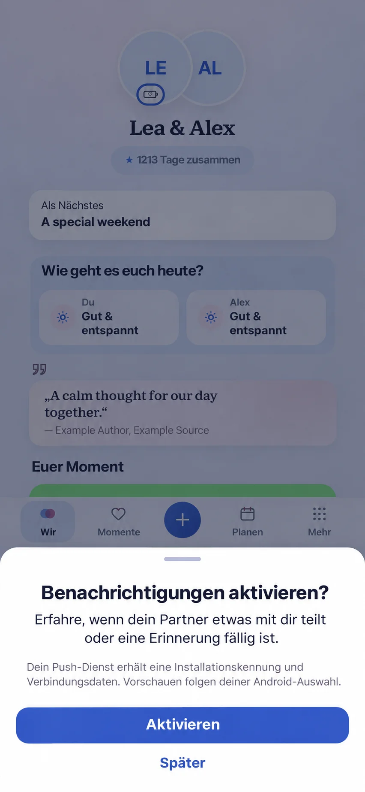

# Android demo links and post-sign-in push (#1599)

Baseline main: `38bd4e6ac544e5da6adf425749621dce62773e42`.

Generated before implementation with the built-in Imagegen tool. The reference
input is the repository's real `1517-app-composition/wir-modern-360-light.png`.
Current main's App/IdentityEntry, identity URL intake, native manifest,
useDevicePush, notification settings, ShortTaskSheet, theme and motion contracts
were inspected. Preserve the current Wir composition, couple identity, next
plan, check-in, quote, shared content and four destinations with central create.
The optional short push consent overlays this existing composition after
successful authenticated entry. The primary action activates the existing
native permission and registration flow; Later preserves ordinary app use.

Prompt: integrate a simple existing ShortTaskSheet with a grab handle, localized
notification benefit, provider/privacy disclosure, Activate and Later above the
existing dimmed Wir screen. Preserve the blue/lavender palette, Instrument Sans
utility type, relationship typography and navigation. No new module, input,
provider, paywall or replacement screen. This is an illustrative composition,
not a pixel lock or evidence of actual Android delivery. Incidental generated
wording/typography is subordinate to the localized implementation.

The full Mobile Interaction Contract, reuse, business/freemium and cross-cutting
review are recorded in [#1599](https://github.com/baerenmarke90/eimir/issues/1599).
Actual implementation and native/browser evidence must identify their source
and limits separately. A rebuilt APK is required for an installed app to use
the manifest and bundled Web changes.
