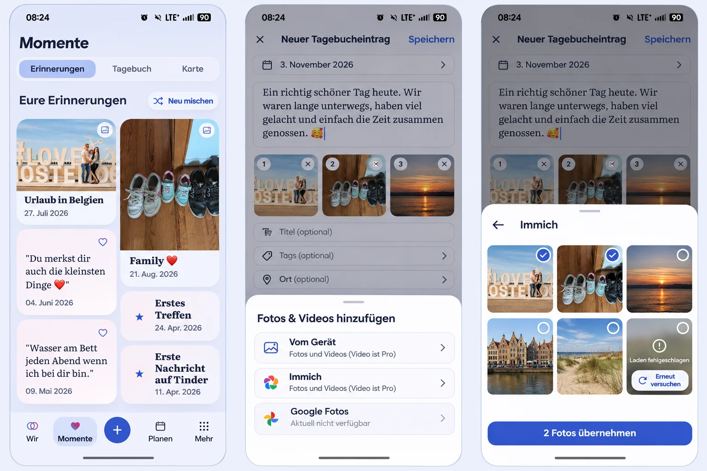

# Media selection and a living Moments album

Owner: #1614. Preflight: 2026-11-03. Current main: `d594d8a0`;
requested dependency: #1612 at `a7e71d78`. Runtime implementation has not
started when this reference is recorded.

The existing diary date/prose, optional title/tags/place, ordered media,
explicit Save, recovery and return stay in place. One source entry replaces
separate device-photo, video and external-source actions. Reuse the established
system pickers and original-photo consent behind that entry. Providers retain
their actual media/capability limits: the illustration is not permission for
Immich video transfer, new galleries or unavailable Google authorization.

The current Moments tabs, toolbar, rediscovery, games and four labeled root
destinations remain. Vary image proportions and editorial note/marker rhythm
within the existing ordered tapestry; retain selection count, safe media,
semantic link order and canonical return. No random per-render reshuffling.

Product Reference v1 R1/R2, D2/D3/D4 and Create/Edit/Discovery templates apply.
Reuse ShortTaskSheet, attachment selection tickets/queue, PhotoDraftGallery,
task-owned object URLs, useDiscoverLayout and semantic product/motion tokens.
No new upload or authorization framework. Browser/native Google security gates
remain explicit; do not represent a system-picker option as OAuth integration.

The dominant task is choose source -> choose media -> adopt into unsaved draft
-> explicit Save -> actual result -> return. Back/cancel restores the composer
and focus. Loading, empty, offline, partial/error and retry preserve usable work.
Visible selected state, readable failure and bounded explicit retry replace
silent blank thumbnail cells. Large text wraps, targets remain at least 44px,
and reduced motion retains feedback. Expanded uses the same task in its modal.
Verify Compact 360/390/430, 320px/200% text, Light/Dark and Expanded with actual
behavioral journeys and screenshots; this generated reference is not runtime
acceptance. Partner shared edit must not grant private access or deletion.

External integration stays Premium (`integration.external_sync`); device photos
and places stay Core and videos retain current policy. No quota, retention,
provider credential sharing, downgrade or existing-content loss is introduced.
