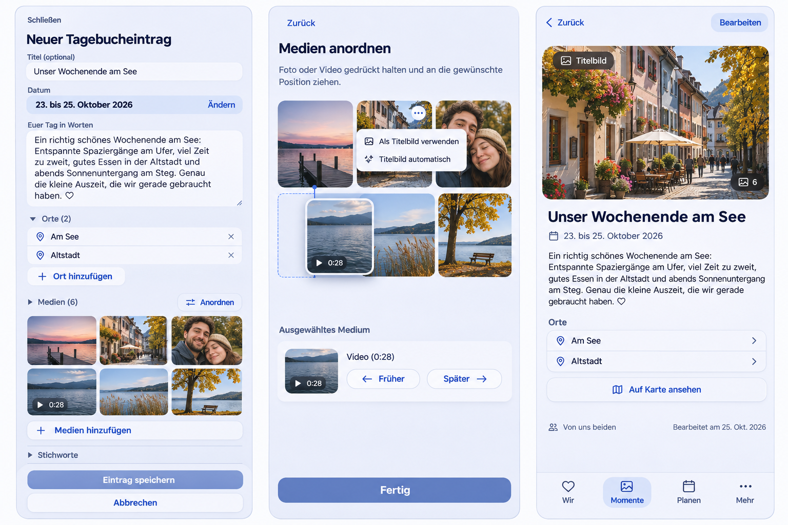

# Memory experiences and mobile media preflight

Owner: [#1618](https://github.com/baerenmarke90/eimir/issues/1618).
Integration baseline: `6a96ad5649d698389e1d628207d4c95ed32b9919`, combining
main `a7d443de`, #1615 `3cfecf57` and #1617 `6e01cb26`. Refresh dependencies
before final acceptance. Google production enablement remains separately owned
by [#1467](https://github.com/baerenmarke90/eimir/issues/1467).

## Product decisions

The Product Owner authorized implementation of the complete concept on
2026-11-03, including the following refinements:

- Optional inclusive Memory end date, several ordered typed Place relations,
  truthful interval discovery, map, recap, statistics and export semantics.
- A shared media-arrangement task with touch sorting and equally functional
  non-drag/keyboard controls, preserving uploads and the parent Save contract.
- Independent optional cover identity; null selects the current first item.
  Reordering never overwrites an explicit choice. Removing it returns to Auto.
- HeartMoment gallery extension preserves privacy, author rights, exclusive
  attachment ownership, old data and compatible client behavior.
- Existing Plan image-only eligibility and Core/Pro boundaries remain.
- Consistent Plan-style Back controls on comparable Story detail surfaces,
  retaining the actual task origin, scope, scroll and editor protection.
- Reported map-point/new-Place coordinate loss requires a reproduced fix and
  a selection → request → saved Place → reload regression.

## Repository-aware generated reference

Generated before UI implementation, using the actual #1615 390px Light diary
capture as a visual input. Inspected MemoryCreatePage, MemoryProductPage,
HeartMomentProductPage, PlanProductPage, PhotoDraftGallery, ordered/upload
controllers, MomentPlaceField, PlaceChoicePicker, PlaceMapPicker and typed
attachment/relation persistence. The generated image is a composition guide,
not runtime evidence, tested interaction or a new design authority. Its
synthetic content is never uploaded to a real account or shipped as user data.

Prompt: preserve the current theme, shell/typography, optional title-first
composer, readable words/date, tag disclosure, source action and safe Save /
Cancel. Show a trip range and multiple named Places, a compact mixed-media
grid, a focused Arrange subtask with hold/drag and earlier/later controls,
independent nonfirst cover choice, and a read-first detail with concise Back.
The actual capability/author/privacy labels remain authoritative where the
generated image simplifies them. Runtime requires the existing sensitive
media handling and named semantic controls.

## Mobile Interaction Contract

Product Reference v1 R1/R2/R3, Create/Edit, Detail and focused media task
templates. Personal photographs and authored words are the focal content.
The parent's explicit Save is dominant; Finish only updates the draft order.
Tap opens the chosen preview. Arrange exposes the complete bounded collection;
hold/drag runs only there, with a visible insertion result, constrained edge
scroll and accessible single-pointer start/earlier/later/end controls. Moving
does not recreate Files, URLs, uploads or sensitivity. Preserve the selected
identity and announce the new position. Reduced motion retains all state.

Optional period/Places disclose their controls in context without automatic
keyboard entry. Names and understandable dates lead; coordinates stay out of
ordinary composition. Back unwinds the nested task before its protected parent
and restores the valid original browsing context. An untrusted origin uses the
canonical destination. Deep links work without fabricated history.

Loading/empty/offline/denied/failed/partial/conflict states retain usable work.
Unknown create results replay the exact original identity, not a rewritten
request. A missing volatile file requires honest reselection/removal; no
provider credential or byte cache is introduced. Capture actual 320/360/390/430,
Expanded, Light/Dark, 200% text, reduced motion and complete Save/result/return
journeys after implementation.

## Reuse, business and cross-cutting review

Reuse current upload/order controllers, Attachment READY validation and
exclusive binding, typed FK relations, request receipts, server capabilities,
NativeDateField, ShortTaskSheet, semantic tokens and task-origin ownership.
Native HTML drag is insufficient as the only touch interaction; repeated move
buttons alone are a poor primary mobile task. Review maintained MIT dnd kit
React pointer/keyboard sorting instead of writing a custom gesture engine.
It adds no service/account/provider data flow; keep a bounded adapter and
review React compatibility, license, maintenance and bundle impact.

Basic date/place/gallery editing is Free/Core in both operating models.
External sources retain `integration.external_sync`; video retains existing
capability/deployment policy and quotas. Privacy, retained content, cancellation,
disconnect/export/deletion rights do not become paywalled. Update authoritative
domain/feature documents for HeartMoment cardinality.

Review migrations, generated API compatibility, actor and tenant boundaries,
private indirect reads, exclusive binding, version/lock order, bounded transfer,
interval precision, concurrency and exact recovery. Operator secrets/provider
verification and real platform acceptance cannot be substituted with mocks or
an availability flag. Existing #1467 protection remains until its independent
security and deployment requirements are satisfied.

## Implementation and acceptance

Current Main is `45e8dadd`, containing merged #1615 and #1617. This delivery
implements concept packages 1–3: period/places, shared media arrangement and
covers, and HeartMoment galleries. Productive Google Photos remains the
separately owned package 4 in #1467, including real OAuth deployment, independent
review and shipping Android/iOS acceptance. The existing fail-closed gate stays.
This PR does not represent Google or store-release acceptance.

`happenedUntil` is a nullable inclusive calendar date. Year lists, year-filtered
Memories/Story and recap month/year availability and source eligibility use
overlap; chronological identity remains the start. Calendar indexes are coalesced
before expansion, avoiding repeated day/year series for overlapping long trips.
Typed PlaceMemory membership stays canonical; protected order hints only arrange
that membership. Edits submit the previously observed membership as well as
If-Match so older unversioned relation writes cannot be silently overwritten.
Place locks precede the Memory lock and an intervening membership race is rejected.
The coordinate draft is explicit state; collapsed technical fields and zero do
not determine whether a map selection is transmitted.

The Arrange task uses pinned MIT `@dnd-kit/react` / `@dnd-kit/dom` 0.5.3 rather
than a custom gesture engine. Drag sensors exist only in the task, require a
250ms hold on a visible handle, and retain stable draft keys through upload state
changes. Four single-pointer/keyboard buttons, localized announcements, reduced
motion, Cancel and Finish provide equivalent operation. Controls and Finish stay
in the reachable footer even in a dense gallery. Finish changes the parent draft;
parent Save remains required. No third-party service, account or data transfer is
added. Compact remains normative; Expanded adapts the same task.

All three domains store an optional independent protected cover reference.
Null follows the current first bound medium; reorder preserves explicit choice,
and removal resets it. Story/cards, map, recap, Dashboard and detail consumers
resolve the choice without rewriting gallery positions. Video covers use the
existing poster path and sensitive media retains its cover/reveal boundary.

Migration 0102 adds a nullable end date plus a database validity check. Migration
0103 adds supplemental HeartMoment bindings; existing primary FKs retain position
zero and old clients retain the gallery tail when replacing it. Parent binding,
READY/size/count checks and owner-only reads remain shared. Downgrade refuses to
discard nonempty supplemental galleries. Export includes every supplemental
binding; import validates order/exclusivity/cover/period and remaps protected IDs.
Existing ciphertext/default payloads need no unsafe rewrite. Free/Core history,
privacy, retained media/export and identical Self-Hosted behavior remain; video
upload and optional external import retain their existing capabilities. The
feature matrix and domain specification record the PO extension.

## Validation

See [runtime evidence](evidence/README.md). Local strict typecheck, production
bundle, focused backend/domain tests and complete authoring journeys are run;
full suites and fresh hosted migration/PostgreSQL/security/browser checks are
required on the final PR head. No hosted check, native-device or live-provider
success is inferred from mocked browser API fixtures. No CI rerun/bypass or
weakened assertion/timeout is part of this change.
