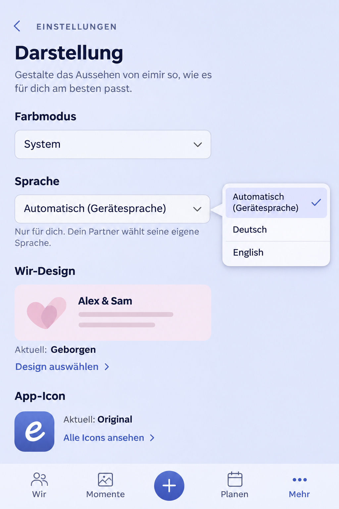

# Personal language and multilingual product preflight

Owning issue: [#1664](https://github.com/baerenmarke90/eimir/issues/1664).

## Reviewed baseline and composition

Reviewed main `a9c5fb46b8c46781c77b27487f07b876b531ec8e`, including
#1663/#1665 WIR wording, and dependent #1668 head
`3972f5ab856370836f431ea900d92d5381d63aae` before implementation. The working
branch starts at that dependency. Merge is authorized only after #1668 is
complete and merged into main, followed by refreshed integration validation.

The actual destination is `/more/settings/appearance`, owned by `SettingsPage`,
`ProfileAppearancePanel`, `ThemeControl`, `WirDesignSettings`, and
`AppIconSettingsPanel`. Preserve the category hierarchy, shared Back behavior,
current color mode, WIR design, app-icon choices and four-destination mobile
navigation. Add one personal language control after color mode. R5, Product
Reference v1 principles 5–9/D6–D7, Settings and Privacy, and existing native
select/form/status primitives govern the change. No visual foundation changes.

Generated before UI implementation with the built-in image-generation tool.
Prompt: create a whole-task 390px eimir Settings > Appearance composition against
the reviewed sources, preserving color mode, WIR design, app icon, Back and bottom
navigation; insert Language after color mode with Automatic (device language),
Deutsch and English, no flags; use existing semantic palette, 44px targets,
wrapping utility text and calm spacing. No paywall, time-zone input or new feature.
The enlarged chooser is an explanatory callout, not a new custom popup. The
runtime keeps the existing native select and actual WIR preview/icon assets;
generated decorative preview details are not implementation instructions.

## Mobile Interaction Contract

- **Human outcome:** use eimir in a personally understandable language while
  retaining the couple's actual words and the current task. Each partner chooses
  independently; no participation from the other partner is required.
- **Primary Compact state/action:** the existing Appearance category, with one
  labeled native Language select. Choosing a language applies immediately and
  reports authoritative persistence; no second Save action or keyboard input.
  Automatic, Deutsch and English use language names rather than flags. Language
  names come from the central locale registry, allowing additional languages
  without rewriting feature components.
- **Hierarchy/disclosure:** category context, color mode, language and its
  personal-scope explanation, existing WIR design and app-icon functions. Utility
  clarity supplies warmth; no romantic decoration, promotional copy or animation
  is appropriate for this setting.
- **Loading/empty:** retain navigation and the known account preference while
  resolving current state. New accounts and absent preferences use Automatic;
  never substitute an earlier account's explicit choice.
- **Error/conflict:** show localized actionable inline feedback, retain the
  attempted choice for retry and distinguish unsaved presentation from saved
  preference. Versioned writes must not silently overwrite concurrent edits.
- **Offline:** bundled resources remain usable. Retain the authenticated
  account's last confirmed preference for offline reading; an unconfirmed
  selection is not queued or described as synchronized. Retry is deliberate.
- **Success:** translated text, accessible names, document language and locale
  formats update in place. Keep authentication, route, scroll, selections,
  unsaved authored input and mounted task identity. Persist the confirmed choice
  to the Account and its existing session snapshot.
- **Back/focus:** native select keyboard interaction, ordinary browser/system
  Back and current category → settings → More navigation. Keep focus on the
  select; announce save/error state without remounting the page.
- **Privacy/ownership:** preference is personal account metadata. Logout clears
  account scope and uses device detection; late responses cannot change another
  account's language. Language never changes stored dates/time zones/schedules,
  privacy, reveal, entitlement or authored content. No translation service.
- **Motion:** reuse native selection/press feedback and existing status roles;
  no global page animation or remount on language change. Reduced motion keeps
  the identical result and focus.
- **Narrow/large text:** 360/390/430px, 320px reflow and 200% text use normal
  wrapping and existing 44px targets. Expanded retains the same bounded personal
  settings task; no second configuration dashboard or extra fields.
- **Acceptance:** open Appearance → choose English → observe text/save state →
  reload → return to Automatic → return to More. Verify the same account's
  offline snapshot, conflict/error recovery, independent account choices and
  switch-and-continue with an unsaved Memory. Capture Compact and Expanded,
  German/English, Light/Dark, long text and reduced motion.

## Reuse, business model and cross-cutting decisions

Extend existing i18next/react-i18next and native Intl. Reviewed current primary
documentation for [fallback](https://www.i18next.com/principles/fallback),
[plural rules](https://www.i18next.com/translation-function/plurals) and
[React subscriptions](https://react.i18next.com/latest/usetranslation-hook).
FormatJS and a custom context/translation engine remain unnecessary. Existing
libraries are MIT; bundled dictionaries add no provider, translation request,
secret, subscription, hoster configuration or Cloud/Self-Hosted difference.

Business/freemium impact reviewed: Accessibility essentials & i18n localization
is Non-paywallable. Existing feature tiers, data/export/downgrade rights, quotas
and Space entitlements are unchanged. Additional static resources add bounded
bundle size; no recurring infrastructure cost or retained-data restriction.

Reuse the existing Account locale write boundary and optimistic concurrency.
Automatic mode records the latest supported device language for background
recipient delivery; explicit choice has priority. Background jobs resolve the
recipient's current effective language, never the actor's UI language. Stable
API error codes and privacy-minimized notification payloads remain unchanged.
Editorial/provider and legal content keep their owning identity, provenance and
language contracts. Unsupported content languages require explicit fallback;
never machine-translate quotations, canonical legal documents or authored text.

Technical validation covers resolver ordering/variants/fallback, account scope,
resource/interpolation/plural parity, migration/API concurrency, recipient mail
and Push, relevant component behavior and conservative browser impact selection.
Actual runtime evidence and final tested revision are recorded in the PR.

## Runtime evidence and integration validation

The implementation incorporates dependent #1668 head
`29a276a422aa421fa617ac8742294e49148f9fbc` (including the per-image sensitivity
correction) at integrated revision `4528e0d074193e867fc4c895faaf67cb32de9877`.
The dependency was verified merged into actual main as
`75048b597c2646d9c8c9c2e617c19c30d173da33` on 2026-11-05 23:42:57 UTC.
That main is integrated before final CI and the authorized #1664 merge.
`source-files.sha256` fingerprints the tested product sources.

The classified multilingual browser journey passed **12/12** on that revision:
Open Appearance → select English → observe authoritative save and retained focus
→ reload → return to Automatic/German → Back to Settings. Both partners keep
independent preferences; sign-out returns to device detection. A real Memory
editor retains authored input, text selection, focus, route, scroll and date
through a device-language change, and editing continues in place. Offline save
requires deliberate retry; no reconnect replay occurs. Ordered regional device
lists and the static offline page are covered. Axe reports no WCAG A/AA findings
in the affected Settings sections at all captured sizes, including 320/200%.

- [360 Light](evidence/language-settings-360-light.png)
- [390 Dark](evidence/language-settings-390-dark.png)
- [430 Light](evidence/language-settings-430-light.png)
- [Expanded Dark](evidence/language-settings-1280-dark.png)
- [320 with 200% text](evidence/language-settings-320-light.png)
- [English Memory draft](evidence/language-draft-390-english.png)
- [Offline choice](evidence/language-offline-390.png)

Resource/resolver/component/session coverage passed 35 tests; recipient
resolution, preferences and push transport contracts passed 135 unit tests.
Real PostgreSQL validation passed 32 preference/notification-mail cases and 33
authentication cases, including four recipient-override/anti-enumeration cases.
Migration upgrade → downgrade → upgrade and Alembic model drift check passed.
Web typecheck/format/resource-generation/PWA checks and backend lint/format/API
contract passed. Browser ownership/planner checks passed 38 tests and classify
all 98 specs; shared i18n changes select the full retained regression. The scoped
engineering-language audit and its 27 regression tests passed.

The Android app and instrumentation APK compile successfully. Device execution
uses the existing required API 28/36/37.1 CI matrix, now explicitly including
RecipientLanguageTest and the additional locale/activation wake contract. Final
native and complete regression evidence must be green in the implementation PR
before merge. Local complete Web runs were interrupted by host ENOSPC; this is
not recorded as a test pass, and no assertion, deadline or CI gate was weakened.
The isolated test database and redundant temporary build data were removed to
allow the focused integrated browser run to complete.

## Consolidated CI corrections

Initial CI identified an old source-location assertion for the now-shared session
key and ordinary English comparison wording caught by the legacy-brand scan.
The guard now verifies the central canonical key and its persistence alias; the
English privacy sentence states the same boundary without ambiguous branding.
The real-stack Web container also exposed formatter VCS discovery in the static
locale generator. Formatting its generated stdin with VCS discovery disabled
produces identical output in the standalone Web build context; it does not alter
any lint/audit scope. A standalone-context generation/check comparison passed.

First-paint language now rejects expired retained sessions; resolver and static
offline regression cases cover it. Unsupported-language fixtures use reserved
unassigned tags so adding French, Italian or Japanese does not invalidate their
fallback assumptions. Final source fingerprints include this coherent correction
batch. The Appearance composition and captured authored draft remain unchanged;
final-head CI must revalidate the complete behavior before merge. No unchanged
workflow rerun was requested.
