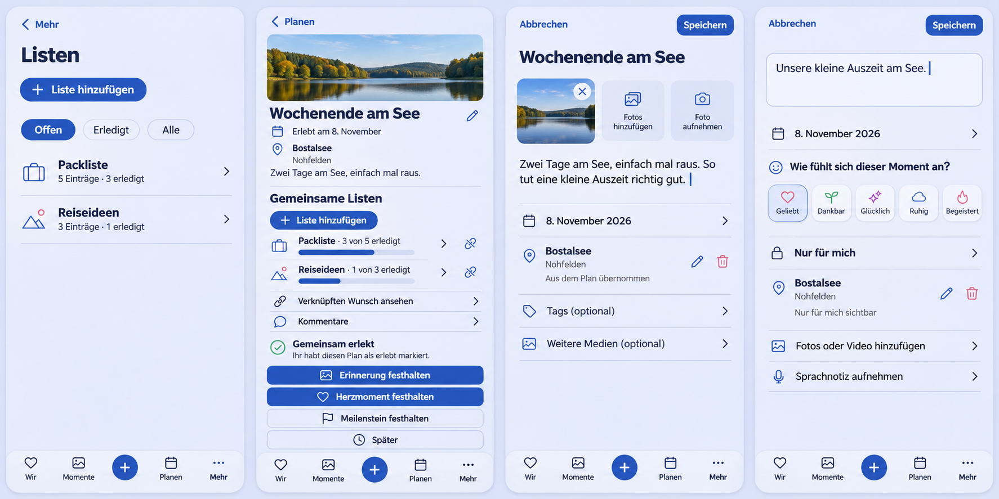

# Plan-linked lists and source Place continuity

## Preflight

Owner: [#1705](https://github.com/baerenmarke90/eimir/issues/1705).
Baseline: `b810058786bf02553005a0a3e74cacaf4d553584`.

The generated image predates UI implementation. The owning issue records the
Mobile Interaction Contract, reuse, commercial model and cross-cutting review.
Reviewed current Plan overview/detail/completion, Collection overview/detail,
Memory source-Plan capture, HeartMoment location/privacy, shared task lifecycles,
status scopes, tokens and shell. Product Reference v1 R1, R3 and R5 govern.

The approved slice links canonical shared lists to Plans, derives list status
from existing items, and prefills the source Place in canonical capture. It
preserves the existing Wish association, comments, Plan completion, Milestone
alternative, gallery, private audience and task return behavior.

The image guides hierarchy, not exact pixels or new capability. Keep actual
navigation glyphs and existing media/feeling controls; do not implement invented
stock imagery, gradients, automatic photo copying or altered privacy choices.
All standalone insertion controls retain the shared blue plus-and-label pill.
The final implementation must include behavioral and real-build visual evidence.
