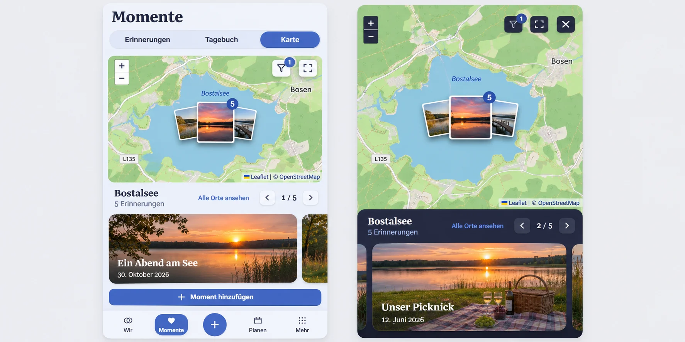

# Map photo stacks and place motion — preflight

Owning issue: [#1707](https://github.com/baerenmarke90/eimir/issues/1707).
Reviewed baseline: `main@ec309e23c86f3a7e6c79b81d2eb5422bfeb93db2`.

Generated before runtime implementation with the built-in image generator. The
complete Mobile Interaction Contract, reuse/business/cross-cutting review and
acceptance scope are recorded in the owning issue.

## Repository context

Reviewed `/story/map`, `MemoryMapPage`, `PlaceMapCanvas`, `MemoryPreview`, the
filter/fullscreen `ShortTaskSheet`, task origins/collection return, semantic
tokens, Product Reference v1/R2 and the retained browser journeys. The unchanged
390 px Dark map journey passed on this baseline before implementation.

Retain the Momente heading, peer tabs, canonical add action, map zoom, place
filter, fullscreen, alphabetical places, tile attribution and app navigation.
Fullscreen retains its own close/history/focus contract. The generated image
guides content hierarchy and the selected-place stack/strip relationship; its
inaccurate add-action placement, image-overlaid captions and extra fullscreen
expand control are not new product decisions. Keep the existing add entry,
readable captions below photos and one close control in the implementation.

## Generation brief

Create two complete Compact compositions, Light regular map and Dark fullscreen,
using the existing screenshot as shell/style reference. Show one selected place
with up to three different memory images as one small fanned photo stack at the
actual coordinate and an authorized memory count. Connect it to a lower-edge,
photo-led scroll-snap strip with place heading, visible reset, previous/next and
current/total. Preserve existing navigation, map/filter/fullscreen controls and
attribution. Use existing eimir blue, typography and theme surfaces. Show ordinary
personal lake memories, no fake geographic positions, new analytics, decorative
romance, admin rows, provider changes or new entitlements.

## Motion and reuse

Use the adopted Leaflet 1.9.4 `flyTo` / `flyToBounds`, `stop` and movement events,
native scroll snap and the existing media/task primitives. Canonical duration
tokens bound map movement and local stack reveal. No staged timers, looping
motion, duplicate marker lifecycle or additional animation/carousel library.
Reduced motion preserves the complete result without travel.

Upstream references checked during preflight:

- [Leaflet 1.9.4 API](https://leafletjs.com/reference-1.9.4.html)
- [Native CSS scroll snap](https://developer.mozilla.org/en-US/docs/Web/CSS/Guides/Scroll_snap/Basic_concepts)

Generated references are composition inputs, not screenshots of implemented or
accepted software. Actual tested-revision evidence is recorded separately.
