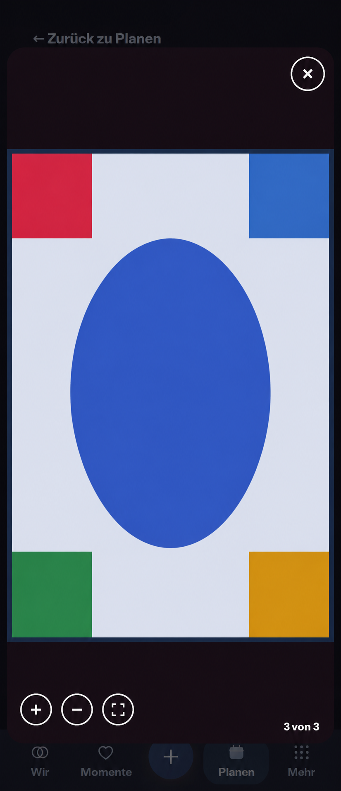

# Gallery gesture correction — PR #1709

PO follow-up, 2026-11-09: photos must support normal gallery zoom/pan without
triggering application navigation. This extends the existing #1705 follow-up
and PR #1709; it does not authorize merge or publication.

## Baseline and generated reference

Main `7aca73a05d27bcbf4ac0073d2b369503d431d641` remains current. Reviewed the
actual MediaGallery inline/full-screen rendering, shared photo consumers,
modal/history ownership, CSS scroll-snap, PrimaryTabSwipe, PullToRefresh and the
Leaflet-owned map gesture contract. The saved Plan gallery viewer evidence
under `../plan-photo-gallery/evidence/plan-gallery-viewer-390-dark.webp` is the
reference input; those viewer components have not changed since that baseline.

Generated before runtime implementation with the built-in Imagegen tool in
edit mode. Prompt: preserve the existing 390px Dark full-screen photo viewer,
rounded aubergine stage, Close, photo count, dimmed source context and synthetic
geometry image; show image-local enlargement and three discreet lower-left
44px overlay controls (plus, minus, fit), without additional panels, titles,
settings or navigation. The reference is composition guidance, not runtime
evidence; actual image proportions and clipping remain authoritative.

## Mobile Interaction Contract

- Reuse Product Reference v1 R2/R3, Detail View and the existing modal photo
  viewer. The photograph remains the focal point; Close remains immediately
  reachable. Keep inline browsing, sensitivity controls, captions and count.
- Two-finger pinch enlarges only the current photo; one finger moves an enlarged
  photo. At fit size, horizontal swipes continue to browse photos. Double tap
  toggles enlargement/fit. Plus, minus and Fit offer named keyboard-accessible
  alternatives; mouse wheel and drag operate the photo on Expanded/Web.
- The photo viewport owns these gestures. App tab swipe, pull-to-refresh,
  document scrolling and carousel navigation must not steal a zoom/pan gesture.
  Video playback retains native controls and is never transformed as an image.
- Switching images, concealing sensitive media, closing or changing authorized
  resource scope discards transient zoom and listeners. Existing Back/Escape,
  focus return, loading/unavailable/offline and read-only media transport stay
  intact; this adds no persistence, media copies or network requests.
- Compact 320/360/390/430px and Expanded adapt the same viewer. Existing overlay,
  focus, target and semantic spacing tokens apply. Direct manipulation tracks
  fingers without animation; reduced motion suppresses optional zoom feedback.

## Reuse, business and quality review

Compared whole-page browser zoom, a custom pointer/transform engine, replacing
the entire viewer with PhotoSwipe, and a small image-only Panzoom adapter.
Select `@panzoom/panzoom` 4.6.2 (MIT), verified from npm and the
[maintainer's source](https://github.com/timmywil/panzoom). Its pointer geometry,
focal pinch, pan bounds and wheel support avoid a bespoke gesture engine while
retaining the existing authorized viewer, sensitive reveal, video, caption and
history contracts. The package executes locally, has no service/account/API,
telemetry, quota or Cloud/Self-Hosted distinction. Preserve its license in the
locked package and normal dependency/license review. No fallback provider or
user setup is needed; named controls supplement touch.

No business/freemium impact: image viewing remains Free/Core under the attachment
and Memory/Plan rows. No entitlement, storage, transfer, downgrade or export
semantics change. No media data goes to Panzoom or another external service.

Acceptance: open a real saved Memory photo; pinch, pan, double tap, fit, swipe
to the next photo, close/Back and return to the same source context. Assert
image geometry changes while the route, document scale/scroll and carousel
index stay stable during zoom/pan. Include one/multiple images, sensitive
conceal/reveal, videos, mouse/keyboard, cleanup, themes, reduced motion, reflow
and accessibility. Add feature-owned browser coverage and mapping without
expanding global always-run coverage or weakening existing assertions.

## Actual result and verification

[Runtime screenshots and SHA-256 manifest](evidence/manifest.json) show photo-local
pinch/pan at 360/390/430/1280/320px in Light/Dark. All five real Chromium CDP
multi-touch cases pass: two-finger enlargement, one-finger pan, unchanged route,
document scale/scroll and carousel index, double tap, Fit, native photo swipe,
keyboard pan, close and focus return. The separate single-photo case verifies
mouse wheel/drag, zoom-out and keyboard alternatives, Back and reset on reopen.
The complete six-spec affected-product run passes 62 cases in 1.4 minutes,
including prior large-text views, sensitive image conceal/reveal, native video
controls and authorized-media return. Tests did not increase retries/timeouts.

The touch tests caught a real conflict: containing overscroll while at fit size
blocked native photo browsing. Containment now applies only while enlarged.
Explicit ESM package import also preserves the same runtime API in browser and
Node tests; its exact declaration reuses the package's published API types.
The focusable image canvas follows the existing interactive-map pattern and
provides localized keyboard help; a scoped lint rationale preserves that
keyboard access rather than removing the focus target. No native device/APK
run or publication is claimed by this browser evidence.
