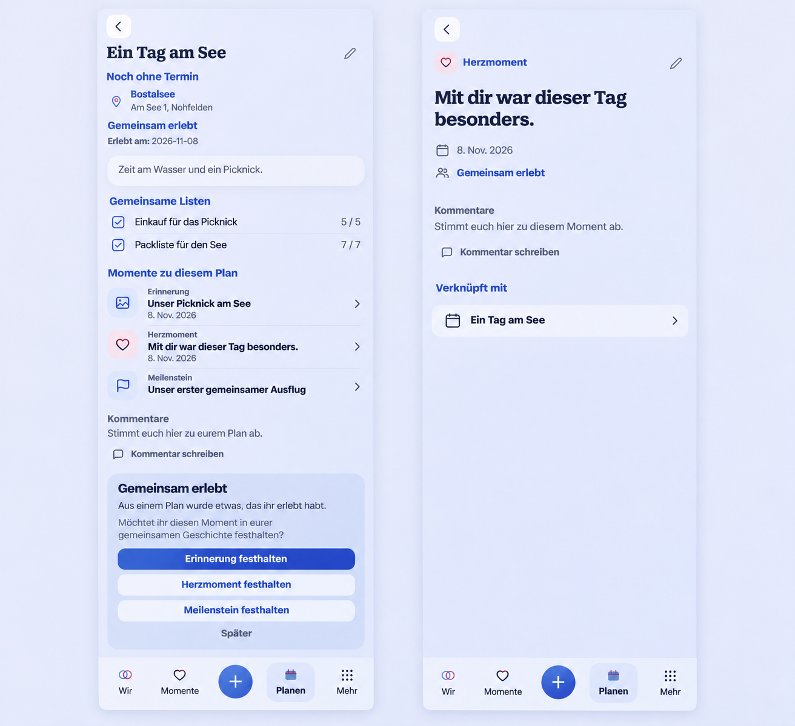

# Bidirectional completed-Plan story context

## Product Owner addendum and baseline

On 2026-11-09 the Product Owner extended correction PR #1709: a completed Plan
must show its linked Memories, HeartMoments and Milestones; the original Plan
must also remain reachable from those entries. Preserve the list-management
boundary requested in the same conversation.

Reviewed current main `7aca73a05d27bcbf4ac0073d2b369503d431d641` and the
validated list correction `48532ea35a04f86364c11efe6c4c8c19b16b6d0f` before
runtime implementation. Actual destinations: PlanProductPage and its completed
continuation, MemoryPlanningLinks/Memory capture/result, HeartMoment and
Milestone create/edit/detail, shared relation APIs, Story projection, task
origin, protected visibility transitions and portable transfer.

Generated with the built-in imagegen tool before this extension's runtime code.
The generation brief was: adapt the actual synthetic completed Plan composition,
retain description, shared lists, comments, completion continuations and mobile
navigation; add one quiet three-type content-link section and demonstrate a
shared HeartMoment's Plan backlink. Use existing eimir colors, controls and
read/Edit boundaries, without a dashboard, extra management controls, private
content or new capabilities. Source screenshot: the validated 360px Light empty
Plan from the preceding correction. No private user screenshot was supplied.

The image guides composition, not exact pixels or additional domain semantics.
Keep actual canonical linked-list rows rather than the generated checkboxes;
use the existing shared-visibility text and the active Momente destination on
Story detail. Generated labels/icons do not override localization, tokens,
privacy or established navigation. Expanded preserves the same reading width
and hierarchy; no separate layout is necessary.

## Mobile Interaction Contract and acceptance

Product Reference v1 R3/R2, reading before editing, Detail/Create/Edit templates.
Focal point: the couple's actual authored experience. The Plan's content leads;
existing shared lists and a supporting 'Moments for this Plan' section precede
comments. Each row opens the original canonical entry, showing its real type,
meaningful title/text and localized date. Use existing content preview/icon,
link and task-return primitives; no copied content, nested cards or new counts.

- All three linked types appear on a completed Plan, including pre-existing
  Memory associations. The reverse content detail opens the original Plan.
- Extend the existing explicit content-to-Plan relation lifecycle to shared
  HeartMoments and Milestones. Keep manual association/removal in their editor.
  A new capture from a Plan retains scoped source identity and uses the same
  visible, retryable association handoff already established for Memory capture.
- PRIVATE HeartMoments never enter shared Plan relations, previews or counts,
  including for their owner. Changing a shared HeartMoment to private removes
  its shared associations atomically; later sharing does not recreate them.
- No heuristic backfill from matching names, dates or Places: a historical
  capture without a stored association can be linked explicitly in Edit.
- Linking/unlinking changes only the relation. Plan/content completion, original
  content, authorship and existing Place behavior remain independent.
- Paginate and authorize related Story content before projection; include Plan,
  viewer and Space identity in cursor binding. Batch existing Story projection
  rather than fetching every item individually or scanning the full timeline.
- Normal detail contains no add/unlink controls or empty promotional section.
  Loading, real failure/retry and available cached content retain honest state.
- Relation failures retain a retryable saved result; no false completion rollback
  or offline-write promise. Account/Space/instance changes cannot reuse handoffs.
- Opening a list or its creation task from Plan Edit uses the existing dirty-exit
  guard so unsaved Plan fields cannot disappear during navigation.

Compact uses direct links and short native-checkbox pickers with no early
keyboard. Existing sheet/focus/history/feedback and reduced-motion roles apply.
Names and actions wrap at 320px/200% text; verify ~360/~390/~430 and Expanded,
Light/Dark, empty/dense, failure/retry, source return and actual capture handoff.
No decorative delight or additional relationship copy is needed for reference
navigation. Linked content remains the personal value.

## Reuse, commercial model and cross-cutting review

Reuse the typed relation service, composite same-Space foreign keys, protected
shared-only relation constraint, existing Story union/keyset cursor/projection,
content-to-planning editor and canonical capture/result/task-origin machinery.
Considered a duplicated Plan-owned content copy, a client-side full-Story scan,
and a separate relation UI; all would duplicate identity, authorization or task
lifecycle. No new dependency, provider, infrastructure or external data flow.

**No business/freemium impact:** Plan lifecycle, ordinary shared Memories,
HeartMoments, Milestones and content links remain Free/Core in both operating
models. No paid map capability, entitlement, quota, retention/downgrade change or
new provider cost. Two additive relation tables participate in normal shared
transfer with identity remapping; essential portability remains non-paywallable.

Review authorization on both ends, author edit rights, same-Space database
constraints, parent/target lock order, idempotent relation creation, private
transition cleanup, parent deletion, IDs-only events and quiet notification
policy. Keep existing localized copy, semantic link targets and focus return.
Tests must prove cross-Space/private denial, reverse reads, cursor isolation,
partial failure, privacy cleanup and transfer roundtrip as well as the complete
browser read/Edit/capture/result/return journey. No native wrapper changes.

## Implementation and validation evidence

The feature-owned final Plan suite passes all 17 cases. The combined final
Plan/gallery/video/browser run passes 62 cases across six complete specs
(1.4 minutes, two local Chromium workers). A preceding four-spec planning
regression run also passed 62 cases, including completion, comments, canonical
references and return context. These are separate measured selections, not a
new always-run core.

[Actual screenshots and hashes](evidence/manifest.json) cover completed Plan
context and shared HeartMoment backlinks at 360/390/430/1280/320px in Light/Dark.
The section heading remains outside the existing linked-entry surfaces; no
additional outer card is introduced. Existing list Edit/read/empty and 200%
text evidence remains under `../1705-plan-lists/edit-boundary-evidence/`.

Browser assertions cover all three source types, retry after a failed saved
HeartMoment association, Milestone association/removal, existing Memory links,
private capture exclusion, cursor continuation past an empty projection page,
no horizontal overflow, axe, focus return and dirty Plan navigation protection.
An offline component regression confirms an honest paused read without an API
call. PostgreSQL tests cover same-Space authorization, cursor isolation,
idempotency, private transition/no restoration, independent Plan/source deletion
and remapped transfer. Migration 0119 upgraded the isolated PostgreSQL 18 test
instance and Alembic reported no model/schema drift. Full version-bound CI is
recorded on PR #1709; local Python is supported CPython 3.13.7.

Final local validation is bound to runtime revision
`178090f2241c7301f4409d231595aefe84138ef3`: 2796 Web tests pass (2 existing
skips), 54 PostgreSQL Plan/transfer/Story tests and 43 endpoint-matrix checks
pass. Production build, full Web lint/format, Ruff/format, mypy, OpenAPI and
all 864 same-version generated client files match. The browser planner passes
38 cases; actual collection is 1186 cases in 104 specs. Complete PR workflow
evidence belongs to PR #1709 and must be observed on its final head.

A final concurrency review reproduced a delayed relation confirmation after the
person had already returned to the Plan. The new browser regression fails
against the earlier implementation and passes with read-ownership reconciliation
independent of mounted task feedback. Navigation/handoff feedback still belongs
to the original active task; a confirmed authorized write may invalidate its
existing read cache after leaving. Removed or newly denied queries cannot be
recreated. All 18 Plan journeys pass, including this return-before-confirmation
case. German example values live in the dedicated locale fixture module; the
engineering-language gate remains intact.

Final confirmation after that concurrency correction: all 63 cases across the
six affected browser specs pass (1.5 minutes), as do all 2796 Web tests (2 existing
skips) and the production build. Actual browser collection is now 1187 cases in
104 specs; the added pending-return case remains feature-owned.

The broad hosted browser run exposed four older device-review expectations for
clickable destinations inside Edit. The existing five-case suite is retained
and now also proves every canonical destination in read mode and removal in
both modes, while Edit keeps static titles. All five cases pass locally (9.5s).
Its ownership map names MemoryProductPage and StoryPlanningLinks explicitly;
no case was added to or removed from the always-run group. All 38 browser
planning regressions pass after this mapping review.
