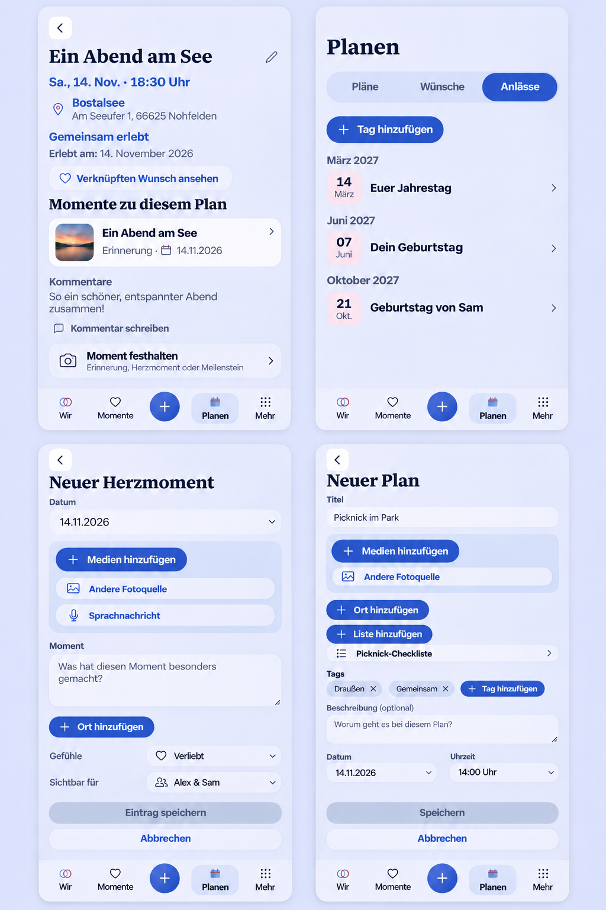

# PR 1712 mobile polish extension

Pre-implementation baseline: main `719cbd267e02e1c135fa2cdd63f8702eeb417cac`;
existing PR head `39df9236ea98998a817297feb7f1c98fe8b73037`.

The PO supplied five screenshots and adds these requirements to the same draft.
The generated reference uses synthetic content and the inspected existing Plan
reader, Planning tabs, HeartMoment composer and Plan creator. It guides hierarchy,
not exact data or pixels. Keep required Plan titles, image-only Plan galleries,
optional schedule fields, canonical navigation and each content type's privacy.

## Acceptance and Mobile Interaction Contract

- Map markers and selected-Place cards reuse the existing durable authorized
  thumbnail cache across reload/app restart. A fresh authorized map response may
  prove only its exact thumbnail identities. Never treat a persisted projection
  as fresh authorization, bypass revocation or cache signed URLs/credentials.
- Plan reading gets a smaller balanced headline, compact schedule/place context,
  quiet completion status and localized calendar dates. Existing Wish/list/source
  links, comments, edit and optional Story capture remain discoverable. Historical
  completion should not repeat a large success surface beside the same status.
- Rename the Planning tab to German "Anlässe". Include the signed-in account's
  birthday, partner birthday and shared relationship-start anniversary from their
  existing authoritative profile sources. Keep authored dates and privacy, avoid
  matching duplicate annual records, handle missing/error/loading separately and
  preserve leap-day/date-only behavior. Never infer private dates from chat.
- Extract the diary's media-source frame into a shared action-group primitive.
  Device/external-source actions use it everywhere; include HeartMoment voice
  entry within that same group. Keep real picker/consent/upload lifecycles,
  canonical blue Add buttons, touch targets, pending/error states and draft safety.
- Plan creation offers the same List action as editing, with existing selection
  and explicit in-context creation. Keep the Plan draft while choosing/creating.
  Link only after the parent is confirmed; a partial failure must retain the
  saved Plan identity and retry links without creating a second Plan. An explicitly
  created independent shared list survives Plan cancellation, like a new Place.

Product Reference v1 R1/R2/R3, Detail/Create templates and the existing shared
media, picker, sheet, task-origin and document-leave contracts apply. Compact is
the Android/iOS interaction reference; Expanded adapts the same product. No new
navigation surface, settings toggle, table, infrastructure setup or novel gesture.
Light/Dark, ~320/360/390/430/1280, keyboard/Back, 200% reflow and reduced motion
must preserve the same information and actions. The reference image is not native
runtime evidence. No identifiable PO photos/screenshots are committed.

## Reuse, business and cross-cutting review

Reuse IndexedDB media ownership/eviction, fresh-projection authorization and the
existing generated Places API adapter boundary rather than a second map cache.
Reuse existing Profile/Space query keys and date formatting. Share the media
frame and collection-choice responsibility rather than cloning per-form controls.
Use existing Collection creation and idempotent Plan relation endpoints; preserve
confirmed-parent identity through partial failure. No provider or runtime
package is introduced. Tokens remain canonical.

No business/freemium impact: saved Memory map stays Pro; basic Places, shared
lists, ordinary Memories/HeartMoments, profile dates and retained-media viewing
retain existing classifications. Shared cache budgets/expiry, Space ownership,
privacy, quotas, Cloud/Self-Hosted and downgrade/export behavior remain. No API or
schema migration is planned. Check concurrency, teardown, stale authorization,
private/authored dates, cache clearing and late mutation results explicitly.

## Validation plan

Use focused cache/projection, date-source/occurrence, common-media and Plan/list
partial-failure tests. Review complete affected browser specs and ownership,
Compact/Expanded visual evidence, themes, reflow, native pickers, navigation and
real save/return. Collect useful existing CI failures before one correction batch;
prepare the PR for review once all additions and applicable checks pass. The PO's
latest 2026-11-09 request explicitly authorizes merging #1712 followed by #1714
after their applicable gates pass. It does not request publication or unrelated
workflow retries.

## Implemented result and validation

- The existing generated-API adapter boundary now gives fresh authorized map
  results the same exact-thumbnail proofs as Story/Dashboard. The existing
  durable store, revocation epochs, account/Space identity and eviction remain.
- Plan reading uses the shared personal-heading role and compact context. Dates
  are localized. Returning to an already completed Plan keeps its readable
  status and optional capture actions without replaying a large success panel.
- Occasions read both account profiles and the shared relationship start date.
  Derived dates keep annual/leap-day semantics; authored records and independent
  private dates remain. Source failures do not become a false empty state.
- `MediaActionGroup` owns the former Memory intake boundary for all shared
  attachment controllers and the People source choice. HeartMoment voice intake
  belongs inside that group. Add actions keep their canonical blue presentation.
- `CollectionChoicePicker` owns paginated alphabetical selection and explicit
  in-context creation for both Plan creation and Edit. A confirmed parent ID
  survives partial link failure; retry uses idempotent relation endpoints and
  never submits a second Plan. An explicitly created shared list is independent.
- Android picker verification uses stable resource identity where available and
  re-queries after screenshot stability instead of retaining a replaced node.
  It preserves real consent, foreign ownership, original-byte/GPS assertions,
  all cases and deadlines. The prior API 37.1 provider/FUSE failure is recorded
  in hosted diagnostics; no provider or permission bypass is introduced.

Local validation on the delivered source: 2,822 Web tests passed, with two
existing skips. Focused checks after scoped finishing changes pass (39 flow/
cache tests, 27 create/People tests and 19 date-source tests). Typecheck,
production/Capacitor build, generated locale/legal/token/PWA checks, source lint
and formatting, both English audits and diff checks pass. The browser planner's
38 regressions pass and the inventory remains 104 complete specs. The one new
Plan-create case stays in its existing feature owner; no always-run case is added.

The complete affected browser selections pass: 59 map/mobile/Planning/People/
list journeys, then 33 list/People/voice journeys. Selections intentionally
intersect; their counts are not added. The profile-source journey additionally
verifies both account birthdays and the shared anniversary. Evidence includes
Compact/Expanded, Light/Dark, reduced motion and existing large-text/reflow and
axe checks. Only synthetic fixtures are captured.

The first hosted changed-spec run exposed four assertions across two existing
specs. Memory Create still inherited its old dashed outer frame underneath the
new shared media boundary; the obsolete frame is now reset explicitly and the
test requires exactly one solid shared boundary while retaining compact geometry
and touch targets. Historical Plan return/conflict checks now require the quiet
completed status, localized experienced date and optional capture heading, plus
the absence of replayed celebration. The complete two-spec selection passes
34 browser journeys; all seven Plan reader unit cases also pass. Light/Dark
Memory intake captures are included in the manifest. Existing ownership and
browser selection remain unchanged.

Android debug APK, instrumentation APK, Lint and JVM tests pass locally using
JDK 21 and the existing SDK/cache with offline strict dependency verification.
This supersedes the first execution's missing-SDK limitation. Installed native
API 28/36/37.1 checks remain hosted requirements; physical-device acceptance and
publication are not inferred from browser mocks or compilation.

The next API 36 run exposed an independent window-handoff race: its recorded
picker screenshot still showed the old WebView, while its accessibility dump
already showed the genuine permission dialog. A window-state event does not
guarantee that Android has published the new root. The fixture now awaits an
actual consent/picker control with the existing bounded lookup before deciding
which native surface owns the interaction. Consent, foreign ownership, original
bytes/GPS and all cases remain required; no shell grant, fixed delay or replay is
added. API 28 and 37.1 passed on that revision. Fresh native execution remains
required for the correction.

See [the screenshot manifest](evidence/manifest.json) for SHA-256 fingerprints.
Hosted exact-head results are recorded in the owning PR before merge.
