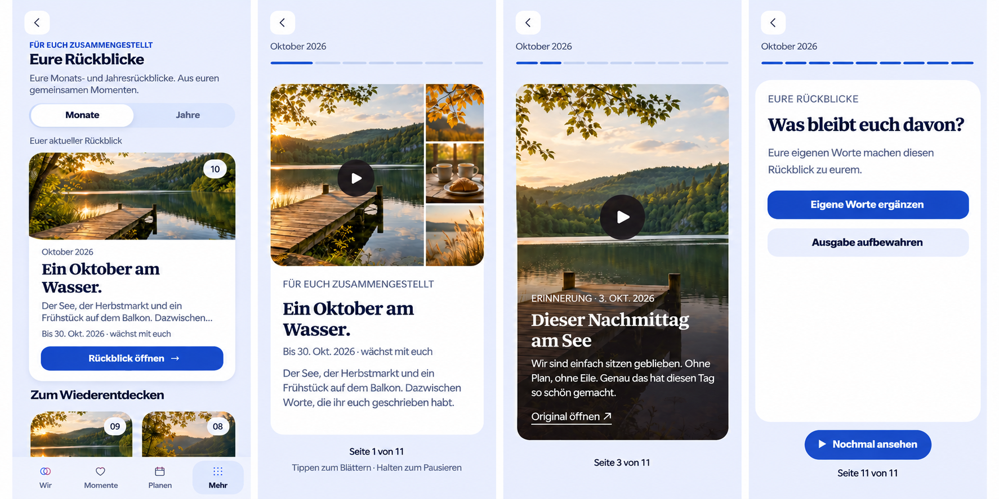
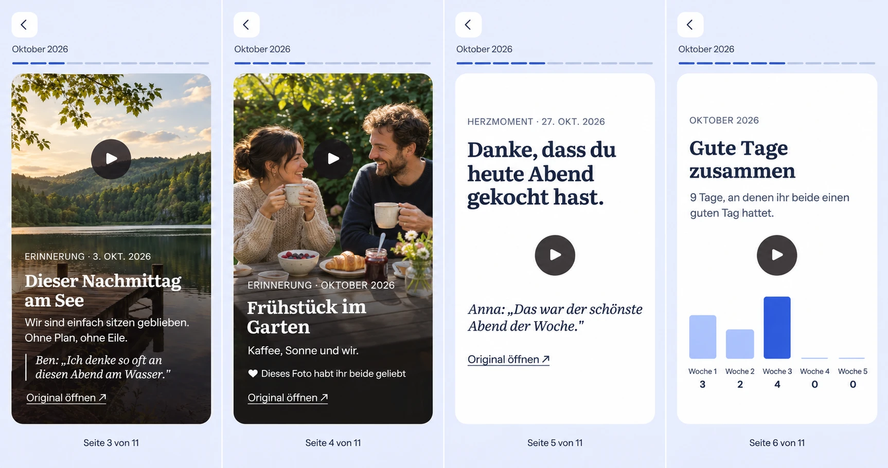
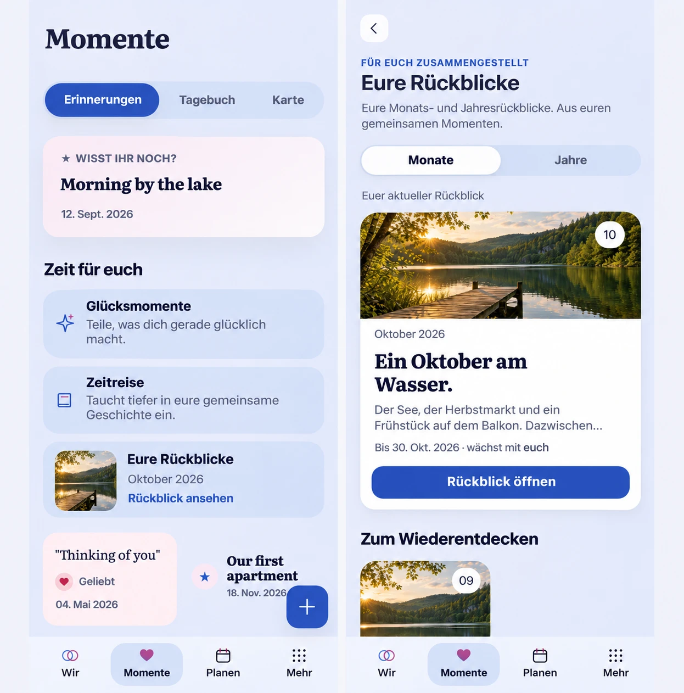

# Immersive relationship recaps (#1744)

[Owning issue, findings and Mobile Interaction Contract](https://github.com/baerenmarke90/eimir/issues/1744).
Product Owner review of 2026-11-11: the shipped monthly/yearly recaps (#1528, #1542)
were too thin for a Pro capability. This slice covers content volume and the reader.
The local model is unchanged; its editorial rework is Phase 2 of the issue.

## Design preflight

The initial demo reviewed `main@1ff8f25aa`. For the generated reference, the
baseline was `main@e0c4d842f34688470580f6a581cb3adeda5914ae`. The review covered
the More library at `/more/passport`, its Months and Years tabs, featured cover,
archive, and context disclosures. It also covered the focused reader's Back and
progress controls, canonical source links and return, selection, reflection,
retention, and the Wir monthly invitation.

ImageGen created this synthetic design board for eimir. during merge preparation
after the first demo. It uses the existing eimir. screens and synthetic lake
imagery as guidance. The [generation prompts](prompt.txt) and the
[project asset terms](../../../../../PROVENANCE.md#assets) record its provenance.
The facts scene and the browser controls appear in the runtime evidence below.

Product Reference v1 R2/R4/R5 governs. Reused: focused-task shell, `TaskBackButton`,
`MemoryPreview` with the authorized media lifecycle, `ShortTaskSheet` tasks,
`useStoryPlayback`, semantic surface, scrim, typography and motion tokens.
No new dependency or provider.

## What changed

- **Volume:** up to 8 highlights per month and 24 per year, still balanced across
  time, kinds and chapters. Manual selection allows 24. The wording model reads an
  evenly spread sample of at most 8 sources.
- **Counted facts:** the read contract gains `facts` with shared entries per kind,
  days with entries and, for a year, the strictly leading month. Only countable,
  authorized shared data; no presence, mood or relationship claims (#473 section 3).
  The scene appears from three counted entries.
- **Typed scenes:** photo-mosaic cover, facts, full-bleed photo with a legibility
  scrim, words for shared heart moments, emblem for milestones and chapters, and
  the unchanged closing scene with the couple's own words.
- **Playback like a photo memory (PO, 2026-11-11):** it starts on open and resumes on
  the restored page after a source. Tap right/left, horizontal swipe and arrow keys
  turn pages without pausing; a held finger pauses. It ends on the closing scene and
  never loops. This supersedes the earlier rule that a source return stays paused.
- **Toggle on the stage (PO, 2026-11-11):** the play/pause control sits centred
  on the stage and fades while playing. Photo scenes centre it above the caption
  so large text stays readable. On text-only scenes it covers part of the text
  while paused, as accepted by the PO. The closing scene places it in the control
  row because its own actions occupy the stage.
- **Browser-only arrows (PO, 2026-11-11):** Previous/Next are painted only in the
  browser. The native app decides by runtime platform, not viewport, and keeps both
  controls for assistive technology.
- **Library:** older editions form a two-column cover shelf; the featured cover has
  one action.
- **Earlier periods arrive by themselves:** every month and year with shared
  material is prepared without a request. The server requests the current periods
  at once and earlier ones newest-first in batches of six, continued every two
  minutes by one queued job per Space and by the six-hourly scan. A long history
  therefore never occupies the worker or the single local inference slot. Until
  its edition exists, a period is a quiet, non-interactive cover in the shelf;
  the per-period "compile" buttons are gone. The library re-reads at a calm
  cadence while such covers remain.

- **Automatic retention (PO, 2026-11-11):** a completed month or year is retained
  by the server seven days after it ends; the manual "keep edition" step and its
  confirmation sheet are gone. The grace week lets late entries and a changed
  selection still count. An automatic proposal that still describes a partial
  period is recomposed over the whole period first; a selection the couple made
  is kept as it is. Only the default variant of a period without a retained
  edition is finalised, and only while the Space holds `relationship.passport`.
  After retention the selection and generated wording are frozen, while own words
  can still be drafted, shared and withdrawn. This supersedes the earlier rule
  that a retained edition accepts no new words. Covers of completed periods read
  "completed period"; the "kept" mark remains only on earlier manual snapshots of
  a running period. `POST .../save` stays in the contract for older clients.

- **Wording resilience (Phase 2, model unchanged):** a narration the editorial
  checks reject gets one retry that names the broken rule; the rejected draft is
  not sent back, and transport failures are not retried. When a source of an
  unretained automatic proposal changes, its prose is still scrubbed at once and
  one rewrite is queued ten minutes later, so several edits cost one inference.
  Retained and curated editions keep the factual template.

## States, motion and accessibility

Reduced motion keeps the reader paused on open and removes scene, drift and stagger
animation; state and focus are unchanged. Pending, paused, empty, error, offline,
downgrade and source-invalidation behavior is unchanged. Sensitive previews stay
behind reveal. Media uses the original variant in the reader and thumbnails in
small covers. All new copy is localized in German and English.

## Evidence

Synthetic fixtures only; the four additional photos are crops and color variants of
the existing lake fixture. Captured from `web/e2e/tests/automatic-recaps.spec.ts`.

| State | Compact light | Compact dark | Expanded dark |
| --- | --- | --- | --- |
| Library | [390](evidence/recaps-immersive-library-390-light.png) | | [1280](evidence/recaps-immersive-library-1280-dark.png) |
| Cover | [390](evidence/recaps-immersive-cover-390-light.png) | [430](evidence/recaps-immersive-cover-430-dark.png) | [1280](evidence/recaps-immersive-cover-1280-dark.png) |
| Facts | [390](evidence/recaps-immersive-facts-390-light.png) | [430](evidence/recaps-immersive-facts-430-dark.png) | |
| Photo | [390](evidence/recaps-immersive-photo-390-light.png) | [430](evidence/recaps-immersive-photo-430-dark.png) | [1280](evidence/recaps-immersive-photo-1280-dark.png) |
| Words | [390](evidence/recaps-immersive-words-390-light.png) | | |
| Milestone | [390](evidence/recaps-immersive-milestone-390-light.png) | | |
| Closing | [390](evidence/recaps-immersive-closing-390-light.png) | | |
| Native container | [cover](evidence/recaps-immersive-native-cover-390-light.png), [photo](evidence/recaps-immersive-native-photo-390-light.png) | | |
| Library, periods in preparation | [390](evidence/recaps-immersive-library-preparing-390-light.png) | [390](evidence/recaps-immersive-library-preparing-390-dark.png) | |
| Retained edition, closing scene | [390](evidence/recaps-immersive-retained-closing-390-light.png) | | |
| Large text | [390](evidence/recaps-immersive-large-text-390.png) | | |

The [360 px reader](evidence/recaps-playback-360-dark-large-reduced.png) shows
Dark, 200% text and reduced motion. The browser-emulated native-container
journey uses touch input to test two quick taps and a swipe. Android device
acceptance is outside this evidence.

## Business/freemium and cross-cutting

Business/freemium impact reviewed: unchanged row "Relationship passport and
automatic recaps (#497, #1528)" — Premium composition, Free retained artifacts,
capability `relationship.passport`. No tier, provider or Self-Hosted change.
The contract change is additive and needs no migration. One read-time query
groups the same authorized shared metadata used by the selection by kind and
day. Counts, active days and the leading month use the same read snapshot.
Deleted or privately reclassified sources leave the counts on the next read.
Automatic preparation of earlier periods stays behind `relationship.passport`:
it stops when the capability lapses and never changes what a retained edition
shows. It adds no table, column or contract field; `periods` in the overview now
lists only periods that still have no edition.

Automatic retention changes no tier: the matrix already keeps every created
edition readable after expiry. It replaces a manual Pro action with a scheduled
one and lets words be added to retained editions under the existing rules (new
words need the capability; own existing words stay editable and withdrawable).
The matrix row records this.

## Rhythm scene "Gute Tage zusammen" (#1744)

The scene follows the counted facts and shows how many days **both** partners marked a good day (`VERY_GOOD` or `GOOD`), per week for a month and per month for a year (backend contract in #1783). It appears only when the edition carries the frozen rhythm and at least three good days were counted; otherwise no scene is added. It is the fourth panel of the [generated Compact reference](own-words-compact-reference.png) (baseline `main@ba3bd390d`).

- Quiet vertical bars sized relative to the strongest bucket, the strictly leading bucket in the cobalt tone, the others in a pale tint, a thin line for zero. No line, axis, score, percentage or emoji.
- Every bucket has a visible label and count plus a screen-reader text ("3 gute Tage"); the bars are decorative. The columns share one grid so labels and counts align even when text wraps.
- It is text-led, so the play toggle sits below the copy like on the facts scene. Reduced motion changes nothing; no motion was added.
- Runtime captures from `automatic-recaps.spec.ts` (390 Light, 430 Dark, 1280 Dark, axe and overflow checks): `evidence/recaps-rhythm-*`.
- Not performed: large-text capture, a year edition capture (12 buckets), and Android device acceptance.

## The couple's own words (#1744, scene reference)

Product Owner direction of 2026-11-12: recap texts come from the couple's own words and localised templates. The [generated Compact reference](own-words-compact-reference.png) shows four scenes of the focused native reader: a photo scene with a quoted comment, a photo scene with the mutual-reaction line, a words scene with a quote, and the rhythm scene "Gute Tage zusammen" (#1783).

The baseline was `main@ba3bd390d`. The board was generated from the existing photo, words, cover and facts captures in [`evidence/`](evidence/), so it keeps the reader's Back, period and segmented-progress rail, the centred play toggle and the absence of a tab bar and painted arrows. It is synthetic guidance, not a pixel lock; its [prompt](prompt.txt) and the project asset terms record its provenance.

Decisions taken from it when building:

- The quote is a quiet block under the authored copy (rule on photo scenes, italic serif on text scenes), always with the author's first name. German scenes use German quotation marks; the board shows an English closing mark.
- The reaction line is one calm line with a filled heart, no badge, and at most three per edition.
- The rhythm scene shows only counts per week or month with the leading bucket in the cobalt tone; zero buckets stay as a thin line. Every bar has a text equivalent. No score, percentage or line.
- The second panel's eyebrow sits over a busy part of the photo: the scrim must be strengthened so the eyebrow, title and reaction line meet contrast, and the date line should carry the day when it is known.

### Runtime evidence for the quote and reaction scenes

Captured by `web/e2e/tests/automatic-recaps.spec.ts` (three journeys: 390 Light, 430 Dark, 1280 Dark, reduced motion, axe and overflow checks) from a dense fixture whose photo scene carries a quote, whose second photo scene carries a mutual reaction, and whose text-led scene carries a quote: `evidence/recaps-own-words-photo-quote-*`, `recaps-own-words-photo-reaction-*` and `recaps-own-words-words-quote-*`.

- The quote is a quiet italic serif block with the author's first name and German quotation marks, inside the photo scrim or on the text-led surface.
- The reaction line is one calm line with a filled heart; it only appears on a photo scene.
- The photo scrim now holds stronger and longer (45 % / 82 % stops) so the eyebrow, title, quote and reaction line stay readable over a busy picture.
- On text-led scenes (facts, words, titles, a cover without photos) the play toggle stays in the stage but sits below the copy (Product Owner decision of 2026-11-12), so a paused reader never covers the title or a quote. While playing it is invisible as before; on photography it stays centred on the picture. The text-scene captures in `evidence/` were refreshed for this. Large-text and Android device acceptance of these scenes have not been performed; the rhythm scene is not built yet.

## Permanent entry in Momente (#1744, scene reference)

Product Owner decisions of 2026-11-13: sharing a scene as an image is not built; the permanent entry to the recap library lives in Momente, the Wir invitation around a month change stays, and More stays as a second way in. The [generated Compact reference](momente-entry-compact-reference.png) (baseline `main@71f1680a2`, generated from the current Momente and recap library captures) shows one new row (`recaps.shortTitle`) in the `coupleExperiences.title` group of Momente and the library opened from it with Momente selected in the bottom bar.

Decisions taken from it when building:

- Exactly one new row below the time-travel row: a small rounded cover on the left, the period and a quiet text action; same width and radius as the existing rows, no badge, no banner.
- The library and the reader live under Momente (`/story/recaps`, `/story/recaps/:recapId`) so the tab stays active; the former `/more/passport` addresses redirect and keep their query and return state.
- States: cover of the newest ready edition; newest retained edition without composition language when the capability is missing; a quiet row without a cover while preparing; no row without editions and capability.

### Implementation record: the Momente entry

Built from the reference above (reviewed against `main@71f1680a2`, built on `main@91f264453`). Runtime captures from `automatic-recaps.spec.ts` (390 Light, 430 Dark, 1280 Dark; reduced motion, axe, no horizontal overflow): `evidence/recaps-momente-entry-*` (Momente with the new row) and `evidence/recaps-momente-library-*` (the library opened from it, Momente selected).

- The row is rendered only where the `coupleExperiences.title` group appears (the Discover view), so the overview is read only there; the timeline tab, Wir and More cause no new read. It shows the newest ready edition with its cover, a quiet pending line (`recaps.entryPending`) while an edition is pending, and nothing without editions. Errors hide the row.
- The library and the reader moved to `/story/recaps` and `/story/recaps/:recapId`; the former `/more/passport` addresses are legacy rewrites (query and hash kept), More and the Wir invitation link to the new route, and the shell treats the reader as a focused task as before. Back from the library returns to Momente.
- On Expanded the row spans the full width of the two-column group so no cell stays empty.
- Not performed: large-text capture of the new row, the Free/pending/no-edition states in the browser (selector covered by unit tests), and Android device acceptance.

## The monthly film (#1744, Product Owner 2026-11-17)

Product Owner direction of 2026-11-17: a monthly recap is an automatic best-of,
cut like a short film from the month's shared material, **without a model and
without generated text**, presented in the existing scene reader (no rendered
video file). The Product Owner reviewed an animated prototype on the live app
with the couple's real data (read-only, nothing stored) and approved its cut,
layouts and timing ("exactly like this"). The baseline was `main@43fabb129`.

**Visual reference (Product Owner decision 2026-11-17):** the Product Owner
accepted screenshots of this animated prototype as the visual product reference
instead of a generated image. Because the prototype ran on the couple's real
photos and words, those screenshots stay out of the repository and the issue;
the committed evidence is captured from synthetic fixtures in the implemented
reader.

### Selection and cut (server, `recaps/film.py`, `recaps/montage.py`)

- **Pool:** every shared moment that starts in the month (Memory, HeartMoment,
  Milestone, Chapter, completed Plan). Both answers to one guided happiness or
  time-travel question are one moment. A multi-day moment belongs to the month
  it starts in. Owner-only content never enters.
- **Points, no model:** real photos, collage material (three or more), words,
  both partners' answers, a mutual positive reaction, a linked Place, a
  multi-day moment and a member's own birthday. Deductions for moments that
  only have screenshots or duplicates, for blur and for the app's automatic
  fallback title. The highlight is guaranteed.
- **Length:** at most 12 moments, two per day, and about 90 seconds of running
  time (Google and Apple memories run 30-60 s; the couple's words need reading
  time). Sparse months get fewer scenes, never filler.
- **Photos:** quality is measured on the stored 512 px thumbnail with Pillow
  only: Laplacian variance (blur), the share of flat areas plus a tall format
  (screenshots) and a 64-bit difference hash (duplicates). Real photos lead,
  then videos, then screenshots. A sensitive photo stays out while its moment
  stays (Product Owner 2026-11-17). A video plays a muted clip of at most five
  seconds from its first third through the existing short-lived playback access.
- **Look:** eight moods, eight transitions (56 ordered pairs), five motions, four
  covers and two to five layouts per scene type. Each edition freezes one look,
  chosen deterministically from Space and period against the frozen looks of the
  latest five monthly editions: no mood and no transition pair repeats within
  five recaps, consecutive recaps never share a cover or a first layout. A
  recomposition keeps the frozen look. Moods are names; the reader maps them to
  semantic tokens, so app designs and Light/Dark apply.
- **Never served:** scores, ranks and selection reasons (Product Owner: the cut
  plan is a trade secret). The read contract carries the frozen look, the
  highlight key, curated media per moment, live answers, the first Place name
  and the month's authored tags with counts. All of these are re-authorized on
  every read; a newly sensitive or removed photo disappears at once.
- **Scene rules:** a calm opener (Places of the month, else the days with
  entries), chronological order with the highlight as the longest and strongest
  scene, never the same scene type twice in a row, answers in the picture when
  short or as the next scene, a scene where the month's tags fly together, and a
  quiet closing. A HeartMoment with a photo shows the photo with its words.
  Music stays optional and is not built; the contract leaves room for it.
- **Year editions** are cut as a longer film (see "The year film" below);
  editions without a frozen film use the existing reader unchanged.

### Mobile Interaction Contract (film)

Human task: watch the month in one sitting, like a photo memory. Focal point: a
real photo or the couple's own words. Single dominant action: play/pause; tap
left/right, hold to pause and the explicit controls stay. Captions never sit
under an image area; full-bleed captions use the strong scrim. States:
loading reserves the scene frame; pending, empty, error, offline and downgrade
semantics are unchanged. Reduced motion follows the app's motion tokens, which
are zero under that preference: scenes change without transition, drift, zoom,
stagger and the tag flight stop, and video posters replace clips; state and
focus are unchanged. Large text reflows;
long words are never set as a display heading. Browser-only arrows stay hidden
in the native runtime. Expanded keeps the same order inside the reading column.

### Reuse, business and cross-cutting review

- **Reuse:** Pillow (already a dependency) for photo measures; ImageHash and
  OpenCV were considered and are not needed for three statistics on a thumbnail.
  Existing worker queue, authorized media loader, playback access, scene reader
  and Web Animations API. No new dependency, provider or model.
- **Business/freemium impact reviewed:** unchanged row "Relationship passport and
  automatic recaps (#497, #1528)": Premium composition behind
  `relationship.passport`, retained editions stay readable after expiry (the
  frozen look is part of the edition). Identical on Cloud and Self-Hosted; no
  inference, so managed cost falls. Thumbnail reads add bounded worker CPU per
  composed month.
- **Privacy:** only shared, authorized content; derived measures are never
  stored; the frozen look and curated media live in the protected edition
  payload and follow the edition lifecycle. No faces, no biometrics.
- **Not part of this change:** removing the local wording model and its texts
  (separate step), music, a per-entry "not in recaps" control.

### Runtime evidence: the monthly film

Captured by `web/e2e/tests/automatic-recaps.spec.ts` ("the monthly film presents
its scenes …") from a synthetic month with curated media, two Places, both
answers to a guided question, five tags and a frozen look (mood `rose`, cover
`mosaic`). Reduced motion is on so every capture shows a settled scene; each run
also asserts that no caption band sits under a picture (full-bleed captions use
the scrim), no horizontal overflow and no axe violation in the reader.

| Scene | Compact 390 Light | Compact 430 Dark | Expanded 1280 Dark |
| --- | --- | --- | --- |
| Cover (mosaic) | [00](evidence/recaps-film-00-390-light.png) | [00](evidence/recaps-film-00-430-dark.png) | [00](evidence/recaps-film-00-1280-dark.png) |
| Places opener | [01](evidence/recaps-film-01-390-light.png) | | |
| Photo (polaroid) | [02](evidence/recaps-film-02-390-light.png) | | |
| Words (letter) | [03](evidence/recaps-film-03-390-light.png) | | |
| Photo (full-bleed caption) | [04](evidence/recaps-film-04-390-light.png) | [04](evidence/recaps-film-04-430-dark.png) | [04](evidence/recaps-film-04-1280-dark.png) |
| Photo with both answers | [05](evidence/recaps-film-05-390-light.png) | | |
| Milestone (stamp) | [06](evidence/recaps-film-06-390-light.png) | | |
| Highlight (collage of three pictures, since the film variety) | [07](evidence/recaps-film-07-390-light.png) | | |
| Words (centered) | [08](evidence/recaps-film-08-390-light.png) | | |
| Chapter (band) | [09](evidence/recaps-film-09-390-light.png) | | |
| Tags of the month | [10](evidence/recaps-film-10-390-light.png) | [10](evidence/recaps-film-10-430-dark.png) | [10](evidence/recaps-film-10-1280-dark.png) |
| Closing | [11](evidence/recaps-film-11-390-light.png) | | |

Not performed: captures of the transitions and motions in flight, a video clip
(the fixture has no video; the clip path is covered by unit tests), large-text
capture of the film scenes, and Android device acceptance.

## The year film (#1744, Product Owner 2026-11-17)

Product Owner direction of 2026-11-17: year recaps work exactly like the monthly
film, but longer and with the year's highlights. The Product Owner approved the
cut plan below in chat, including three choices: the year highlight closes the
film as its climax, the milestones play as one "firsts" sequence in the finale,
and the film is bounded to 36 moments (about 3.5 minutes, at most 4). The
synthetic storyboard shown with the plan and the browser captures below serve
as the visual reference; the baseline was this stack's base
`claude/recap-bestof-8cf63b@d212c72ab` (PR #2018 on `main@1daf96b48`).

### Cut (server, `recaps/film.py` `year_cut`, `recaps/montage.py` `compose_year`)

- **Per month:** where a monthly film of that month exists, its frozen highlight
  and its frozen selection are reused; otherwise the monthly cut rules choose,
  with the seed the monthly film would use. Months with a film therefore only
  contribute what that film chose, which also bounds the photos measured for a
  year. Months without material get no chapter.
- **Fill:** the year's strongest further moments, at most four per month
  (highlight included) and two per day, until 36 moments or about 3.5 minutes.
  Month highlights are never removed; the hard limit of four minutes is held by
  dropping the weakest milestones down to three.
- **Year highlight:** the strongest month highlight, guaranteed. Because it
  closes the film, its month keeps at least one other moment when one exists.
- **Firsts:** every milestone of the year (at most eight) plays as one sequence
  in the finale and never again inside a month chapter. A month film whose
  highlight is a milestone therefore opens its year chapter with its next pick.
- **Look:** frozen per year edition; no mood and no transition pair of the latest
  five year editions, and never the mood or transition pair of the December film
  of the same year (checked from either side, whichever is composed later).
- **Contract:** additive `film.monthHighlights` (month number and source key);
  scores, ranks and selection reasons are still never stored or served.

### Scenes (Web, `recapFilm.ts`, `RecapFilmScene`)

- **Intro:** cover with the year and a mosaic of the month highlights (the year
  highlight's own title as heading, else `recaps.film.coverFallbackYear`), the counted facts or
  Places of the year and the rhythm scene with twelve buckets when frozen.
- **Month chapters:** a short marker that shows only the localized month name
  (no generated text), followed by the month's moments under every monthly rule
  (chronology, no scene type twice in a row, answers in the picture or next).
- **Finale:** the firsts (`recaps.film.firsts`) with each milestone's day and own title appearing one
  after another, the year's tags flying together, the year highlight as the
  longest and strongest scene, a montage of the month covers with the short
  month name below each picture (never on it), and the quiet closing.
- **Progress:** one segment per chapter (intro, each month, finale) that fills
  scene by scene; taps, swipes and arrow keys still page by scene. The monthly
  film keeps one bar per scene.

### Mobile Interaction Contract (year film)

Unchanged from the monthly film: watch in one sitting, a real photo or the
couple's own words as focal point, play/pause as the single dominant action,
tap left/right and hold to pause. Captions never sit under an image area. Reduced
motion follows the app's motion tokens like the monthly film: scenes change
without transition, and the month-marker zoom and the staggered firsts and
covers stop; state and focus are unchanged.
Browser-only arrows stay hidden in the native runtime. Expanded keeps the same
order inside the reading column. Pending, empty, error, offline and downgrade
behavior is unchanged; a year without material keeps the empty state.

### Reuse, business and cross-cutting review

- **Reuse:** the monthly film's scoring, photo measures, look catalogue, reader,
  playback and progress fill; no new dependency, provider or model.
- **Business/freemium impact reviewed:** the same Premium composition row
  "Relationship passport and automatic recaps (#497, #1528)"; the matrix wording
  now names monthly and yearly films. No tier change; identical on Cloud and
  Self-Hosted; retained year editions keep their look after expiry. A year job
  measures at most the photos of months without a monthly film, so worker CPU
  stays bounded; no inference.
- **Privacy:** only shared, authorized content; month highlights are source keys
  the edition already references; derived measures are not stored.
- **Performance:** reading a year edition re-authorizes up to 36 sources with the
  same per-source live extras as a month (answers, first Place, media).

### Runtime evidence: the year film

Captured by `web/e2e/tests/automatic-recaps.spec.ts` ("the year film plays its
month chapters …" and "the year film keeps browser-only arrows hidden in the
native app") from a synthetic year (January to October 2026, one highlight and
one further moment per month, three milestones, six tags, frozen mood `sage`).
Reduced motion is on, so every capture shows a settled scene; each run asserts
twelve progress chapters, that no caption band sits under a picture, no
horizontal overflow and no axe violation in the reader.

| Scene | Compact 390 Light | Compact 430 Dark | Expanded 1280 Dark |
| --- | --- | --- | --- |
| Cover (mosaic of month highlights) | [390](evidence/recaps-year-film-cover-390-light.png) | [430](evidence/recaps-year-film-cover-430-dark.png) | [1280](evidence/recaps-year-film-cover-1280-dark.png) |
| Places opener | [390](evidence/recaps-year-film-place-390-light.png) |  |  |
| Month marker | [390](evidence/recaps-year-film-month-390-light.png) | [430](evidence/recaps-year-film-month-430-dark.png) | [1280](evidence/recaps-year-film-month-1280-dark.png) |
| Photo in a month chapter | [390](evidence/recaps-year-film-photo-390-light.png) |  |  |
| Title in a month chapter | [390](evidence/recaps-year-film-title-390-light.png) |  |  |
| Words in a month chapter | [390](evidence/recaps-year-film-words-390-light.png) |  |  |
| Firsts | [390](evidence/recaps-year-film-firsts-390-light.png) | [430](evidence/recaps-year-film-firsts-430-dark.png) | [1280](evidence/recaps-year-film-firsts-1280-dark.png) |
| Tags of the year | [390](evidence/recaps-year-film-tags-390-light.png) |  |  |
| Year highlight (climax) | [390](evidence/recaps-year-film-climax-390-light.png) | [430](evidence/recaps-year-film-climax-430-dark.png) | [1280](evidence/recaps-year-film-climax-1280-dark.png) |
| Month covers | [390](evidence/recaps-year-film-covers-390-light.png) | [430](evidence/recaps-year-film-covers-430-dark.png) | [1280](evidence/recaps-year-film-covers-1280-dark.png) |
| Closing | [390](evidence/recaps-year-film-closing-390-light.png) |  |  |
| Native container, month marker | [390](evidence/recaps-year-film-native-390-light.png) | | |

Not performed: captures of transitions and motions in flight, a large-text
capture of the year scenes, a full twelve-month browser fixture (the
PostgreSQL integration test covers twelve months), and Android device
acceptance.

## The film variety (#1744, Product Owner 2026-11-17)

Product Owner direction of 2026-11-17: the monthly and yearly films need far
more animations, transitions and presentation logic, and must feel clean and
well made throughout. "Choices" means **automatisms, not settings**: the app
itself picks the most beautiful moments and stages them attractively. No option
or setting reaches the couple. The Product Owner approved the plan below in chat
without a preview; the synthetic browser captures below are the
review evidence. The baseline was this stack's base
`claude/recap-year-film-6b7fbd@94608eb42` (PR #2019).

### Catalogue (server `recaps/film.py`, reader `recapFilm.ts`)

- **Transitions:** twelve pair transitions (fade, slide, rise, zoom, iris, wipe,
  shift, blur, and new: blinds, split, flip, focus pull), 132 ordered pairs.
  Each look also freezes three **accents**: the first opens the highlight (a
  warm light leak is reserved for it), the others join photo runs, including a
  **match cut** that grows the next picture out of the previous frame. A real
  shared-element morph across scenes was ruled out: scenes remount, so it would
  stutter.
- **Camera motion:** nine paths in three families. Portraits move vertically
  (pan up, pan down, parallax), landscapes horizontally (drift left/right,
  diagonal), and neutral paths fit both (zoom in/out, breathe). Each look
  freezes two of each orientation and one neutral path.
- **Layouts:** photo (+ mat, panorama band, corner with the day), two pictures
  (+ diptych, crossfade, scattered prints), **collage** for three pictures of a
  moment (grid, scattered prints, travelling strip), words (+ word by word,
  large quote mark), titles (+ between two rules), answers (+ soft cards),
  Places (+ postcard, route in visiting order without a map), counted days (+
  counting up), year forms (month as numeral or stamp, firsts as cards, covers
  as calendar or travelling strip) and three closings (tiles, polaroid stack,
  fade). Covers: + frame, stack and split.

### Staging from the material (deterministic, no model)

- **Format and crop:** the stored thumbnail gives each curated picture a format
  (portrait, landscape, square) and a crop centre: the centre of its edge energy
  (where the photo has the most detail), damped and bounded to 30-70 % so a
  subject is never pushed to the edge. Layouts and camera paths follow the
  format; the crop and the camera's origin follow the centre.
- **Mood from the photos:** the mean light and colour of the film's photos (the
  highlight counts twice) gives a tone (dark, warm, cool, green, bright). The
  mood leans towards it (for example dark photos towards night or ink), but only
  among the moods the five-edition rule leaves free.
- **Cover:** the highlight's best photo first, then one picture per day with
  alternating formats; the cover form fits the pictures there are (a strip needs
  three, a split two; a film without pictures uses the type cover).
- **Pace:** frozen from the number of chosen moments: calm up to four (month)
  or fourteen (year), lively from nine or twenty-eight. Picture time scales by
  1.15 or 0.85; the couple's words keep their full reading time.
- **Beat:** a run of three or more plain picture scenes plays long-short-short-
  long, with quicker entrances on the short beats.
- **Climax:** a held breath in the mood colour, then the highlight's accent, the
  most generous form that suits its pictures (full bleed, overlap or collage
  grid) and a slower, deeper camera move.
- **No repetition:** within a film no neighbouring scenes share a layout or a
  camera path, no transition plays three times in a row, and two collages in a
  row become a collage and a pair. Across editions the existing rules stay, and
  the highlight's accent and the closing form do not return within three
  consecutive editions.
- **Calm finish:** a fading closing lets the highlight go into the mood colour
  above the closing line.

### Contract and compatibility

- Additive and optional: `film.accents`, `film.pace`, and per curated picture
  `shape`, `focusX`, `focusY`. Nothing else is served: tone, light, sharpness,
  hashes, scores and selection reasons stay on the server and are never stored.
- Frozen editions stay readable: a look without accents or pace plays its pair
  and an even pace, layouts and scene types it lacks use the established first
  form (line marker, timeline, grid covers, tiles), and every unknown name falls
  back to fade, the type's first known layout, zoom-in or the mosaic cover.
- The arrangement is reader logic, so an existing edition now also benefits:
  three pictures of one moment play as a collage and its highlight takes the
  most generous form. The frozen names themselves never change.

### Mobile Interaction Contract (film variety)

Unchanged from the monthly and year film: watch in one sitting, a real photo or
the couple's own words as focal point, play/pause as the single dominant action,
captions never under a picture (full-bleed captions keep the strong scrim). All
timings derive from motion tokens; under reduced motion entrances, accents, the
breath, camera paths, the word-by-word reveal, the counter and the covers strip
stop, a crossfade shows both pictures side by side and the covers strip keeps
the calm grid. Decorative marks (the large quote mark, the month numeral, the
corner day and the counting digits) are hidden from assistive technology, which
reads the real text once. Browser-only arrows stay hidden in the native runtime.

### Reuse, business and cross-cutting review

- **Reuse:** Pillow statistics on the existing thumbnails (no new dependency),
  CSS registered custom properties for the blinds and the counter, container
  query units for the covers strip, and the existing reader, playback and
  motion tokens. Colour and saliency libraries (ColorThief, OpenCV saliency)
  were considered and are not needed for a mean colour and an edge centroid.
- **Business/freemium impact reviewed:** the same Premium composition row
  "Relationship passport and automatic recaps (#497, #1528)"; no tier, quota or
  entitlement change; identical on Cloud and Self-Hosted. Colour and focus come
  from the same thumbnail read as the quality measures, so worker cost stays
  bounded; no inference.
- **Privacy:** format and crop centre are presentation hints of already curated,
  authorized pictures and live in the protected edition payload; derived
  colour and detail measures are not stored.
- **Accessibility and i18n:** no new text; the quote mark uses the locale's own
  quotes, and month numerals use the locale's number format.

### Runtime evidence: the film variety

Captured by `web/e2e/tests/automatic-recaps.spec.ts` ("the film variety stages
its scenes …", "… catches its accents and the breath before the highlight
mid-flight" and "the year film variety shows …") from the synthetic month and
year with a frozen variety look (mood `ink`, cover `stack`, accents `light`,
`match`, `blinds`) and formats and crop centres on the pictures. Each run
asserts that no caption band sits under a picture, no horizontal overflow and
no axe violation, and that the cover stack, the Places route, the collage
climax and the fading closing come from the look. The mid-flight captures stop
every running animation at 40 % with the Web Animations API.

| Scene | Compact 390 Light | Compact 430 Dark | Expanded 1280 Dark |
| --- | --- | --- | --- |
| Cover (stack) | [00](evidence/recaps-film-variety-00-cover-390-light.png) | [00](evidence/recaps-film-variety-00-cover-430-dark.png) | [00](evidence/recaps-film-variety-00-cover-1280-dark.png) |
| Places (route) | [01](evidence/recaps-film-variety-01-place-390-light.png) | | |
| Photo (panorama, landscape) | [02](evidence/recaps-film-variety-02-photo-390-light.png) | | |
| Words (large quote mark) | [03](evidence/recaps-film-variety-03-words-390-light.png) | | |
| Photo (corner with the day, portrait) | [04](evidence/recaps-film-variety-04-photo-390-light.png) | | |
| Photo with answers (mat) | [05](evidence/recaps-film-variety-05-photo-390-light.png) | | |
| Milestone (between rules) | [06](evidence/recaps-film-variety-06-title-390-light.png) | | |
| Highlight (collage grid) | [07](evidence/recaps-film-variety-07-climax-390-light.png) | [07](evidence/recaps-film-variety-07-climax-430-dark.png) | [07](evidence/recaps-film-variety-07-climax-1280-dark.png) |
| Words (word by word) | [08](evidence/recaps-film-variety-08-words-390-light.png) | | |
| Chapter (stamp) | [09](evidence/recaps-film-variety-09-title-390-light.png) | | |
| Tags of the month | [10](evidence/recaps-film-variety-10-tags-390-light.png) | | |
| Closing (fade) | [11](evidence/recaps-film-variety-11-closing-390-light.png) | [11](evidence/recaps-film-variety-11-closing-430-dark.png) | [11](evidence/recaps-film-variety-11-closing-1280-dark.png) |
| In flight: split entrance | [split](evidence/recaps-film-variety-motion-split-390-light.png) | | |
| In flight: focus pull | [focus](evidence/recaps-film-variety-motion-focus-390-light.png) | | |
| In flight: breath and light leak before the highlight | [light](evidence/recaps-film-variety-motion-light-390-light.png) | | |
| In flight: match cut | [match](evidence/recaps-film-variety-motion-match-390-light.png) | | |
| Year: month numeral | [390](evidence/recaps-year-film-variety-month-390-light.png) | | |
| Year: firsts as cards | [390](evidence/recaps-year-film-variety-firsts-390-light.png) | | |
| Year: covers calendar | [390](evidence/recaps-year-film-variety-covers-390-light.png) | | |

The monthly and year film captures above were renewed with this change: the
monthly highlight now plays its three pictures as a collage, and the year
climax, closing and tag captures follow the new arrangement.

Not performed: a generated visual reference image (the Product Owner approved
the textual plan directly), captures of the blinds, flip and diagonal or
breathing camera paths in flight (unit tests cover their selection), large-text
captures of the new forms, a video clip in the new layouts, and Android device
acceptance on the Pixel.
