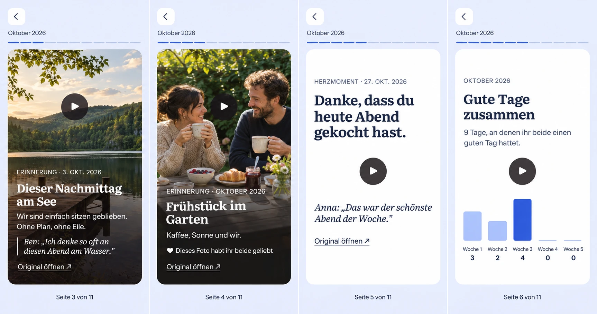
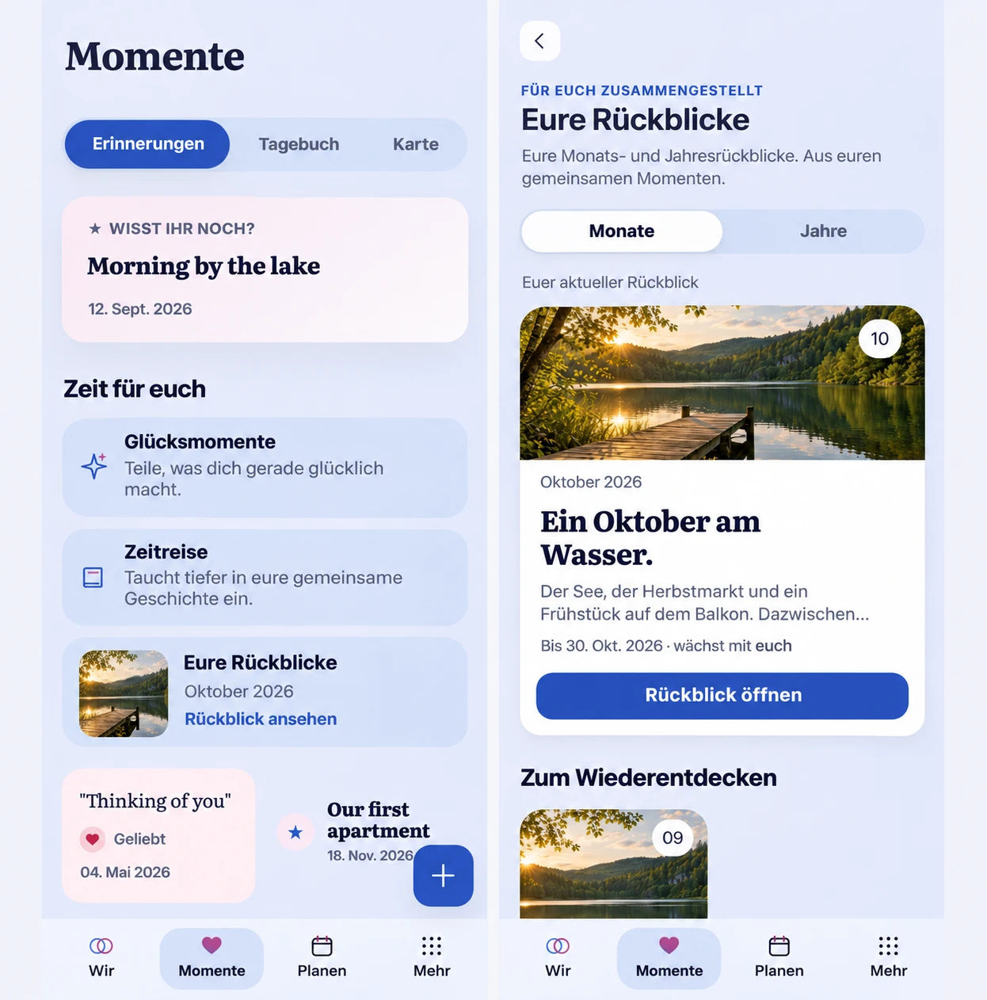

# Immersive relationship recaps (#1744)

[Owning issue, findings and Mobile Interaction Contract](https://github.com/baerenmarke90/eimir/issues/1744).
Product Owner review of 2026-11-11: the shipped monthly/yearly recaps (#1528, #1542)
were too thin for a Pro capability. This slice covers content volume and the reader.
The local model is unchanged; its editorial rework is Phase 2 of the issue.

## Design preflight

The initial demo reviewed `main@1ff8f25aa`. For the generated reference, the
baseline was `main@e0c4d842f34688470580f6a581cb3adeda5914ae`. The review covered
the More library at `/more/passport`, its Months and Years tabs, featured cover,
archive, and context disclosures. It also covered the focused reader's Back and
progress controls, canonical source links and return, selection, reflection,
retention, and the Wir monthly invitation.

ImageGen created this synthetic design board for eimir. during merge preparation
after the first demo. It uses the existing eimir. screens and synthetic lake
imagery as guidance. The [generation prompts](prompt.txt) and the
[project asset terms](../../../../../PROVENANCE.md#assets) record its provenance.
The facts scene and the browser controls appear in the runtime evidence below.

Product Reference v1 R2/R4/R5 governs. Reused: focused-task shell, `TaskBackButton`,
`MemoryPreview` with the authorized media lifecycle, `ShortTaskSheet` tasks,
`useStoryPlayback`, semantic surface, scrim, typography and motion tokens.
No new dependency or provider.

## What changed

- **Volume:** up to 8 highlights per month and 24 per year, still balanced across
  time, kinds and chapters. Manual selection allows 24. The wording model reads an
  evenly spread sample of at most 8 sources.
- **Counted facts:** the read contract gains `facts` with shared entries per kind,
  days with entries and, for a year, the strictly leading month. Only countable,
  authorized shared data; no presence, mood or relationship claims (#473 section 3).
  The scene appears from three counted entries.
- **Typed scenes:** photo-mosaic cover, facts, full-bleed photo with a legibility
  scrim, words for shared heart moments, emblem for milestones and chapters, and
  the unchanged closing scene with the couple's own words.
- **Playback like a photo memory (PO, 2026-11-11):** it starts on open and resumes on
  the restored page after a source. Tap right/left, horizontal swipe and arrow keys
  turn pages without pausing; a held finger pauses. It ends on the closing scene and
  never loops. This supersedes the earlier rule that a source return stays paused.
- **Toggle on the stage (PO, 2026-11-11):** the play/pause control sits centred
  on the stage and fades while playing. Photo scenes centre it above the caption
  so large text stays readable. On text-only scenes it covers part of the text
  while paused, as accepted by the PO. The closing scene places it in the control
  row because its own actions occupy the stage.
- **Browser-only arrows (PO, 2026-11-11):** Previous/Next are painted only in the
  browser. The native app decides by runtime platform, not viewport, and keeps both
  controls for assistive technology.
- **Library:** older editions form a two-column cover shelf; the featured cover has
  one action.
- **Earlier periods arrive by themselves:** every month and year with shared
  material is prepared without a request. The server requests the current periods
  at once and earlier ones newest-first in batches of six, continued every two
  minutes by one queued job per Space and by the six-hourly scan. A long history
  therefore never occupies the worker or the single local inference slot. Until
  its edition exists, a period is a quiet, non-interactive cover in the shelf;
  the per-period "compile" buttons are gone. The library re-reads at a calm
  cadence while such covers remain.

- **Automatic retention (PO, 2026-11-11):** a completed month or year is retained
  by the server seven days after it ends; the manual "keep edition" step and its
  confirmation sheet are gone. The grace week lets late entries and a changed
  selection still count. An automatic proposal that still describes a partial
  period is recomposed over the whole period first; a selection the couple made
  is kept as it is. Only the default variant of a period without a retained
  edition is finalised, and only while the Space holds `relationship.passport`.
  After retention the selection and generated wording are frozen, while own words
  can still be drafted, shared and withdrawn. This supersedes the earlier rule
  that a retained edition accepts no new words. Covers of completed periods read
  "completed period"; the "kept" mark remains only on earlier manual snapshots of
  a running period. `POST .../save` stays in the contract for older clients.

- **Wording resilience (Phase 2, model unchanged):** a narration the editorial
  checks reject gets one retry that names the broken rule; the rejected draft is
  not sent back, and transport failures are not retried. When a source of an
  unretained automatic proposal changes, its prose is still scrubbed at once and
  one rewrite is queued ten minutes later, so several edits cost one inference.
  Retained and curated editions keep the factual template.

## States, motion and accessibility

Reduced motion keeps the reader paused on open and removes scene, drift and stagger
animation; state and focus are unchanged. Pending, paused, empty, error, offline,
downgrade and source-invalidation behavior is unchanged. Sensitive previews stay
behind reveal. Media uses the original variant in the reader and thumbnails in
small covers. All new copy is localized in German and English.

## Evidence

Synthetic fixtures only; the four additional photos are crops and color variants of
the existing lake fixture. Captured from `web/e2e/tests/automatic-recaps.spec.ts`.

| State | Compact light | Compact dark | Expanded dark |
| --- | --- | --- | --- |
| Library | [390](evidence/recaps-immersive-library-390-light.png) | | [1280](evidence/recaps-immersive-library-1280-dark.png) |
| Cover | [390](evidence/recaps-immersive-cover-390-light.png) | [430](evidence/recaps-immersive-cover-430-dark.png) | [1280](evidence/recaps-immersive-cover-1280-dark.png) |
| Facts | [390](evidence/recaps-immersive-facts-390-light.png) | [430](evidence/recaps-immersive-facts-430-dark.png) | |
| Photo | [390](evidence/recaps-immersive-photo-390-light.png) | [430](evidence/recaps-immersive-photo-430-dark.png) | [1280](evidence/recaps-immersive-photo-1280-dark.png) |
| Words | [390](evidence/recaps-immersive-words-390-light.png) | | |
| Milestone | [390](evidence/recaps-immersive-milestone-390-light.png) | | |
| Closing | [390](evidence/recaps-immersive-closing-390-light.png) | | |
| Native container | [cover](evidence/recaps-immersive-native-cover-390-light.png), [photo](evidence/recaps-immersive-native-photo-390-light.png) | | |
| Library, periods in preparation | [390](evidence/recaps-immersive-library-preparing-390-light.png) | [390](evidence/recaps-immersive-library-preparing-390-dark.png) | |
| Retained edition, closing scene | [390](evidence/recaps-immersive-retained-closing-390-light.png) | | |
| Large text | [390](evidence/recaps-immersive-large-text-390.png) | | |

The [360 px reader](evidence/recaps-playback-360-dark-large-reduced.png) shows
Dark, 200% text and reduced motion. The browser-emulated native-container
journey uses touch input to test two quick taps and a swipe. Android device
acceptance is outside this evidence.

## Business/freemium and cross-cutting

Business/freemium impact reviewed: unchanged row "Relationship passport and
automatic recaps (#497, #1528)" — Premium composition, Free retained artifacts,
capability `relationship.passport`. No tier, provider or Self-Hosted change.
The contract change is additive and needs no migration. One read-time query
groups the same authorized shared metadata used by the selection by kind and
day. Counts, active days and the leading month use the same read snapshot.
Deleted or privately reclassified sources leave the counts on the next read.
Automatic preparation of earlier periods stays behind `relationship.passport`:
it stops when the capability lapses and never changes what a retained edition
shows. It adds no table, column or contract field; `periods` in the overview now
lists only periods that still have no edition.

Automatic retention changes no tier: the matrix already keeps every created
edition readable after expiry. It replaces a manual Pro action with a scheduled
one and lets words be added to retained editions under the existing rules (new
words need the capability; own existing words stay editable and withdrawable).
The matrix row records this.

## Rhythm scene "Gute Tage zusammen" (#1744)

The scene follows the counted facts and shows how many days **both** partners marked a good day (`VERY_GOOD` or `GOOD`), per week for a month and per month for a year (backend contract in #1783). It appears only when the edition carries the frozen rhythm and at least three good days were counted; otherwise no scene is added. It is the fourth panel of the [generated Compact reference](own-words-compact-reference.png) (baseline `main@ba3bd390d`).

- Quiet vertical bars sized relative to the strongest bucket, the strictly leading bucket in the cobalt tone, the others in a pale tint, a thin line for zero. No line, axis, score, percentage or emoji.
- Every bucket has a visible label and count plus a screen-reader text ("3 gute Tage"); the bars are decorative. The columns share one grid so labels and counts align even when text wraps.
- It is text-led, so the play toggle sits below the copy like on the facts scene. Reduced motion changes nothing; no motion was added.
- Runtime captures from `automatic-recaps.spec.ts` (390 Light, 430 Dark, 1280 Dark, axe and overflow checks): `evidence/recaps-rhythm-*`.
- Not performed: large-text capture, a year edition capture (12 buckets), and Android device acceptance.

## The couple's own words (#1744, scene reference)

Product Owner direction of 2026-11-12: recap texts come from the couple's own words and localised templates. The [generated Compact reference](own-words-compact-reference.png) shows four scenes of the focused native reader: a photo scene with a quoted comment, a photo scene with the mutual-reaction line, a words scene with a quote, and the rhythm scene "Gute Tage zusammen" (#1783).

The baseline was `main@ba3bd390d`. The board was generated from the existing photo, words, cover and facts captures in [`evidence/`](evidence/), so it keeps the reader's Back, period and segmented-progress rail, the centred play toggle and the absence of a tab bar and painted arrows. It is synthetic guidance, not a pixel lock; its [prompt](prompt.txt) and the project asset terms record its provenance.

Decisions taken from it when building:

- The quote is a quiet block under the authored copy (rule on photo scenes, italic serif on text scenes), always with the author's first name. German scenes use German quotation marks; the board shows an English closing mark.
- The reaction line is one calm line with a filled heart, no badge, and at most three per edition.
- The rhythm scene shows only counts per week or month with the leading bucket in the cobalt tone; zero buckets stay as a thin line. Every bar has a text equivalent. No score, percentage or line.
- The second panel's eyebrow sits over a busy part of the photo: the scrim must be strengthened so the eyebrow, title and reaction line meet contrast, and the date line should carry the day when it is known.

### Runtime evidence for the quote and reaction scenes

Captured by `web/e2e/tests/automatic-recaps.spec.ts` (three journeys: 390 Light, 430 Dark, 1280 Dark, reduced motion, axe and overflow checks) from a dense fixture whose photo scene carries a quote, whose second photo scene carries a mutual reaction, and whose text-led scene carries a quote: `evidence/recaps-own-words-photo-quote-*`, `recaps-own-words-photo-reaction-*` and `recaps-own-words-words-quote-*`.

- The quote is a quiet italic serif block with the author's first name and German quotation marks, inside the photo scrim or on the text-led surface.
- The reaction line is one calm line with a filled heart; it only appears on a photo scene.
- The photo scrim now holds stronger and longer (45 % / 82 % stops) so the eyebrow, title, quote and reaction line stay readable over a busy picture.
- On text-led scenes (facts, words, titles, a cover without photos) the play toggle stays in the stage but sits below the copy (Product Owner decision of 2026-11-12), so a paused reader never covers the title or a quote. While playing it is invisible as before; on photography it stays centred on the picture. The text-scene captures in `evidence/` were refreshed for this. Large-text and Android device acceptance of these scenes have not been performed; the rhythm scene is not built yet.

## Permanent entry in Momente (#1744, scene reference)

Product Owner decisions of 2026-11-13: sharing a scene as an image is not built; the permanent entry to the recap library lives in Momente, the Wir invitation around a month change stays, and More stays as a second way in. The [generated Compact reference](momente-entry-compact-reference.png) (baseline `main@71f1680a2`, generated from the current Momente and recap library captures) shows one new row (`recaps.shortTitle`) in the `coupleExperiences.title` group of Momente and the library opened from it with Momente selected in the bottom bar.

Decisions taken from it when building:

- Exactly one new row below the time-travel row: a small rounded cover on the left, the period and a quiet text action; same width and radius as the existing rows, no badge, no banner.
- The library and the reader live under Momente (`/story/recaps`, `/story/recaps/:recapId`) so the tab stays active; the former `/more/passport` addresses redirect and keep their query and return state.
- States: cover of the newest ready edition; newest retained edition without composition language when the capability is missing; a quiet row without a cover while preparing; no row without editions and capability.

### Implementation record: the Momente entry

Built from the reference above (reviewed against `main@71f1680a2`, built on `main@91f264453`). Runtime captures from `automatic-recaps.spec.ts` (390 Light, 430 Dark, 1280 Dark; reduced motion, axe, no horizontal overflow): `evidence/recaps-momente-entry-*` (Momente with the new row) and `evidence/recaps-momente-library-*` (the library opened from it, Momente selected).

- The row is rendered only where the `coupleExperiences.title` group appears (the Discover view), so the overview is read only there; the timeline tab, Wir and More cause no new read. It shows the newest ready edition with its cover, a quiet pending line (`recaps.entryPending`) while an edition is pending, and nothing without editions. Errors hide the row.
- The library and the reader moved to `/story/recaps` and `/story/recaps/:recapId`; the former `/more/passport` addresses are legacy rewrites (query and hash kept), More and the Wir invitation link to the new route, and the shell treats the reader as a focused task as before. Back from the library returns to Momente.
- On Expanded the row spans the full width of the two-column group so no cell stays empty.
- Not performed: large-text capture of the new row, the Free/pending/no-edition states in the browser (selector covered by unit tests), and Android device acceptance.

